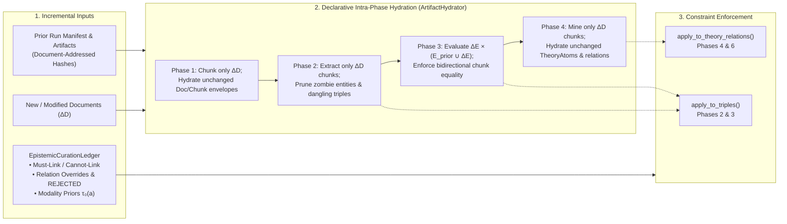

# [0021] Incremental Corpus Evolution and Persistent HITL Constraint Ledgers

Status: Accepted (2026-10-25)

## Context

Scholarly literature research in the philosophy of science and formal epistemology is inherently iterative:
researchers construct an initial theory graph over a foundational literature corpus ($\mathcal{D}_t$), inspect and curate
the resulting dialectical arguments in Episteme Studio, and subsequently expand the corpus with newly published or
discovered literature ($\Delta D$) such that $\mathcal{D}_{t+1} = \mathcal{D}_t \cup \Delta D$.

Previously, two architectural limitations in the pipeline execution model created severe operational friction:

1. **Monolithic Input Invalidation**:
   `RunManifest.input_fingerprint` was computed as a single aggregate hash over all paths in `PipelineInput.source_paths`.
   Adding a single document ($\Delta D$) altered `input_fingerprint` and triggered Rule 3 of `_choose_reuse_source()`:
   all phases from Phase 1 onward were marked as invalidated, forcing complete re-parsing, re-chunking, re-embedding,
   and re-extraction across the entire corpus $\mathcal{D}_t$.
2. **Orphaned Human Expert Curations**:
   When domain scholars reviewed extraction results in Episteme Studio—correcting edge misclassifications (e.g., flipping
   a claim relation from `SUPPORTS` to `ATTACKS`), pruning spurious hallucinations (`REJECTED`), merging alias entities,
   or calibrating modal acceptability priors $\tau_0(a)$—these expert judgments were transient mutations applied to
   ephemeral graph views. A subsequent pipeline run re-extracted from raw source texts and re-committed the identical
   machine errors, rendering expert curation throwaway work rather than cumulative scientific knowledge building.

---

## Decision

We establish **Per-Document Content Fingerprinting**, a **Declarative Incremental Hydration Engine**, and a
**Persistent Epistemic Curation Ledger** as first-class architectural contracts.

### 1. Per-Document Content Fingerprinting (`document_fingerprints`)

- `RunManifest` records a deterministic mapping `document_fingerprints: dict[str, str]` computed via
  `compute_document_fingerprints(source_paths)` in `episteme_pipeline.runs.fingerprints`.
- When an aggregate `input_fingerprint` mismatch occurs, `Pipeline._choose_reuse_source()` evaluates whether all
  documents from `prior.document_fingerprints` exist and match in `current.document_fingerprints`. If so, invalidation
  reason `source-changed:incremental` is assigned, signaling to downstream phase runners that unchanged documents must
  be hydrated rather than recomputed.

### 2. Declarative Incremental Artifact Hydration (`ArtifactHydrator`)

Located in `episteme_pipeline.artifacts.execution`, `ArtifactHydrator` and `IncrementalRetentionScope` replace
duplicated manual diffing logic across phase runners with declarative retention contracts:

- **`IncrementalRetentionScope`**: Evaluates `unchanged_doc_ids`, `unchanged_chunk_ids`, and
  `unmodified_prior_entity_chunks` (entities whose entire evidence sets reside strictly within unchanged chunks).
- **Phase 1 (`hydrate_phase1`)**: Retains `DocumentArtifact` and `ChunkArtifact` envelopes from unchanged documents,
  forwarding only `delta_source_paths` to PDF/text parsing and chunking.
- **Phase 2 (`hydrate_phase2`)**:
  - **Zombie Entity Pruning**: Prior entities that lose all supporting chunk mentions in modified or removed documents
    are automatically pruned.
  - **Dangling Triple Pruning**: Local relation triples are retained only if both subject and object survive and their
    `source_chunk_id` belongs to `unchanged_chunk_ids`.
- **Phase 3 (`hydrate_phase3`)**:
  - **Bidirectional Chunk-Set Equality Invariant**: An entity is classified as `prior_only` if and only if
    `frozenset(e.source_chunk_ids) == unmodified_prior_entity_chunks[e.id]`. If an entity loses mentions due to modified
    chunks, it is ejected from `prior_only`, forcing candidate pair re-extraction.
  - **Candidate Frontier Bounding**: Candidate pairs where both entities are `prior_only` are skipped; their prior
    `GlobalRelationArtifact` triples are hydrated directly. Only pairs spanning $\Delta E \times (E_{\text{prior}} \cup \Delta E)$
    are dispatched to global relation extraction.
- **Phase 4 (`hydrate_phase4`)**: Retains `TheoryAtom` components and local argument relations originating from unchanged
  chunks, mining only delta chunks.

### 3. First-Class Epistemic Curation Ledger (`EpistemicCurationLedger`)

Defined in `episteme_pipeline.contracts.phase_contracts`, `EpistemicCurationLedger` is ingested via
`PipelineInput.curation_ledger_path` (or `curation_ledger`) and enforces expert human constraints as axiomatic rules:

- **`apply_to_triples()` (Phases 2 and 3)**:
  - Filters out relations marked `relation_type == "REJECTED"`.
  - Mutates predicate labels and confidence values for overridden entity pairs.
  - Injects curated triples connecting valid entity nodes.
- **`apply_to_theory_relations()` (Phases 4 and 6)**:
  - Filters rejected relations.
  - Reconstructs `TheoryRelation` instances upon override to trigger Pydantic `@model_validator` revalidation of
    `effective_weight`, `active_weight`, and polarity caches.
  - Preserves `inferential_force` only when `relation_type` was unchanged, ensuring downstream `TheoryNetProjector`
    correctly re-derives warrants when a relation type changes (e.g., from `SUPPORTS` to `ATTACKS`).
  - Deduplicates multi-predicate pair collisions.
  - Injects curated argumentative edges between valid `TheoryAtom` components.
- **Modality Priors (Phase 6)**:
  - `modality_overrides: dict[str, float]` locks expert-adjudicated base acceptability priors $\tau_0(a)$ during
    TheoryNet projection.

---

## Alternatives Considered

1. **Monolithic Re-Execution with Prompt/LLM Response Caching**:
   Relying exclusively on `DiskCachedStructuredLLM` without document-level hydration. Rejected because chunking,
   embedding generation, cross-encoder candidate generation, and graph projection still scale as $\mathcal{O}(|\mathcal{D}|)$,
   causing unnecessary latency and database write overhead.
2. **Direct Post-Execution Database Mutation**:
   Applying human curations solely via Cypher updates in Neo4j after pipeline completion. Rejected because subsequent
   pipeline executions or artifact invalidation diffs would have no record of human edits, resulting in divergence between
   persisted research artifacts and the Neo4j projection graph.
3. **Single-Direction Chunk Retention in Phase 3**:
   Classifying an entity as `prior_only` if its current chunks are a subset of prior chunks. Rejected because losing
   supporting chunks alters an entity's semantic scope and context; full bidirectional chunk equality is required to
   ensure candidate pairs are re-evaluated when evidence is dropped.

---

## Consequences

### Positive
- **Asymptotic Speedup on Incremental Updates**: Adding a paper to a 50-paper corpus requires $\mathcal{O}(|\Delta D|)$
  computational cost in Phases 1, 2, and 4, and bounded frontier evaluation in Phase 3, reducing incremental runtimes
  from hours to seconds.
- **Cumulative Scientific Adjudication**: Domain scholar curations persist across pipeline runs as hard constraints,
  preventing machine regression and ensuring research reproducibility.
- **Guaranteed Graph Integrity**: Zombie entity pruning, dangling triple removal, and bidirectional chunk equality
  prevent stale or orphaned nodes from polluting downstream TheoryNets.

### Negative
- **Manifest Complexity**: `RunManifest` stores per-document fingerprints and hydration scopes, requiring backward
  compatibility handling when inspecting historical runs generated before document-level fingerprinting.

---

## Related Documentation

- [Artifact and Run Model](../architecture/artifact_run_model.md)
- [Invalidation and Resume](../architecture/invalidation_and_resume.md)
- [Phase Contracts Reference](../reference/phase_contracts.md)
- [Artifacts Reference](../reference/artifacts.md)
- [ADR 0014: Deterministic Identity Diffing](0014-deterministic-identity-diffing-and-progression-workbench.md)
- [ADR 0016: Phase 3 Within-Phase Checkpointing & Atomicity](0016-phase-3-within-phase-checkpointing-and-atomicity.md)
- [ADR 0019: TypeSafe Jev Client Implementation & Decision Observability](0019-typesafe-jev-client-and-decision-observability.md)
