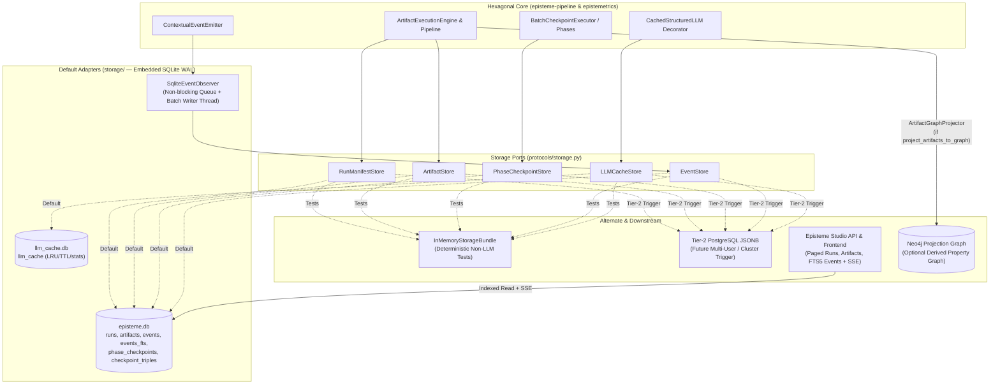

# [0025] Embedded SQLite Default Persistence, Hexagonal Storage Ports, and Telemetry Indexing

Status: Proposed (Implementation tracked via [`issues/12-sqlite-persistence-and-storage-ports/`](../../issues/12-sqlite-persistence-and-storage-ports/index.md))  
Date: 2026-11-19  
Extends: ADR-0001 (Neo4j Async Graph Backend), ADR-0010 (Dual-Driver Graph Preview), ADR-0012 (Phase Config & Langfuse Governance), ADR-0013 (Per-Run Neo4j Credentials & Fallback), ADR-0014 (Deterministic Identity Diffing), ADR-0016 (Within-Phase Checkpointing & Atomicity), ADR-0017 (Explicit Batch Contracts & Artifact-Native Execution), ADR-0021 (Incremental Corpus Evolution & HITL Constraint Ledger), ADR-0024 (Closed-Loop Hermeneutic Refinement)

---

## Context

Episteme separates **domain execution** from **graph projection** ([ADR-0010](0010-graph-preview-driver-selection-neo4j.md), [ADR-0013](0013-per-run-neo4j-credentials-and-graph-fallback.md), [ADR-0017](0017-explicit-batch-contracts-and-bulk-io.md)). In this model, `ExecutionConfig.project_artifacts_to_graph` defaults to `False`, and Neo4j serves only as an optional, derived cross-run property graph projection—never the system of record for runs. Even when Neo4j projection is enabled, Neo4j holds only the latest projected graph snapshot; it does **not** hold run-to-run history and diffs ([ADR-0014](0014-deterministic-identity-diffing-and-progression-workbench.md)), pass-$0$ vs. pass-$r$ hermeneutic refinement lineage ([ADR-0024](0024-closed-loop-hermeneutic-refinement.md)), `EpistemicDeficitArtifact` records (which are explicit projection no-ops), rejected reranker candidates, LLM response caches, or fine-grained domain telemetry events.

Currently, operational persistence and telemetry rely on four uncoordinated flat-file mechanisms and an ephemeral in-memory broker:

1. **Run Manifests (`JsonRunManifestStore` in `episteme_pipeline/runs/persistence.py`)**: One JSON file per run under `.pipeline_runs/`.
2. **Artifacts (`JsonArtifactStore` in `episteme_pipeline/artifacts/store.py`)**: One JSON file per `ArtifactEnvelope` under `.pipeline_artifacts/<run_id>/<artifact_id>.json`.
3. **Intra-Phase Checkpoints (`FileSystemCheckpointStore` in `episteme_pipeline/artifacts/checkpoint_store.py`)**: One JSON file per `(phase, lineage_fingerprint)` under `.pipeline_artifacts/_checkpoints/`.
4. **LLM Cache (`DiskCachedStructuredLLM` in `episteme_pipeline/llm/cache.py`)**: One JSON file per prompt/input hash under `.pipeline_runs/llm_cache/`.
5. **Studio Run Discovery & Live Telemetry (`ArtifactReader` & `EventBroker` in `episteme-studio`)**: A 1,349-line filesystem reader scanning `.pipeline_runs` / `.pipeline_artifacts` (plus secondary `extra_*_dirs`) and an in-memory `deque(maxlen=10000)` ring buffer for live SSE streaming.

While this layout works smoothly for small **1–5 page** test runs (hundreds of files per run; ~15 MB locally across 355 manifests, 1,924 artifact files, and 644 cache files), scaling to **100–500 page monographs** (or dense intra-document runs yielding **20,000–80,000+ artifacts** and **50,000–200,000+ events** per run) and adding searchable frontend telemetry exposes five structural failures:

1. **Non-Persistent, Unsearchable Frontend Events**: `episteme_studio/adapters/worker.py` streams events over an IPC queue to `EventBroker` (capped in RAM at `capacity=10000`) and optionally to Langfuse, without persisting run events locally. At 100–500 pages, early-phase events (Phases 1–3) are evicted from memory mid-run, all events vanish on Studio restarts, and the frontend (`LogConsole.tsx`) cannot filter, full-text search, or cursor-paginate historical runs.
2. **Severe Read Amplification in Studio**: `ArtifactReader.list_runs()` executes `_calculate_run_size_bytes()` → `_collect_run_envelopes()` for *every* run on disk, traversing `parent_run_id` chains and calling `json.loads()` on every single artifact file just to populate the sidebar. Similarly, `ArtifactReader.list_artifacts(run_id, kind=...)` parses every JSON envelope (including chunk files carrying dense embedding vectors) before filtering by `kind`.
3. **Quadratic Disk Write Amplification in Checkpointing**: Despite `artifact_run_model.md` describing `FileSystemCheckpointStore` as an append-only WAL, `_save_phase_state()` serializes and atomically replaces the entire checkpoint JSON on every batch commit—producing $O(N^2)$ write I/O across hundreds of Phase 3 batches.
4. **Non-Atomic Concurrent Cache Writes & Missing Telemetry**: `DiskCachedStructuredLLM` writes cache entries with non-atomic `write_text()` under concurrent `asyncio` tasks, couples caching directly to filesystem `Path` objects, and exposes no hit/miss accounting or LRU/TTL pruning.
5. **Hexagonal Boundary Leaks**: `ArtifactExecutionEngine` and `Pipeline` type-hint concrete `JsonRunManifestStore` and `JsonArtifactStore`; `protocols/checkpoint_store.py` (`CheckpointStoreProtocol`) is dead duplicate code alongside `PhaseCheckpointStore` (which inherits from `GraphHandle`); `DiskCachedStructuredLLM` uses `getattr(base_llm, "base_llm", base_llm)` in violation of `AGENTS.md §2`; and `lifespan.py` / `ArtifactReader` couple FastAPI endpoints directly to filesystem directory traversal.

We must decide whether to stay on flat files, introduce an external document database (such as MongoDB), or adopt an embedded structured storage default behind strict Hexagonal ports.

---

## Decision

We adopt **Embedded SQLite (WAL + JSON1 + FTS5) via Python stdlib `sqlite3`** as the **default local persistence backend** for run manifests, artifacts, intra-phase checkpoints, LLM response caching, and indexed domain events, accessed strictly through **five unified Hexagonal Storage Ports**. Under the project's `[NO LEGACY]` mandate, flat-file default stores (`JsonRunManifestStore`, `JsonArtifactStore`, `FileSystemCheckpointStore`, `DiskCachedStructuredLLM`) and Studio's monolithic `ArtifactReader` are cleanly replaced rather than maintained via legacy shims, while portable JSON/per-run SQLite export preserves human-inspectable research replication packages.

### 1. Canonical Hexagonal Storage Ports (`episteme_pipeline/protocols/storage.py`)

All persistence concerns are isolated behind five narrow `@runtime_checkable` / ABC protocols aggregated by a composition-root `StorageBundle`:

| Port Protocol | Responsibility | Key Operations |
| :--- | :--- | :--- |
| **`RunManifestStore`** | Run lifecycle metadata & lineage | `write_manifest`, `read_manifest`, `list_manifests`, `list_run_summaries`, `latest_manifest`, `resolve_lineage` |
| **`ArtifactStore`** | Immutable, identity-keyed phase envelopes | `write_artifact`, `write_artifacts` (batched), `get_artifact`, `query_artifacts` (`kind`, `phase`, `latest_only`, `cursor`, `limit`), `get_run_stats`, `list_run_artifacts` |
| **`PhaseCheckpointStore`** | Crash recovery & poison-pill quarantine | Decoupled from `GraphHandle`; `filter_unprocessed_items` (chunked), `commit_phase_batch`, `commit_phase_items`, `save_chunk_state_snapshot`, `get_chunk_state_snapshot`, `get_committed_triples`, `clear_phase_checkpoints` |
| **`EventStore`** | Persistent indexed & FTS5 telemetry | `append_batch`, `query_events` (`EventQuery` with phase/kind/level/FTS5/cursor), `get_event_summary`, `delete_run_events` |
| **`LLMCacheStore`** | Content-addressed structured LLM cache | `get`, `put`, `delete`, `stats`, `prune` (TTL / max-bytes LRU) |

Dead duplicate `protocols/checkpoint_store.py` and the thin `protocols/artifact_store.py` split are eliminated in favor of this single canonical module. `Pipeline`, `ArtifactExecutionEngine`, `PipelineFactory`, and Studio services accept `StorageBundle` (or individual narrow ports) via Dependency Injection.

### 2. Dual-Database File Topology (`episteme.db` vs. `llm_cache.db`)

Storage is split across two physically independent SQLite databases configured via `StorageConfig`:

1. **`episteme.db`** (Authoritative Research State & Telemetry):
   - **`runs`**: Denormalized summary columns (`run_id`, `parent_run_id`, `status`, `schema_version`, `created_at`, `started_at`, `completed_at`, `refinement_pass`, `artifact_count`, `size_bytes`, `artifact_counts_by_kind_json`, `input_sources_json`) alongside `manifest_json`. Allows Studio sidebar queries (`list_run_summaries`) in `<5 ms` without scanning artifacts.
   - **`artifacts`**: Keyed by `(run_id, artifact_id)` with indexed metadata columns (`identity_key`, `kind`, `phase_name`, `refinement_pass`, `deficit_id`, `created_at`, `size_bytes`), `payload_json`, and a **separated nullable `embedding_blob`** (`float32` raw bytes). Separating dense vectors ensures Studio metadata, graph projection, and run-to-run diff queries never load or parse megabytes of embedding floats at 500-page scale.
   - **`events` + `events_fts` (FTS5)**: Stores `(run_id, seq, timestamp, phase, kind, level, component, entity_id, summary, payload_json)` with composite indexes on `(run_id, seq)`, `(run_id, phase, seq)`, `(run_id, kind, seq)`, and `(run_id, level, seq)`, plus an `FTS5` external-content virtual table synced via triggers for sub-millisecond full-text log/payload search.
   - **`phase_checkpoints`, `checkpoint_triples`, `checkpoint_snapshots`**: Replaces full-file JSON rewrites with single-transaction batch upserts preserving [ADR-0016](0016-phase-3-within-phase-checkpointing-and-atomicity.md) atomicity and poison-pill quarantine, while chunking `IN (...)` filters into 500-key batches to stay safely below SQLite bind-parameter limits.
2. **`llm_cache.db`** (Disposable Compute Cache):
   - **`llm_cache`**: Keyed by `cache_key` with `cache_version`, `cache_prefix`, `method_fp`, `output_schema`, `payload_json`, `created_at`, `last_accessed_at`, `hit_count`, and `size_bytes`.
   - **Rationale for Separation**: Prevents heavy Phase 2/3/4 LLM cache writes from contending on `episteme.db`'s writer lock during active phase execution, keeps archival research runs small, and allows researchers to wipe, share, or mount `llm_cache.db` across machines independently of `episteme.db`.

### 3. Non-Blocking Batched Event Persistence (`SqliteEventObserver`)

Per `packages/episteme-studio/docs/SPEC.md §4`, `SimpleEventEmitter.emit()` invokes `observer.on_event(event)` synchronously on the pipeline thread—any blocking I/O inside `on_event` stalls extraction. `SqliteEventObserver` preserves this invariant:

- `on_event(event)` performs only lightweight Pydantic serialization and a non-blocking `put_nowait()` into a bounded queue (tracking `dropped_events` for `RunReport.observer_telemetry`).
- A background writer thread drains batches (e.g., up to 100 events or every 250 ms) inside a single `BEGIN IMMEDIATE ... executemany ... COMMIT` transaction into `episteme.db`.
- `flush()` blocks until the queue is completely drained and committed on disk, integrating cleanly with `use_event_emitter`'s `finally:` flush barrier ([ADR-0024](0024-closed-loop-hermeneutic-refinement.md), `ISSUE-052`).
- Studio's `EventBroker` remains solely an in-memory live SSE multiplexer (`subscribe(since_seq)`), falling back seamlessly to `SqliteEventStore.query_events(after_seq=...)` when replaying events older than the live ring buffer or inspecting historical runs after restarts.

### 4. SQLite Operational Invariants, Docker Hardening & Replication Export

- **Connection & Async Discipline**: Uses stdlib `sqlite3` managed behind `SqliteConnectionManager` (avoiding `aiosqlite` background-thread / `nest_asyncio` loop-binding conflicts documented in `SPEC.md §4` D-05), dispatching async port calls safely via `asyncio.to_thread()` under explicit per-DB lock coordination.
- **Pragmas**: `journal_mode=WAL`, `synchronous=NORMAL`, `busy_timeout=10000`, `foreign_keys=ON`, `temp_store=MEMORY`, `cache_size=-65536` (~64 MB), and schema versioning via `PRAGMA user_version`.
- **Read-Only & Demo Containers ([docker.md](../deployment/docker.md))**: When `StorageConfig.read_only = True` (e.g., `--read-only --demo`), connections open via SQLite URI `file:<path>?mode=ro&immutable=1` so queries run cleanly against immutable container images without `-wal`/`-shm` sidecar creation on read-only mounts.
- **Portable Research Export (`export-run` / `import-run`)**: Exports any `run_id` (and its resolved `parent_run_id` ancestor chain, excluding `llm_cache.db` and credentials per [ADR-0013](0013-per-run-neo4j-credentials-and-graph-fallback.md)) as either a human-readable JSON/JSONL directory or a standalone self-contained per-run `.db` file for Zenodo/Git peer-review replication.

---

## Alternatives Considered

| Option | Verdict | Rationale |
| :--- | :--- | :--- |
| **1. Stay As-Is (Flat JSON Files + RAM `EventBroker`)** | **Rejected** | Breaks at 100–500 pages: `EventBroker` drops events >10k and loses all telemetry on restart; `ArtifactReader.list_runs()` parses every artifact JSON across all runs; `FileSystemCheckpointStore` exhibits $O(N^2)$ rewrite amplification; concurrent `DiskCachedStructuredLLM` writes risk torn JSON files. |
| **2. MongoDB (External Document Server)** | **Rejected** | Introduces a **third** database daemon alongside Neo4j 5 and Langfuse's PostgreSQL 16 ([docker-compose.yml](../../docker-compose.yml)). Breaks zero-DB offline Studio and `--demo` / `--read-only` containers, complicates peer-review replication (`mongodump` vs. copying one file), and adds network/BSON overhead (16 MB doc limit) without solving a multi-node problem that currently exists. |
| **3. PostgreSQL (`JSONB` + GIN)** | **Deferred (Designated Tier-2 Adapter)** | Strongly preferred over MongoDB if Episteme later needs multi-user hosted Studio concurrency or distributed cluster workers—because PostgreSQL 16 is already in `docker-compose.yml` and aligns with Horizon 2 `pgvector` plans ([roadmap.md](../roadmap.md)). Overkill as the default for single-machine/offline research runs today, but cleanly swappable behind the exact same `protocols/storage.py` ports. |
| **4. DuckDB as Primary Operational Store** | **Rejected as OLTP Store / Endorsed for OLAP** | DuckDB excels at columnar analytical scans over runs, not frequent concurrent small row upserts, crash-safe batch checkpoints, or low-latency point lookups for Studio UI pagination. **Bonus**: DuckDB's native `sqlite_scanner` extension can attach and query `episteme.db` directly for zero-ETL cross-run research analytics. |
| **5. Redis (Cache & Event Stream)** | **Rejected as Default** | Requires a separate in-memory daemon and lacks durable archival semantics without AOF/RDB tuning. Remains straightforward to add later as an optional `LLMCacheStore` implementation if distributed workers share a live cache. |

---

## Consequences

### Positive (Advantages)

1. **Orders-of-Magnitude Faster Studio at 100–500 Pages**: Sidebar run discovery (`GET /api/runs`), filtered artifact listing (`kind`/`phase`/cursor pagination without loading `embedding_blob`), and FTS5 event search drop from multi-second full-directory JSON scans to `<5 ms` indexed queries.
2. **Durable, Searchable Frontend Telemetry**: Run events survive Studio restarts and browser refreshes, are no longer capped at 10,000 in RAM, and support server-side filtering (`phase`, `kind`, `level`, FTS5 `q`) and seamless cursor handoff into live SSE streams.
3. **Crash-Safe, Atomic Checkpoints & Cache**: Eliminates $O(N^2)$ checkpoint file rewrites and concurrent LLM cache file corruption via WAL transactions, while adding cache hit telemetry and LRU/TTL pruning.
4. **Zero-Ops Offline & Hardened Container Compatibility**: Uses Python stdlib `sqlite3` with zero external services, preserving single-command local execution, offline Studio inspection, and `--read-only --demo` Docker deployments.
5. **Reproducibility & Archival Portability**: SQLite is a Library of Congress-recommended archival format; researchers can inspect runs directly with `sqlite3`, Python, Pandas, or DuckDB, or export clean per-run JSON/SQLite replication bundles.
6. **True Hexagonal Architecture**: Consolidating 5 narrow protocols in `episteme_pipeline/protocols/storage.py` removes concrete `Json*` orchestrator coupling, deletes dead/duplicate protocol code, removes `getattr`/`hasattr` hacks in cache/lifespan wiring, and decomposes Studio's 1,349-line `ArtifactReader` god-adapter.

### Negative / Trade-offs & Mitigations (Disadvantages)

1. **Single-Writer Lock per SQLite File**: SQLite allows unlimited concurrent readers under WAL, but serializes concurrent writers per database file.
   - *Mitigation*: Dual-database split (`episteme.db` vs. `llm_cache.db`), batched `executemany` writes, `busy_timeout=10000`, and an explicit migration trigger to the **Tier-2 PostgreSQL `JSONB` adapter** if multi-user concurrent Studio mutations or distributed multi-host pipeline workers are introduced.
2. **Binary `.db` Files Are Not Line-Diffable (`git diff` / `cat`)**: Unlike individual `.json` files, `.db` files are binary.
   - *Mitigation*: Keep JSON payloads inside readable `payload_json` TEXT columns, provide first-class `export-run --format json` for human/Git inspection and Zenodo packages, and document `sqlite3` / DuckDB CLI inspection workflows.
3. **Explicit Schema Migrations Required**: Changing indexed SQLite columns requires disciplined DDL versioning.
   - *Mitigation*: Track monotonic `PRAGMA user_version` migrations in `SqliteConnectionManager` while keeping volatile domain schema fields inside versioned Pydantic `payload_json` columns ([NO LEGACY] simplifies clean table rebuilds during research iteration).
4. **Network Filesystem (NFS / SMB / EFS) Locking Hazards**: POSIX file locks needed by SQLite WAL behave unreliably on network-mounted filesystems.
   - *Mitigation*: Document local-volume placement invariants in [docker.md](../deployment/docker.md); enforce PostgreSQL `JSONB` when sharing live state across network hosts.
5. **Unbounded File Size Growth on Cache Churn**: Deleting rows leaves free pages inside `.db` files until vacuumed.
   - *Mitigation*: Enable `PRAGMA auto_vacuum = INCREMENTAL` on `llm_cache.db` and expose explicit cache pruning/compaction commands.

### Explicit Triggers to Adopt the Tier-2 PostgreSQL `JSONB` Adapter

Do **not** replace SQLite with PostgreSQL until at least one of the following operational triggers occurs:
- **Multi-User Hosted Studio**: Multiple researchers concurrently launching runs, editing `EpistemicCurationLedger` constraints, or adjudicating benchmarks against one shared server.
- **Distributed Cluster Execution**: Multiple worker nodes executing phases in parallel against a shared live `LLMCacheStore`, `PhaseCheckpointStore`, or `ArtifactStore` over a network.
- **Archive Scale Threshold**: Active workspace databases exceed multi-tens of gigabytes or require centralized cloud object/relational backups and role-based access control.

---

## Related

- **Implementation Roadmap & Sub-Issues**: [`issues/12-sqlite-persistence-and-storage-ports/index.md`](../../issues/12-sqlite-persistence-and-storage-ports/index.md) (`ISSUE-108` through `ISSUE-115`)
- **Architecture Guides**: [System Architecture Overview](../architecture/overview.md), [Artifact and Run Model](../architecture/artifact_run_model.md), [Event System Architecture](../architecture/event-system.md), [Cross-Cutting Concerns](../architecture/cross_cutting_concerns.md), [Design Patterns & Standards](../architecture/design_patterns_and_standards.md), [Invalidation and Resume](../architecture/invalidation_and_resume.md)
- **Studio & Deployment**: [Episteme Studio SPEC](../../packages/episteme-studio/docs/SPEC.md), [Docker Deployment Guide](../deployment/docker.md), [Reproducibility Practices](../research/reproducibility.md)
- **Related ADRs**: [ADR-0001](0001-neo4j-async-graph-backend.md), [ADR-0010](0010-graph-preview-driver-selection-neo4j.md), [ADR-0012](0012-phase-config-redesign-and-langfuse-integration.md), [ADR-0013](0013-per-run-neo4j-credentials-and-graph-fallback.md), [ADR-0014](0014-deterministic-identity-diffing-and-progression-workbench.md), [ADR-0016](0016-phase-3-within-phase-checkpointing-and-atomicity.md), [ADR-0017](0017-explicit-batch-contracts-and-bulk-io.md), [ADR-0021](0021-incremental-corpus-evolution-and-persistent-hitl-constraint-ledger.md), [ADR-0024](0024-closed-loop-hermeneutic-refinement.md)
