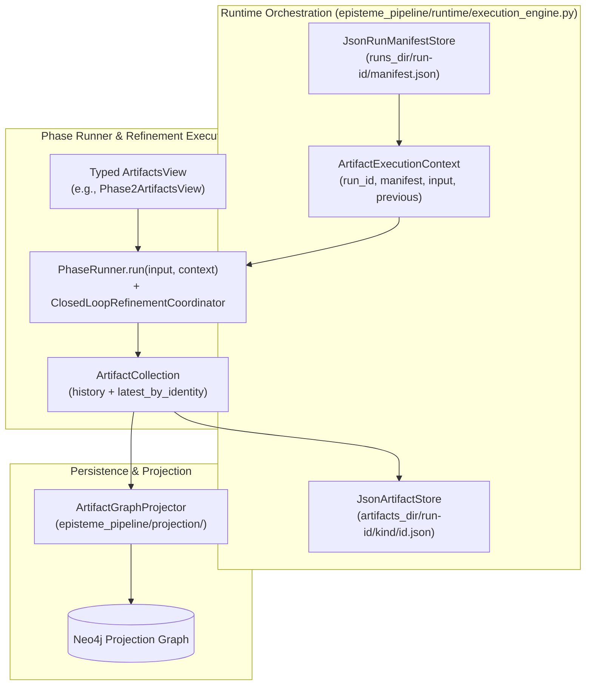

# Artifact and Run Model

This document defines the architecture of the **Artifact and Run Model** in Episteme.

The pipeline executes entirely on **durable, run-scoped research artifacts** and **first-class run manifests**, rather than ephemeral inter-phase execution values or graph-as-run-state.

---

## Purpose & Motivation

In earlier iterations of the pipeline, intermediate outputs were transient Python objects passed directly in memory, and the Neo4j database was overloaded as both execution state tracker and target knowledge graph.

The artifact and run model solves this by establishing two decoupled architectural foundations:

1. **Run Model** — Tracks what execution took place, with which configuration snapshot, input fingerprints, method fingerprints, and phase records.
2. **Artifact Model** — Tracks what was produced by each phase, with full provenance, stable identity keys, and content-addressed dependency fingerprints.

### Key Architectural Benefits

- **Graph-Independent Execution**: Intermediate outputs are evaluated, replayed, and inspected without querying Neo4j. Graph persistence is isolated to an explicit projection step.
- **Reproducibility & Lineage**: Every artifact carries provenance pointing back to source files, chunks, upstream artifact IDs, and run manifests.
- **Safe Resumption & Caching**: Downstream phases can hydrate upstream artifacts across a chain of parent runs without re-executing valid prior work.
- **Fine-Grained Invalidation**: Runs record deterministic fingerprints of inputs, configs, prompts, and model parameters to detect exactly which phases or artifacts require recomputation.

---

## Core Architecture



---

## The Run Model

Located in `episteme_pipeline/runs/models.py` and persisted via `episteme_pipeline/runs/persistence.py`.

### `RunManifest`

The `RunManifest` is the central execution record for a pipeline run:

- **`run_id`**: Unique run identifier (e.g., `run-<uuid4>`).
- **`parent_run_id`**: Identifier of the parent run when resuming or reusing prior phases.
- **`status`**: Current lifecycle status (`RunStatus.PLANNED`, `RUNNING`, `COMPLETED`, `FAILED`, `ABORTED`).
- **`schema_version`**: Active `SchemaConfig.version` tracking ontology/taxonomy versions.
- **`source_fingerprint` & `input_fingerprint`**: Deterministic hashes of source document paths, bibtex files, and structural anchors.
- **`document_fingerprints`**: Map of `{document_id: sha256_hash}` tracking per-document content hashes for fine-grained delta extraction.
- **`curation_ledger_fingerprint`**: Deterministic hash of applied `EpistemicCurationLedger` constraints.
- **`config_snapshot`**: Full JSON-serialized snapshot of `PipelineConfig`.
- **`phase_config_fingerprints`**: Per-phase configuration hashes derived from serialized phase configs (including fine-grained nested leaf fingerprints).
- **`method_fingerprints`**: Fine-grained fingerprints of models, extractors, and prompts used by each phase (e.g., LLM parameters, embedding model dimensions, and prompt bundles).
- **`phase_records`**: List of `RunPhaseRecord` tracking execution status and artifact outputs per phase.
- **`refinement_pass`**: Non-negative integer (`default=0`) recording the highest closed-loop hermeneutic refinement pass executed for this run (`0` for purely feed-forward runs).

### `RunPhaseRecord`

Tracks execution state for an individual phase (or refinement pass):

- `phase_name`, `phase_ordinal` (1-based index, aliased as `ordinal`), and `phase_key` (machine key, e.g., `"phase4"` or `"refinement"`).
- `status`: `RunStatus` for this specific phase.
- `started_at` and `completed_at` timestamps.
- `input_artifact_ids`: IDs of artifacts consumed as input.
- `output_artifact_ids` and `artifact_ids`: IDs of artifacts produced by this phase.
- `output_fingerprint`: Stable hash of the emitted artifact collection.
- `reused`: Boolean flag indicating whether the phase was reused from a prior run.
- `refinement_pass`: Non-negative integer (`default=0`) distinguishing forward executions (`0`) from pass-$r$ refinement records ($r \ge 1$).

### `RunReport`

At run completion, a `RunReport` is generated summarizing:

- Overall status and execution durations.
- Counts of artifacts by `kind` and by `phase`.
- Breakdown of `new` vs. `reused` artifacts.
- Invalidation decisions and reasons.
- Full list of `ArtifactReportEntry` references.

---

## The Artifact Model

Located in `episteme_pipeline/artifacts/models.py` and persisted via `episteme_pipeline/artifacts/store.py`.

### `ArtifactEnvelope[T]` and `ArtifactProvenance`

Every artifact emitted by the pipeline is wrapped in a generic `ArtifactEnvelope[T]` carrying a typed `ArtifactProvenance`:

```python
class ArtifactProvenance(BaseModel):
    source_path: str | None = None
    source_document_id: str | None = None
    source_chunk_id: str | None = None
    upstream_artifact_ids: list[str] = Field(default_factory=list)
    notes: dict[str, str] = Field(default_factory=dict)
    refinement_pass: int = Field(default=0, ge=0)
    deficit_id: str | None = None


class ArtifactEnvelope(BaseModel, Generic[ArtifactPayloadT]):
    artifact_id: str
    identity_key: str | None = None
    kind: ArtifactKind
    run_id: str
    phase_name: str
    method: str
    method_version: str = "v1"
    config_fingerprint: str | None = None
    dependency_fingerprint: str | None = None
    created_at: datetime = Field(default_factory=utc_now)
    provenance: ArtifactProvenance = Field(default_factory=ArtifactProvenance)
    payload: ArtifactPayloadT
    metadata: dict[str, Any] = Field(default_factory=dict)
```

#### Dual Identifier System & Pass-Scoped IDs

Every artifact carries two complementary identifiers:

1. **`artifact_id`** (`artifact::<base_id>` for pass 0, or pass-scoped `artifact::<base_id>::pass<r>` for `refinement_pass = r > 0` via `_scoped_artifact_id` in `episteme_pipeline/artifacts/builders.py`): Unique identifier representing the specific artifact instance in a particular run and refinement pass. Used in `provenance.upstream_artifact_ids` to track concrete data lineage and preserve pass history on disk.
2. **`identity_key`** (`<kind>::<canonical_identifier>`): Stable semantic identity across runs and refinement passes (e.g., `linked_entity::kant_crp_space`, `epistemic_deficit::<deficit_id>`). Used by `ArtifactCollection.latest_by_identity`, the invalidation DAG, and cross-run comparison tools to correlate equivalent entities across parameter changes and localized refinement overlays.
3. **Refinement Provenance (`refinement_pass`, `deficit_id`)**: Artifacts emitted or updated during top-down refinement record the pass number (`refinement_pass >= 1`) and the triggering `EpistemicDeficit.deficit_id` (`provenance.deficit_id`).

### Payload Families

The pipeline defines typed payloads for each construction stage:

| Artifact Kind | Payload Class | Emitting Phase | Description |
|:---|:---|:---|:---|
| `document` | `DocumentArtifact` | Phase 1 | Ingested source document with structural anchor |
| `chunk` | `ChunkArtifact` | Phase 1 | Segmented and embedded text chunks |
| `entity_mention` | `EntityMentionArtifact` | Phase 2 | Extracted surface mentions in text |
| `linked_entity` | `LinkedEntityArtifact` | Phase 2 / Phase 4m | Canonicalized, linked, and matured entities |
| `local_relation` | `LocalRelationArtifact` | Phase 2 | Intra-chunk entity relationships |
| `global_relation` | `GlobalRelationArtifact` | Phase 3 | Cross-chunk / document-wide relationships |
| `canonicalization` | `CanonicalizationArtifact` | Phase 3b | Entity canonicalization (`SAME_AS`) merge decisions |
| `theory_atom` | `TheoryAtomArtifact` | Phase 4 / Phase 6 | Argument components (premises, claims, axioms, observations) |
| `theory_relation` | `TheoryRelationArtifact` | Phase 4 / Phase 6 | Argumentative relations (supports, attacks, undercuts) |
| `fusion_decision` | `FusionDecisionArtifact` | Phase 5 | Argument equivalence alignment & fusion decisions |
| `theoretical_enrichment` | `TheoreticalEnrichmentArtifact` | Post-processing | Theoretical enrichment & tenability scores |
| `epistemic_deficit` | `EpistemicDeficitArtifact` | Phase 6 / Post-processing / Refinement | Top-down deficit signals (`enthymeme_gap`, `polysemy_collision`, `ungrounded_axiom`) |

---

## Execution & Inter-Phase Handoff

Located in `episteme_pipeline/artifacts/execution.py`, `episteme_pipeline/artifacts/subgraph_reader.py`, and `episteme_pipeline/artifacts/checkpoint_store.py`.

### Identity-Keyed `ArtifactCollection` & Refinement Overlays

An `ArtifactCollection` is a typed container holding emitted `ArtifactEnvelope` instances across two views:

1. **`history`**: The complete append-only sequence of all emitted `ArtifactEnvelope` instances, preserving full per-pass version history (pass `0`, pass `1`, ..., pass $r$) for `JsonArtifactStore` persistence and provenance inspection.
2. **`latest_by_identity`**: A deterministic last-write-wins index keyed by `identity_key` (or `artifact_id` when `identity_key` is `None`).

`collection.of_kind(*kinds, latest_only: bool = True)` defaults to returning only the latest version for each `identity_key`. When a downstream phase (such as `Phase4EntityMaturationRunner`) or a **hermeneutic refinement cycle** ([ADR 0024](../adr/0024-closed-loop-hermeneutic-refinement.md)) emits an updated envelope sharing the same `identity_key` with a pass-scoped `artifact_id` (`::pass<r>`), downstream `EpistemicStateView`s see the refined entity, relation, or atom immediately while pass-0 artifacts remain preserved in `collection.history` and **unaffected subgraphs remain untouched**.

### Cumulative `EpistemicStateView` & Canonical L2/L3 Resolution

Phases consume upstream data through cumulative typed views inheriting from `EpistemicStateView`:

- **`Phase1ArtifactsView`**: Provides `documents: list[L1Document]` (including `structural_anchor` ToC trees) and `chunks: list[L1Chunk]`. Consumed by Phase 2.
- **`Phase2ArtifactsView`**: Cumulative L1 + L2 state (`documents`, `chunks`, canonicalized `entities`, canonicalized `local_triples`, `entity_envelopes_by_id`, and `entity_mentions_by_id`). Consumed by Phase 3.
- **`Phase3ArtifactsView`**: Cumulative L1 + L2 + global relation state (`documents`, `chunks`, canonicalized `entities`, `local_triples`, `global_triples`, `entity_envelopes_by_id`, and `relation_type_distribution`). Automatically applies Phase 3b `CanonicalizationArtifact` (`SAME_AS`) alias mappings $\pi_{L2}: \text{entity\_id} \to \text{canonical\_entity\_id}$ to merge duplicate entities, combine mention textual envelopes, and rewrite/deduplicate `local_triples` and `global_triples` (dropping induced self-loops). Consumed by Phase 3b, Phase 4 Maturation, and Phase 4 Argument Mining.
- **`Phase4ArtifactsView` / `Phase5ArtifactsView`**: Cumulative L1 + L2 + L3 state (`theory_atoms`, `theory_relations`, `fusion_decisions`, `canonical_theory_atoms`, `canonical_theory_relations`, `theoretical_enrichments`, plus all upstream L1/L2 fields). Automatically applies Phase 5 `FusionDecisionArtifact` cluster/merge decisions $\pi_{L3}: \text{atom\_id} \to \text{canonical\_atom\_id}$ so Phase 6 (`TheoryNet` / QBAF gradual semantics) and `TheoreticalEnrichmentRunner` evaluate canonical equivalence classes without multi-counting duplicate claims.
- **`TheoreticalEnrichmentArtifactsView`**: Provides `enrichments: list[TheoreticalEnrichmentArtifact]`.
- **`EpistemicDeficitArtifactsView`**: Hydrates full L1–L4 state plus active `epistemic_deficits: list[EpistemicDeficitArtifact]` (`to_domain_deficits()`). Kept intentionally separate from forward `Phase1ArtifactsView`–`Phase4ArtifactsView` `_allowed_kinds` so `WorkflowDAG` preserves strict forward acyclicity while refinement detectors and coordinators access complete state and active deficits.

Every view tracks the exact list of `consumed_artifact_ids` read during `from_collection(collection)`, which `ArtifactExecutionEngine.execute()` records directly on `RunPhaseRecord.input_artifact_ids`. During post-forward refinement (`_run_refinement_stage()`), `ArtifactExecutionEngine._record_new_artifacts_in_report()` records newly emitted refinement and deficit artifacts as `ArtifactReportEntry` records in `RunReport` and updates per-kind/per-phase counts.

### In-Memory `ArtifactSubgraphReader` & `FileSystemCheckpointStore`

- **`ArtifactSubgraphReader` (`GraphReader`)**: Every `EpistemicStateView` exposes `view.to_graph_reader()`, returning a deterministic in-memory `GraphReader` backed by the view's canonical entities, chunks, triples, mention envelopes, and theory atoms. Phase runners (`Phase2`, `Phase3`, `Phase3b`, `Phase4Maturation`, `Phase4`, `Phase5`, `Phase6`, `TheoreticalEnrichment`) execute 1-hop/k-hop neighborhood queries, vector similarity searches, and entity lookups 100% offline against `ArtifactSubgraphReader` with zero Neo4j dependency.
- **`FileSystemCheckpointStore` (`PhaseCheckpointStore`)**: Default atomic JSON checkpoint store (`.json.tmp` write + atomic `Path.replace`) under `<artifacts_dir>/_checkpoints/` scoped by `(phase_key, lineage_fingerprint)`. Isolates intra-phase batch checkpoints, short-term memory snapshots, and committed Phase 3 triples across concurrent or alternating runs with different LLM/config parameters.

### Runner Interface

All pipeline phase runners implement the uniform async interface:

```python
async def run(
    self,
    input: ViewT,
    context: ArtifactExecutionContext,
) -> ArtifactCollection: ...
```

The orchestrator builds the appropriate view via `entry.input_view.from_collection(previous)` and passes it to the runner alongside the `ArtifactExecutionContext` (which contains `run_id`, `manifest`, `pipeline_input`, `previous`, and `lineage_fingerprint`).

---

## Graph Projection & Decoupling

Located in `episteme_pipeline/projection/artifact_projector.py` and `episteme_pipeline/projection/theorynet_projector.py`.

Execution is strictly decoupled from graph storage:

1. **Zero direct runner writes to `projection_graph`**: Phase runners never receive `projection_graph`; all target graph mutations flow exclusively through `ArtifactGraphProjector`.
2. **Batched Topological Projection (`project_collection`)**: When `config.execution.project_artifacts_to_graph` is enabled, the orchestrator calls `await self._projector.project_collection(collection, batch_size=500)`. `ArtifactGraphProjector` deduplicates envelopes by `identity_key` (`latest_only=True`) and projects them in topological order (**Nodes before Edges**: `DOCUMENT`, `CHUNK`, `LINKED_ENTITY`, `THEORY_ATOM`, and reified `:TheoryInference` nodes first; `ENTITY_MENTION`, `LOCAL_RELATION`, `GLOBAL_RELATION`, `CANONICALIZATION`, and `THEORY_RELATION` edges second) using batched `GraphWriter` bulk calls (`upsert_nodes`, `upsert_chunks`, `upsert_entities`, `upsert_relations`, `upsert_triples`, `upsert_argument_components`, `upsert_theory_relations`).
3. **Hydration Re-Projection**: When a run reuses upstream phases from a parent run and targets a `projection_graph`, the hydrated `initial_previous_collection` is bulk-projected before downstream phases execute.
4. **Dual Projection Streams**:
   - **Property Graph Projection** (`ArtifactGraphProjector`): Projects artifact envelopes into concrete Neo4j nodes and relationships in topological batches.
   - **TheoryNet Formalism Projection** (`TheoryNetProjector`): Projects canonicalized L3 `TheoryAtom` and `TheoryRelation` views into the formal mathematical $\mathcal{G}_{\text{TheoryNet}}$ structure, executing iterative QBAF gradual semantics.

### Artifact-to-Graph Projection Mapping

`ArtifactGraphProjector` maps artifact payloads into the projection graph according to the following rules:

| Artifact Payload | Graph Mutation Target | Labels / Rel Types | Properties & Metadata |
|:---|:---|:---|:---|
| `DocumentArtifact` | Node (Batched via `upsert_nodes`) | `:Document` | `document_id`, `title`, `source_path`, `toc_structure`, `document_summary`, `global_thesis` |
| `ChunkArtifact` | Node (Batched) | `:Chunk` | `chunk_id`, `text`, `document_id`, `chapter_id`, `sequence_index`, `token_count`, `embedding` |
| `EntityMentionArtifact` | Edge (Batched) | `(:Entity)-[:EXTRACTED_FROM]->(:Chunk)` | `entity_type`, `surface_form`, `textual_envelope`, `confidence` |
| `LinkedEntityArtifact` | Node (Batched) | `:<entity_type>` / `:Entity` | `entity_id`, `name`, `description`, `textual_envelope`, `is_mature`, `confidence`, `conceptions` |
| `LocalRelationArtifact` | Edge (Batched) | `(:Entity)-[:<PREDICATE> {scope: "local"}]->(:Entity)` | `confidence`, `source_chunk_id` |
| `GlobalRelationArtifact` | Edge (Batched) | `(:Entity)-[:<PREDICATE> {scope: "global"}]->(:Entity)` | `confidence`, `supporting_chunk_ids` |
| `TheoryAtomArtifact` | Node (Batched) | `:TheoryAtom` | `component_id`, `text`, `component_type`, `modal_prior`, `local_tenability`, `equilibrium_strength`, `parameters`, `measurements`, `tenability` |
| `TheoryRelationArtifact` | Edge / Reified Node + Edges (Batched) | `(:TheoryAtom)-[:<REL_TYPE>]->(:TheoryAtom)` or `:TheoryInference` with `:HAS_PREMISE` / `:CONCLUDES` | `scope`, `confidence`, `weight`, `edge_tenability`, `t_norm` |
| `CanonicalizationArtifact` | Edge (Batched) | `(:Entity)-[:SAME_AS]->(:Entity)` | `confidence: 1.0`, `source: "phase3b_consolidation"` |
| `FusionDecisionArtifact` | Explicit No-Op (View-Canonicalized) | — | Equivalence cluster decisions applied directly by `Phase4ArtifactsView` / `Phase5ArtifactsView` |
| `TheoreticalEnrichmentArtifact` | Edge Metadata Patch | — | Updates `edge_tenability` on projected `TheoryRelation` items before batch flush (enriched atom parameters/tenability are emitted via updated `TheoryAtomArtifact` envelopes) |
| `EpistemicDeficitArtifact` | Explicit No-Op | — | Audit/coordination signal (`project_to_graph` and `collect_for_projection` are explicit no-ops) |

---

## Artifact Hydration & Parent-Run Lineage

Artifact hydration operates at two complementary granularities:

### 1. Whole-Phase Lineage Hydration (`ArtifactExecutionEngine.hydrate_previous_collection`)

When a run is resumed via `resume_from_run()` or reuses phases via `ArtifactExecutionEngine.choose_reuse_source()`:

1. The orchestrator identifies the source run (`parent_run_id`).
2. `ArtifactExecutionEngine.hydrate_previous_collection(phase_number, source_run_id)` retrieves all artifacts produced prior to the resume boundary.
3. If an artifact was inherited across multiple resume hops, the store traverses the parent-run chain (`run_id -> parent_run_id -> ...`), always selecting the nearest occurrence of each `identity_key`.
4. Downstream phases execute seamlessly with a fully populated `ArtifactCollection` as if all upstream phases had executed in the current process.

### 2. Fine-Grained Declarative Intra-Phase Hydration (`ArtifactHydrator`)

When inputs evolve incrementally ($\mathcal{D}_{t+1} = \mathcal{D}_t \cup \Delta D$), phases from Phase 1 onward are marked for execution, but phase runners execute via `ArtifactExecutionContext.hydrator(ordinal, name)`:

- **`IncrementalRetentionScope`**: Isolates unchanged document IDs, unchanged chunk IDs, and entities whose supporting evidence resides strictly within unchanged chunks (`unmodified_prior_entity_chunks`).
- **Declarative Phase Hydration**:
  - `hydrate_phase1()`: Copies prior `DocumentArtifact` and `ChunkArtifact` envelopes for unchanged documents, returning only delta source paths.
  - `hydrate_phase2()`: Retains surviving entities, mention envelopes, and local relation triples while pruning zombie entities and dangling relations.
  - `hydrate_phase3()`: Enforces bidirectional chunk-set equality to re-extract pairs for entities that lost mentions in modified chunks while retaining global relation triples for unmodified pairs.
  - `hydrate_phase4()`: Retains `TheoryAtom` components and local relations from unchanged chunks.
- **Persistent Constraint Ingestion (`EpistemicCurationLedger`)**:
  Applies human domain curation rules (`apply_to_triples`, `apply_to_theory_relations`), suppressing `REJECTED` relations, updating confidence/predicates, and injecting curated triples/relations.

---

## Configuration Controls

The artifact and run model is configured via `ExecutionConfig` in `episteme_pipeline/config.py`:

| Parameter | Type | Default | Description |
|:---|:---|:---|:---|
| `runs_dir` | `str` | `".pipeline_runs"` | Base directory for serialized `RunManifest` files |
| `artifacts_dir` | `str` | `".pipeline_artifacts"` | Base directory for serialized JSON artifact files |
| `persist_run_manifests` | `bool` | `True` | Whether to write `manifest.json` on disk |
| `persist_theoretical_enrichment_artifacts` | `bool` | `True` | Whether to persist `TheoreticalEnrichmentRunner` artifacts |
| `persist_refinement_artifacts` | `bool` | `True` | Whether to persist `EpistemicDeficitArtifact` and pass-$r$ delta artifacts |
| `project_artifacts_to_graph` | `bool` | `False` | Whether to project emitted artifacts to Neo4j |
| `allow_phase_reuse` | `bool` | `True` | Whether to reuse valid phases from compatible prior runs |
| `allow_artifact_hydration` | `bool` | `True` | Whether to hydrate upstream artifacts across runs |

---

## Related Documentation

- **Invalidation and Resumption**: [Invalidation and Resume](invalidation_and_resume.md)
- **Runtime and Complexity**: [Pipeline Runtime Analysis](runtime_analysis.md)
- **System Overview**: [System Architecture Overview](overview.md)
- **Pipeline Architecture**: [Pipeline Architecture](pipeline_architecture.md)
- **ADRs**: [ADR 0001: Neo4j Async Graph Backend](../adr/0001-neo4j-async-graph-backend.md), [ADR 0014: Deterministic Identity Diffing](../adr/0014-deterministic-identity-diffing-and-progression-workbench.md), [ADR 0021: Incremental Corpus Evolution & HITL Constraint Ledger](../adr/0021-incremental-corpus-evolution-and-persistent-hitl-constraint-ledger.md), [ADR 0024: Closed-Loop Hermeneutic Refinement](../adr/0024-closed-loop-hermeneutic-refinement.md)

