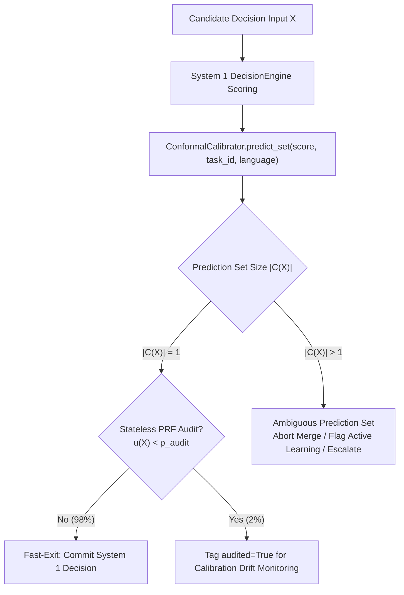

# Conformal Prediction & Calibrated Decision Routing

This document explains how Episteme uses **Split Conformal Prediction** to turn uncertain neural probability scores into
statistically rigorous decision sets, and how those sets drive System 1 / System 2 routing across the pipeline.

*For runtime usage in theory fusion,
see [Phase 5: Alignment & Theory Fusion](../workflow/5_inter_document_argument_web/index.md). For entity consolidation,
see [Phase 3b: Latent Graph Consolidation](../workflow/3b_consolidation/index.md). For architectural background,
see [ADR 0005](../adr/0005-two-pass-fusion-strategy.md).*

---

## Intuition: Why Fixed Probability Cutoffs Fail

Throughout the pipeline, a fast **System 1 Decision Engine** ([
`DecisionEngine`](../../packages/episteme-pipeline/episteme_pipeline/protocols/decision.py)) evaluates candidate graph
operations before we spend tokens on a heavy **System 2 Generative LLM**. For example:

- **Entity Consolidation (Phase 3b)**: Given two similar concepts (e.g., *"Transzendentale Apperzeption"* and *"Reines
  Selbstbewusstsein"*), are they identical (`IDENTICAL_MERGE`), is one a sub-concept of the other
  (`HIERARCHICAL_SUBSUMPTION`), or are they distinct (`DISTINCT_SEPARATE`)?
- **Cross-Document Theory Fusion (Phase 5)**: Given a cluster of argument nodes from different texts, do they express
  the same claim (`EQUIVALENT_FUSION`), opposing positions (`COMPETING_THEORIES`), or parallel domain applications
  (`DISTINCT_APPLICATIONS`)?

### The Problem with a Fixed Threshold (e.g., $\hat{P} \ge 0.80$)

Relying on a raw softmax cutoff like $\hat{P} (y \mid X) \ge 0.80$ creates three practical failure modes:

1. **Miscalibration Across Domains**: A neural model that outputs $0.82$ on modern English analytic philosophy may be
   right $90\%$ of the time, whereas the same $0.82$ score on 18th-century German prose may be right only $60\%$ of the
   time.
2. **Blindness to Competing Alternatives**: A top-1 score alone does not tell us how probabilities are distributed
   across the remaining choices. A distribution of $\{0.78, 0.11, 0.11\}$ (one clear winner) is very different
   from $\{0.52, 0.46, 0.02\}$ (the model is torn between two competing interpretations).
3. **Irreversible Graph Corruption**: False merges in Phase 3b or Phase 5 collapse distinct philosophical concepts or
   opposing arguments into a single node, corrupting downstream TheoryNet structures and QBAF gradual semantics.

### The Conformal Solution: Predict a Set, Not Just a Point

Instead of picking a single label and hoping its score is calibrated, [
`ConformalCalibrator`](../../packages/episteme-pipeline/episteme_pipeline/decision/conformal.py) returns a **prediction
set** $C (X) \subseteq \mathcal{Y}$ containing *all* labels that are statistically plausible at a user-chosen confidence
level $1 - \alpha$ (default $\alpha = 0.05$, i.e., $95\%$ coverage):

- **If $|C (X)| = 1$ (Singleton Set)**: Only one label is plausible (e.g., $C (X) = \{\text{"IDENTICAL\_MERGE"}\}$).
  System 1 can safely take the action immediately (**Fast-Exit**).
- **If $|C (X)| > 1$ (Ambiguous Set)**: Multiple labels are plausible
  (e.g., $C (X) = \{\text{"IDENTICAL\_MERGE"}, \text{"HIERARCHICAL\_SUBSUMPTION"}\}$). The calibrator blocks automatic
  merging and flags the case for System 2 reasoning or active-learning review.

---

## How Split Conformal Prediction Works

Split Conformal Prediction (Vovk et al., 2005; Angelopoulos & Bates, 2021) requires no assumptions about the model
architecture or probability distribution—only that calibration examples and test examples are exchangeable.

It works in three steps:

### Step 1: Measure "Surprise" on Calibration Data (Non-Conformity Scores)

Suppose we have a held-out calibration dataset $\mathcal{D}_{\text{cal}} = \{ (x_1, y_1), \dots, (x_n, y_n)\}$ of $n$
labeled examples where $y_i \in \mathcal{Y}$ is the known ground-truth label.

For each calibration example, the model outputs a probability distribution $\hat{P} (Y \mid x_i)$ over all options. We
measure how "surprised" the model is by the true label $y_i$ using the **non-conformity score** $s_i$:

$$s_i = 1 - \hat{P} (y_i \mid x_i)$$

- If the model assigned $\hat{P} (y_i \mid x_i) = 0.92$ to the true answer, the non-conformity score is small
  ($s_i = 0.08$).
- If the model assigned only $\hat{P} (y_i \mid x_i) = 0.55$ to the true answer, the non-conformity score is large
  ($s_i = 0.45$).

### Step 2: Compute the Empirical Quantile Cutoff ($\hat{q}$)

Given a target error rate $\alpha \in (0, 1)$ (default $\alpha = 0.05$ for $95\%$ coverage), [
`ConformalCalibrator.calibrate()`](../../packages/episteme-pipeline/episteme_pipeline/decision/conformal.py#L92-L155)
sorts the $n$ non-conformity scores in ascending order $s_{ (1)} \le s_{ (2)} \le \dots \le s_{ (n)}$ and selects the
finite-sample corrected quantile $\hat{q}$:

$$k = \lceil (n + 1)(1 - \alpha) \rceil, \qquad \hat{q} = \begin{cases} s_{ (k)} & \text{if } k \le n \\ 1.0 & \text{if } k > n \end{cases}$$

**Intuition**: At least $(1 - \alpha)$ of true answers in our calibration set had a non-conformity score of $\hat{q}$ or
less—which is equivalent to saying the true answer had a predicted probability of at least $1 - \hat{q}$.

### Step 3: Form the Prediction Set $C (X)$ at Runtime

When a new input $X_{n+1}$ arrives at runtime, [
`ConformalCalibrator.predict_set()`](../../packages/episteme-pipeline/episteme_pipeline/decision/conformal.py#L199-L260)
includes every candidate option $y \in \mathcal{Y}$ whose predicted probability is at least $1 - \hat{q}$:

$$C (X_{n+1}) = \left\{ y \in \mathcal{Y} \;\middle|\; 1 - \hat{P} (y \mid X_{n+1}) \le \hat{q} \right\} = \left\{ y \in \mathcal{Y} \;\middle|\; \hat{P} (y \mid X_{n+1}) \ge 1 - \hat{q} \right\}$$

By the conformal coverage theorem, the true label $Y_{n+1}$ is guaranteed to lie inside $C (X_{n+1})$ with probability
at least $1 - \alpha$:

$$P\big (Y_{n+1} \in C (X_{n+1})\big) \ge 1 - \alpha$$

!!! note "Uncalibrated Fallback (Adaptive Prediction Sets / APS)"
    If no calibrated quantile $\hat{q}$ has been fitted yet for the requested task or language (`get_q_hat(...) is None`), `predict_set()` automatically falls back to greedy cumulative probability mass accumulation: it sorts candidate labels from highest to lowest probability and adds labels to $C (X)$ until their cumulative probability reaches $1 - \alpha$. Similarly, if a calibrated threshold $1 - \hat{q}$ is so strict that rounding leaves $C (X)$ empty, `predict_set()` retains the top-1 argmax label so a valid probability distribution never produces an empty set.

---

## Mondrian Calibration: Stratifying by Task and Language

Score distributions vary significantly across pipeline phases and languages:

- A 3-way entity merge check (`p3b_merge`) behaves differently from a 4-way argument relation classifier (`p4_arc`) or a
  5-point modal strength rating (`modality`).
- Historical German texts (`de`) exhibit higher lexical variance and lower raw model confidence than contemporary
  English analytic papers (`en`).

If we computed a single global cutoff $\hat{q}$ across all tasks and languages, easy tasks would have overly wide
prediction sets while hard tasks would fail to achieve $95\%$ coverage.

### Stratified Quantiles ($\hat{q}_{t, \ell}$)

Episteme implements **Mondrian Split Conformal Prediction** (Vovk et al., 2005) by partitioning calibration scores into
strata defined by `(task_id, language)`:

- **Tasks (`task_id`)**: `p1_relevance`, `p2_linking`, `p3_rerank`, `p3b_merge`, `p4_acc`, `p4_arc`, `p5_fusion`,
  `modality`
- **Languages (`language`)**: `de`, `en`

Each stratum $(t, \ell)$ maintains its own calibrated cutoff $\hat{q}_{t, \ell}$ computed over its calibration
subset $\mathcal{D}_{\text{cal}}^{ (t, \ell)}$.

### Hierarchical Lookup Order (`get_q_hat`)

When [
`ConformalCalibrator.get_q_hat(task_id, language)`](../../packages/episteme-pipeline/episteme_pipeline/decision/conformal.py#L157-L197)
is called at runtime, it resolves the cutoff from most specific to most general:

1. **Exact `(task_id, language)`** — e.g., `("p3b_merge", "de")`
2. **Task-only `(task_id, None)`** — e.g., `("p3b_merge", None)`
3. **Language-only `(None, language)`** — e.g., `(None, "de")`
4. **Global `self.q_hat`** — or `None` (triggering the APS cumulative mass fallback)

### Reproducibility & Manifest Lineage

`ConformalCalibrator` implements the [
`Fingerprintable`](../../packages/episteme-pipeline/episteme_pipeline/protocols/fingerprint.py#L25-L43) protocol. Its
`fingerprint()` method exports the full calibration state—including `alpha`, every stratum's `q_hat`, calibration sample
count `n_cal`, and `dataset_sha256`—into `RunManifest.method_fingerprints`. Whenever calibration quantiles are
updated, [`Pipeline._choose_reuse_source()`](../../packages/episteme-pipeline/episteme_pipeline/pipeline.py#L879-L891)
detects the fingerprint change (`method-changed:decision_engine`) and invalidates stale cached phases.

---

## 4. Runtime Triage & Stateless Stochastic Auditing

At runtime, [`ConformalCalibrator`](../../packages/episteme-pipeline/episteme_pipeline/decision/conformal.py) and [
`ObservableDecisionEngine`](../../packages/episteme-pipeline/episteme_pipeline/decision/observable.py) combine
prediction set size with deterministic auditing:

### Triage Outcomes

1. **Unambiguous Singleton ($|C (X)| = 1$) $\implies$ `fast_exit`**:
    - [
      `ConformalCalibrator.triage()`](../../packages/episteme-pipeline/episteme_pipeline/decision/conformal.py#L278-L293)
      returns `"fast_exit"` when `len(prediction_set) == 1`.
    - Only a single option is plausible at the $1 - \alpha$ level, allowing System 1 to commit the decision without
      invoking a generative LLM.
2. **Multi-Label Ambiguity ($|C (X)| > 1$) $\implies$ `escalate_to_system2` / `active_learning`**:
    - More than one option is plausible (for example, both `EQUIVALENT_FUSION` and `COMPETING_THEORIES`
      exceed $1 - \hat{q}$).
    - The verifier refuses to blindly merge or fuse the nodes and emits a gating telemetry event (`active_learning`) so
      the ambiguity can be resolved by System 2 or human review.

### Counter-Free Stateless Stochastic Auditing (`_should_audit`)

Even when System 1 is confident, [
`ObservableDecisionEngine`](../../packages/episteme-pipeline/episteme_pipeline/decision/observable.py#L126-L157) samples
a small fraction of evaluations (`stochastic_audit_rate`, default $p_{\text{audit}} = 0.02$) and marks their telemetry
events with `audited=True` to monitor long-term calibration drift.

Instead of a stateful counter, `ObservableDecisionEngine._should_audit()` computes a
stateless **HMAC-SHA256 Pseudo-Random Function (PRF)** keyed by the engine `seed` over the task namespace and input
`state_hash`:

$$u (X) = \frac{\text{int}\big (\text{HMAC}_{\text{SHA256}} (\text{key}=\text{seed},\; \text{msg}=\text{task}_{\text{namespace}} \mathbin{\Vert} \text{state\_hash})[:16],\; 16\big)}{2^{64}} \in [0, 1)$$

$$ \text{Audit} (X) = \mathbb{I}\big[u (X) < p_{\text{audit}}\big] $$

Taking the first 16 hex characters (8 bytes / 64 bits) of the HMAC digest and dividing by $2^{64}$ produces a uniform
number in $[0, 1)$ that depends *only* on `(seed, task_namespace, state_hash)`. Whether 100 items are evaluated
sequentially or in shuffled `asyncio` tasks, every item receives the exact same audit decision on every run.

---

## 5. Concrete Pipeline Integration Points

### Phase 3b: Borderline Entity Pair Verification

In [
`Phase3bLatentConsolidationRunner`](../../packages/episteme-pipeline/episteme_pipeline/phases/phase3b_consolidation/runner.py),
entity pairs with cosine similarity in the borderline band $[0.75, 0.88)$ are passed to [
`BorderlinePairVerifier.verify()`](../../packages/episteme-pipeline/episteme_pipeline/phases/phase3b_consolidation/clustering.py#L183-L276):

- **Candidate Options**: `["IDENTICAL_MERGE", "HIERARCHICAL_SUBSUMPTION", "DISTINCT_SEPARATE"]`
- **Mondrian Stratum**: `task_id="p3b_merge"`, `language=language or self.language`
- **Decision Rule**:
  A borderline pair is approved as a candidate merge edge for clique-constrained clustering (`action_taken="merge_approved"`) if and only if:
    1. The conformal prediction set is the unambiguous singleton $C (X) = \{\text{"IDENTICAL\_MERGE"}\}$, **or**
    2. The top-1 choice is `"IDENTICAL_MERGE"` and its calibrated empirical accuracy meets `confidence_threshold`
       (default $0.80$). Otherwise, the merge is aborted (`action_taken="merge_aborted"`) so hierarchical or distinct
       concepts are never conflated.
  Subsequently, `clique_constrained_components` enforces minimum internal similarity and maximum diameter bounds, preventing transitive bridge chaining.

### Phase 5: Inter-Document Theory Cluster Verification

In [`Phase5bTheoryFusionRunner`](../../packages/episteme-pipeline/episteme_pipeline/phases/phase5_fusion/runner.py),
cross-document candidate clusters are verified by [
`InterDocumentClusterVerifier.verify()`](../../packages/episteme-pipeline/episteme_pipeline/phases/phase5_fusion/argument_clustering.py#L302-L390):

- **Candidate Options**: `["EQUIVALENT_FUSION", "COMPETING_THEORIES", "DISTINCT_APPLICATIONS"]`
- **Mondrian Stratum**: `task_id="p5_fusion"`, `language=language or self.language`
- **Decision Rule & Telemetry**:
    - **Confirmed (`is_confirmed=True`)**: `"EQUIVALENT_FUSION"` is selected/present in $C (X)$ **and**
      either $|C (X)| = 1$ or `empirical_accuracy >= confidence_threshold` (default $0.85$).
    - **Gating Event (`DecisionGatingTriggered`)**:
        - If $|C (X)| > 1$: emits `action_taken="active_learning"` (and logs `active_learning_candidate=True` when
          `"EQUIVALENT_FUSION"` is competing with another label in $C (X)$).
        - Else if `is_confirmed`: emits `action_taken="fast_exit"`.
        - Otherwise: emits `action_taken="rejected"`.

---

## 6. Compositional Conformal Risk Control & Global Epistemic Risk Budget ($\alpha_{\text{global}}$)

Split conformal prediction provides a $1 - \alpha$ coverage guarantee at a **single** isolated decision gate. However, scientific theory-graph construction is a multi-stage sequential pipeline spanning entity discovery (Phase 2), latent consolidation (Phase 3b), argument mining (Phase 4), and cross-document theory fusion (Phase 5).

If each of $M$ sequential stages independently commits decisions at error rate $\alpha = 0.05$, the cumulative family-wise error rate across the pipeline degrades:

$$P(\text{at least one failure}) \le 1 - (1 - \alpha)^M \approx 1 - 0.95^5 \approx 22.6\%$$

To provide end-to-end statistical risk guarantees across the entire graph construction workflow, Episteme introduces a **Global Epistemic Risk Budget ($\alpha_{\text{global}}$)** managed by [`DecisionEngineConfig`](../../packages/episteme-pipeline/episteme_pipeline/config.py) and [`ConformalCalibrator.allocate_risk_budget()`](../../packages/episteme-pipeline/episteme_pipeline/decision/conformal.py):

$$\alpha_m = \alpha_{\text{global}} \cdot \frac{w_m}{\sum_{k=1}^M w_k}, \qquad \sum_{m=1}^M \alpha_m \le \alpha_{\text{global}}$$

By the union bound (Bonferroni inequality / Conformal Risk Control, Angelopoulos et al., 2022), the sequence-level probability that *any* decision gate commits an error is strictly bounded by $\alpha_{\text{global}}$:

$$P\left(\bigcup_{m=1}^M \mathcal{E}_m\right) \le \sum_{m=1}^M P(\mathcal{E}_m) \le \sum_{m=1}^M \alpha_m \le \alpha_{\text{global}}$$

### Asymmetric Epistemic Risk Allocation

Pipeline gates have asymmetric consequences:
1. **Irreversible Structural Gates (Phase 3b Latent Consolidation)**: Merging two distinct philosopher concepts or categories irreversibly corrupts the foundational graph topology. Phase 3b is allocated a tight risk budget ($w_{\text{p3b}} = 0.10 \implies \alpha_{\text{p3b}} = 0.005$).
2. **Reversible Soft Gates (Phase 4 Argument Mining & Phase 5 Fusion)**: Soft-weighted edges and community discovery can tolerate more permissive exploration ($w_{\text{p4}} = 0.25 \implies \alpha_{\text{p4}} = 0.0125$).

At pipeline initialization (`Pipeline.for_task()`), `PipelineConfig.sync_allocated_risk_budgets()` computes the per-phase $\alpha_m$ allocations and propagates them into each phase's configuration model.

---

## References

- Angelopoulos, A. N., & Bates, S. (2021). *A Gentle Introduction to Conformal Prediction and Distribution-Free
  Uncertainty Quantification*. arXiv:2107.07511.
- Angelopoulos, A. N., Bates, S., Candès, E. J., Jordan, M. I., & Wainwright, M. J. (2022). *Learn then test: Calibrating predictive algorithms to achieve risk control*.
- Bansal, N., Blum, A., & Chawla, S. (2004). *Correlation clustering*. Machine Learning, 56(1), 89-113.
- Vovk, V., Gammerman, A., & Shafer, G. (2005). *Algorithmic Learning in a Random World*. Springer.
- [ADR 0005: Two-Pass Fusion Strategy](../adr/0005-two-pass-fusion-strategy.md)
