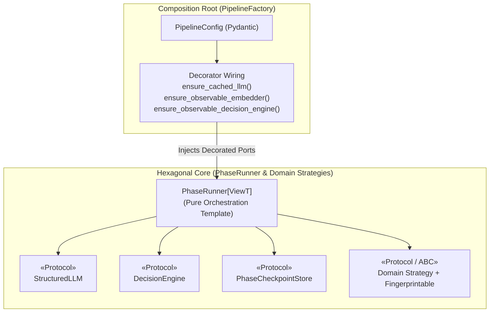
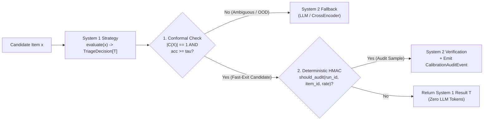

# Design Patterns, Clean Code & Architectural Standards

## 1. Motivation: Clean Code as Epistemic Infrastructure

**Episteme** is designed as both a state-of-the-art theory-graph construction engine and a **living knowledge project**. Researchers and engineers reading this codebase should be able to understand *both* the underlying epistemological and NLP theories (Schurz, Lakatos, Thagard, Dung, Conformal Prediction, TAGs) *and* the software engineering decisions that operationalize them.

In a fast-moving research environment, agility and theoretical rigor depend directly on structural code quality:

- **Hexagonal Architecture (Ports & Adapters)** isolates pure epistemological domain logic from volatile infrastructure (LLM providers, Neo4j drivers, vector stores, telemetry sinks).
- **SOLID Principles** ensure that integrating a new paper or replacing an algorithm (e.g., swapping Union-Find for Correlation Clustering, or raw cosine similarity for CSLS) requires implementing a single narrow protocol rather than modifying a 1,300-line orchestrator.
- **DRY (Don't Repeat Yourself)** ensures that mathematical primitives (cosine similarity matrices, conformal prediction sets, connected components) and lifecycle mechanics (batch checkpointing, progress telemetry, systematic failure guards) are implemented once, tested exhaustively, and reused everywhere.
- **YAGNI (You Aren't Gonna Need It)** eliminates dead code paths, unused constructor dependencies, and speculative abstractions that pollute run fingerprints and confuse readers.
- **Strict Static Typing & Explicit Contracts** make invalid states unrepresentable and forbid runtime reflection hacks (`getattr`, `hasattr`, `isinstance` dispatch).

> [!IMPORTANT]
> This document serves as the canonical engineering orientation for all future features, phases, extractors, and post-processors in `episteme-pipeline`. Before introducing a new component or refactoring an existing phase, consult the decision matrix and pattern specifications below.

---

## 2. Decision Matrix: Recurring Problems $\to$ Canonical Design Patterns

Whenever you encounter one of the following recurring problems in the orchestrator or phases, apply the designated design pattern and shared infrastructure rather than inventing ad-hoc phase-local logic:

| Recurring Problem | Canonical Design Pattern | Required Infrastructure / Wrapper | Where It Applies |
| :--- | :--- | :--- | :--- |
| **Phase execution lifecycle** (progress bars, batch slicing, `:PhaseItem` checkpointing, chunked graph upserts, systematic failure circuit-breaking, artifact wrapping) | **Template Method** + **Unit of Work** | `BasePhaseRunner[InputViewT, ItemT, OutputT]`, `BatchCheckpointExecutor`, `ProgressScope` context manager | All `PhaseRunner` implementations (`Phase1Runner`–`Phase6Runner`, `TheoreticalEnrichmentRunner`) |
| **System 1 (`DecisionEngine`) fast triage $\to$ System 2 (`StructuredLLM`) fallback** with conformal prediction sets and stochastic auditing | **Chain of Responsibility** + **Generic Decorator** | `CalibratedCascade[ItemT, ResultT]`, `TriageDecision[ResultT]`, deterministic HMAC `should_audit()` | Phase 2 Entity Linking & Gleaning, Phase 3 Pair Gating, Phase 3b Consolidation Verification, Phase 4 ACC & ARC, Phase 5 Fusion Gating |
| **Cross-cutting operational hooks** (disk caching, Langfuse spans, domain event emission, token-overflow backoff) | **Decorator Pattern** (wired at Composition Root) | `ensure_cached_llm()`, `ensure_observable_embedder()`, `ensure_observable_decision_engine()`, `RetryingStructuredExtractor` | `PipelineFactory` (`Pipeline.for_task`) — **never** inside domain extractor methods |
| **Swappable domain algorithms** (chunkers, NER extractors, entity linkers, subgraph formatters, clustering algorithms, modal resolvers) | **Strategy Pattern** + **Dependency Inversion (DIP)** | `@runtime_checkable Protocol` or `ABC` in `protocols/` + constructor injection in `__init__` | All phase sub-components (`EntityLinker`, `GlobalRelationExtractor`, `ARCClassifier`, `ModalStrengthResolver`) |
| **Component discovery for run fingerprinting & cache invalidation** | **Composite / Visitor Pattern** | `Fingerprintable` protocol + `find_components()` inspecting attributes bound in `__init__` | All runners and strategy components that influence phase output |
| **Translating between Domain Contracts, Artifact Payloads, and Graph Properties** | **Bidirectional Codec / Mapper Pattern** | `ArtifactCodec[DomainT, PayloadT]` + `EpistemicWorkspaceView` (identity-deduplicated) | `artifacts/builders.py`, `artifacts/execution.py`, `projection/artifact_projector.py` |
| **Combining sequential state evolution with concurrent batch processing** | **Two-Stage Map-Reduce / Immutable State Reducer** | Concurrent stateless extraction (`asyncio.gather`) followed by sequential deterministic state transition $S_t = f(S_{t-1}, x_t)$ | Phase 2 `EpisodicWorkingMemoryManager`, Phase 4 Entity Maturation, Post-Processing two-pass parameter lookup |
| **Shared vector & graph mathematics** (cosine similarity, CSLS, connected components, cross-chunk pairing) | **Pure Functional Domain Utilities** | `episteme_pipeline/utils/similarity.py`, `episteme_pipeline/utils/graph_algorithms.py` | Phase 2, Phase 3, Phase 3b, Phase 4 Maturation, Phase 4 ARC, Phase 5 |

---

## 3. Canonical Pattern Specifications & Reference Architectures

### 3.1 Pattern 1: Hexagonal Ports, Composition Root & Strict Protocol Boundaries

#### When to Apply
Whenever a phase runner or domain service interacts with an external model (LLM, embedding model, cross-encoder reranker, System 1 decision engine), storage backend (Neo4j, filesystem artifact store), or pluggable domain strategy.

#### Architectural Rules
1. **Depend on Narrow Protocols (ISP & DIP)**:
   - Phase runners must declare dependencies using narrow protocols from `episteme_pipeline/protocols/` (`GraphReader`, `ProcessingGraph`, `ProjectionGraph`, `StructuredLLM`, `EmbeddingModel`, `DecisionEngine`, `CrossEncoder`), never `Any` and never concrete backend classes (`Neo4jStore`, `LiteLLM`).
   - Do not pass a read-only `GraphReader` into a parameter named `graph_store` that the runner subsequently mutates with write methods. If a phase only reads from the graph (or ideally reads from its `ArtifactsView`), type it as `GraphReader`. If it checkpoints within-phase progress, inject `PhaseCheckpointStore`.
2. **Instantiate Strategies in `__init__` or `PipelineFactory`, Never Inside Loops**:
   - All sub-components (`ADUSegmenter`, `ACCClassifier`, `ARCClassifier`, `EntityLinker`, `ModalStrengthResolver`, `AutoToCParser`, `ParameterInducer`) **must** be bound as instance attributes in `__init__` (either injected or defaulted there).
   - **Why**: `find_components()` in `protocols/fingerprint.py` inspects the object graph attached to `self` *before* `phase.run()` executes to compute `method_fingerprints`. Any component instantiated lazily inside `_process_chunk()` is invisible to fingerprinting and violates the Single Responsibility Principle.
3. **Every Domain Strategy Must Implement `Fingerprintable`**:
   - Do not rely on hardcoded attribute-name allowlists (`_CORE_COMPONENT_NAMES`). Every pluggable strategy class must implement `Fingerprintable.component_metadata() -> ComponentMetadata` so changing its implementation or parameters automatically invalidates downstream cache manifests.
4. **Never Inject Unused Dependencies**:
   - If a phase does not use an `LLM` (e.g., `Phase1Runner` or `Phase3bLatentConsolidationRunner`), do not accept or store `self.llm = llm`. Storing an unused component pollutes the phase's `method_fingerprints` and causes false cache invalidations when unrelated model settings change.



---

### 3.2 Pattern 2: Template Method & Unit-of-Work (`BatchCheckpointExecutor` & `ProgressScope`)

#### The Recurring Problem
Previously, every `PhaseRunner` manually re-implemented:
- A `@property def event_emitter(self)` helper doing a lazy import of `get_event_emitter()`.
- Manual `ProgressStarted`, `ProgressAdvanced`, and `ProgressCompleted` event emissions—frequently without `try ... finally:` blocks, leaving UI progress indicators stuck when an exception occurred.
- Ad-hoc `for batch in batched(items, batch_size):` loops with `asyncio.gather(..., return_exceptions=True)`, inconsistent failure counting (`_guard_systematic_failure` copied between Phase 2 and Phase 3, absent in Phase 4), and hardcoded `batched(..., 500)` graph writes.

#### The Canonical Solution
1. **Inherit Base Lifecycle Infrastructure from `PhaseRunner`**:
   - `PhaseRunner` provides `self.event_emitter` and `self.progress_scope(total=..., label=..., run_id=...)` (an async/sync context manager that guarantees `ProgressCompleted` or `PhaseFailed` is emitted in a `finally` block).
2. **Use `BatchCheckpointExecutor` for Within-Phase Checkpointing (`ADR-0016`)**:
   - Any phase processing a collection of independent items (documents, chunks, candidate entity pairs, immature entities, theoretical clusters) delegates batch slicing, `:PhaseItem` filtering (`filter_unprocessed_items`), concurrent execution, systematic failure circuit-breaking (`SystematicFailureError` if Batch 0 fails 100% or cumulative failure rate exceeds threshold), and atomic batch commits (`commit_phase_batch`) to a shared `BatchCheckpointExecutor`.

```python
from contextlib import contextmanager
from typing import Iterator
from episteme_pipeline.events.context import get_event_emitter
from episteme_pipeline.events.models import ProgressAdvanced, ProgressCompleted, ProgressStarted


@contextmanager
def progress_scope(run_id: str, phase_name: str, total: int, label: str) -> Iterator[callable]:
    """Guarantee symmetric ProgressStarted / ProgressCompleted emission even on exception."""
    emitter = get_event_emitter()
    emitter.emit(ProgressStarted(run_id=run_id, phase=phase_name, total=total, current=0, label=label))
    completed = 0

    def advance(step: int = 1, step_label: str | None = None) -> None:
        nonlocal completed
        completed += step
        emitter.emit(
            ProgressAdvanced(
                run_id=run_id,
                phase=phase_name,
                total=total,
                current=completed,
                label=step_label or label,
            )
        )

    try:
        yield advance
    finally:
        emitter.emit(
            ProgressCompleted(
                run_id=run_id,
                phase=phase_name,
                total=total,
                current=completed,
                label=f"{label} finished",
            )
        )
```

---

### 3.3 Pattern 3: Decorator Pattern (`ensure_*`) for Cross-Cutting Concerns

#### When to Apply
All non-domain concerns—**LLM disk caching**, **embedding/decision telemetry**, **Langfuse tracing spans**, **rate-limit/context-window retry backoff**, and **observability events**—must be implemented as **transparent Decorators** conforming to the exact same port protocol as the underlying component.

#### Architectural Rules
1. **Idempotent Factory Wrappers (`ensure_*`)**:
   - Follow the pattern established in `episteme_pipeline/observability/decorators.py` (`ensure_observable_embedder`, `ensure_observable_reranker`, `ensure_observable_decision_engine`) and `episteme_pipeline/llm/cache.py` (`DiskCachedStructuredLLM`): check `if isinstance(port, DecoratorClass): return port` to prevent double-wrapping.
2. **Keep Domain Extractors Free of Telemetry Plumbing**:
   - A domain extractor (e.g., `DenseRetrievalGlobalRelationExtractor`, `LLMNERExtractor`, `LLMACCClassifier`) should contain **only** prompt construction, structured decoding invocation, and domain post-processing.
   - Context-window overflow retries (shrinking `max_envelopes` or truncating context on token-limit errors) and span timing belong in a reusable decorator/helper rather than a 150-line nested `try/except` inside each extractor's `_extract_pair` method.

---

### 3.4 Pattern 4: Chain of Responsibility & Calibrated Triage Cascade (`CalibratedCascade[InT, OutT]`)

#### The Recurring Problem
Episteme uses a dual-process cognitive architecture (`ADR-0018`): a fast, calibrated System 1 `DecisionEngine` (Jev) handles clear-cut classifications in $<10\text{ms}$, escalating only ambiguous ($|C(X)| > 1$), out-of-distribution ($|C(X)| = 0$), low-confidence, or stochastically audited items to System 2 (`StructuredLLM` or `CrossEncoder`).

When each phase implemented its own `Cascading*` class ad-hoc, four severe anti-patterns emerged:
1. **Protocol-Breaking `isinstance` Checks**: `CascadingEntityLinker` checked `if isinstance(self.primary, JevEntityLinker):` to access raw decision probabilities instead of using a unified return contract.
2. **Vacuous Fallback Triggers**: `CascadingACCClassifier` checked `if is_uncertain or is_audit or not relations:`, unaware that `JevACCClassifier` only classifies atoms and *always* returns `relations = []`—causing a 100% fallback rate to the LLM!
3. **Whole-Batch / Whole-Corpus Re-Execution on Audit**: `CascadingARCClassifier.classify_global` triggered a single coin flip after evaluating all pairs and re-ran the expensive LLM classifier over the **entire corpus** instead of escalating only the audited/uncertain pairs.
4. **Inverted Audit Semantics**: `InterDocumentClusterVerifier.should_fuse` returned `True` (approving a rejected cluster merge!) whenever `random.random() < self.audit_rate` fired, confusing *auditing a decision via System 2* with *randomly flipping a negative decision to positive*.

#### The Canonical Solution: `TriageDecision[T]` + Item-Level `CalibratedCascade`



Every System 1 / System 2 cascade **must** obey four invariants:
1. **Typed `TriageDecision[T]` Contract**: System 1 evaluators expose a uniform decision envelope containing:
   - `value: T` (the predicted domain output),
   - `empirical_accuracy: float` ($\hat{p} \in [0, 1]$),
   - `prediction_set: list[str]` (the conformal set $C(X)$ at significance level $\alpha$),
   - `is_ambiguous: bool` ($|C(X)| \neq 1$).
2. **Per-Item Escalation**: Batch/global methods (`classify_global`, `filter_candidate_pairs`, `link`) must partition items into `fast_accepted` vs. `escalated_items` and invoke System 2 **only** on `escalated_items`.
3. **Deterministic Seeded Auditing**: Never call unseeded `random.random()` inside async tasks (where task scheduling order makes the audit sample non-reproducible). Use a deterministic PRF over `(run_seed, phase_key, item_id)`:
   ```python
   import hashlib

   def should_audit_deterministically(run_seed: str, phase_key: str, item_id: str, audit_rate: float) -> bool:
       """Compute a reproducible Bernoulli audit decision in [0, 1) via SHA-256."""
       if audit_rate <= 0.0:
           return False
       if audit_rate >= 1.0:
           return True
       digest = hashlib.sha256(f"{run_seed}:{phase_key}:{item_id}".encode("utf-8")).digest()
       uniform_val = int.from_bytes(digest[:8], "big") / float(1 << 64)
       return uniform_val < audit_rate
   ```
4. **Audit Means Verify, Never Blindly Approve**: When `should_audit` triggers on a System 1 decision, the item is routed to System 2 (or tagged with `audit_sample=True` for active-learning evaluation) to compare System 1 vs. System 2 agreement—**never** to invert the boolean return value without verification.

---

### 3.5 Pattern 5: Bidirectional Codec / Mapper Pattern for Lossless State Transitions

#### The Recurring Problem
In Episteme's Artifact-Native architecture (`ADR-0017`), domain objects (`L1Chunk`, `L2Entity`, `L2Triple`, `TheoryAtom`, `TheoryRelation`) are converted into `ArtifactEnvelope[PayloadT]` at the end of a phase, hydrated back into domain objects by `ArtifactsView.from_collection()` in downstream phases, and projected into Neo4j properties by `ArtifactGraphProjector`.

When `builders.py`, `execution.py`, and `artifact_projector.py` each wrote manual, asymmetric field mappings:
- `ChunkArtifact` dropped `L1Chunk.embedding`, `text_anchor`, and `metadata` (breaking Phase 2's `EpisodicEvictionHandler`, which relies on `chunk.metadata["section_path"]`).
- `TheoryAtomArtifact` dropped `entity_ids`, `modal_strength`, `base_score`, `measurements`, `parameters`, and `tenability`.
- `Phase4EntityMaturationRunner` formatted `mention_artifact_ids` as `artifact::{chunk_id}` instead of `artifact::mention::{entity_id}::{chunk_id}`, causing `parse_mention_id` in `execution.py` and `artifact_projector.py` to wipe out `source_chunk_ids = []` on every matured entity.

#### The Canonical Solution
1. **Single Bidirectional Codec per Domain Entity (`ArtifactCodec[DomainT, PayloadT]`)**:
   - Every artifact payload class pairs `to_payload(domain_obj: DomainT) -> PayloadT` and `to_domain(payload: PayloadT) -> DomainT` in one place, enforced by a round-trip property test:
     $$\forall x \in \text{DomainT}: \quad \text{Codec.to\_domain}(\text{Codec.to\_payload}(x)) == x$$
2. **Typed ID NewTypes / Value Objects**:
   - Never pass raw strings that require regex/prefix stripping (`"artifact::mention::..."` vs. `"artifact::..."`). Use explicit helper constructors (`MentionId.format(entity_id, chunk_id)` / `MentionId.parse(raw)`) or store `source_chunk_ids: list[str]` directly as a first-class typed field on `LinkedEntityArtifact`.
3. **Pure Data Payloads (No Domain Math in `models.py`)**:
   - `ArtifactPayload` classes in `artifacts/models.py` are pure serialization schemas. Do not embed domain fallback calculations (such as `TheoryRelationArtifact.to_graph_properties()` computing QBAF support/attack weights) inside artifact models; compute domain values in the phase's domain service (`TheoryNetProjector`) before constructing the artifact.

---

### 3.6 Pattern 6: Two-Stage Map-Reduce for Stateful Sequential Context (`S_t = f(S_{t-1}, x_t)`)

#### The Recurring Problem
Some epistemological mechanisms are inherently **sequential** along document reading order—for example, Phase 2's `EpisodicWorkingMemoryManager` ($S_t = \text{Update}(S_{t-1}, \text{Entities}_t, \text{Section}_t)$)—while LLM/DecisionEngine extraction across chunks needs **concurrency** for throughput.

Running `asyncio.gather(*[self._process_chunk(c) for c in batch])` where `_process_chunk` both *reads* and *mutates* `self.working_memory_manager.state` creates a data race: all chunks in the batch read the same stale state $S_{t_0}$ and overwrite `_last_section_path` in completion order rather than document order.

#### The Canonical Solution
Whenever a phase combines concurrent extraction with sequential state or cross-item lookup:
- **Case A (State Depends on Prior Extraction, e.g., Working Memory)**:
  - Keep `WorkingMemoryState` as an **immutable value object** (`@dataclass(frozen=True)` or Pydantic `frozen=True`).
  - Either parallelize across independent **documents/chapters** (giving each document/chapter its own isolated `EpisodicWorkingMemoryManager` instance while processing chunks sequentially within that chapter), or use a two-stage pipeline where stage 1 extracts chunk candidates in parallel and stage 2 folds them sequentially through the state transition function `state, resolved = memory.step(state, chunk_result)`.
- **Case B (Cross-Cluster / Cross-Node Lookup, e.g., Theoretical Enrichment)**:
  - Never query a dictionary (`cluster_theory_params`) inside the same single-pass `for cluster in clusters:` loop that populates it! Always separate into **Pass 1 (Populate Map for All Clusters)** and **Pass 2 (Resolve Cross-Cluster Directed Edges)**.

---

## 4. Forbidden Anti-Patterns & Code Smells

### 4.1 Anti-Pattern 1: Reflection & Duck-Typing Hacks (`getattr`, `hasattr`, String-Matching)

Per `AGENTS.md §2`, **`getattr` and `hasattr` duck-typing workarounds are strictly forbidden** in domain and orchestration code. They hide missing protocol methods, bypass static type checking (`mypy` / `pyright`), and cause silent runtime misbehavior when attribute names change.

| Bad Practice (Forbidden) | Clean Architectural Standard |
| :--- | :--- |
| `getattr(config.phase3, "use_jev_reranker", False)` | Declare `use_jev_reranker: bool = False` explicitly on `Phase3Config` and access `config.phase3.use_jev_reranker`. |
| `if not hasattr(config, phase_key): phase_key = "phase1"` | Define `config_section(self, config: PipelineConfig) -> BaseModel` on `PhaseRunner` or map `phase_key` via a typed registry without falsifying another phase's key. |
| `if hasattr(self.projector, "aproject"): await self.projector.aproject(...)` | Define `async def aproject(...)` on the `ParameterProjector` protocol; provide a default async wrapper on base implementations. |
| `text = node.text if hasattr(node, "text") else getattr(node, "description", "")` | Define a `ClusterableNode` protocol (`id: str`, `cluster_text: str`) or pass a typed extraction callable `key_fn: Callable[[T], str]`. |

### 4.2 Anti-Pattern 2: Fake Domain Adapters Violating Liskov Substitution (LSP)

Do not fabricate dummy domain objects of one layer to satisfy the type signature of another layer's service.

- **Violation Example**: `TAGARCClassifier._component_as_entity(component: TheoryAtom) -> L2Entity` constructs a fake `L2Entity(id=component.id, label="TheoryAtom", ...)` just to call `GlobalRelationExtractor.get_structural_neighborhood(entity_a, entity_b)`.
- **Clean Standard**: Extract a shared graph-neighborhood formatting service (`SubgraphContextFormatter.format_pair_neighborhood(node_a_id: str, node_b_id: str, label_a: str, label_b: str)`) that accepts node IDs and display metadata directly, used cleanly by both Phase 3 (`L2Entity`) and Phase 4 (`TheoryAtom`).

### 4.3 Anti-Pattern 3: Copy-Pasted Mathematical Primitives

Never copy-paste numerical or graph algorithms across phases.
- **Cosine Similarity & L2 Normalization**: Previously duplicated across Phase 3 (`dense_retrieval_extractor.py`), Phase 3b (`consolidation.py`), Phase 4 (`arc_classifier.py`), and Phase 5 (`argument_clustering.py`)—leading to a bug where `dense_retrieval_extractor.py` omitted the zero-norm guard (`norms[norms == 0] = 1e-10`), risking `NaN` propagation. Use a single tested utility `cosine_similarity_matrix(embeddings_a, embeddings_b)` (and `csls_similarity_matrix`).
- **Disjoint-Set / Connected Components (`_union_find_components`)**: Previously duplicated identically in `phase3b_consolidation/consolidation.py` and `phase5_fusion/argument_clustering.py`. Centralize in `episteme_pipeline/utils/graph_algorithms.py`.
- **Cross-Chunk Priority Pairing (`_get_pairs_by_priority`)**: Previously duplicated verbatim between `TAGARCClassifier` and `JevARCClassifier`. Extract into a shared `CrossChunkPairGenerator` strategy or helper function.

### 4.4 Anti-Pattern 4: Dual Divergent Execution Paths on the Same Class

Do not maintain two partially overlapping entrypoints on a strategy where one path quietly lacks safety guards present in the other.
- **Violation Example**: `DenseRetrievalGlobalRelationExtractor` defines both `extract()` (which uses `asyncio.Semaphore(50)` and `trace_sink.span`) and `_extract_pair()` (called via inherited `GlobalRelationExtractor.extract_pairs()` from `Phase3Runner`, bypassing `extract()`'s semaphore and omitting `TAGRelationExtractor`'s `global_relation_confidence_threshold` check).
- **Clean Standard**: Keep a single canonical execution pipeline per responsibility: `Phase3Runner` orchestrates batching and checkpointing via `BatchCheckpointExecutor`, while `GlobalRelationExtractor` implements `candidate_pairs()` and `extract_pair()` (with confidence threshold filtering enforced uniformly).

---

## 5. Pre-Merge Clean Code & Architecture Checklist

Before submitting any new phase, extractor, classifier, or post-processor, verify:

1. **Hexagonal & SOLID Compliance**:
   - [ ] All external dependencies (LLM, Embeddings, Reranker, DecisionEngine, GraphStore) are injected via protocols from `episteme_pipeline/protocols/`.
   - [ ] All sub-components are bound in `__init__` (never instantiated inside `run()` or `_process_chunk()`).
   - [ ] Every custom strategy implements `Fingerprintable` (`component_metadata()`).
   - [ ] No unused dependencies are accepted or stored on `self`.
2. **Zero Reflection Hacks**:
   - [ ] Zero uses of `getattr(...)` or `hasattr(...)` to probe config fields, runner capabilities, or union types.
   - [ ] Zero `isinstance(...)` checks against concrete strategy implementations inside orchestrators or cascades.
3. **Pattern Alignment**:
   - [ ] Progress reporting uses a `try ... finally` scoped helper (`progress_scope`) so failed runs never leave dangling progress bars.
   - [ ] System 1 $\to$ System 2 cascades use `TriageDecision[T]`, escalate per-item (never re-running the whole corpus on audit), and use deterministic seeded auditing.
   - [ ] Concurrent `asyncio.gather` tasks never mutate shared instance state (`WorkingMemoryState`, counters, or partially populated lookup dicts).
4. **Lossless Artifacts & Documentation**:
   - [ ] Every emitted `ArtifactPayload` preserves 100% of the domain contract fields required for downstream `ArtifactsView` hydration and graph projection.
   - [ ] All modules, classes, and functions include complete **NumPy-style docstrings** (`Parameters`, `Returns`, `Raises`, `Notes`, `References`).
   - [ ] Corresponding documentation in `docs/workflow/` is updated with accurate `episteme_pipeline.*` import paths, config tables, and mermaid diagrams.
