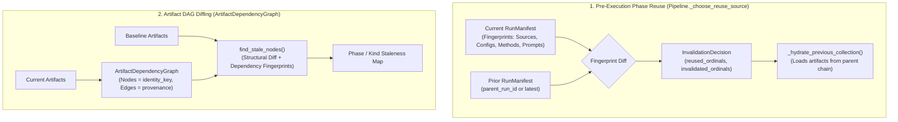
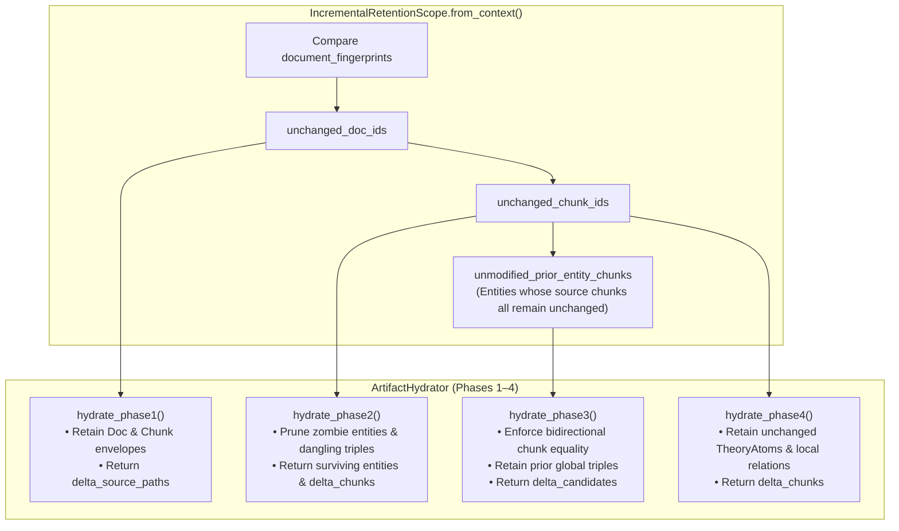

# Invalidation and Resume

This document defines the invalidation and resume architecture in Episteme.

The pipeline combines **deterministic run-manifest fingerprinting** for pre-execution phase reuse with **DAG-based
artifact dependency diffing** for fine-grained staleness detection.

---

## Architectural Overview

Invalidation operates across two distinct, complementary layers:

1. **Pre-Execution Phase Reuse (`Pipeline._choose_reuse_source`)**:
   Evaluated *before* execution starts. Compares the current run's manifest fingerprints (source, config, models,
   prompts) against the parent or latest completed run to determine which upstream phases can be reused without
   recomputation.
2. **Post-Execution / Cross-Run Artifact Diffing (`ArtifactDependencyGraph`)**:
   Operates on persisted artifacts. Constructs a directed acyclic graph (DAG) of artifact identities and upstream
   provenance to detect exactly which artifacts changed, which became structurally stale, and what downstream nodes were
   affected across runs.



---

## Run Modes

The pipeline provides three execution and resumption entry points in `pipeline/pipeline.py`:

### 2.1 Standard Execution with Automated Reuse (`Pipeline.run`)

```python
async def run(
        self,
        input: PipelineInput,
        run_id: str | None = None,
        parent_run_id: str | None = None,
) -> ExecutionResult: ...
```

- Assembles the initial `RunManifest` with all current fingerprints.
- Calls `_choose_reuse_source(manifest)` to compare against `parent_run_id` (or the latest completed run).
- Hydrates upstream artifacts from the prior run lineage for all reused phases.
- Starts execution at the first invalidated phase ordinal.

### Explicit Boundary Resumption (`Pipeline.run_from_phase`)

```python
async def run_from_phase(
        self,
        phase_number: int,
        input: PipelineInput | None = None,
        run_id: str | None = None,
        parent_run_id: str | None = None,
) -> ExecutionResult: ...
```

- Forces execution to begin at the specified 1-based phase ordinal (`phase_number`).
- Recovers input source paths from the prior manifest if `input` is omitted.
- Phases prior to `phase_number` are reused if completed in the prior manifest; phases from `phase_number` onward are
  re-executed.

### Resumption from a Specific Run (`Pipeline.resume_from_run`)

```python
async def resume_from_run(
        self,
        run_id: str,
        input: PipelineInput,
        from_phase: int | None = None,
) -> ExecutionResult: ...
```

- Resumes explicitly against a historical `run_id`.
- Reuses all phases preceding `from_phase` and invalidates all phases from `from_phase` onward.
- Hydrates the required upstream artifacts directly from the target run's lineage.

---

## Fingerprint System

Fingerprints are deterministic SHA-256 hashes generated via `pipeline/runs/fingerprints.py`:

### Source and Input Fingerprints

- **Corpus Files**: Computed by `fingerprint_existing_sources()`. Combines filesystem stat metadata (file size,
  modification time) with full SHA-256 content hashes of all corpus source and bibtex files.
- **Per-Document Content Fingerprints (`document_fingerprints`)**: Computed by `compute_document_fingerprints()`.
  Maps each individual document path to its independent SHA-256 content hash in `RunManifest.document_fingerprints`.
  This allows fine-grained, document-level delta detection rather than forcing coarse re-processing of the entire corpus.
- **Structural Anchors**: `fingerprint_structural_anchor()` hashes chapter/section structural metadata when provided.
- **Input Fingerprint**: Combined hash `stable_fingerprint({"source": source_fp, "anchor": anchor_fp})`.

### Phase-Config Fingerprints

- Serialized configuration hashes for each phase (`fingerprint_phase_config()`).
- **Fine-Grained Nested Configs**: `fingerprint_phase_config_nested()` traverses Pydantic phase configurations and
  generates per-leaf fingerprints under `config.<field>` keys (e.g., `config.chunk_size`, `config.ner_prompt_template`).
  This detects changed leaves individually while preserving unchanged ones.

### Method, Model, and Engine Fingerprints (`Fingerprintable`)

Component fingerprinting captures fine-grained, environmental, and calibrated state across all injected computational
units via the [
`Fingerprintable`](../reference/protocols.md)
protocol and recursive discovery ([
`find_components`](../reference/protocols.md)).

#### Recursive Component Tree

- Base [
  `PhaseRunner.components()`](../reference/protocols.md)
  uses `find_components(self)` to recursively traverse instance attributes, composite containers, lists, and
  dictionaries using Depth-First Search (DFS).
- Generates hierarchical dotted keys in the run manifest (e.g.,
  `Phase 4: Argument Mining.global_extractor.reranker.decision_engine`), ensuring that modifying an inner dependency
  invalidates the entire downstream phase sequence.

#### Captured Component Types:

- **Decision Engines**: [
  `JevClient`](../reference/decision.md), [
  `MockJevDecisionEngine`](../reference/decision.md),
  and [
  `ObservableDecisionEngine`](../reference/decision.md)
  capture checkpoint paths, precision, batch size, timeout, conformal $\alpha$, empirical confidence thresholds, and
  stochastic audit rates.
- **Modality Engines**: [
  `HybridModalResolver`](../reference/decision.md), [
  `StructuralistModalResolver`](../reference/decision.md),
  and [
  `DecisionEngineModalResolver`](../reference/decision.md)
  capture fusion mode, fusion $\alpha$, epistemic status priors, and underlying decision engine instances.
- **Rerankers & Extractors**: [
  `JevRelationReranker`](../reference/phase-components.md), [
  `CrossEncoderRelationReranker`](../reference/phase-components.md), [
  `SentenceTransformerCrossEncoderReranker`](../reference/phase-components.md),
  and [
  `DenseRetrievalGlobalRelationExtractor`](../reference/phase-components.md).
- **Entity Linkers & Classifiers**: [
  `DenseEntityLinker`](../reference/phase-components.md), [
  `JevEntityLinker`](../reference/phase-components.md), [
  `CascadingEntityLinker`](../reference/phase-components.md), [
  `LLMNERExtractor`](../reference/phase-components.md), [
  `LLMACCClassifier`](../reference/phase-components.md),
  and [
  `TAGARCClassifier`](../reference/phase-components.md).
- **Language Models & Embeddings**: Model class, model identifier (`model_name`), endpoint/provider (`base_url`,
  `api_version`), generation parameters (`temperature`, `max_tokens`, `top_p`, `n`), embedding dimension, and model
  keyword arguments.

### Prompt Template Fingerprints

- All 7 prompt task categories (across NER extraction, entity linking, global relations, entity synthesis, ADU
  segmentation, ACC classification, and ARC classification) are fingerprinted per run.
- Fingerprints are partitioned by the phase that actually consumes the prompt, preventing prompt changes in later phases
  (e.g., ADU segmentation in Phase 4) from invalidating Phase 1 ingestion.
- Because prompt templates are configured as part of each phase's `StructuredPromptBundle` inside `PhaseNConfig`, prompt
  updates are automatically tracked via both `phase_config_fingerprints` and `prompts_fingerprints`.

### Schema Version

- `RunManifest.schema_version` tracks the ontology version from `SchemaConfig.version`. Changes in taxonomy or schema
  definitions trigger re-execution of extraction and fusion phases.

---

## Phase Invalidation Logic (`_choose_reuse_source`)

When `Pipeline.run()` is invoked with phase reuse enabled (`config.execution.allow_phase_reuse = True`):

1. **Topological Phase DAG Dependency Evaluation**:
   Phase reuse is evaluated along the declarative phase dependency DAG rather than as a rigid linear array.
   Dependencies are resolved from declared artifact contracts (`reads_kinds` $\cap$ `writes_kinds`) and explicit
   runner dependencies (`runner.dependencies`):
   - Appending modular analytical passes (e.g. `TheoreticalEnrichmentRunner`, custom evaluators) automatically
     reuses completed upstream phases (Phases 1–6) without triggering full-pipeline invalidation.
   - Independent post-processing branches (e.g. Phase 5/6 TheoryNet vs. Theoretical Enrichment) do not transitively
     invalidate each other when their respective configurations or hyperparameters change.

2. **Prior Phase Completion Check**:
   A phase is eligible for reuse from `prior` only if it completed with `RunStatus.COMPLETED` in the prior run manifest.
   If a phase was not executed in the prior run, only that phase and its downstream dependents are scheduled for execution.

3. **Input Change Check**:
   If `prior.input_fingerprint != current.input_fingerprint`, root phases (those consuming raw `PipelineInput`)
   cannot be reused as-is. However, the orchestrator distinguishes between two invalidation reasons:
   - `source-changed:incremental`: Every document fingerprint in `prior.document_fingerprints` exists and matches in
     `current.document_fingerprints` (pure corpus additions, $\mathcal{D}_{t+1} = \mathcal{D}_t \cup \Delta D$). Upstream
     phase runners execute in delta mode via `ArtifactHydrator`.
   - `source-changed`: Documents were modified, removed, or structural anchors changed.

4. **Semantic Config, Method, and Prompt Check**:
   Phase configurations are keyed semantically by machine identifier (`phase_key`) in `RunManifest.phase_config_fingerprints`.
   Custom runners can supply self-contained configuration fingerprints via `runner.config_fingerprint()`.
   A phase is marked invalidated if:
   - Its `phase_config_fingerprints` changed relative to `prior`, or
   - Its associated `method_fingerprints` (LLMs, embedders, classifiers, prompts) differed.

5. **Topological Invalidation Propagation**:
   If a phase $p$ is invalidated, all downstream phases in $\text{descendants}(p)$ are invalidated. Phases in disjoint
   or upstream sub-DAGs remain marked as reused (`reused_phase_ordinals`).

6. **Artifact Hydration & Delta-Aware Context**:
   If `config.execution.allow_artifact_hydration = True`:
   - Reused upstream phases hydrate their artifacts from historical lineage via `_hydrate_previous_collection(wanted_phase_names=...)`.
   - When an invalidated phase executes on incremental corpus changes, `ArtifactExecutionContext.hydrator(phase_key, phase_name)` verifies phase config and method stability by semantic `phase_key` (`is_phase_unchanged`) and selectively carries forward unmodified prior artifacts via `IncrementalRetentionScope` without redundant LLM recomputation.

---

## Declarative Incremental Artifact Hydration (`ArtifactHydrator`)

Located in `pipeline/artifacts/execution.py`.

When corpus documents evolve incrementally ($\mathcal{G}_t + \Delta D \to \mathcal{G}_{t+1}$), phase runners do not
recompute artifacts for unchanged documents. Instead, `ArtifactExecutionContext.hydrator(phase_key, phase_name)`
provides declarative hydration routines that enforce strict retention invariants across runs:



### 1. `IncrementalRetentionScope`

Derived deterministically by comparing `prior_manifest.document_fingerprints` with `current_manifest.document_fingerprints`:
- `unchanged_doc_ids`: Set of document identifiers whose SHA-256 hashes are identical.
- `unchanged_chunk_ids`: Set of chunk identifiers derived from unchanged documents.
- `unmodified_prior_entity_chunks`: Mapping from entity ID to its prior chunk set, populated strictly for entities
  whose entire evidence set fell within `unchanged_chunk_ids`.

### 2. Phase-by-Phase Retention Invariants

- **Phase 1 (`hydrate_phase1`)**: Returns `Phase1HydrationResult(delta_source_paths, retained_artifacts)`. Existing
  `DocumentArtifact` and `ChunkArtifact` envelopes for unchanged documents are copied with updated `run_id`, skipping
  redundant PDF/text parsing and chunking.
- **Phase 2 (`hydrate_phase2`)**: Returns `Phase2HydrationResult(delta_chunks, entities, triples, mention_envelopes)`.
  - **Zombie Entity Pruning**: Prior entities that lose all supporting chunk mentions in modified or deleted files are pruned.
  - **Dangling Triple Pruning**: Local relation triples are only retained if both subject and object survive and their
    `source_chunk_id` belongs to `unchanged_chunk_ids`.
- **Phase 3 (`hydrate_phase3`)**: Returns `Phase3HydrationResult(delta_candidates, hydrated_triples)`.
  - **Bidirectional Chunk-Set Invariant**: An entity is classified as `prior_only` if and only if
    `frozenset(e.source_chunk_ids) == unmodified_prior_entity_chunks[e.id]`. If an entity loses mentions due to modified
    chunks, it is ejected from `prior_only`, forcing re-extraction of its candidate pairs.
  - **Candidate Delta Filtering**: Candidate pairs where both entities are `prior_only` are skipped; their prior
    `GlobalRelationArtifact` triples are hydrated directly.
- **Phase 4 (`hydrate_phase4`)**: Returns `Phase4HydrationResult(delta_chunks, components, local_relations)`.
  Retains `TheoryAtom` components from unchanged chunks and surviving local argument relations.

---

## Persistent Epistemic Curation Ledger (`EpistemicCurationLedger`)

Located in `pipeline/contracts/phase_contracts.py`.

To ensure that human domain expert adjudications in Episteme Studio are preserved across incremental runs rather than
being lost as throwaway post-processing edits, the pipeline accepts a persistent curation ledger via
`PipelineInput.curation_ledger_path` (or `PipelineInput.curation_ledger`).

`EpistemicCurationLedger` centralizes filtering, mutation, and edge injection across the pipeline:

1. **Relation Overrides on Triples (`apply_to_triples`)**:
   - Suppresses relations marked `relation_type == "REJECTED"`.
   - Mutates predicate labels and confidence values for human-corrected entity pairs.
   - Injects curated triples between valid entity nodes (scoped as `"local"` or `"global"`).
   - Applied in **Phase 2** (local extraction) and **Phase 3** (global relations).
2. **Relation Overrides on Theory Relations (`apply_to_theory_relations`)**:
   - Reconstructs `TheoryRelation` instances upon override to trigger Pydantic `@model_validator` revalidation of
     `effective_weight`, `active_weight`, and polarity caches.
   - Preserves `inferential_force` only when `relation_type` was not modified, allowing downstream `TheoryNetProjector`
     to re-derive warrants when a relation type changes (e.g., from `SUPPORTS` to `ATTACKS`).
   - Deduplicates multi-predicate pair collisions.
   - Injects curated argumentative edges between valid `TheoryAtom` components.
   - Applied in **Phase 4** (argument relations) and **Phase 6** (TheoryNet input relations prior to projection).
3. **Modal Strength Priors**:
   - `modality_overrides: dict[str, float]` locks expert-curated base acceptability priors $\tau_0(a)$ during Phase 6
     TheoryNet projection.

---

## Artifact Dependency Graph Diffing (`ArtifactDependencyGraph`)

Located in `pipeline/artifacts/invalidate.py`.

While phase reuse decisions must be made *before* a run executes, fine-grained artifact comparison operates across
completed runs to analyze the exact downstream impact of parameter changes.

### Dual-Key Graph Representation

Artifacts carry two complementary identifiers:

- `artifact_id` (`artifact::<uuid>`): Concrete artifact instance identifier used in `provenance.upstream_artifact_ids`.
- `identity_key` (`<kind>::<canonical_id>`): Stable semantic identity across runs.

`ArtifactDependencyGraph` resolves raw `artifact_id` provenance references into stable `identity_key` edges, producing a
clean DAG where nodes and adjacency maps share the same semantic key space.

### Topological Sorting & Cycle Detection

`dag.topsort()` implements Kahn's algorithm over `identity_key` nodes, establishing the dependency ordering and
validating that no cyclical dependencies exist in artifact provenance.

### Staleness Detection (`find_stale_nodes`)

`find_stale_nodes()` evaluates an `ArtifactDependencyGraph` against prior run artifacts and fingerprints:

A node is marked **stale** if:

1. **Missing Prior**: It has no corresponding entry in `prior_fps` (a newly discovered entity or relation).
2. **Fingerprint Mismatch**: Its `dependency_fingerprint` differs from the stored prior value.
3. **Structural Divergence**: Its upstream dependency edge set changed (`_compare_dag_structures()`), even if the
   content hash coincided.
4. **Transitive Staleness**: It depends directly or indirectly on any stale node (propagated breadth-first through
   downstream edges).

### Diagnostic Diffing (`Pipeline.diff_artifacts`)

The pipeline exposes `diff_artifacts(run_id, baseline_run_id) -> dict[str, list[str]]`, which groups stale
`identity_key`s by phase name. This allows researchers to:

- Trace the exact downstream ripple effects of prompt or parameter adjustments.
- Inspect which entities or relations diverged between experimental configurations.
- Verify that unchanged subgraphs remain deterministic across pipeline runs.

---

## Open Architecture Enhancements

As tracked in the [Project & Research Roadmap](../roadmap.md):

- **DAG Stage Execution Planning**:
  The orchestrator currently executes phase runners in a sequential 1-based ordinal loop. Refactoring `_execute` to
  support arbitrary DAG execution plans (`_build_execution_plan`, `_resolve_phase_order`, `_execute_via_plan`) remains
  an active architecture enhancement to allow non-linear, branching phase topologies.

---

## Related Documentation

- **Artifact and Run Model**: [Artifact and Run Model](artifact_run_model.md)
- **Runtime and Complexity**: [Pipeline Runtime Analysis](runtime_analysis.md)
- **System Architecture Overview**: [System Architecture Overview](overview.md)
- **Pipeline Architecture**: [Pipeline Architecture](pipeline_architecture.md)
- **ADRs**: [ADR 0014: Deterministic Identity Diffing](../adr/0014-deterministic-identity-diffing-and-progression-workbench.md), [ADR 0016: Phase 3 Checkpointing & Atomicity](../adr/0016-phase-3-within-phase-checkpointing-and-atomicity.md), [ADR 0021: Incremental Corpus Evolution & HITL Constraint Ledger](../adr/0021-incremental-corpus-evolution-and-persistent-hitl-constraint-ledger.md)
