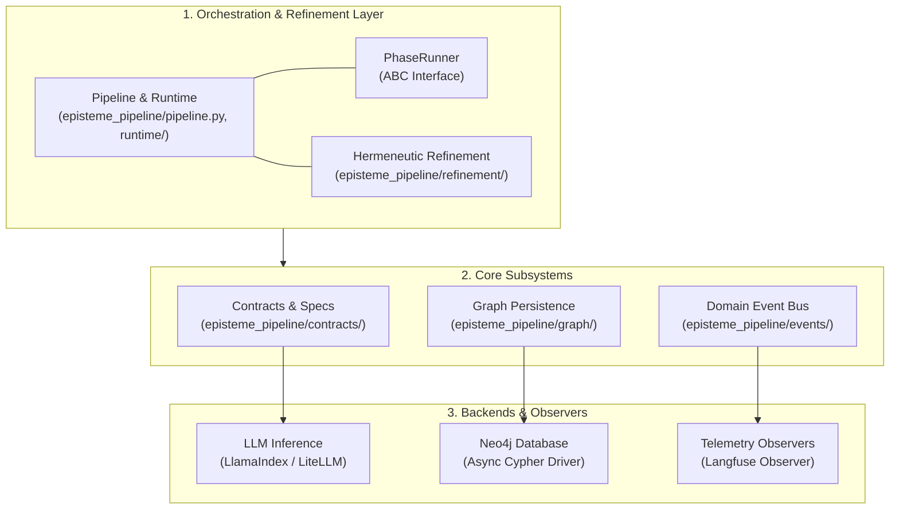
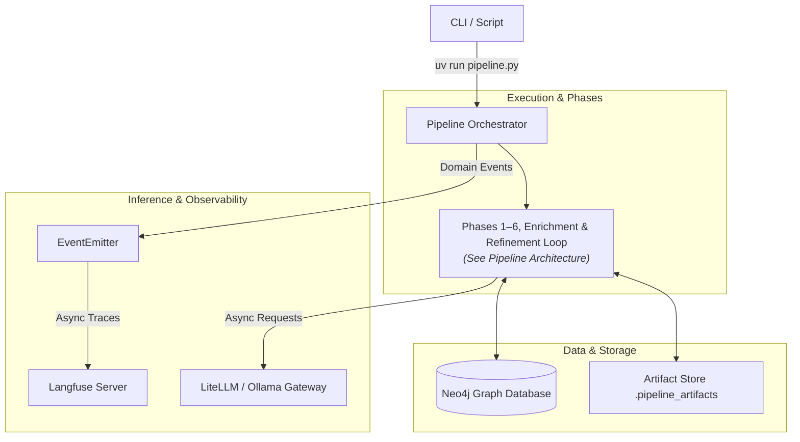

# System Architecture Overview

This document provides an architectural perspective on the **Episteme** codebase. It details the
technical stack, core software layers, subsystem interactions, and cross-cutting concerns.

*For domain concepts, scientific rationale, and phase-by-phase functional breakdowns,
see [Pipeline Architecture](pipeline_architecture.md), [Formal Graph Schema (TheoryNet)](../concepts/formal_graph_model.md), and the [Documentation Index](../index.md).*

---

## Technical Stack & Runtime Specifications

Episteme is built on a **contract-driven, backend-agnostic architecture**. The core construction engine inside `episteme_pipeline/` has zero hard dependencies on specific database vendors, LLM providers, or telemetry platforms. Instead, it relies on **Dependency Injection (DI)** across strictly defined Python `Protocol` interfaces and Pydantic data contracts.

The technologies below are organized into the **agnostic core engine** and the **default reference adapters** provided out-of-the-box for production deployments:

### Core Engine (Agnostic Runtime)

| Component | Technology | Version / Spec | Architectural Role |
|:---|:---|:---|:---|
| **Language & Runtime** | Python | `>= 3.12` | Core execution environment, strict typing, and async protocols |
| **Data Contracts** | Pydantic | `v2.x` | Strictly typed phase contracts, inputs, artifact models, and configs |
| **Package Management** | `uv` | SOTA Cargo-like | Fast dependency resolution & reproducible virtual environments |
| **Testing & Quality** | Pytest + Ruff | Standard suite | Non-LLM deterministic test harness, linting, and formatting |
| **Documentation** | Zensical / MkDocs | Material Theme | Static documentation build & API reference generation |

### Pluggable Subsystems & Reference Adapters (Dependency Injection)

Every external capability is decoupled from business logic via abstract protocols. While Episteme ships with production-grade reference adapters, any component can be swapped by providing a class implementing the respective protocol:

| Subsystem | Core Protocol (Agnostic Contract) | Default Reference Adapter | Capabilities & Role |
|:---|:---|:---|:---|
| **Property Graph** | `GraphReader` / `GraphWriter` | `Neo4jGraphReader` / `Neo4jGraphWriter` | Async Cypher driver, APOC, GDS Leiden clustering, native vector indexing |
| **LLM Inference** | `StructuredLLM` / `BaseLLM` | `LiteLLM` / `LlamaIndex` | Multi-provider router supporting OpenAI, Anthropic, Ollama, vLLM |
| **Embedding Model** | `EmbeddingModel` | `LiteLLMEmbedding` / LlamaIndex | Normalized async text and batch vector embeddings |
| **Reranking & Scoring** | `CrossEncoder` / `RelationReranker` | `SentenceTransformerCrossEncoderReranker` | PyTorch / HuggingFace joint-attention candidate relation scoring |
| **Decision Engine** | `DecisionEngine` | `LayaDecisionEngine` / `MockJevDecisionEngine` | Sub-second System 1 classification, calibrated confidence scoring, conformal prediction sets, and categorical decision gating |
| **Epistemic Quality Gates** | `EpistemicQualityGate` | `OntologyEntropyGate`, `PercolationQualityGate`, `ConformalCalibrationGate` | Inter-phase homeostatic circuit breakers checking entity type entropy, cluster percolation, and conformal OOD rates |
| **Prompt Management** | `PromptProvider` | `LangfusePromptProvider` | Remote prompt versioning, label resolution (`production`), auto-sync (with `DefaultPromptProvider` fallback) |
| **Observability & Tracing** | `EventEmitter` / `Observer` | `LangfuseObserver` | Distributed LLM call tracing, token/cost analysis, latency tracking |

---

## Subsystem & Layered Architecture

The codebase inside `episteme_pipeline/` follows a clean, decoupled layered architecture separating orchestrators, business
logic, persistence, and telemetry observers.

### Orchestration & Refinement Layer (`pipeline.py`, `runtime/`, `refinement/`)

- **`Pipeline`**: High-level facade coordinating composition, declarative topology, optional `deficit_detector` / `refinement_coordinator` overrides (`Pipeline.for_task`), and runtime execution.
- **`PipelineFactory` (`runtime/pipeline_factory.py`)**: Composition root wiring LLMs, embedders, rerankers, `DecisionEngine`, `ModalStrengthResolver`, `EpistemicQualityGate` instances, and (when `config.refinement.max_refinement_cycles > 0`) `ResolvedPipelineComponents.deficit_detector`, `refinement_coordinator`, and shared `enrichment_runner` via `_build_theorynet_projector`, `resolve_components`, and `build_phases`.
- **`WorkflowDAG` (`runtime/workflow_dag.py`)**: Declarative dataflow topology defining `WorkflowNode`s, data dependencies (`reads_kinds`/`writes_kinds`), topological ordering, and bound `EpistemicQualityGate`s.
- **`ArtifactExecutionEngine` (`runtime/execution_engine.py`)**: Executes any `WorkflowDAG` (and post-forward bounded refinement cycles via `_run_refinement_stage()` when `_is_refinement_active()` holds) with manifest fingerprinting, DAG-based cache hydration, inter-phase epistemic quality gate evaluation (`OntologyEntropyGate`, `PercolationQualityGate`, `ConformalCalibrationGate`), batched graph projection, and symmetric lifecycle event emission.
- **`PhaseRunner`**: Abstract base class enforcing a uniform async contract `run(input, context) -> ArtifactCollection` across all pipeline phases.
- **Closed-Loop Hermeneutic Refinement (`episteme_pipeline/refinement/`, `protocols/refinement.py`)**: Implements top-down $\text{L4/L3} \to \text{L2/L1}$ feedback ([ADR 0024](../adr/0024-closed-loop-hermeneutic-refinement.md)) via `TheoryNetDeficitDetector` (`EpistemicDeficitDetector`), `ClosedLoopRefinementCoordinator` (`HermeneuticRefinementCoordinator` / `TargetedRefinementPort`), and strictly localized recovery handlers (`LLMTheoryGuidedPremiseRecoverer`, `ConceptionConceptSplitter`, `TheoryGuidedAxiomGrounder`).

### Domain Contracts & Data Layer (`episteme_pipeline/contracts/`)

- Pure data models (Pydantic v2) defining explicit input/output boundaries for each phase.
- Guarantees strict serialization/deserialization for intermediate file artifacts stored under `.pipeline_artifacts/`.

### Persistence & Graph Layer (`episteme_pipeline/graph/`)

- **`GraphReader` / `GraphWriter`**: Abstract interfaces isolating pipeline business logic from direct database drivers.
- **`Neo4jGraphWriter` / `Neo4jGraphReader`**: Concrete implementations executing parameterised Cypher queries using
  async connections.
- **Dual-Graph Strategy**:
    - *Processing Graph*: Temporary operational nodes tracking chunking state, intermediate extraction status, and
      provenance.
    - *Projection Graph*: Final canonicalized nodes and relationships forming the clean theory graph.

### Domain Event & Telemetry System (`episteme_pipeline/events/`)

- Decouples observability from pipeline execution logic.
- Components emit semantic domain events (e.g., `PhaseCompleted`, `EntityProcessed`, `EpistemicDeficitDetected`, `RefinementCycleStarted`, `RefinementCycleCompleted`, `RunCompleted`)
  via an `EventEmitter`.
- Registered observers (such as `LangfuseObserver`) handle event delivery asynchronously without blocking pipeline
  progress.

### Schema & Vocabulary (`episteme_pipeline/schema/`)

- Enforces entity types, relationship taxonomy, property constraints, and validation rules applied during extraction and
  alignment fusion.

### System 1 Decision Engine Subsystem (`episteme_pipeline/protocols/decision.py`, `episteme_pipeline/decision/`)

- Implements a Dual-Process Neuro-Symbolic Architecture (System 1 fast gating + System 2 generative synthesis).
- Encapsulated via the abstract `DecisionEngine` protocol providing three core primitives: `evaluate_noul` (binary gating), `evaluate_choice` (categorical selection with conformal prediction sets), and `evaluate_score` (ordered scale evaluation).
- Returns strictly typed `DecisionScore` and `DecisionNoulResult` contracts decoupling softmax class probabilities from empirical accuracy calibration.
- Normalised at the composition root (`Pipeline.for_task`) via `ensure_decision_engine`, providing an optional, zero-regression dependency.

---

## Integration Topology

---

## Cross-Cutting Concerns

- **Configuration Management**: Hierarchical parameters configured in `episteme_pipeline/config.py` with CLI overrides.
- **Fault Recovery**: Automatic retry handlers for transient database connections and rate-limited LLM endpoints.
- **LLM Prompt Caching**: Integrated structured prompt responses to optimize execution time and API costs.

---

## Architectural Governance & Engineering Standards

Engineering and architectural decisions made over the evolution of this project are documented in detail in our architecture guides and ADR repository:

- **[Design Patterns, Clean Code & Architectural Standards](design_patterns_and_standards.md)** — Canonical pattern catalog (Hexagonal Ports, Template Method & Batch Executor, Decorator, Calibrated Cascade, Bidirectional Artifact Codec, Stateful Reducers), SOLID rules, and forbidden anti-patterns.
- **[Cross-Cutting Concerns & System Hooks](cross_cutting_concerns.md)** — Caching, fingerprinting, structured logging, event publishing, and observability invariants.
- **[Architecture Decision Records (ADRs)](../adr/index.md)** — Full historical decision index, including:
    - **[ADR 0001](../adr/0001-neo4j-async-graph-backend.md)**: Neo4j Async Graph Backend
    - **[ADR 0005](../adr/0005-two-pass-fusion-strategy.md)**: Two-Pass Fusion Strategy
    - **[ADR 0008](../adr/0008-diataxis-documentation-framework.md)**: Diátaxis Documentation Framework
    - **[ADR 0015](../adr/0015-theoretical-enrichment-and-tenability-evaluation.md)**: Theoretical Enrichment and Tenability Evaluation
    - **[ADR 0016](../adr/0016-phase-3-within-phase-checkpointing-and-atomicity.md)**: Within-Phase Checkpointing and Atomicity
    - **[ADR 0017](../adr/0017-explicit-batch-contracts-and-bulk-io.md)**: Artifact-Native Execution and Explicit Batch Contracts
    - **[ADR 0018](../adr/0018-decision-engine-architecture-and-contracts.md)**: System 1 Calibrated Decision Engine
    - **[ADR 0019](../adr/0019-typesafe-jev-client-and-decision-observability.md)**: TypeSafe Jev Client Implementation and Decision Observability
    - **[ADR 0020](../adr/0020-propositional-modal-strength-resolver.md)**: Propositional Modal Strength Resolver
    - **[ADR 0021](../adr/0021-incremental-corpus-evolution-and-persistent-hitl-constraint-ledger.md)**: Incremental Corpus Evolution & Persistent HITL Constraint Ledger
    - **[ADR 0022](../adr/0022-unified-stratified-epistemic-metamodel.md)**: Unified Stratified Epistemic Metamodel
    - **[ADR 0023](../adr/0023-intensional-perspectival-scoping-and-conception-stratification.md)**: Intensional & Perspectival Scoping and Conception Stratification
    - **[ADR 0024](../adr/0024-closed-loop-hermeneutic-refinement.md)**: Closed-Loop Hermeneutic Refinement

