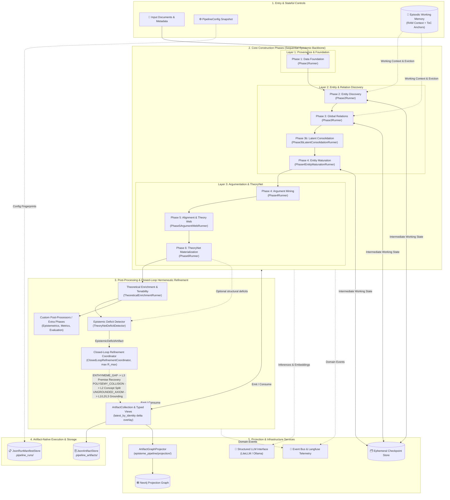
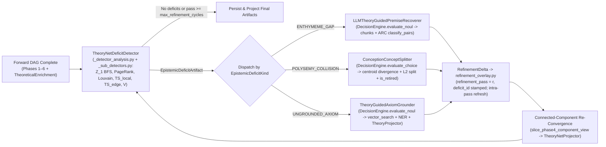
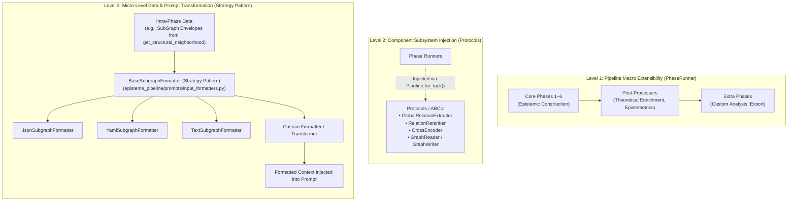

# Pipeline Architecture

The Episteme pipeline implements a **Synergized Bidirectional Reasoning Engine for Scientific Theory Graphs** (grounded
in the roadmap framework of Pan et al., 2024). It combines LLMs and Knowledge Graphs in a mutually beneficial feedback
loop to transform unstructured scientific text into formally structured theory graphs.

*For formal mathematical models, epistemic foundations, and graph definitions, see [Formal Graph Schema & Argumentation Semantics](../concepts/formal_graph_model.md) and [Epistemic Grounding & Dense Alignment](../concepts/dense_alignment.md).*

---

## Architectural Overview

The pipeline follows an event-driven, modular, and artifact-native architecture designed for:

- **Synergized Reasoning**: LLMs extract and canonicalize entities/arguments; the Text-Attributed Graph (TAG) in turn
  conditions and guides global LLM relation extraction and argumentative stance classification.
- **Episodic Working Memory**: Maintains a SOTA Dual-Memory stateful context (Short-Term Memory RAM + Long-Term Memory
  Neo4j Disk) using Global Structural Anchors (ToC) and boundary-based eviction across sequential text chunks.
  See [Episodic Working Memory](../concepts/episodic_working_memory.md) and [ADR 0009](../adr/0009-sota-dual-memory-episodic-working-memory.md).
- **Artifact-Native Orchestration**: Every phase consumes typed artifact views and emits durable, content-addressed
  artifact collections. Execution is completely decoupled from database drivers.
- **Decoupled Graph Projection**: Intermediate outputs are evaluated and stored independently of Neo4j. A dedicated
  projection layer materializes validated artifacts into the final property graph.
- **Multi-Level Extensibility**: Supports macro-level post-processing passes, component-level protocol injection,
  and micro-level prompt/data transformation strategies.
- **Observability & Telemetry**: Domain event bus emitting typed lifecycle events to async observers (e.g., Langfuse).

---

## Core Components & System Topology



---

## Phase-by-Phase Breakdown

The theory-graph construction process is organized into sequential phase runners in [`Pipeline.for_task()`](../reference/pipeline.md):

### Phase 1: Data Foundation (`Phase1Runner`)

- **Input**: [`PipelineInput`](../reference/phase_contracts.md) (source document paths, bibtex paths, structural anchors).
- **Purpose**: Document parsing, adaptive rhetorical chunking, and provenance metadata generation.
- **Key Operations**:
  - Multi-format parsing (PDF, TeX, Markdown).
  - Structure-aware chunking preserving section boundaries (H1/H2 headers) to prevent evidence fragmentation.
  - Bibliography extraction and citation linking.
- **Emitted Artifacts**: [`DocumentArtifact`](../reference/artifacts.md), [`ChunkArtifact`](../reference/artifacts.md).
- **See**: [Phase 1: Data Foundation Workflow](../workflow/1_data_foundation/index.md).

---

### Phase 2: Entity Discovery & Local Relations (`Phase2Runner`)

- **Input View**: `Phase1ArtifactsView` (`documents`, `chunks`).
- **Purpose**: Identify theoretical concepts, assign stable IDs, extract within-chunk local relations, and maintain episodic context.
- **Key Operations**:
  - **Named Entity Recognition (NER)**: Structured LLM extraction guided by CoT structural reasoning.
  - **Episodic Working Memory**: SOTA Dual-Memory stateful context (RAM Short-Term Memory + Neo4j Long-Term Memory) with ToC anchors and boundary-based eviction.
  - **Constrained Decoding**: Enforces ontology schema constraints while preserving reasoning tokens. See [Constrained Decoding Architecture](constrained_decoding.md).
  - **Local Relation Extraction**: Intra-chunk semantic triples with confidence scores.
  - **Entity Linking (`EntityLinker`)**: Calibrated and dense entity linkers (`DenseEntityLinker`, `JevEntityLinker`, `CascadingEntityLinker`) with deterministic `NameEntityLinker` fallback mapping mentions to stable graph IDs.
- **Emitted Artifacts**: [`EntityMentionArtifact`](../reference/artifacts.md), [`LinkedEntityArtifact`](../reference/artifacts.md), [`LocalRelationArtifact`](../reference/artifacts.md).
- **See**: [Phase 2: Entity Discovery Workflow](../workflow/2_entity_discovery/index.md).

---

### Phase 3: Global Relation Discovery (`Phase3Runner`)

- **Input View**: `Phase2ArtifactsView` (`documents`, `chunks`, canonicalized `entities`, `local_triples`, `entity_envelopes_by_id`, type distributions).
- **Purpose**: Discover semantic relationships across distant sections/documents using dense graph retrieval over `ArtifactSubgraphReader`.
- **Key Operations**:
  - **Text-Attributed Graph (TAG) Envelopes**: Constructs rich context envelopes around entity pairs via MIPS bi-encoder retrieval over `input.to_graph_reader()`. Detailed in [Dense Alignment](../concepts/dense_alignment.md).
  - **LLM Relational Reranking**: Evaluates context envelopes via Cross-Encoder joint attention to score cross-chunk triples.
  - **Structural Correspondence (ADR 0007)**: Scores edge admissibility $\kappa$-overlap.
- **Emitted Artifacts**: [`GlobalRelationArtifact`](../reference/artifacts.md).
- **See**: [Phase 3: Relation Extraction Workflow](../workflow/3_relation_extraction/index.md).

---

### Phase 3b: Latent Graph Consolidation (`Phase3bLatentConsolidationRunner`)

- **Input View**: `Phase3ArtifactsView` (cumulative `documents`, `chunks`, `entities`, `local_triples`, `global_triples`, relation distributions).
- **Purpose**: Consolidate duplicate Layer 2 entity nodes using latent topological invariance over `ArtifactSubgraphReader`.
- **Key Operations**:
  - Dense vector similarity matrix over entity textual envelopes (`dense_similarity_threshold`).
  - Topological relation overlap via Jaccard similarity ($J(A, B)$) over 1-hop edge signatures (`IN:rel:id`, `OUT:rel:id`).
  - Clique-constrained complete-linkage clustering (with diameter and internal similarity floor bounds) to merge duplicate entity pairs and elect canonical nodes with maximal source grounding.
- **Emitted Artifacts**: [`CanonicalizationArtifact`](../reference/artifacts.md).
- **See**: [Phase 3b Consolidation Workflow](../workflow/3b_consolidation/index.md).

---

### Phase 4: Entity Maturation (`Phase4EntityMaturationRunner`)

- **Input View**: `Phase3ArtifactsView` (with Phase 3b `CanonicalizationArtifact` merges applied to `entities` and `entity_envelopes_by_id`).
- **Purpose**: Resolve entity-level epistemic drift across continuous extraction.
- **Key Operations**:
  - **Epistemic Centroid Calculation**: Computes geometric centroid $C = \frac{1}{N} \sum E_{\text{ctx}}(T_i)$ of accumulated empirical envelopes from `input.entity_envelopes_by_id`.
  - **Batch Epistemic Synthesis**: Synthesizes canonical descriptions to eliminate description mutation drift. Detailed in [Dense Alignment & Maturation](../concepts/dense_alignment.md#24-two-stage-entity-maturation-protocol).
- **Emitted Artifacts**: Updated [`LinkedEntityArtifact`](../reference/artifacts.md) payloads (`is_mature=True`) that supersede raw Phase 2 entities via `ArtifactCollection` identity-key resolution.
- **See**: [Phase 4: Entity Maturation Workflow](../workflow/4_entity_maturation/index.md).

---

### Phase 4: Argument Mining (`Phase4Runner`)

- **Input View**: `Phase3ArtifactsView` (containing consolidated and matured `entities`, `chunks`, `local_triples`, and `global_triples`).
- **Purpose**: Extract Layer 3 bipolar argumentation structures from the corpus.
- **Key Operations**:
  - **ADU Segmentation (`LLMADUSegmenter`)**: Identifies Argumentative Discourse Units and segments text spans for classification.
  - **Component Classification (`LLMACCClassifier` / `JevACCClassifier` / `CascadingACCClassifier`)**: Assigns argumentative roles, intensional modes ([ADR-0023](../adr/0023-intensional-perspectival-scoping-and-conception-stratification.md)), and epistemic statuses (`TheoryAtom`) grounded in matured canonical chunk entities via `ArtifactSubgraphReader`.
  - **Relation Classification (`TAGARCClassifier` / `JevARCClassifier` / `CascadingARCClassifier`)**: Classifies defeasible support, attack, and undercut relations (`TheoryRelation`: `SUPPORTS_ARG`, `ATTACKS`, `UNDERCUTS`).
- **Emitted Artifacts**: [`TheoryAtomArtifact`](../reference/artifacts.md), [`TheoryRelationArtifact`](../reference/artifacts.md).
- **See**: [Phase 4: Argument Mining Workflow](../workflow/4_argument_mining/index.md).

---

### Phase 5: Alignment & Theory Web (`Phase5ArgumentWebRunner`)

- **Input View**: `Phase4ArtifactsView` (cumulative L1/L2/L3 state: `theory_atoms`, `theory_relations`, `entities`, `chunks`, `local_triples`, `global_triples`).
- **Purpose**: Cluster semantically equivalent argument components across documents and detect theory-level graph communities.
- **Key Operations**:
  - **Argument Component Clustering (`EmbeddingArgumentClustering`)**: Computes dense vector embeddings of argument components and merges equivalent claims via clique-constrained complete-linkage clustering (preventing non-transitive single-linkage chaining) for Key Point Analysis.
  - **Leiden Theory Clustering (`LeidenTheoryClustering`)**: Builds a global graph of entities and argument relations via `ArtifactSubgraphReader`, applies modularity optimization via Hierarchical Leiden community detection, and assigns theoretical community affiliations.
- **Emitted Artifacts**: [`FusionDecisionArtifact`](../reference/artifacts.md).
- **See**: [Phase 5 Workflow](../workflow/5_inter_document_argument_web/index.md).

---

### Phase 6: TheoryNet Materialization (`Phase6Runner`)

- **Input View**: `Phase5ArtifactsView` (`canonical_theory_atoms`, `canonical_theory_relations` with Phase 5 `FusionDecisionArtifact` cluster merges applied).
- **Purpose**: Formalize canonical argument components and relations into the Stratified Epistemic State Tuple ([ADR-0022](../adr/0022-unified-stratified-epistemic-metamodel.md)), solve continuous D-QBAF gradual semantics ([ADR-0011 Addendum 2](../adr/0011-declarative-graph-metrics-and-qbaf-semantics.md)), and calculate baseline empirical content.
- **Key Operations**:
  - Resolves node-intrinsic propositional modal priors $\tau_0(a) \equiv M(\phi_a) \in [0, 1]$ (`modal_prior` / `modal_strength`) via `HybridModalResolver` ([ADR-0020](../adr/0020-propositional-modal-strength-resolver.md)), strictly decoupled from edge-intrinsic Toulminian inferential warrants $I_{j \to i} \in [0, 1]$ (`inferential_warrant` / `inferential_force`).
  - Evaluates continuous D-QBAF gradual epistemic semantics (closed-form topological pass on DAGs; adaptive `RK45`/`Radau` ODE integration on cyclic graphs) from tenability-modulated prior $\tilde{\tau}_0(a) = \tau_0(a) \cdot TS_{\text{local}}(a)$ to equilibrium justification degree $\tau^*(a)$ (`equilibrium_strength` / `plausibility`) and controversy volatility $\mathcal{V}(a)$.
  - Calculates empirical content ratio of theoretical antecedents to empirical observation base ($B \cap P$).
- **Emitted Artifacts**: Updated [`TheoryAtomArtifact`](../reference/artifacts.md) and [`TheoryRelationArtifact`](../reference/artifacts.md) envelopes with converged equilibrium justification scores.
- **See**: [Formal Graph Schema & Argumentation Semantics](../concepts/formal_graph_model.md), [ADR-0022: Unified Stratified Epistemic Metamodel](../adr/0022-unified-stratified-epistemic-metamodel.md).

---

## Post-Processing & Analytical Passes

Beyond core graph construction (Phases 1–6), modular post-processors can be attached via `Pipeline.for_task(..., post_processors=[...])` or enabled in `PipelineConfig`:

### Theoretical Enrichment & Tenability Evaluation (`TheoreticalEnrichmentRunner`)

- **Input View**: `Phase5ArtifactsView` (consuming `canonical_theory_atoms` and `canonical_theory_relations`).
- **Purpose**: Execute the structuralist dual-enrichment architecture ($\Phi = \Phi_{\text{spec}} \circ \Phi_{\text{gen}}$) and close the empirical tenability feedback loop into D-QBAF equilibrium justification $\tau^*$.
- **Key Operations**:
  - Maps empirical clusters to Intended Applications ($I \subseteq M_{pp}$).
  - Applies domain-specific lenses ($\Phi_{\text{spec}}$).
  - Calculates local tenability ($TS_{\text{local}} = \sup \{ 1 - \delta \}$).
  - Evaluates cross-theory constraint edges ($TS_{\text{edge}}$), flagging untenable anomalies ($TS < 0.5$).
  - Executes a coupled D-QBAF re-convergence pass over tenability-modulated priors $\tilde{\tau}_0(a) = \tau_0(a) \cdot TS_{\text{local}}(a)$ and edge weights $W_{ji} \cdot TS_{\text{edge}}(e)$ so empirically falsified hypotheses ($TS_{\text{local}} < 0.5$) reflect degraded equilibrium justification $\tau^*(a)$.
- **Emitted Artifacts**: [`TheoreticalEnrichmentArtifact`](../reference/artifacts.md) (postulated theoretical parameters, $TS_{\text{local}}$, $TS_{\text{edge}}$, equilibrium strengths $\tau^*$, admissible blurs $\delta^*$), re-converged [`TheoryAtomArtifact`](../reference/artifacts.md) / [`TheoryRelationArtifact`](../reference/artifacts.md) envelopes, and optional [`EpistemicDeficitArtifact`](../reference/artifacts.md) signals when configured with `EpistemicDeficitDetector`.
- **Governed by**: [ADR 0015](../adr/0015-theoretical-enrichment-and-tenability-evaluation.md), [ADR 0022](../adr/0022-unified-stratified-epistemic-metamodel.md), and documented in [Theoretical Enrichment Workflow](../workflow/post_processing/theoretical_enrichment.md).

---

## Closed-Loop Hermeneutic Refinement ($\text{L4/L3} \to \text{L2/L1}$)

When `HermeneuticRefinementConfig.max_refinement_cycles > 0` (`PipelineConfig.refinement`), the pipeline closes the macro-architectural feedback loop envisaged by Pan et al. (2024) ([ADR 0024](../adr/0024-closed-loop-hermeneutic-refinement.md)) without introducing cycles into `WorkflowDAG`:



### Deficit Taxonomy & Localized Recovery (`episteme_pipeline/refinement/`)

| Deficit Kind | Detector Criteria (`TheoryNetDeficitDetector`) | Localized Handler (`protocols/refinement.py`) | Subgraph Scope & Guards |
|:---|:---|:---|:---|
| `ENTHYMEME_GAP` | `SchemaConfig`-partitioned `A`-atom (`utils/graph_algorithms.compute_z1_grounding`) with `epistemetrics.page_rank` $\ge$ `enthymeme_min_centrality` and `in_support_degree == 0` or broken $Z_1$ path when Partition-`B` bases exist | `LLMTheoryGuidedPremiseRecoverer` (`premise_recovery.py`) | System 1 `DecisionEngine.evaluate_noul` gate + audit; re-reads only `target_chunk_ids` with centralized prompt bundle; preserves [ADR-0023](../adr/0023-intensional-perspectival-scoping-and-conception-stratification.md) scoping; resolves entities (`EntityLinker` + `EpistemicCurationLedger`) & `modal_prior` (`HybridModalResolver`); runs shared `CascadingARCClassifier.classify_pairs` on local pairs |
| `POLYSEMY_COLLISION` | `L2Entity` or `TheoryAtom` bridging incompatible clusters, `louvain_communities`, `EntityConception`s, ambiguity cues, or conflicting edges (`SchemaConfig.get_relation_polarity`) with $\mathcal{V} \ge 0.25$ or $TS_{\text{edge}} < 0.5$ | `ConceptionConceptSplitter` (`concept_splitter.py`) | System 1 `DecisionEngine.evaluate_choice` conformal triage gate (`UNIVOCAL_DISAGREEMENT` vs `TRUE_POLYSEMY_SPLIT`); scopes strictly to deficit entities; checks real `EmbeddingModel` centroid cosine divergence (`utils/similarity.cosine_similarity`); retires split parent entities/mentions (`retired_entity_ids`, `split_entity_parents`); emits `cannot_link_pairs`; rewires local triples/atoms & runs Phase 3 pair filtering |
| `UNGROUNDED_AXIOM` | Failing `TheoreticalEnrichmentArtifact` ($TS_{\text{local}} < 0.5$, `is_tenable == False`, missing $M_{pp}$ dimensions) or `A`-atom lacking $Z_1$ empirical base in cluster | `TheoryGuidedAxiomGrounder` (`axiom_grounder.py`) | System 1 `DecisionEngine.evaluate_noul` gate + audit; expands locally (`sequence_index ± neighbor_window` + bounded `ArtifactSubgraphReader.vector_search`); invokes shared `NERExtractor`, centralized prompt bundle, `EntityLinker`, `HybridModalResolver`, and `TheoryProjector` |

### Refinement Configuration & Overlay Architecture

Configured on `PipelineConfig.refinement` (`HermeneuticRefinementConfig` in `episteme_pipeline/config.py`), orchestrated by `ClosedLoopRefinementCoordinator` (`coordinator.py`) over `artifacts/refinement_overlay.py` (`slice_phase4_component_view`, pass-aware `ArtifactDependencyGraph`, and intra-pass working overlay refresh):

- `max_refinement_cycles: int = 0` (`0..5`; `0` preserves strictly feed-forward runs with unchanged manifest & prompt fingerprints)
- Central prompt bundles & strategies: `concept_split_prompts`, `premise_recovery_prompts`, `axiom_grounding_prompts` (registered in `DefaultPromptProvider`, `LangfusePromptProvider`, `FilePromptProvider`)
- System 1 gating & triage: `use_decision_engine_gating: bool = True`, `decision_confidence_threshold: float = 0.70`, `conformal_alpha: float = 0.10`, `stochastic_audit_rate: float = 0.05`, `polysemy_ambiguity_similarity_threshold: float = 0.82`
- Detection thresholds & caps: `enthymeme_min_centrality: float = 0.0`, `polysemy_edge_tenability_threshold: float = 0.5`, `polysemy_volatility_threshold: float = 0.25`, `ungrounded_local_tenability_threshold: float = 0.5`, `max_deficits_per_cycle: int = 20`
- Enable flags: `enable_theory_guided_premise_recovery`, `enable_targeted_concept_split`, `enable_localized_axiom_grounding` (plus `ExecutionConfig.persist_refinement_artifacts = True`).
- Detailed specification & scoring formulas: [Deficit Graph Analysis & Hermeneutic Refinement](../workflow/post_processing/hermeneutic_refinement.md) and [Refinement API Reference](../reference/refinement.md).

---

## Extensibility & Data Transformation Architecture

The pipeline distinguishes between three distinct architectural levels of extensibility:



### Level 1: Macro Extensibility (`PhaseRunner`, `WorkflowDAG`, & `EpistemicQualityGate`)

- **Declarative Orchestration Trio (`runtime/`)**:
  - **`PipelineFactory`**: Composition root that normalizes LLMs, embedders, rerankers, `DecisionEngine`, `ModalStrengthResolver`, `EpistemicQualityGate`s, and (when `config.refinement.max_refinement_cycles > 0`) wires `ResolvedPipelineComponents.deficit_detector`, `refinement_coordinator`, and shared `enrichment_runner` via `_build_theorynet_projector`, `resolve_components`, `build_phases`, and `create_for_task`.
  - **`WorkflowDAG`**: Declarative topology graph resolving `WorkflowNode` dataflow dependencies (`reads_kinds` / `writes_kinds`), topological ordering, and per-phase quality gate bindings. Supports both linear pipelines and multi-branch research workflows.
  - **`ArtifactExecutionEngine`**: Executes any `WorkflowDAG` and, when `_is_refinement_active()` holds (`refinement_coordinator` wired and `config.refinement.max_refinement_cycles > 0`), runs `_run_refinement_stage()` (`ClosedLoopRefinementCoordinator.refine(...)`) after the forward DAG loop, persists newly emitted artifacts, records `ArtifactReportEntry`s via `_record_new_artifacts_in_report()`, and preserves manifest fingerprints identically when `max_refinement_cycles == 0`.
  - **`Pipeline` Facade (`pipeline.py`)**: Accepts and forwards optional `deficit_detector` and `refinement_coordinator` parameters on `Pipeline.__init__` and `Pipeline.for_task(...)`, constructing a standalone deterministic `ClosedLoopRefinementCoordinator` when `max_refinement_cycles > 0`.
- **Inter-Phase Epistemic Quality Gates (`protocols/quality_gate.py`, `runtime/quality_gates.py`)**:
  - **`OntologyEntropyGate` (Post-Phase 2)**: Verifies Shannon entropy $H(\text{entity\_types}) \ge H_{\min}$, bounds single-type dominance ratio, and checks non-empty chunk entity density.
  - **`PercolationQualityGate` (Post-Phase 3b & Phase 5)**: Verifies that the largest merged equivalence class does not exceed $\rho_{\max} \cdot |E|$, preventing giant-component percolation collapse.
  - **`ConformalCalibrationGate` (Post-Phase 3 & Phase 4)**: Monitors empirical rates of empty ($|C(X)| = 0$) and ambiguous ($|C(X)| > 1$) conformal prediction sets, emitting a `QualityGateWarning` or halting with `QualityGateViolationError` before corrupted artifacts are persisted or projected.
- **Interface**: All phases and post-processors implement the uniform async [`PhaseRunner`](../reference/pipeline.md) protocol:
  ```python
  async def run(
      self, input: ViewT, context: ArtifactExecutionContext
  ) -> ArtifactCollection: ...
  ```
- **Phases vs. Post-Processors**:
  - **Core Phases (Phases 1–6)** form the sequential epistemic construction backbone: each stage depends on the ontology constructed by preceding stages.
  - **Post-Processors** (e.g., `TheoreticalEnrichmentRunner`, standalone Epistemetrics evaluation) run *after* core construction. They inspect, enrich, or score the synthesized graph without altering foundational entity/relation boundaries.
  - **Ordering Rules**: In `Pipeline.for_task(...)`, `post_processors` and `extra_phases` are appended after Phase 6. When instantiating `Pipeline(phases=[...])` directly, runners can be arranged in any order, provided each runner's declared `input_view` is satisfied by the accumulated `ArtifactCollection`.

### Level 2: Component Subsystem Injection (Protocols)

Rather than hardcoding algorithms into phase runners, subsystem behaviors are defined as abstract protocols in `episteme_pipeline/protocols/`:
- **`GlobalRelationExtractor`**: Retrieval and candidate pair scoring (`DenseRetrievalGlobalRelationExtractor`, `TAGRelationExtractor`).
- **`RelationReranker` & `CrossEncoder`**: Joint-attention scoring for relation candidates (`CrossEncoderRelationReranker`).
- **`GraphReader` & `GraphWriter`**: Isolates storage operations from graph business logic.
- **`EmbeddingModel`**: Normalized embedding interface supporting LlamaIndex, sentence-transformers, or custom embedding providers.
- **`EpistemicDeficitDetector` & Refinement Ports (`protocols/refinement.py`, `refinement/`)**: Top-down deficit detection (`TheoryNetDeficitDetector`), coordinator (`ClosedLoopRefinementCoordinator` implementing `HermeneuticRefinementCoordinator` and `TargetedRefinementPort`), and localized recovery ports (`LLMTheoryGuidedPremiseRecoverer`, `ConceptionConceptSplitter`, `TheoryGuidedAxiomGrounder`).

These components are injected at composition time via `Pipeline.for_task(...)`, allowing alternative retrieval, reranking, or refinement strategies to be swapped without modifying phase runners.

### Level 3: Micro-Level Data Transformation & Strategy Pattern

When data within a phase needs to be transformed before consumption (for example, converting a `get_structural_neighborhood()` subgraph envelope into a specialized prompt representation), this is handled via the **Strategy Pattern** in `episteme_pipeline/prompts/input_formatters.py`:

- **`BaseSubgraphFormatter`**: Abstract strategy defining:
  ```python
  class BaseSubgraphFormatter(ABC):
      @abstractmethod
      def format(
          self, env_a: SubGraph, env_b: SubGraph, include_description: bool = True
      ) -> str: ...
  ```
- **Built-in Strategies**:
  - `JsonSubgraphFormatter`: Structured JSON serialization (recommended for modern LLMs).
  - `YamlSubgraphFormatter`: YAML representation minimizing token overhead.
  - `TextSubgraphFormatter`: Human-readable plain text block.
- **Custom Transformers**: Custom formatting logic (e.g., converting graph neighborhoods into natural language narratives, Cypher path lists, or mindmaps) is implemented by subclassing `BaseSubgraphFormatter` and selecting it via `InputFormatStrategy`.

---

## Data Flow & Artifact Lifecycle

### Artifact Management

All phase outputs are persisted as typed research artifacts:
- **Storage**: [`JsonArtifactStore`](../reference/artifacts.md) writes envelopes under `.pipeline_artifacts/<run_id>/<kind>/<id>.json`.
- **Versioning & Identity**: Dual-identifier system (`artifact_id` for instance lineage, `identity_key` for cross-run semantic matching).
- **Lineage & Hydration**: When resuming or reusing phases, `ArtifactExecutionEngine.hydrate_previous_collection()` walks the parent run chain (`parent_run_id`), hydrating nearest-run artifacts so downstream phases receive a complete artifact collection without recomputation.
- **Incremental Intra-Phase Delta Hydration**: When extending a corpus ($\mathcal{D}_{t+1} = \mathcal{D}_t \cup \Delta D$), [`ArtifactHydrator`](../reference/artifacts.md) and [`IncrementalRetentionScope`](../reference/artifacts.md) compare per-document fingerprints (`document_fingerprints`), hydrating unchanged document and chunk artifacts and evaluating only delta items across Phases 1–4.
- **Persistent Epistemic Curation**: [`EpistemicCurationLedger`](../reference/phase_contracts.md) applies expert human constraints (relation overrides, rejections, polarity corrections, `cannot_link` pairs, and edge injections) directly to triple streams and theory relations before projection.

### Decoupled Graph Projection

Phases have no direct write dependencies on the final projection graph:
- **Artifact Projection**: When `config.execution.project_artifacts_to_graph` is enabled, [`ArtifactGraphProjector`](../../packages/episteme-pipeline/episteme_pipeline/projection/artifact_projector.py) maps emitted artifacts into Neo4j nodes and edges.
- **Dual Graph Architecture**:
  - *Checkpoint Store (Operational Graph)*: Temporary graph tracking extraction working state, co-occurrence blocking, and episodic memory.
  - *Projection Graph*: Final canonical property graph holding the clean, validated theory graph.

---

## Performance & Asymptotic Complexity

For a rigorous asymptotic complexity analysis across all phases, candidate bounding constants $K$, and small-corpus overhead mitigations, see [Pipeline Runtime Analysis](runtime_analysis.md).

### Key Performance Considerations

- **Parallelization**: Chunk-level parallelism within phases and bounded candidate evaluation.
- **Caching**: LLM response caching via `DiskCachedStructuredLLM` and content-addressed artifact reuse.
- **Memory Management**: Streaming document ingestion and episodic working memory eviction.

---

## Related Documentation

- **Artifact and Run Model**: [Artifact and Run Model](artifact_run_model.md)
- **Invalidation and Resume**: [Invalidation and Resume](invalidation_and_resume.md)
- **Graph Projection**: [Graph Projection & Decoupling](artifact_run_model.md#graph-projection-decoupling)
- **System Overview**: [System Architecture Overview](overview.md)
- **Runtime Analysis**: [Pipeline Runtime Analysis](runtime_analysis.md)
- **ADRs**: [Architectural Decision Records](../adr/index.md), [ADR 0024: Closed-Loop Hermeneutic Refinement](../adr/0024-closed-loop-hermeneutic-refinement.md)
