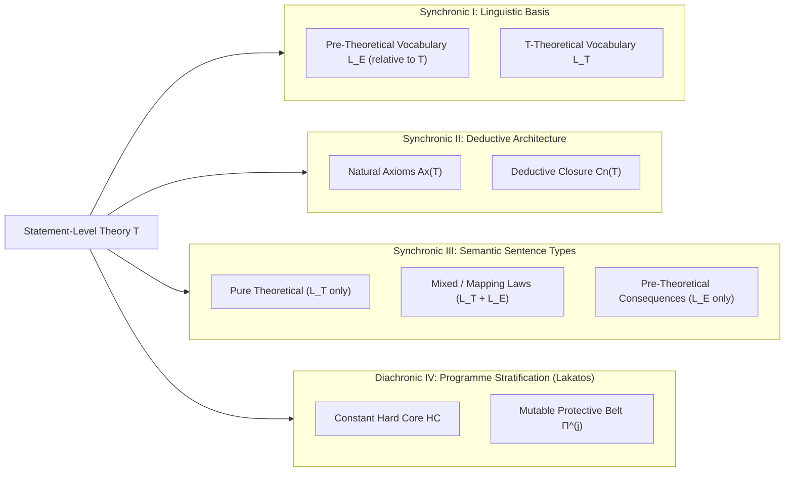

# Epistemology & Philosophy of Science

This document establishes the philosophical and metatheoretical foundations that inform the design and evaluation criteria of **Episteme**. It synthesizes work from formal philosophy of science ([Schurz, 2014](references.md#schurz-2014)), the methodology of scientific research programmes ([Lakatos, 1970](references.md#lakatos-1970), [1971](references.md#lakatos-1971), [1978](references.md#lakatos-1978)), structuralist metascience ([Sneed, 1971](references.md#sneed-1971); [Stegmüller, 1976](references.md#stegmuller-1976); [Balzer, Moulines, & Sneed, 1987](references.md#balzer-1987)), and explanatory coherence ([Thagard, 1989](references.md#thagard-1989), [1992](references.md#thagard-1992)). All formal symbols follow the [Canonical Notation & Symbol Reference](notation.md); all bibliographic citations resolve to the [Consolidated References & Bibliography](references.md).

---

## 1. Scope and Domain of Epistemic Criteria

A central methodological requirement for an interdisciplinary system spanning empirical science and philosophy is **avoiding covert verificationism**. Episteme therefore scopes its evaluative apparatus explicitly by domain:

1. **Empirical-Scientific Corpora (Primary Scope of §§2–4):** Criteria defined over empirical content $E_{\text{emp}}(\cdot) := \operatorname{Cn}(\cdot) \cap L_E$ — namely empirical creativity, novel predictive success, comparative empirical progress, axiomatic homogeneity, and Lakatosian degeneration — apply strictly to **empirical theories** equipped with a $T$-non-theoretical empirical sub-language $L_E$.
2. **Normative & Philosophical Corpora (Domain-Generalized Evidential Base):** Layer 1–3 graph construction and D-QBAF dialectical evaluation (see [Formal Graph Schema](formal_graph_model.md)) are domain-general. For normative, conceptual, or philosophical theories (e.g., Kantian deontology vs. utilitarianism), the evidential base $B \subseteq \mathcal{A}$ generalizes — as an explicit, qualified analogy — to domain-appropriate starting points such as **considered moral judgments, conceptual intuitions, or textual cases** evaluated via **reflective equilibrium** ([Goodman, 1955](references.md#goodman-1955); [Rawls, 1971](references.md#rawls-1971); [Daniels, 1979](references.md#daniels-1979)). Applying Lakatosian progressiveness or empirical-content ratios directly to ethics or metaphysics is a contested metatheoretical analogy, not an established empirical decision procedure, and non-empirical philosophical principles are never dismissed as meaningless or defective merely for lacking observational consequences.

---

## 2. Methodological Criteria for Empirical Theories

In formal philosophy of science (*Wissenschaftstheorie*), an isolated theoretical principle (such as Newton's second law $F = m \cdot a$) generates no testable empirical consequences on its own. Empirical testability and explanatory power emerge only when theoretical principles interact systematically with auxiliary laws, boundary conditions, and mapping laws ([Schurz, 2014](references.md#schurz-2014), ch. 5).

Throughout this section, let $L$ be the formal language of an empirical theory partitioned into its pre-theoretical vocabulary $L_E$ and $T$-theoretical vocabulary $L_T$, let $\operatorname{Cn}(X) = \{\varphi \in L : X \vdash \varphi\}$ denote **classical deductive (Tarskian) consequence**, and let $E_{\text{emp}}(X) := \operatorname{Cn}(X) \cap L_E$ denote the **empirical content** of sentence set $X$.

!!! note "Note on Deductive vs. Probabilistic Consequence.""

    $\operatorname{Cn}$ is strictly deductive (reflexive, monotone, idempotent, and closed under conjunction). High-probability consequence is *not* closed under conjunction — as demonstrated by the lottery paradox ([Kyburg, 1961](references.md#kyburg-1961)) — so folding probabilistic entailment into $\operatorname{Cn}$ would invalidate the closure-based definitions of empirical creativity, homogeneity, and ad-hoc accommodation below. Inductive and probabilistic support is instead modeled separately via graded inferential warrant weights $\mathcal{I} \in [0, 1]$ in Layer 3 (see [Formal Graph Schema](formal_graph_model.md#32-formal-definition-of-the-bipartite-d-qbaf-mathcalq)).

### 2.1 System Character and Empirical Creativity

Two or more theoretical hypotheses combined in a system exhibit **empirical creativity** (*empirische Kreativität*; [Schurz, 2014](references.md#schurz-2014), ch. 5) when their conjunction yields empirical consequences that are not already deductively entailed by the union of their separate empirical contents:

$$
H_1 \wedge H_2 \text{ is empirically creative} \iff E_{\text{emp}}(H_1 \wedge H_2) \supsetneq \operatorname{Cn}\bigl(E_{\text{emp}}(H_1) \cup E_{\text{emp}}(H_2)\bigr) \cap L_E,
$$

equivalently, $\exists e \in L_E$ such that $H_1 \wedge H_2 \vdash e$ while $E_{\text{emp}}(H_1) \cup E_{\text{emp}}(H_2) \nvdash e$.

Comparing $E_{\text{emp}}(H_1 \wedge H_2)$ against the *deductive closure* $\operatorname{Cn}(E_{\text{emp}}(H_1) \cup E_{\text{emp}}(H_2)) \cap L_E$ rather than the bare set union $E_{\text{emp}}(H_1) \cup E_{\text{emp}}(H_2)$ is mathematically essential. Because $E_{\text{emp}}(\cdot)$ is closed under conjunction, any two independent empirical hypotheses with $e_1 \in E_{\text{emp}}(H_1) \setminus \operatorname{Cn}(E_{\text{emp}}(H_2))$ and $e_2 \in E_{\text{emp}}(H_2) \setminus \operatorname{Cn}(E_{\text{emp}}(H_1))$ satisfy $e_1 \wedge e_2 \in E_{\text{emp}}(H_1 \wedge H_2) \setminus (E_{\text{emp}}(H_1) \cup E_{\text{emp}}(H_2))$; using bare set union would falsely classify arbitrary tacked conjunctions (§2.5) as creative.

### 2.2 Explanatory Unification

**Explanatory unification** (*Vereinheitlichungsleistung*; [Friedman, 1974](references.md#friedman-1974); [Kitcher, 1981](references.md#kitcher-1981), [1989](references.md#kitcher-1989); [Schurz & Lambert, 1994](references.md#schurz-1994); [Schurz, 2014](references.md#schurz-2014)) is the capacity of a compact set of overarching principles or argument patterns to derive qualitatively disparate regularities through a single theoretical mechanism — for example, Newtonian mechanics unifying Kepler's planetary laws, Galileo's free-fall law, and tidal phenomena.

Unification is a **structural-explanatory virtue** distinct from temporal novelty: it can be fully achieved over *already known* regularities. Because unifying across *diverse* domains differs from repeatedly deriving similar facts within one narrow cluster, raw node out-degree is an inadequate proxy for unification; graph-level operationalization instead requires diversity-sensitive measures such as the **participation coefficient** across empirical communities ([Guimerà & Amaral, 2005](references.md#guimera-2005)) or the number of distinct application domains reached (see [Theory-Nets, Posets & Topologies](theory_nets_and_topologies.md#5-topological-node-centrality)).

### 2.3 Novel Predictive Success

Distinct from synchronic unification is **novel predictive success** ([Lakatos, 1970](references.md#lakatos-1970); [Zahar, 1973](references.md#zahar-1973); [Worrall, 1985](references.md#worrall-1985)): deriving empirical phenomena that are either *temporally novel* (not observed prior to the theory's formulation) or *use-novel* (not used in constructing or tuning the theory's parameters). Canonical examples from Newtonian mechanics include Halley's prediction of the 1758/59 return of Halley's comet, the oblateness of the Earth, and Leverrier and Adams's prediction of Neptune (1846). Evaluating diachronic progressiveness (§4) strictly distinguishes corroborated novel predictions ($\mathsf{Succ}^{\text{nov}}$) from post-hoc accommodated explanations ($\mathsf{Succ}^{\text{acc}}$).

### 2.4 Holism of Testing vs. Holism of Meaning, and Comparative Empirical Success

Two conceptually and historically distinct holistic theses must be kept separate:

1. **Holism of Theory Testing (Duhem's Thesis):** Because testable empirical consequences follow only from the conjunction of core theoretical laws, mapping laws, and auxiliary assumptions, a falsifying observation refutes via *Modus Tollens* only the conjunction as a whole — never singling out which constituent premise is false ([Duhem, 1906](references.md#duhem-1906)). Duhem formulated this logical thesis strictly for physics and was **not** a meaning holist. Testing holism follows directly from the systemic structure of empirical content (§2.1) without presupposing any semantic thesis.
2. **Global Testing Holism and Meaning Holism (Quine–Neurath):** [Quine (1951)](references.md#quine-1951) (echoing [Neurath, 1932/1933](references.md#neurath-1932)) generalized testing holism to the entire "web of belief" and combined it with the independent, far stronger thesis of **meaning holism** — that the semantic content of a theoretical term depends on its entire surrounding network of laws (see [Fodor & Lepore, 1992](references.md#fodor-1992) for critical analysis). Meaning holism does *not* entail testing holism; rather, testing holism stands independently on logical grounds.

**Normative Comparative Empirical Success ($\succ_{\text{emp}}$).** Because theoretical axioms cannot be tested in isolation, empirical theories are compared holistically over their sets of corroborated empirical successes $\mathsf{Succ}(T)$ and empirical failures $\mathsf{Fail}(T)$. Following [Schurz (2014, ch. 5)](references.md#schurz-2014) and [Kuipers (2000)](references.md#kuipers-2000), theory $T_1$ is **empirically more successful** than $T_2$ ($T_1 \succ_{\text{emp}} T_2$) iff:

$$
T_1 \succ_{\text{emp}} T_2 \iff \mathsf{Succ}(T_2) \subseteq \mathsf{Succ}(T_1) \;\wedge\; \mathsf{Fail}(T_1) \subseteq \mathsf{Fail}(T_2) \;\wedge\; \bigl(\mathsf{Succ}(T_2) \subsetneq \mathsf{Succ}(T_1) \;\vee\; \mathsf{Fail}(T_1) \subsetneq \mathsf{Fail}(T_2)\bigr).
$$

This relation defines a **strict partial order** (irreflexive and transitive) covering both strict expansion of successes at equal failure sets and strict reduction of failures at equal success sets. Two caveats apply:

- **Shared individuation & incommensurability:** Comparing $\mathsf{Succ}(T_1)$ and $\mathsf{Succ}(T_2)$ by set inclusion presupposes a common individuation of empirical phenomena across $T_1$ and $T_2$ — precisely what Kuhn's taxonomic incommensurability challenges across radical paradigm shifts ([Kuhn, 1983](references.md#kuhn-1983), [2000](references.md#kuhn-2000); see [KG vs. Theory Graphs](kg_vs_tg.md#4-epistemic-and-construction-challenges)).
- **Normative order vs. cardinality proxies:** Set inclusion $\succ_{\text{emp}}$ is the *normative* comparative standard. Scalar cardinality indices (such as the degeneration proxy in §4.2) are explicitly **heuristic proxies** whose values depend on how phenomena are individuated and weighted equally. Moreover, greater empirical success is an empirical criterion; overall rationality of theory choice may also weigh theoretical virtues such as simplicity, coherence, and heuristic fertility.

### 2.5 Homogeneity vs. The Tacking Problem (*Klebeparadoxon*)

In confirmation theory, the **tacking problem** (irrelevant conjunction) arises because if observation $e$ hypothetico-deductively confirms hypothesis $T$, then $e$ equally confirms $T \wedge X$ for any unrelated sentence $X$ ([Glymour, 1980](references.md#glymour-1980); [Fitelson, 2002](references.md#fitelson-2002)). A closely related content-inflation problem arises for Popperian boldness — Popper's demand for high empirical content and low prior probability ([Popper, 1959](references.md#popper-1959), §15): taking a well-confirmed physical theory $T$ and conjoining an unrelated but empirically testable generalization $X$ (e.g., *"all ravens are black"*) strictly increases empirical content ($E_{\text{emp}}(T \wedge X) \supsetneq E_{\text{emp}}(T)$) through mere conjunctive padding. (By contrast, a purely existential claim such as *"telepathy exists"* is unfalsifiable in Popper's sense and adds no empirical content at all.)

To exclude conjunctive padding without falling prey to trivial logical decompositions ($T \equiv T \wedge \top$) or disguised disjunctive splits ($T \equiv (T \vee p) \wedge (T \vee \neg p)$ for $p \in L_E$; the content-part problem of [Schurz, 1991](references.md#schurz-1991) and [Gemes, 1993](references.md#gemes-1993)), homogeneity is defined over a **natural (relevance-based) axiomatization** $\mathrm{Ax}(T)$ ([Schurz, 1991](references.md#schurz-1991), [2014](references.md#schurz-2014); [Gemes, 1993](references.md#gemes-1993)):

A theory $T$ is **empirically factorizable** iff there exists a partition of its natural axioms into two non-empty subsets $\mathrm{Ax}(T) = \mathrm{Ax}_1 \uplus \mathrm{Ax}_2$ ($\mathrm{Ax}_1 \neq \emptyset, \mathrm{Ax}_2 \neq \emptyset$) such that:

$$
E_{\text{emp}}(T) = \operatorname{Cn}\bigl(E_{\text{emp}}(\mathrm{Ax}_1) \cup E_{\text{emp}}(\mathrm{Ax}_2)\bigr) \cap L_E.
$$

$T$ is **empirically homogeneous** (*nicht-faktorisierbar*) iff it is not factorizable. Equivalently, $T$ is homogeneous if and only if **every** non-trivial bipartition of $\mathrm{Ax}(T)$ exhibits empirical creativity (§2.1). Under this unified definition, the tacked theory $T \wedge X_{\text{ravens}}$ is both **factorizable** (along $\mathrm{Ax}_1 = \mathrm{Ax}(T)$, $\mathrm{Ax}_2 = \{X_{\text{ravens}}\}$) and **non-creative**, bringing §§2.1 and 2.5 into exact logical alignment.

---

## 3. Analytical Dimensions of Statement-Level Theory Reconstruction

To organize statement-level theory reconstruction in Layer 3, Episteme synthesizes three **synchronic analytical dimensions** drawn from [Schurz (2014, ch. 5)](references.md#schurz-2014) alongside a fourth **diachronic/epistemic stratification** drawn from [Lakatos (1970, 1978)](references.md#lakatos-1970) (rather than attributing the four-part synthesis verbatim to Schurz alone):

1. **Linguistic Basis ($L_E$ vs. $L_T$):**
   - **Pre-Theoretical Language ($L_E$, relative to $T$):** Vocabulary presupposed as understood and determinable *without presupposing $T$* — including both observation terms and terms supplied by established background theories ([Schurz, 2014](references.md#schurz-2014), ch. 5). Sneed's $T$-non-theoreticity ([Sneed, 1971](references.md#sneed-1971)) is a formal special case of this theory-relative distinction, not a naive observational/unobservable dichotomy.
   - **Theoretical Language ($L_T$):** Terms whose determination or definition depends on $T$ itself (e.g., *force* in Newtonian mechanics, *unconscious repression* in psychoanalysis).
2. **Deductive Architecture ($\mathrm{Ax}(T)$ vs. $\operatorname{Cn}(T)$):**
   - **Natural Axioms ($\mathrm{Ax}(T)$):** A relevant, content-part-minimal axiomatization of $T$ ([Schurz, 1991](references.md#schurz-1991); [Gemes, 1993](references.md#gemes-1993)) — a stronger technical requirement than mere logical non-redundancy, ensuring that unrelated conjuncts cannot hide inside single axioms.
   - **Deductive Consequence Set ($\operatorname{Cn}(T)$):** $\operatorname{Cn}(T) = \{\varphi \in L : \mathrm{Ax}(T) \vdash \varphi\}$.
3. **Semantic Stratification (Sentence Types):**
   - **Pure Theoretical Sentences:** Formulated exclusively in $L_T$ (e.g., Newton's third law).
   - **Mixed Sentences / Mapping Laws (*Zuordnungsgesetze*):** Object-level bridge principles combining $L_T$ and $L_E$ terms ([Carnap, 1956](references.md#carnap-1956); [Schurz, 2014](references.md#schurz-2014), ch. 5). In Episteme's Layer 3, mapping laws are represented as propositional atoms of semantic type `MIXED`, never as database edges or numeric functions (see [Formal Graph Schema](formal_graph_model.md#41-mapping-laws-as-object-level-mixed-sentences)).
   - **Pre-Theoretical / Empirical Consequences:** Statements formulated strictly in $L_E$.
4. **Diachronic Programme Stratification (Lakatos):**
   In [Lakatos (1970, pp. 132–138)](references.md#lakatos-1970), the primary unit of evaluation is not an isolated theory but a **scientific research programme** — a historical sequence of theory versions $T^{(0)}, T^{(1)}, \dots, T^{(m)}$ of the form:
   $$
   T^{(j)} = \mathbf{HC} \cup \Pi^{(j)},
   $$
   consisting of a **constant Hard Core ($\mathbf{HC}$)** protected by the programme's *negative heuristic* (abandoning $\mathbf{HC}$ means leaving the research programme by definition, distinct from Kuhn's broader notion of a *paradigm* as disciplinary matrix and exemplars; [Kuhn, 1962](references.md#kuhn-1962)) and a **mutable Protective Belt ($\Pi^{(j)}$)** of auxiliary hypotheses and boundary conditions modified under the *positive heuristic* to absorb anomalies. Identifying Lakatos's hard core $\mathbf{HC}$ with the core $K(T_0)$ of a structuralist basic theory-element is a substantive reconstruction thesis due to [Stegmüller (1976)](references.md#stegmuller-1976) (and remains debated because Lakatosian belt changes are statement-level and heuristic-driven whereas structuralist specializations restrict model classes).

---

## 4. Lakatosian Research Programmes and Theory Dynamics

### 4.1 Empirical Outcomes and Ad-Hoc Accommodations

For an empirical theory version $T^{(j)} = \mathbf{HC} \cup \Pi^{(j)}$, empirical interactions partition into:

- **Empirical Successes ($\mathsf{Succ}(T^{(j)}) = \mathsf{Succ}^{\text{nov}}(T^{(j)}) \uplus \mathsf{Succ}^{\text{acc}}(T^{(j)})$):** Split strictly into **corroborated novel predictions** $\mathsf{Succ}^{\text{nov}}$ (temporal or use-novelty; [Zahar, 1973](references.md#zahar-1973)) and **accommodated (post-hoc) explanations** $\mathsf{Succ}^{\text{acc}}$. A problem shift $T^{(j)} \to T^{(j+1)}$ is *theoretically progressive* iff $T^{(j+1)}$ predicts novel facts not entailed by $T^{(j)}$, and *empirically progressive* iff some of those novel predictions are corroborated ([Lakatos, 1970](references.md#lakatos-1970), pp. 118–119).
- **Direct Refutations — Failure Type a ($\mathsf{Fail}_a(T^{(j)})$):** Accepted empirical statements $e \in L_E$ directly contradicting $T^{(j)}$ ($T^{(j)} \vdash \neg e$).
- **Ad-Hoc₁ Immunizations — Failure Type b ($\mathsf{Fail}_b(T^{(j)})$):** Suppose $e \in L_E$ is an anomaly for $T^{(j)}$ ($T^{(j)} \vdash \neg e$). A protective-belt modification $T^{(j+1)} = \mathbf{HC} \cup \Pi^{(j+1)}$ (leaving $\mathbf{HC}$ intact) accommodates $e$ **ad hoc₁** iff $T^{(j+1)} \nvdash \neg e$ (accommodating $e$) while generating **no excess empirical content** beyond $e$ itself:
  $$
  E_{\text{emp}}(T^{(j+1)}) \subseteq \operatorname{Cn}\Bigl(\bigl(E_{\text{emp}}(T^{(j)}) \div \neg e\bigr) \cup \{e\}\Bigr) \cap L_E,
  $$
  where $\div$ is an AGM belief-contraction operator ([Alchourrón, Gärdenfors, & Makinson, 1985](references.md#alchourron-1985)) removing $\neg e$ from the prior empirical consequence set. (Removing a single sentence via $\operatorname{Cn}(\cdot) \setminus \{e\}$ is logically ineffective because closed sets still contain $e \wedge e$, $e \wedge \top$, etc.) Lakatos further distinguishes **ad hoc₂** (excess empirical content exists but remains uncorroborated) and **ad hoc₃** (the modification violates the spirit of the programme's positive heuristic; [Lakatos, 1970](references.md#lakatos-1970), [1971](references.md#lakatos-1971)).

### 4.2 Bounded Degeneration Proxy (Episteme Operationalization)

To complement the normative set-inclusion order (§2.4) with a tractable graph-level diagnostic over version histories, Episteme defines a **project-specific heuristic degeneration proxy** $D_{\text{deg}}(T^{(j)}) \in [0, 1]$ inspired by [Lakatos (1970)](references.md#lakatos-1970) and [Schurz (2014)](references.md#schurz-2014), paired with an overall **empirical failure rate** $R_{\text{fail}}(T^{(j)}) \in [0, 1]$:

$$
D_{\text{deg}}(T^{(j)}) = \begin{cases} \dfrac{\lvert \mathsf{Fail}_b(T^{(j)}) \rvert}{\lvert \mathsf{Succ}^{\text{nov}}(T^{(j)}) \rvert + \lvert \mathsf{Fail}_b(T^{(j)}) \rvert} & \text{if } \lvert \mathsf{Succ}^{\text{nov}}(T^{(j)}) \rvert + \lvert \mathsf{Fail}_b(T^{(j)}) \rvert > 0, \\ 0 & \text{otherwise,} \end{cases}
$$

$$
R_{\text{fail}}(T^{(j)}) = \begin{cases} \dfrac{\lvert \mathsf{Fail}_a(T^{(j)}) \rvert + \lvert \mathsf{Fail}_b(T^{(j)}) \rvert}{\lvert \mathsf{Succ}^{\text{nov}}(T^{(j)}) \rvert + \lvert \mathsf{Fail}_a(T^{(j)}) \rvert + \lvert \mathsf{Fail}_b(T^{(j)}) \rvert} & \text{if the denominator} > 0, \\ 0 & \text{otherwise.} \end{cases}
$$

This bounded formulation satisfies three essential analytical requirements: (i) it avoids division by zero when a version consists solely of ad-hoc patches ($D_{\text{deg}} = 1.0$, the worst-case bound); (ii) $D_{\text{deg}}$ is strictly monotone increasing in ad-hoc immunizations $\lvert \mathsf{Fail}_b \rvert$ and strictly decreasing in corroborated novel predictions $\lvert \mathsf{Succ}^{\text{nov}} \rvert$, without the perverse artifact of letting open refutations $\lvert \mathsf{Fail}_a \rvert$ lower the degeneration score (open refutations increase $R_{\text{fail}}$ instead); and (iii) because Lakatosian progressiveness is a property of **problem shifts**, $D_{\text{deg}}$ is evaluated as a **diachronic trajectory** $j \mapsto D_{\text{deg}}(T^{(j)})$ across versions rather than a single static snapshot. As a cardinality-based heuristic, its numerical values remain sensitive to phenomenon individuation and should always be interpreted alongside the underlying set-inclusion profile.

---

## 5. Explanatory Coherence (Thagard's TEC and ECHO Lens)

Alongside Episteme's primary directed D-QBAF acceptability semantics (see [Formal Graph Schema](formal_graph_model.md#3-uncertainty-ontology-and-d-qbaf-gradual-semantics)), Episteme provides an optional **Explanatory Coherence lens** grounded in Paul Thagard's **Theory of Explanatory Coherence (TEC)** ([Thagard, 1989](references.md#thagard-1989), pp. 436–437; [Thagard, 1992](references.md#thagard-1992), ch. 4).

### 5.1 The Seven Principles of TEC

TEC defines coherence and incoherence relations among propositions via seven principles:

1. **Principle E1 (Symmetry):** Explanatory coherence and incoherence are symmetric relations: if $P$ and $Q$ cohere (or incohere), then $Q$ and $P$ cohere (or incohere) equally.
2. **Principle E2 (Explanation):**
   - *(E2a — Explanatory coherence):* If hypotheses $P_1, \dots, P_m$ jointly explain $Q$, then each $P_i$ coheres with $Q$ and every pair $P_i, P_j$ coheres with each other.
   - *(E2b — Higher-level explanation):* A hypothesis that is itself explained by a higher-level principle gains coherence with that principle.
   - *(E2c — Simplicity / Co-hypothesis dilution):* The degree of coherence between each co-hypothesis $P_i$ and explained proposition $Q$ decreases with the number $m$ of co-hypotheses jointly required for the explanation (requiring hyperedge / reified-warrant representation; see [Formal Graph Schema](formal_graph_model.md#bipartite-inference-hypergraph-mathcalw)).
   *(Explanatory breadth / consilience — [Thagard, 1978](references.md#thagard-1978) — emerges dynamically as hypotheses accumulate more explanatory links, rather than being a separate TEC axiom.)*
3. **Principle E3 (Analogy):** Analogous hypotheses explaining analogous pieces of evidence cohere with each other.
4. **Principle E4 (Data Priority):** Propositions describing observational results possess a degree of acceptability on their own — crucially, this acceptability is **defeasible** (data can be rejected if strongly incoherent with an otherwise compelling system), consistent with a **foundherentist** epistemology ([Haack, 1993](references.md#haack-1993)) rather than infallible classical foundationalism.
5. **Principle E5 (Contradiction):** Contradictory propositions incohere with each other, generating inhibitory constraints.
6. **Principle E6 (Competition):** Independently proposed hypotheses that explain the same evidence without explaining one another incohere with each other ([Thagard, 1992](references.md#thagard-1992), ch. 4).
7. **Principle E7 (Acceptance):** The acceptability of a proposition in a system depends on its coherence with the system as a whole.

### 5.2 The ECHO Connectionist Implementation

Whereas TEC is a philosophical theory of coherence, **ECHO** is its connectionist parallel constraint-satisfaction implementation ([Thagard, 1989](references.md#thagard-1989); [Thagard & Verbeurgt, 1998](references.md#thagard-1998)). In ECHO, each proposition carries a continuous activation $a_i^{\text{echo}}(t) \in [-1, 1]$ (distinct from D-QBAF's $[0, 1]$ acceptability scale) over an **undirected** network of symmetric weights $w_{ij}^{\text{echo}} = w_{ji}^{\text{echo}}$ (positive for coherence, negative for contradiction/competition). For symmetric weights, the network approximately maximizes the Hopfield-type global harmony function ([Hopfield, 1982](references.md#hopfield-1982)):

$$
\mathcal{H}_{\text{echo}}(t) = \sum_{i} \sum_{j} w_{ij}^{\text{echo}} \, a_i^{\text{echo}}(t) \, a_j^{\text{echo}}(t).
$$

Because Layer 3 D-QBAF edges are directed with non-negative weights, computing ECHO activations and $\mathcal{H}_{\text{echo}}$ requires first applying the explicit symmetrization map $\mathcal{D} \to \text{ECHO}$ defined in [Formal Graph Schema](formal_graph_model.md#37-alternative-analytical-lenses-echo-dung-extensions-maximal-consistency).

---

## 6. Historiography: Rational Reconstruction vs. Anachronism

Applying computational and formal tools to historical scientific and philosophical texts requires carefully distinguishing **illegitimate anachronism** from **legitimate rational reconstruction**:

- **Anachronistic Attribution (Avoided):** Projecting later doctrines, concepts, or intentions into historical texts where they did not exist — Quentin Skinner's "mythology of doctrines" and "prolepsis" ([Skinner, 1969](references.md#skinner-1969)).
- **Anachronistic Evaluation / Whig History (Avoided):** Judging the epistemic rationality of a historical theory against modern data or experimental results unavailable at the time of authorship ([Butterfield, 1931](references.md#butterfield-1931)).
- **Rational Reconstruction (Endorsed Method):** Explicitly utilizing modern formal apparatus (argumentation graphs, structuralist posets, gradual semantics) as an *analytical metalanguage* to make implicit inferential structures explicit and testable ([Lakatos, 1971](references.md#lakatos-1971); [Rorty, 1984](references.md#rorty-1984)).

Following the hermeneutic insight that no interpreter operates from a presuppositionless "neutral" standpoint ([Gadamer, 1960](references.md#gadamer-1960)), Episteme does not claim absolute historical neutrality. Instead, it enforces **transparent, auditable reconstruction**:

1. Every reconstructed atom and inference preserves verbatim provenance spans in $L_1$ and an explicit exegetical reading index $\mathrm{rd}(a) \in \mathcal{R}_{\text{int}}$ so competing scholarly interpretations remain distinct.
2. Diachronic evaluation assesses a historical theory version $T^{(j)}$ relative to the **historical evidential horizon** $\mathcal{B}_{\text{hist}}(t)$ available at epoch $t$ (aligning with Lakatos's temporal novelty), rather than retrofitting anachronistic modern datasets.

---

## Related Documentation

- **Shared Symbols:** [Canonical Notation & Symbol Reference](notation.md)
- **Bibliography:** [Consolidated References & Bibliography](references.md)
- **Formal Graph Representation:** [Formal Graph Schema & Argumentation Semantics](formal_graph_model.md)
- **Topologies & Posets:** [Theory-Nets, Posets & Topologies](theory_nets_and_topologies.md)
- **Motivation & KG Framing:** [From Factual Knowledge Graphs to Epistemic Theory Graphs](kg_vs_tg.md)
- **Quantitative Evaluation:** [Theory Metrics Subsystem](theory/metrics/index.md)
- **Glossary:** [Glossary](glossary.md)
