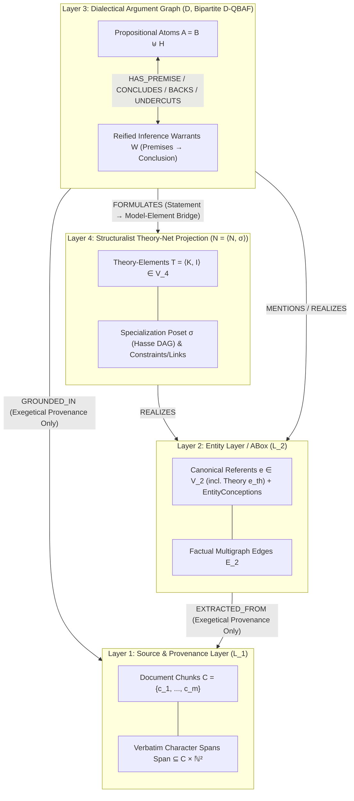

# Formal Graph Schema & Argumentation Semantics

This document establishes the unified formal mathematical model of the **Epistemic Theory Graph** in **Episteme**. It synthesizes a stratified multi-layer property multigraph, a bipartite **Decoupled Quantitative Bipolar Argumentation Framework (D-QBAF)**, a three-tier uncertainty ontology, and an explicit two-level bridge to **structuralist theory-nets**. All mathematical symbols follow the shared [Canonical Notation & Symbol Reference](notation.md); all bibliographic citations resolve to the [Consolidated References & Bibliography](references.md).

---

## 1. Stratified Multi-Layer Graph Architecture

### 1.1 Global Labeled Directed Multigraph

An Epistemic Theory Graph is a **labeled, directed, four-layer multigraph**:

$$
G = \bigl(V,\; E,\; \mathrm{src},\; \mathrm{tgt},\; \lambda_v,\; \lambda_e\bigr)
$$

where:

- $V = V_1 \uplus V_2 \uplus V_3 \uplus V_4$ is the finite vertex set, partitioned disjointly across four structural layers:
  - $V_1$: **Layer 1 ($L_1$, Source & Provenance Layer)** — document chunks.
  - $V_2$: **Layer 2 ($L_2$, Entity Layer / ABox)** — canonical typed entities (`Concept`, `Person`, `Work`, `Theory`, `Institution`).
  - $V_3 = \mathcal{A} \uplus \mathcal{W}$: **Layer 3 ($L_3$, Dialectical Argument Graph $\mathcal{D}$)** — propositional argument atoms $\mathcal{A}$ and reified inference warrants $\mathcal{W}$.
  - $V_4 = N$: **Layer 4 ($L_4$, Structuralist Theory-Net Projection $\mathcal{N}$)** — structuralist theory-elements $T = \langle K, I \rangle$.
- $E = E_{\text{intra}} \uplus E_{\text{inter}}$ is an abstract finite set of directed edge tokens, equipped with incidence maps $\mathrm{src}, \mathrm{tgt}: E \to V$. Defining $E$ as an abstract edge-token set (rather than $E \subseteq V \times V$) permits parallel typed edges between the same ordered pair of vertices (e.g., an edge of type `SUPPORTS_ARG` alongside a structural relation).
- $\lambda_v: V \to \mathcal{T}_v$ assigns each vertex a type from an ontological vertex hierarchy $\mathcal{T}_v$.
- $\lambda_e: E \to \mathcal{T}_e$ assigns each edge a predicate from a typed edge hierarchy $\mathcal{T}_e$. Numeric attributes (confidences, priors, warrant weights, acceptability degrees) are stored in separate attribute functions rather than conflated with $\lambda_v$ or $\lambda_e$.

### 1.2 Two-Level Architecture & Terminology Disambiguation

To separate statement-view argumentation from non-statement structuralist metascience, Episteme defines two distinct mathematical objects across Layers 3 and 4:

1. **Dialectical Argument Graph ($\mathcal{D}$, Layer 3):** The induced labeled bipartite subgraph $G[V_3]$ over propositional atoms $\mathcal{A}$ and reified inference warrants $\mathcal{W}$ connected by argumentative relations ($\mathcal{R}_{\text{sup}}, \mathcal{R}_{\text{att}}$) and exegetical/structural annotations. $\mathcal{D}$ is a **general directed graph that admits cycles** (e.g., mutual rebuttals and coherentist feedback loops).
2. **Structuralist Theory-Net ($\mathcal{N} = \langle N, \sigma \rangle$, Layer 4):** A finite partially ordered set of structuralist theory-elements $T = \langle K, I \rangle$ ordered by Balzer–Moulines–Sneed (BMS) specialization $\sigma$ ([Balzer, Moulines, & Sneed, 1987](references.md#balzer-1987)). Only the strict part (or Hasse diagram) of $\langle N, \sigma \rangle$ is guaranteed to be a directed acyclic graph (DAG); see [Theory-Nets, Posets & Topologies](theory_nets_and_topologies.md).

**Canonical Theory Identity.** A scientific or philosophical theory carries a single canonical identifier on its Layer 2 `Theory` entity $e_{\text{th}} \in V_2$. Its statement-level argumentative formulation (a subgraph $\mathcal{D}[S]$ in $L_3$), its structuralist net $\mathcal{N}$ in $L_4$, any empirical community cluster, and any holon node connect to $e_{\text{th}}$ via explicit typed edges (`REALIZES`, `REPRESENTS`), giving unambiguous cross-layer identity criteria.

> **Note on Provenance vs. Epistemic Justification.** Edges from $L_2$ and $L_3$ to $L_1$ (`EXTRACTED_FROM`, `GROUNDED_IN`) record **exegetical provenance** — that a source text asserts or mentions a proposition. They are strictly orthogonal to **within-theory epistemic justification**, which operates strictly among atoms and warrants inside $L_3$ (terminating in the evidential base $B \subseteq \mathcal{A}$). A verbatim quote proving that an author asserted $p$ is evidence *that the author held $p$*, not evidence *that $p$ is true*.

---

## 2. Formal Layer Specifications

### 2.1 Layer 1: Source & Provenance Layer ($L_1$)

Layer 1 anchors all extracted structures to verbatim character spans in the source corpus:

$$
L_1 = (C,\; \lambda_c,\; \pi,\; \mathrm{Span})
$$

where:

- $V_1 = C = \{c_1, c_2, \dots, c_m\}$ is the finite set of document chunks.
- $\lambda_c: C \to \mathrm{DocMeta}$ assigns bibliographic and structural metadata (work, author, publication epoch, chapter, section, page).
- $\pi: C \to \Sigma^*$ maps each chunk $c \in C$ to its verbatim character sequence over character alphabet $\Sigma$.
- $\mathrm{Span} = \{(c, i, j) \in C \times \mathbb{N}^2 : 0 \le i < j \le \lvert \pi(c) \rvert\}$ is the set of character-offset spans, providing deterministic, byte-exact source auditability.

### 2.2 Layer 2: Entity Layer / ABox ($L_2$)

Layer 2 is a stochastically extracted entity-relational assertion box (ABox) capturing factual, bibliographic, and conceptual links:

$$
L_2 = \bigl(V_2,\; E_2,\; \mathrm{src}_2,\; \mathrm{tgt}_2,\; \gamma_v,\; \gamma_e,\; \mathrm{prov}_2\bigr)
$$

where:

- $V_2$ is the finite set of canonical typed entities (`Concept`, `Person`, `Work`, `Theory`, `Institution`).
- $E_2$ is the finite set of directed multigraph edge tokens with $\mathrm{src}_2, \mathrm{tgt}_2: E_2 \to V_2$ and edge predicates $\lambda_e(e) \in \mathcal{R}_{\text{fac}}$ (e.g., `AUTHORED`, `PART_OF`, `SUBCLASS_OF`, `RELATED_TO`).
- $\gamma_v: V_2 \to [0, 1]$ and $\gamma_e: E_2 \to [0, 1]$ assign Tier-1 extraction confidences.
- $\mathrm{prov}_2: V_2 \cup E_2 \to \operatorname{Pot}(\mathrm{Span})$ maps each entity or factual triple to its supporting verbatim character spans in $L_1$.
- **Referent-vs-Conception Stratification:** Each canonical node $e \in V_2$ represents a shared *referential topic* (e.g., *Space* or *Mass*), optionally carrying perspective-specific `EntityConception` facets and spherical embedding dispersion $v_{\text{poly}}(e) = 1 - \lVert \frac{1}{N}\sum_{k=1}^N \hat{\mathbf{e}}_k \rVert_2 \in [0, 1]$ when contextual usages diverge across authors or traditions (see [ADR-0023](../adr/0023-intensional-perspectival-scoping-and-conception-stratification.md)).

### 2.3 Layer 3: Dialectical Argument Graph ($\mathcal{D}$)

#### Propositional Atoms and Epistemic Partitioning

The vertex set of Layer 3 is $V_3 = \mathcal{A} \uplus \mathcal{W}$, where $\mathcal{A}$ is the finite set of propositional **argument atoms** (argumentative discourse units, ADUs). Following argument-mining conventions ([Peldszus & Stede, 2013](references.md#peldszus-2013); [Stab & Gurevych, 2017](references.md#stab-2017)), *Claim* and *Premise* are **relational roles** determined by edge incidence (a proposition can serve as a conclusion in one inference and a premise in the next), not mutually exclusive node types. When projecting $\mathcal{D}$ onto abstract argumentation frameworks, Episteme adopts the explicit modeling convention that each atom $a \in \mathcal{A}$ represents the argument whose conclusion is $a$.

The **epistemic partition** applies strictly to $\mathcal{A}$ (never to $V_1$ or $V_2$):

$$
\mathcal{A} = B \uplus H, \qquad B \cap H = \emptyset
$$

- **$B$ (Evidential Base):** Propositions presupposed as **pre-theoretical relative to the analyzed theory $T$** ([Schurz, 2014](references.md#schurz-2014), ch. 5). In empirical sciences, $B$ consists of $T$-non-theoretical observation reports and localized empirical generalizations (which remain theory-laden and **defeasible**, never infallible or naively "directly observable"; [Hanson, 1958](references.md#hanson-1958); [Kuhn, 1962](references.md#kuhn-1962)). In normative or philosophical domains, $B$ generalizes as a qualified domain analogy to considered judgments or textual/conceptual starting points under reflective equilibrium ([Goodman, 1955](references.md#goodman-1955); [Rawls, 1971](references.md#rawls-1971); [Daniels, 1979](references.md#daniels-1979); see [Epistemology](epistemology.md#1-scope-and-domain-of-epistemic-criteria)).
- **$H$ (Theoretical Hypotheses & Principles):** Propositions containing $T$-theoretical terms ($L_T$) or theoretical quantifiers, including core axioms, peripheral auxiliary hypotheses, and **mixed mapping laws** (*Zuordnungsgesetze*, tagged `sem_type(a) = MIXED`; see §4.1).

#### Bipartite Inference Hypergraph ($\mathcal{W}$)

Binary edges $\mathcal{A} \times \mathcal{A}$ cannot distinguish **linked** (conjunctive) premises from **convergent** (independent) premises ([Freeman, 1991](references.md#freeman-1991)), cannot represent co-hypotheses jointly explaining a datum in ECHO, and cannot represent Pollockian **undercutters**, which attack an *inference step* rather than its conclusion ([Pollock, 1987](references.md#pollock-1987); [Modgil & Prakken, 2014](references.md#modgil-2014)).

Layer 3 therefore adopts an AIF-inspired **bipartite inference hypergraph** ([Chesñevar et al., 2006](references.md#chesnevar-2006); [Nielsen & Parsons, 2006](references.md#nielsen-2006); [ADR-0011 Addendum 4](../adr/0011-declarative-graph-metrics-and-qbaf-semantics.md)):

- Each reified **inference warrant** $\xi_k \in \mathcal{W}$ binds a non-empty conjunctive premise set $\mathrm{Prem}(\xi_k) \subseteq \mathcal{A}$ (via `HAS_PREMISE`) to a single target conclusion $\mathrm{Conc}(\xi_k) \in \mathcal{A}$ (via `CONCLUDES`) with polarity $\mathrm{pol}(\xi_k) \in \{+1, -1\}$ (support vs. rebuttal/attack).
- Higher-order modifiers target warrants directly: Toulmin **backing** (`BACKS`) supports $\xi_k \in \mathcal{W}$, while Pollockian **undercutting** (`UNDERCUTS`) attacks $\xi_k \in \mathcal{W}$.
- An untargeted unary inference ($\lvert \mathrm{Prem}(\xi_k) \rvert = 1$ with no incoming `BACKS` or `UNDERCUTS` edges) reduces algebraically to a direct pairwise edge $(a_j, a_i)$ in $\mathcal{A} \times \mathcal{A}$.

#### Intensional Mode, Perspectival Attribution, and Exegetical Reading Index

Scholarly texts interleave an author's own positive claims with *reductio* suppositions, summaries of opponents, and contested scholarly interpretations. Each atom $a \in \mathcal{A}$ carries three perspectival coordinates:

1. **Intensional mode:** $\iota(a) \in \{\text{asserted}, \text{attributed}, \text{suppositional}, \text{historical}\}$ ([ADR-0023](../adr/0023-intensional-perspectival-scoping-and-conception-stratification.md)).
2. **Attributing agent:** $\mathrm{agent}(a) \in V_2 \cup \mathrm{Agent} \cup \{\bot\}$ identifying the thinker or school to whom an `attributed` claim belongs.
3. **Exegetical reading index:** $\mathrm{rd}(a) \in \mathcal{R}_{\text{int}}$, indexing distinct scholarly interpretations of the same primary passage. Incompatible reconstructions of *what an author meant* are linked by a dedicated structural relation `ALTERNATIVE_READING_OF` $\in \mathcal{R}_{\text{str}}$ that is explicitly **excluded from** $\mathcal{R}_{\text{att}}$, preventing exegetical disagreement from being misclassified as substantive dialectical refutation.

#### Four-Branch Role Hierarchy (DL-Lite$_R$)

Edge types in $\mathcal{T}_e$ are organized under four pairwise disjoint top-level role classes using DL-Lite$_R$ role inclusions $r_k \sqsubseteq \mathcal{R}_{\text{top}}$ ([Calvanese et al., 2007](references.md#calvanese-2007)):

1. **Dialectical Support ($\mathcal{R}_{\text{sup}}$):** Subtyped by support semantics ([Cayrol & Lagasquie-Schiex, 2013](references.md#cayrol-2013); [Cohen et al., 2014](references.md#cohen-2014)): *deductive* (`ENTAILS`, `DEDUCES`, non-defeasible), *evidential/explanatory* (`SUPPORTS_ARG`, `EXPLAINS`, defeasible), and *warrant backing* (`BACKS`, targeting $\mathcal{W}$).
2. **Dialectical Attack ($\mathcal{R}_{\text{att}}$):** Structured along the standard ASPIC+ triad ([Modgil & Prakken, 2014](references.md#modgil-2014)): **rebuttal** (`REBUTS` / `ATTACKS`, targeting conclusions in $\mathcal{A}$), **undercutting** (`UNDERCUTS`, targeting warrants in $\mathcal{W}$), and **undermining** (`UNDERMINES`, targeting premises in $\mathcal{A}$).
3. **Structural & Metatheoretical ($\mathcal{R}_{\text{str}}$):** Non-dialectical structural relations (`SPECIALIZES`, `CONSTRAINS`, `REDUCES_TO`, `ALTERNATIVE_READING_OF`, `HAS_PREMISE`, `CONCLUDES`).
4. **Factual & Inter-Layer ($\mathcal{R}_{\text{fac}}$):** Layer 2 predicates (`RELATED_TO`, `PART_OF`, `SUBCLASS_OF`, `INSTANCE_OF`) and cross-layer links (`EXTRACTED_FROM`, `GROUNDED_IN`, `MENTIONS`, `FORMULATES`, `REALIZES`).

DL-Lite$_R$ role inclusions guarantee **set inclusion of role extensions** (e.g., every `UNDERMINES` edge is in $\mathcal{R}_{\text{att}}$); the normative semantics of defeat and strength propagation are supplied by the argumentation layer below, not by the description logic itself.

---

## 3. Uncertainty Ontology and D-QBAF Gradual Semantics

### 3.1 Three-Tier Uncertainty Ontology

To eliminate conflation between NLP extraction noise, authorial rhetoric, and normative dialectical standing, every numeric score in Episteme belongs to **exactly one of three orthogonal tiers**, each governed by a single calculus:

| Tier | Question Answered | Bearers & Symbols | Mathematical Calculus | Literature Grounding |
|:---|:---|:---|:---|:---|
| **Tier 1 — Perception & Extraction** | *Is this entity, atom, or relation actually expressed in the source text?* | L2 confidences $\gamma_v, \gamma_e$; L3 stance probability $\mathcal{P}(r)$ and calibrated precision $\mathcal{C}_{\text{cal}}(r)$ | Calibrated probabilities via temperature scaling / reliability diagrams ([Guo et al., 2017](references.md#guo-2017)) and distribution-free conformal prediction sets $C_\alpha(X)$ ([Angelopoulos & Bates, 2023](references.md#angelopoulos-2023)) | Constellations view of structural graph uncertainty ([Hunter, 2013](references.md#hunter-2013)) |
| **Tier 2 — Authorial Commitment** | *With what rhetorical or illocutionary force does the author assert the proposition or inference?* | Atom modal strength $M_{\text{mod}}(\phi_a) \in [0,1]$; inferential warrant force $\mathcal{I}(\xi_k) \in [0,1]$ | Ordinal/continuous descriptive encoding of linguistic hedging and argumentation scheme strength | Hedging pragmatics ([Hyland, 1998](references.md#hyland-1998)); Toulmin's inferential qualifier & warrant ([Toulmin, 1958](references.md#toulmin-1958), ch. 3); argumentation schemes ([Walton, Reed, & Macagno, 2008](references.md#walton-2008)) |
| **Tier 3 — Evaluative Acceptability & Tenability** | *How strongly justified is the proposition given the dialectical graph and empirical/structural fit?* | Atom acceptability $s_i^*$, warrant validity $s_{\mathcal{W}}^*(\xi_k)$, volatility $\mathcal{V}(a_i)$, operational tenability $TS_{\text{local}}, TS_{\text{edge}}$ | Continuous D-QBAF Weighted Quadratic Energy dynamics ([Potyka, 2018](references.md#potyka-2018)) coupled with uniform-blur tenability ([Balzer et al., 1987](references.md#balzer-1987)) | Gradual argumentation ([Baroni, Rago, & Toni, 2019](references.md#baroni-2019)); foundherentism ([Haack, 1993](references.md#haack-1993)) |

> **Clarification on Calibration vs. Conformal Prediction.** Temperature scaling and reliability-diagram binning estimate scalar **calibrated empirical precision** $\mathcal{C}_{\text{cal}}(r)$ ([Guo et al., 2017](references.md#guo-2017)). When $\mathcal{P}(r)$ is already perfectly calibrated, $\mathcal{C}_{\text{cal}}(r)$ is a deterministic function of $\mathcal{P}(r)$; maintaining both allows Episteme to pair raw classifier sharpness ($\mathcal{P}$) with out-of-sample reliability estimates ($\mathcal{C}_{\text{cal}}$) computed by a calibrated System 1 decision classifier (see [ADR-0018](../adr/0018-decision-engine-architecture-and-contracts.md)). By contrast, **conformal prediction** ([Angelopoulos & Bates, 2023](references.md#angelopoulos-2023)) produces *set-valued* predictions $C_\alpha(X) \subseteq \mathcal{Y}$ with finite-sample marginal coverage $1 - \alpha$ used for active triage and escalation, not per-edge scalar precision.

### 3.2 Formal Definition of the Bipartite D-QBAF ($\mathcal{Q}$)

The **normative primary acceptability semantics** of Layer 3 is the bipartite **Decoupled Quantitative Bipolar Argumentation Framework (D-QBAF)**:

$$
\mathcal{Q} = \bigl\langle \mathcal{A},\; \mathcal{W},\; \mathcal{R}_{\text{att}},\; \mathcal{R}_{\text{sup}},\; \iota,\; \mathrm{agent},\; \mathrm{rd},\; M_{\text{mod}},\; \beta,\; \mathcal{I},\; \mathcal{P},\; \mathcal{C}_{\text{cal}} \bigr\rangle
$$

where $\mathcal{R}_{\text{arg}} = \mathcal{R}_{\text{att}} \uplus \mathcal{R}_{\text{sup}} \subseteq (\mathcal{A} \cup \mathcal{W}) \times (\mathcal{A} \cup \mathcal{W})$ is the disjoint union of dialectical attack and support relations, and:

1. **$M_{\text{mod}}: \mathcal{A} \to [0, 1]$ (Descriptive Authorial Commitment):** Captures linguistic hedging and assertoric force in the source text (e.g., *"it is conceivable that"* vs. *"we demonstrate that"*). Because hedging conventions vary markedly across genres, disciplines, and languages ([Hyland, 1998](references.md#hyland-1998)), $M_{\text{mod}}(\phi_a)$ is strictly a **descriptive** attribute. Note also that in [Toulmin (1958, ch. 3)](references.md#toulmin-1958), the modal qualifier governs the *inferential step* from data via warrant to claim; Episteme captures inferential strength separately in $\mathcal{I}$.
2. **$\beta: \mathcal{A} \to [0, 1]$ (Base Prior Policy):** Assigns each atom its initial acceptability prior prior to dialectical propagation. Separating $\beta(a)$ from $M_{\text{mod}}(\phi_a)$ avoids equating authorial confidence with epistemic warrant and supports two explicit evaluation modes:
   - **Normative Evaluation Mode:** Assigns a neutral uniform prior to theoretical hypotheses (e.g., $\beta(a) = 0.5$ for $a \in H$) and a defeasible Data-Priority prior to evidential base atoms ($\beta(b) = \beta_B \in (0.5, 1)$ for $b \in B$, or expert-calibrated priors), reporting sensitivity across prior choices. This realizes a **foundherentist** epistemology ([Haack, 1993](references.md#haack-1993)) in which evidential statements carry initial presumption but remain revisable under strong counterargument.
   - **Descriptive Authorial-Reconstruction Mode:** Sets $\beta(a) = M_{\text{mod}}(\phi_a)$ (as currently configured by default in [ADR-0020](../adr/0020-propositional-modal-strength-resolver.md) and [ADR-0022](../adr/0022-unified-stratified-epistemic-metamodel.md)) strictly to reconstruct how an author weights commitments *within their own text*, rather than as an objective measure of truth.
   - **Tenability & Perspectival Modulation:** When operational structuralist tenability $TS_{\text{local}}(a) \in [0, 1]$ is available (§5.3) and a perspective filter $\pi_{\text{persp}}$ is active, the effective base prior is $\tilde{\beta}(a) = \beta(a) \cdot TS_{\text{local}}(a)$ for active atoms in the selected perspective, and $\tilde{\beta}(a) = 0$ for isolated `suppositional` (*reductio*) or out-of-perspective `attributed` atoms ([ADR-0022](../adr/0022-unified-stratified-epistemic-metamodel.md); [ADR-0023](../adr/0023-intensional-perspectival-scoping-and-conception-stratification.md)).
3. **$\mathcal{I}: \mathcal{W} \cup \mathcal{R}_{\text{arg}} \to [0, 1]$ (Inferential Warrant Force):** Quantifies the conditional strength of the argumentation scheme instantiating an inference warrant $\xi_k \in \mathcal{W}$ (e.g., deductive entailment vs. inductive corroboration vs. defeasible analogy; [Walton, Reed, & Macagno, 2008](references.md#walton-2008)), serving as the intrinsic warrant prior $\omega_0(\xi_k) = \mathcal{I}(\xi_k)$.
4. **$\mathcal{P}, \mathcal{C}_{\text{cal}}: \mathcal{W} \cup \mathcal{R}_{\text{arg}} \to [0, 1]$ (Tier-1 Extraction Metrics):** Classifier stance probability $\mathcal{P}$ and calibrated empirical precision $\mathcal{C}_{\text{cal}}$.

### 3.3 Bivariate Admissibility Gating

Multiplying inferential force $\mathcal{I}$ directly by extraction probability $\mathcal{P}$ confounds a strong deductive inference extracted with moderate NLP confidence ($\mathcal{I}=1.0, \mathcal{P}=0.5$) with a weak analogy extracted with high confidence ($\mathcal{I}=0.5, \mathcal{P}=1.0$). Instead, Episteme applies a bivariate admissibility filter $\mathcal{F}: \mathcal{W} \cup \mathcal{R}_{\text{arg}} \to [0, 1]$:

- **Mode 1 — Hard Bivariate Admissibility Gate (Normative Standard):**

$$
\mathcal{F}_{\text{hard}}(r) = \begin{cases} 1 & \text{if } \mathcal{P}(r) \ge \theta_P \;\wedge\; \mathcal{C}_{\text{cal}}(r) \ge \theta_C, \\ 0 & \text{otherwise.} \end{cases}
$$

  Every admitted inference retains its undiluted warrant force $\mathcal{I}(r)$, while unadmitted extractions are pruned before dialectical evaluation. Because $\mathcal{P}(r)$ and $\mathcal{C}_{\text{cal}}(r)$ are **fixed extraction data** (not dynamical state variables), the gated weights are constant parameters of the dynamical system below; Mode 1 introduces no state-space discontinuities and does not require discontinuous-state Filippov solution theory ([Filippov, 1988](references.md#filippov-1988)).

- **Mode 2 — Smooth Sigmoidal Relaxation (Differentiable Surrogate for Threshold Calibration):**

$$
\mathcal{F}_{\text{soft}}(r) = \operatorname{sig}\bigl(k_1(\mathcal{P}(r) - \theta_P)\bigr) \cdot \operatorname{sig}\bigl(k_2(\mathcal{C}_{\text{cal}}(r) - \theta_C)\bigr), \qquad \operatorname{sig}(z) = \frac{1}{1 + e^{-z}}.
$$

  Mode 2 is an opt-in differentiable surrogate strictly for **gradient-based calibration or sensitivity analysis** with respect to the threshold parameters $(\theta_P, \theta_C)$ (not for ODE well-posedness). *Trade-off:* near the admissibility boundary, $\mathcal{F}_{\text{soft}}$ re-introduces partial multiplicative attenuation of $\mathcal{I}$ (for example, at $k_1 = 20$ and $\mathcal{P}(r) = \theta_P + 0.05$ with $\mathcal{C}_{\text{cal}}(r) \gg \theta_C$, $\mathcal{F}_{\text{soft}}(r) \approx \operatorname{sig}(1) \approx 0.73$, attenuating $\mathcal{I}$ by $\approx 27\%$). Normative evaluation therefore always uses Mode 1.

Let the effective gating factor for each warrant $\xi_k \in \mathcal{W}$ be $g_k = \mathcal{F}(\xi_k) \cdot TS_{\text{edge}}(\xi_k) \in [0, 1]$ (with $TS_{\text{edge}} \equiv 1$ when post-processing enrichment is inactive), and let $W_{ji} = \mathcal{I}(r) \cdot \mathcal{F}(r) \cdot TS_{\text{edge}}(r)$ denote the corresponding effective weight when $\xi_k$ reduces to an untargeted unary edge $r = (a_j, a_i)$.

### 3.4 Continuous Quadratic-Energy Dynamical System

Let $\mathbf{s}(t) = (s_1(t), \dots, s_n(t))^\top \in [0, 1]^n$ denote the acceptability vector over atoms $\mathcal{A} = \{a_1, \dots, a_n\}$, and let $s_{\mathcal{W}}(\xi_k, t) \in [0, 1]$ denote the dynamic validity of each reified warrant $\xi_k \in \mathcal{W}$. For any warrant $\xi_k$, conjunctive premise activation is aggregated via a configurable continuous t-norm $\Phi_{\text{conj}}$:

$$
\Phi_{\text{conj}}\bigl(\mathrm{Prem}(\xi_k), t\bigr) = \begin{cases} \displaystyle\prod_{a_j \in \mathrm{Prem}(\xi_k)} s_j(t) & \text{(product t-norm)}, \\[10pt] \displaystyle\min_{a_j \in \mathrm{Prem}(\xi_k)} s_j(t) & \text{(Gödel t-norm)}. \end{cases}
$$

Let $\mathcal{W}_{\text{sup}}(a_i) = \{\xi_k \in \mathcal{W} : \mathrm{Conc}(\xi_k) = a_i,\; \mathrm{pol}(\xi_k) = +1\}$ and $\mathcal{W}_{\text{att}}(a_i) = \{\xi_r \in \mathcal{W} : \mathrm{Conc}(\xi_r) = a_i,\; \mathrm{pol}(\xi_r) = -1\}$. Similarly, let $\mathrm{Backs}(\xi_k)$ and $\mathrm{Undercuts}(\xi_k)$ denote the sets of gated modifier warrants targeting $\xi_k$ with effective weights $g_m \cdot \omega_0(m)$ (or pairwise weights $W_{b, \xi_k}$ for unary atom modifiers). The net continuous energies $\eta_i(t), \eta_{\xi_k}(t) \in \mathbb{R}$ are:

$$
\eta_i(t) = \sum_{\xi_k \in \mathcal{W}_{\text{sup}}(a_i)} g_k \, s_{\mathcal{W}}(\xi_k, t) \, \Phi_{\text{conj}}\bigl(\mathrm{Prem}(\xi_k), t\bigr) \;-\; \sum_{\xi_r \in \mathcal{W}_{\text{att}}(a_i)} g_r \, s_{\mathcal{W}}(\xi_r, t) \, \Phi_{\text{conj}}\bigl(\mathrm{Prem}(\xi_r), t\bigr)
$$

$$
\eta_{\xi_k}(t) = \sum_{m^+ \in \mathrm{Backs}(\xi_k)} g_{m^+} \, s_{\mathcal{W}}(m^+, t) \, \Phi_{\text{conj}}\bigl(\mathrm{Prem}(m^+), t\bigr) \;-\; \sum_{m^- \in \mathrm{Undercuts}(\xi_k)} g_{m^-} \, s_{\mathcal{W}}(m^-, t) \, \Phi_{\text{conj}}\bigl(\mathrm{Prem}(m^-), t\bigr)
$$

Using the $C^1$ quadratic-energy impact function $h(x) = \frac{\max\{x, 0\}^2}{1 + \max\{x, 0\}^2}$ ([Potyka, 2018](references.md#potyka-2018)), atom acceptabilities and warrant validities co-evolve via the autonomous coupled ODE system:

$$
\frac{ds_i}{dt} = \tilde{\beta}(a_i) - s_i(t) + \bigl(1 - \tilde{\beta}(a_i)\bigr) \, h\bigl(\eta_i(t)\bigr) - \tilde{\beta}(a_i) \, h\bigl(-\eta_i(t)\bigr)
$$

$$
\frac{ds_{\mathcal{W}}(\xi_k)}{dt} = \omega_0(\xi_k) - s_{\mathcal{W}}(\xi_k, t) + \bigl(1 - \omega_0(\xi_k)\bigr) \, h\bigl(\eta_{\xi_k}(t)\bigr) - \omega_0(\xi_k) \, h\bigl(-\eta_{\xi_k}(t)\bigr)
$$

initialized at $s_i(0) = \tilde{\beta}(a_i)$ and $s_{\mathcal{W}}(\xi_k, 0) = \omega_0(\xi_k) = \mathcal{I}(\xi_k)$. Under the `product` t-norm the vector field is $C^1$ on $[0, 1]^{n + \lvert \mathcal{W} \rvert}$; under the `godel` ($\min$) t-norm it is globally Lipschitz continuous (piecewise $C^1$), guaranteeing unique global solutions by Picard–Lindelöf in both cases.

**Pairwise Reduction & Undercutting Semantics.** When $\lvert \mathrm{Prem}(\xi_k) \rvert = 1$ and $\mathrm{Backs}(\xi_k) = \mathrm{Undercuts}(\xi_k) = \emptyset$, $\eta_{\xi_k}(t) \equiv 0$ implies $s_{\mathcal{W}}(\xi_k, t) \equiv \omega_0(\xi_k) = \mathcal{I}(\xi_k)$ and $\Phi_{\text{conj}}(\{a_j\}, t) = s_j(t)$, reducing identically to pairwise $W_{ji} \, s_j(t)$ dynamics. Conversely, falsifying any single premise in a conjunctive derivation drives $\Phi_{\text{conj}} = 0$, and strong Pollockian undercutting drives $s_{\mathcal{W}}(\xi_k, t) \to 0$, neutralizing the inference without pushing the conclusion $a_i$ below its base prior $\tilde{\beta}(a_i)$.

### 3.5 Analytical Properties & Numerical Stability

1. **Proposition 1 (Pointwise Sigmoid Limit):** $\lim_{k \to \infty} \operatorname{sig}(k(x - \theta)) = \Theta_H(x - \theta)$ for every $x \neq \theta$ (almost everywhere), where $\Theta_H$ is the Heaviside step function.
2. **Proposition 2 (Forward Invariance & Derivative Bound):** On the compact hypercube $[0, 1]^{n + \lvert \mathcal{W} \rvert}$, at any boundary face $s_i = 1$ we have $\dot{s}_i = (\tilde{\beta}_i - 1)(1 - h(\eta_i)) - \tilde{\beta}_i h(-\eta_i) \le 0$, and at $s_i = 0$ we have $\dot{s}_i = \tilde{\beta}_i(1 - h(-\eta_i)) + (1 - \tilde{\beta}_i)h(\eta_i) \ge 0$ (and identically for $s_{\mathcal{W}}(\xi_k)$). By Nagumo's subtangential condition ([Nagumo, 1942](references.md#nagumo-1942)), $[0, 1]^{n + \lvert \mathcal{W} \rvert}$ is positively invariant for all $t \ge 0$, and $\lvert \dot{s}_i \rvert < 1$.
3. **Proposition 3 (Equilibrium & Trajectory Balance):** If $\eta_i(t) = 0$ for all $t \ge 0$, then (since $s_i(0) = \tilde{\beta}(a_i)$) $s_i(t) = \tilde{\beta}(a_i)$ for all $t \ge 0$. At any stationary point $(\mathbf{s}^*, \mathbf{s}_{\mathcal{W}}^*)$, $\eta_i^* = 0 \iff s_i^* = \tilde{\beta}(a_i)$.
4. **Proposition 4 (Convergence Regimes):**
   - **Acyclic Graphs (DAGs):** If the bipartite dependency graph over $\mathcal{A} \cup \mathcal{W}$ is acyclic, every node converges to a unique stationary point computable directly along a topological sort in $O(\lvert \mathcal{A} \rvert + \lvert \mathcal{W} \rvert + \lvert E_3 \rvert)$ time without ODE integration:
     $$
     s_i^* = \tilde{\beta}(a_i) + \bigl(1 - \tilde{\beta}(a_i)\bigr) \, h(\eta_i^*) - \tilde{\beta}(a_i) \, h(-\eta_i^*),
     $$
     and identically for $s_{\mathcal{W}}^*(\xi_k)$.
   - **Support-Only Graphs (Including Cycles):** When $\mathcal{W}_{\text{att}} = \emptyset$ and $\mathrm{Undercuts} = \emptyset$, the system is cooperative (quasimonotone non-decreasing under both `product` and `godel` t-norms) and satisfies $\dot{s}_i(0) \ge 0$, $\dot{s}_{\mathcal{W}}(\xi_k, 0) \ge 0$. By the Kamke–Müller monotonicity theorem ([Smith, 1995](references.md#smith-1995), Prop. 3.2.1), the trajectory from $(\tilde{\boldsymbol{\beta}}, \boldsymbol{\omega}_0)$ is componentwise non-decreasing and bounded above by $\mathbf{1}$, hence guaranteed to converge to an equilibrium.
   - **Mixed Cyclic Graphs:** Global convergence is **not** guaranteed in general; limit cycles or oscillations can occur in weighted cyclic bipolar frameworks ([Mossakowski & Neuhaus, 2018](references.md#mossakowski-2018)). Solvers therefore monitor stationary residuals and emit an explicit non-convergence diagnostic if equilibrium is not attained within the integration horizon.
5. **Remark on Jacobian Stiffness & Integrator Selection:** In the pairwise reduction, $\max_{x \ge 0} h'(x) = h'(1/\sqrt{3}) = \frac{9}{8\sqrt{3}} \approx 0.6495$, so by Gershgorin's Circle Theorem ([Gershgorin, 1931](references.md#gershgorin-1931)) the Jacobian spectral radius satisfies:
   $$
   \rho_{\text{spec}}(J) \le 1 + \frac{9}{8\sqrt{3}} \max_{i} \sum_{j \neq i} W_{ji}.
   $$
   Two subtleties govern numerical integration: (i) on any DAG, ordering vertices topologically makes $J$ lower-triangular with diagonal $-1$, so $\operatorname{spec}(J) = \{-1\}$ and $\rho_{\text{spec}}(J) = 1$ regardless of in-degree (and DAGs use the closed form of Prop. 4 anyway); (ii) Gershgorin gives only an upper bound (loose near $\eta_i = 0$, where $h'(0) = 0$) and cannot by itself prove instability. Nevertheless, bounded $\lvert \dot{s}_i \rvert < 1$ does not preclude stiffness on **cyclic** graphs with large weighted in-degree, where eigenvalues of $J$ may exit the real-axis stability limit ($\approx 2.785$) of fixed-step classical RK4 ([Hairer & Wanner, 1996](references.md#hairer-1996)). Episteme therefore solves cyclic strongly connected components with adaptive explicit integrators paired with an implicit stiff-solver fallback (see [ADR-0011 Addendum 2](../adr/0011-declarative-graph-metrics-and-qbaf-semantics.md)).

### 3.6 Evidentiary Weight and Controversy Diagnostics

An equilibrium score $s_i^* = 0.5$ can arise either from complete absence of evidence or from intense, balanced dialectical contestation. Inspired by Keynes's concept of *weight of evidence* ([Keynes, 1921](references.md#keynes-1921), ch. VI) and Gärdenfors & Sahlin's *epistemic reliability* ([Gärdenfors & Sahlin, 1982](references.md#gardenfors-1982)), Episteme defines two project-specific diagnostics directly over the equilibrium aggregated support mass $S^+_i$ and attack mass $S^-_i$:

$$
S^+_i = \sum_{\xi_k \in \mathcal{W}_{\text{sup}}(a_i)} g_k \, s_{\mathcal{W}}^*(\xi_k) \, \Phi_{\text{conj}}\bigl(\mathrm{Prem}(\xi_k), \mathbf{s}^*\bigr), \qquad S^-_i = \sum_{\xi_r \in \mathcal{W}_{\text{att}}(a_i)} g_r \, s_{\mathcal{W}}^*(\xi_r) \, \Phi_{\text{conj}}\bigl(\mathrm{Prem}(\xi_r), \mathbf{s}^*\bigr).
$$

- **Gross Weight of Evidence ($\mathrm{Wt}(a_i) \in [0, 1)$):**
  $$
  \mathrm{Wt}(a_i) = \frac{S^+_i + S^-_i}{1 + S^+_i + S^-_i}
  $$
- **Evidentiary Controversy ($\mathrm{Controv}(a_i) \in [0, 1]$) & Epistemic Volatility Index ($\mathcal{V}(a_i) \in [0, 1)$):**
  $$
  \mathrm{Controv}(a_i) = \begin{cases} 1 - \dfrac{\lvert S^+_i - S^-_i \rvert}{S^+_i + S^-_i} & \text{if } S^+_i + S^-_i > 0, \\ 0 & \text{otherwise,} \end{cases} \qquad \mathcal{V}(a_i) = \mathrm{Wt}(a_i) \cdot \mathrm{Controv}(a_i).
  $$

Because $\mathrm{Controv}(a_i)$ compares $S^+_i$ against $S^-_i$ directly rather than measuring $\lvert s_i^* - 0.5 \rvert$, an uncontested claim always scores $\mathcal{V}(a_i) = 0$ regardless of its base prior $\tilde{\beta}(a_i)$, while a heavily contested claim with balanced support and attack scores $\mathcal{V}(a_i) \to 1$ even when its base prior lies far from $0.5$.

### 3.7 Alternative Analytical Lenses (ECHO, Dung Extensions, Maximal Consistency)

D-QBAF (§3.2–3.5) is the **normative primary semantics** of Layer 3. Because different philosophical questions benefit from alternative formal viewpoints — and because gradual, connectionist, and extension-based semantics are known to satisfy different principles and can disagree ([Baroni, Rago, & Toni, 2019](references.md#baroni-2019)) — Episteme defines explicit projections from $\mathcal{D}$ onto three optional **secondary analytical lenses**:

| Lens | Input Structure (Projected from $\mathcal{D}$) | Directedness | Output Type | Key Semantic Properties |
|:---|:---|:---|:---|:---|
| **D-QBAF Quadratic Energy (Primary)** | Bipartite hypergraph $\mathcal{Q}$ with gated weights | Directed | $s_i^* \in [0, 1]$, $s_{\mathcal{W}}^* \in [0, 1]$ | Continuous balance, neutrality, strict monotonicity; handles linked premises and undercutters natively ([Potyka, 2018](references.md#potyka-2018)) |
| **ECHO Explanatory Coherence (Lens)** | Undirected signed network via explicit symmetrization map below | Undirected ($w_{ij}^{\text{echo}} = w_{ji}^{\text{echo}}$) | $a_i^{\text{echo}} \in [-1, 1]$, harmony $\mathcal{H}_{\text{echo}}$ | Parallel constraint satisfaction with Hopfield-type Lyapunov harmony ([Thagard, 1989](references.md#thagard-1989); [Hopfield, 1982](references.md#hopfield-1982)) |
| **Dung Extensions (Lens)** | Bipolar-reduced AF $(\mathcal{A}, \leadsto_{\text{eff}})$ | Directed | Sets of extensions (grounded, preferred, stable) | Discrete dialectical admissibility and reinstatement ([Dung, 1995](references.md#dung-1995)) |
| **Maximal $B$-Consistent Subsets (Diagnostic)** | Statement sets $(B, H)$ under an NLI/logical consistency oracle | Non-graph (set-based) | Maximal subsets $\Sigma \subseteq H$ consistent with $B$ | Classical paraconsistent selection ([Rescher & Manor, 1970](references.md#rescher-1970)) |

- **Symmetrization Map $\mathcal{D} \to \text{ECHO}$:** Because ECHO requires symmetric weights $w_{ij}^{\text{echo}} = w_{ji}^{\text{echo}}$ (positive for explanatory coherence, negative for contradiction/competition; [Thagard, 1989](references.md#thagard-1989)) whereas D-QBAF edges are directed with non-negative weights, projecting $\mathcal{D}$ into ECHO applies an explicit symmetrization: for any explanatory warrant $\xi_k$ with $m = \lvert \mathrm{Prem}(\xi_k) \rvert$ co-hypotheses explaining $a_i$, assign symmetric excitatory weights $w_{ji}^{\text{echo}} = w_{ij}^{\text{echo}} = \frac{\epsilon^+}{m} g_k \omega_0(\xi_k)$ (and between co-hypotheses), and for contradictory/competing pairs assign $w_{ji}^{\text{echo}} = w_{ij}^{\text{echo}} = -\epsilon^- \max(W_{ji}, W_{ij})$. Global harmony $\mathcal{H}_{\text{echo}}(t) = \sum_{i,j} w_{ij}^{\text{echo}} a_i^{\text{echo}}(t) a_j^{\text{echo}}(t)$ is defined strictly under this symmetrized lens, never on the raw directed D-QBAF.
- **Support-Preserving Dung Reduction:** Rather than discarding $\mathcal{R}_{\text{sup}}$, projecting a bipolar graph onto Dung's abstract framework $(\mathcal{A}, \leadsto_{\text{eff}})$ first derives *supported* and *secondary* attacks according to the chosen support type (deductive, necessary, or evidential; [Cayrol & Lagasquie-Schiex, 2005](references.md#cayrol-2005), [2013](references.md#cayrol-2013); [Cohen et al., 2014](references.md#cohen-2014)), then evaluates standard grounded, preferred, or stable extensions ([Dung, 1995](references.md#dung-1995)).

---

## 4. Mapping Laws (*Zuordnungsgesetze*) & Epistemic Justification Paths

### 4.1 Mapping Laws as Object-Level Mixed Sentences

In formal philosophy of science — tracing from Carnap's correspondence rules ([Carnap, 1956](references.md#carnap-1956)) to Schurz's *Zuordnungsgesetze* ([Schurz, 2014](references.md#schurz-2014), ch. 5) — mapping laws are **object-level mixed sentences** belonging to the theory itself, containing both theoretical vocabulary ($L_T$) and pre-theoretical vocabulary ($L_E$) (e.g., *"mean molecular kinetic energy is proportional to measured temperature"*).

Accordingly, Episteme models mapping laws as **atoms in Layer 3** ($\mathcal{A}$) carrying semantic type `MIXED` (not as inter-layer $L_3 \to L_2$ database edges and not as numeric functions). These `MIXED` atoms participate as premises inside inference warrants $\xi_k \in \mathcal{W}$ that bridge purely theoretical hypotheses ($H_{\text{pure}}$) to pre-theoretical evidential statements ($B$).

Separately, during graph construction Episteme may compute an optional project-specific **structural correspondence score** $\mathrm{ov}_{\text{str}}: \mathcal{A} \times \mathcal{A} \to [0, 1]$ estimating neighborhood/conceptual overlap between candidate linked atoms ([ADR-0007](../adr/0007-tf-structural-correspondence.md)). This heuristic aids relation validation and is strictly distinct from object-level mapping laws.

### 4.2 Acceptability-Conditioned Justification Paths

Within Layer 3, the set of **acceptability-conditioned evidential justification paths** $J_\theta(a)$ supporting a theoretical atom $a \in H$ consists of all **simple** (vertex-non-repeating) directed paths in the support sub-hypergraph of $\mathcal{D}$ running **from** an evidential base atom $b \in B$ **toward** $a$ such that every intermediate atom and warrant meets an acceptability threshold $\theta_{\text{acc}} \in (0, 1)$:

$$
J_\theta(a) = \Bigl\{ p = (b, \xi_1, a_1, \dots, \xi_k, a) \;\Big|\; b \in B,\; a_r \in \mathrm{Prem}(\xi_{r+1}),\; \mathrm{Conc}(\xi_{r+1}) = a_{r+1},\; \mathrm{pol}(\xi_r) = +1,\; s^*(v) \ge \theta_{\text{acc}} \;\forall v \in p,\; p \text{ simple} \Bigr\}
$$

Restricting to simple paths keeps $J_\theta(a)$ finite in the presence of cycles (though worst-case path counts remain exponential, so queries test *existence* or shortest/strongest paths via bounded search), and conditioning on $s^*(v) \ge \theta_{\text{acc}}$ ensures that defeated or undercut intermediate inferences cannot falsely count as grounding $a$.

---

## 5. Layer 4: Structuralist Model-Theoretic Foundations and Two-Level Bridge

### 5.1 Two-Level Stance and Operational Scope

Statement-view frameworks (Schurz's axiomatics, Lakatosian methodology, D-QBAF argumentation) treat theories as sets of sentences that can be true, false, consistent, or refuted. The **structuralist non-statement view** ([Sneed, 1971](references.md#sneed-1971); [Stegmüller, 1976](references.md#stegmuller-1976); [Balzer et al., 1987](references.md#balzer-1987)) treats a theory-element $T = \langle K, I \rangle$ as a model-theoretic entity that is *neither true nor false*; only its **empirical claim** ($I \in \operatorname{Cn}_{\text{str}}(K)$, or its approximative counterpart) is truth-apt and falsifiable.

Episteme reconciles these traditions via an explicit **two-level model** (cf. [Stegmüller, 1976](references.md#stegmuller-1976), ch. 2; [Schurz, 2014](references.md#schurz-2014), ch. 5): Layer 4 represents structuralist theory-elements $T \in N$, while Layer 3 represents their linguistic formulations (axioms, special laws, mapping laws, and empirical claims) linked via typed `FORMULATES` edges. Because full structuralist reconstructions require formal structure species that rarely exist in qualitative philosophical prose ([Balzer, Sneed, & Moulines, 2000](references.md#balzer-2000)), Episteme deploys structuralism across **three explicit operational tiers**:

1. **Tier A — Structuralism Light (Universal Baseline):** Applicable to *all* scholarly corpora (including ethics, metaphysics, and history of ideas). Operationalizes the specialization poset topology $\langle N, \sigma \rangle$ and $T$-theoreticity / sentence-type annotations ($L_E$ vs. $L_T$).
2. **Tier B — Operational Parametric Enrichment (Formal/Quantitative Corpora):** Applicable where texts exhibit mathematical or parametric laws. An optional post-processing pass induces approximate local parameter spaces ($M_p, M, M_{pp}$), evaluates uniform-blur fit ($TS_{\text{local}}, TS_{\text{edge}}$), and feeds tenability back into Layer 3 D-QBAF priors and weights ([ADR-0015](../adr/0015-theoretical-enrichment-and-tenability-evaluation.md); [ADR-0022](../adr/0022-unified-stratified-epistemic-metamodel.md)).
3. **Tier C — Full BMS Model Theory (Regulative Ideal):** The complete set-theoretic apparatus below (Bourbaki structure species, global constraints $GC$, intertheoretical links $GL$, uniformities $\mathcal{U}$, and induced entourages on $\operatorname{Pot}(M_{pp})$) serves as the formal *regulative ideal* defining what complete reconstruction would achieve, not an automated extraction guarantee for arbitrary prose.

### 5.2 Complete BMS Formal Core ($K$)

Following [Balzer, Moulines, & Sneed (1987, ch. II)](references.md#balzer-1987), a structuralist **theory-element** is a pair $T = \langle K, I \rangle$, where $I \subseteq M_{pp}$ is the domain of intended applications (a **definitional** condition of being a theory-element, not an evaluative validity test) and the **formal core** is the five-tuple:

$$
K = \langle M_p,\; M,\; M_{pp},\; GC,\; GL \rangle
$$

1. **Potential Models ($M_p$):** The class of set-theoretic structures instantiating the theory's conceptual framework (fixed via a Bourbaki species of structures; [Bourbaki, 1968](references.md#bourbaki-1968)), whether or not the substantive laws hold.
2. **Actual Models ($M \subseteq M_p$):** The subclass of potential models satisfying the theory-element's fundamental law(s).
3. **Partial Potential Models ($M_{pp}$):** Obtained from $M_p$ via the **restriction (forgetful) function** $r: M_p \to M_{pp}$ that strips away all $T$-theoretical functions, so $M_{pp} = \{r(x) : x \in M_p\}$. Crucially, $M_{pp}$ is **not** a subset of $M_p$ (its structures have a reduced signature), and $T$-non-theoreticity means determinability *without presupposing $T$* ([Sneed, 1971](references.md#sneed-1971)), **not** direct sensory observability.
4. **Global Constraints ($GC \subseteq \operatorname{Pot}(M_p)$):** Cross-application restrictions demanding that intrinsic theoretical magnitudes (e.g., mass or charge of the same physical body) remain consistent across overlapping applications within $T$.
5. **Global Intertheoretical Links ($GL \subseteq \operatorname{Pot}(M_p)$):** Restrictions importing values or relations determined by distinct background theories.

Lifting $r$ to subsets via $\bar{r}(X) = \{r(x) : x \in X\}$ for $X \subseteq M_p$, the **structuralist empirical content** of core $K$ is:

$$
\operatorname{Cn}_{\text{str}}(K) := \bigl\{ \bar{r}(X) \;\big|\; X \in \operatorname{Pot}(M) \cap GC \cap GL \bigr\} \subseteq \operatorname{Pot}(M_{pp})
$$

and the **exact empirical claim** of $T = \langle K, I \rangle$ is the truth-apt assertion $I \in \operatorname{Cn}_{\text{str}}(K)$.

### 5.3 Uniform Spaces, Admissible Blurs & Approximative Empirical Claim

Because empirical measurements involve finite precision, [Balzer et al. (1987, ch. VII)](references.md#balzer-1987) replace exact equality with a **Bourbaki uniform space** $(M_p, \mathcal{U})$ ([Bourbaki, 1966](references.md#bourbaki-1966), ch. II). A **uniformity** $\mathcal{U}$ on $M_p$ is a non-empty family of entourage relations $u \subseteq M_p \times M_p$ satisfying all five uniform-space axioms:

1. **Diagonal containment:** $\forall u \in \mathcal{U},\; \Delta_{M_p} \subseteq u$, where $\Delta_{M_p} = \{(x, x) : x \in M_p\}$.
2. **Upward closure:** $\forall u \in \mathcal{U},\; \forall v \subseteq M_p \times M_p,\; (u \subseteq v \implies v \in \mathcal{U})$.
3. **Finite intersection:** $\forall u_1, u_2 \in \mathcal{U},\; u_1 \cap u_2 \in \mathcal{U}$.
4. **Triangular composition:** $\forall u \in \mathcal{U},\; \exists v \in \mathcal{U} : v \circ v \subseteq u$.
5. **Symmetry:** $\forall u \in \mathcal{U},\; u^{-1} \in \mathcal{U}$.

A pragmatically bounded sub-family of **admissible blurs** $\mathfrak{A} \subseteq \mathcal{U}$ specifies tolerated approximation neighborhoods without admitting arbitrarily coarse blurs that would render the claim empirically vacuous. Via the restriction map $r: M_p \to M_{pp}$, each blur $u \in \mathfrak{A}$ induces a corresponding set-level entourage $\tilde{u} \subseteq \operatorname{Pot}(M_{pp}) \times \operatorname{Pot}(M_{pp})$ ([Balzer et al., 1987](references.md#balzer-1987), ch. VII). The **approximative empirical claim** of $T = \langle K, I \rangle$ is then well-typed as:

$$
\exists u \in \mathfrak{A} \; \exists X \in \operatorname{Pot}(M) \cap GC \cap GL : \bigl(I,\; \bar{r}(X)\bigr) \in \tilde{u}.
$$

If this claim fails for every admissible blur $u \in \mathfrak{A}$, the **empirical claim** of $T$ (not the core $K$ itself) is falsified for $I$. Under Tier B operational enrichment ([ADR-0015](../adr/0015-theoretical-enrichment-and-tenability-evaluation.md)), this binary condition is relaxed into continuous local and edge tenability scores $TS_{\text{local}}, TS_{\text{edge}} \in [0, 1]$ measuring the tightest scaled blur reconciling projected application parameters with core laws and constraints.

---

## 6. Temporal Graph Evolution

To support diachronic analysis across historical editions and research programme shifts, the Epistemic Theory Graph is indexed by chronological epoch $t$:

$$
G(t) = \bigl(V(t),\; E(t),\; \mathrm{src}_t,\; \mathrm{tgt}_t,\; \lambda_{v,t},\; \lambda_{e,t}\bigr).
$$

- **Versioned Conceptions:** When a concept specializes or shifts across epochs, historical `EntityConception` facets and descriptions are retained immutably alongside newer versions rather than overwritten, preserving cross-epoch traceability.
- **Diachronic Theory Revisions:** New observations, anomalies, and protective-belt revisions produce successive graph snapshots $G(t_1), G(t_2), \dots$, enabling evaluation of progressive vs. degenerating problem shifts (see [Epistemology](epistemology.md#4-lakatosian-research-programmes-and-theory-dynamics)) without conflating *diachronic theory change* with *synchronic non-monotonic inference* over a fixed graph.

---

## 7. Computational Complexity & Pipeline Tractability

Computational tractability arises at **two distinct stages** that must not be conflated: (i) **candidate generation during relation extraction**, and (ii) **evaluating argumentation or consistency semantics** on the extracted graph.

### 7.1 Argumentation Semantics Complexity

| Computational Problem | Complexity Class | Reference |
|:---|:---|:---|
| Computing the **D-QBAF equilibrium** on a DAG (Prop. 4) | $O(\lvert \mathcal{A} \rvert + \lvert \mathcal{W} \rvert + \lvert E_3 \rvert)$ (linear) | [Potyka (2018)](references.md#potyka-2018) |
| Computing the **grounded extension** (Dung AF) | P-complete (polynomial) | [Dung (1995)](references.md#dung-1995); [Dvořák & Dunne (2018)](references.md#dvorak-2018) |
| Verifying admissibility of a given set $S \subseteq \mathcal{A}$ | Polynomial | [Dvořák & Dunne (2018)](references.md#dvorak-2018) |
| Credulous acceptance (admissible / preferred); existence of a stable extension | NP-complete | [Dimopoulos & Torres (1996)](references.md#dimopoulos-1996) |
| Skeptical acceptance (preferred semantics) | $\Pi_2^p$-complete | [Dunne & Bench-Capon (2002)](references.md#dunne-2002) |
| Verifying partial-order axioms on $\langle N, \sigma \rangle$ | $O(\lvert N \rvert^3)$ (polynomial) | Standard order theory |

Note that the empty set $\emptyset$ is always admissible in a Dung framework, so finding *an* admissible set is trivial; intractability applies to credulous/skeptical acceptance and stable-extension existence (and stable extensions need not exist at all). Similarly, under the optional **Rescher–Manor diagnostic** ([Rescher & Manor, 1970](references.md#rescher-1970)), a subset $\Sigma \subseteq H$ is *maximal $B$-consistent* iff $\Sigma \cup B$ is consistent and every **proper** superset $\Sigma' \supsetneq \Sigma$ with $\Sigma' \subseteq H$ renders $\Sigma' \cup B$ inconsistent; because atoms are natural-language statements rather than formal propositional formulas, consistency checking requires a natural-language inference (NLI) contradiction proxy and faces worst-case exponential enumeration of maximal subsets.

Episteme achieves practical tractability for Layer 3 evaluation by adopting continuous **D-QBAF gradual semantics** as its primary engine — solving acyclic subgraphs in exact linear time and decomposing cyclic regions into strongly connected components integrated numerically.

### 7.2 Extraction-Stage Candidate Retrieval (Separate Concern)

During graph construction (unrelated to extension-semantics complexity), avoiding quadratic $O(\lvert V \rvert^2)$ pairwise LLM calls across large corpora is addressed via two-stage neural retrieval: (1) dense bi-encoder Maximum Inner Product Search (MIPS) to retrieve top-$K$ semantic candidate pairs, followed by (2) cross-encoder reranking and System 1 calibrated decision triage (see [Pipeline Architecture](../architecture/pipeline_architecture.md)).

---

## 8. Quality & Validation Metrics

Structural and epistemological metrics **complement** — rather than replace — standard precision, recall, and F1 evaluation used in information extraction and argument mining ([Stab & Gurevych, 2017](references.md#stab-2017)). Each metric below is explicitly tagged by whether it measures extraction fidelity or acts as a heuristic structural proxy:

| Metric | Target Layer | Formal Definition / Operationalization | Construct & Caveats |
|:---|:---|:---|:---|
| **Entity & Component P / R / F1** | $L_2$, $L_3$ | $\mathrm{Prec} = \dfrac{\lvert V_{\text{correct}} \rvert}{\lvert V_{\text{ext}} \rvert},\quad \mathrm{Rec} = \dfrac{\lvert V_{\text{correct}} \rvert}{\lvert V_{\text{gold}} \rvert}$ | Extraction fidelity against expert-annotated benchmarks. |
| **Exegetical Provenance Precision & Coverage** | $L_2, L_3 \to L_1$ | Share of extracted elements mapped via $\mathrm{prov}$ to accurate verbatim spans in $\mathrm{Span}$ | Audits textual faithfulness (exegetical provenance, not truth). |
| **Semantic Soft Matching** | $L_2$, $L_3$ | $\cos\bigl(\mathrm{emb}_{\text{ctx}}(a_{\text{pred}}),\, \mathrm{emb}_{\text{ctx}}(a_{\text{gold}})\bigr) \ge \theta_{\cos}$ | Accommodates valid paraphrasing across translations and editions. |
| **Evidential Connectivity Proxy** | $L_3$ ($H \leftarrow B$) | $\dfrac{\lvert \{a \in H : J_\theta(a) \neq \emptyset\} \rvert}{\lvert H \rvert}$ | *Connectivity proxy* for evidential anchoring into domain-appropriate $B$ (not deductive empirical content $E_{\text{emp}}$; interpreted relative to corpus domain). |
| **Dialectical Volatility Profile** | $L_3$ (D-QBAF) | Distribution of $(\mathrm{Wt}(a_i),\, \mathcal{V}(a_i))$ over $\mathcal{A}$ | Distinguishes deeply contested hypotheses from unevidenced assertions. |
| **Symmetrized Coherence (ECHO Lens)** | $L_3$ (ECHO) | $\mathcal{H}_{\text{echo}}(t^*) = \sum_{i,j} w_{ij}^{\text{echo}} a_i^{\text{echo}}(t^*) a_j^{\text{echo}}(t^*)$ | Parallel constraint satisfaction under the symmetrized ECHO lens (does not measure acyclicity). |

---

## Related Documentation

- **Shared Symbols:** [Canonical Notation & Symbol Reference](notation.md)
- **Bibliography:** [Consolidated References & Bibliography](references.md)
- **Philosophy of Science:** [Epistemology & Philosophy of Science](epistemology.md)
- **Topologies & Posets:** [Theory-Nets, Posets & Topologies](theory_nets_and_topologies.md)
- **Motivation & KG Framing:** [From Factual Knowledge Graphs to Epistemic Theory Graphs](kg_vs_tg.md)
- **Software Architecture & ADRs:** [Pipeline Architecture](../architecture/pipeline_architecture.md), [ADR-0011](../adr/0011-declarative-graph-metrics-and-qbaf-semantics.md), [ADR-0015](../adr/0015-theoretical-enrichment-and-tenability-evaluation.md), [ADR-0022](../adr/0022-unified-stratified-epistemic-metamodel.md), [ADR-0023](../adr/0023-intensional-perspectival-scoping-and-conception-stratification.md)
