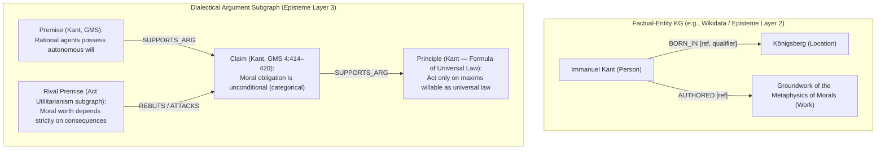

# Knowledge as Structure: From Factual Knowledge Graphs to Epistemic Theory Graphs

This document motivates the conceptual shift from general-purpose **factual-entity Knowledge Graphs (KGs)** to **Epistemic Theory Graphs** in **Episteme**, situates the approach relative to existing scholarly and argumentative knowledge-graph systems, and outlines the core representational challenges of scientific and philosophical literature. All mathematical symbols follow the [Canonical Notation & Symbol Reference](notation.md); all bibliographic citations resolve to the [Consolidated References & Bibliography](references.md).

---

## 1. Moving from Linear Prose to Structured Epistemic Topology

We argue that the knowledge graph—or more formally, *knowledge as structure*—is an indispensable tool for human and computational inquiry. Breaking the dense, interconnected architecture of scientific theories into tractable, structured representations is one of our primary objectives. Representing theoretical discourse as an explicit graph topology makes inferential dependencies, implicit assumptions, and dialectical conflicts directly inspectable for both human scholars and neuro-symbolic tools.

Scientific theories are not flat inventories of isolated facts; they are structured networks of concepts, axioms, hypotheses, inferential warrants, counterarguments, and application domains ([Toulmin, 1958](references.md#toulmin-1958); [Balzer, Moulines, & Sneed, 1987](references.md#balzer-1987); [Schurz, 2014](references.md#schurz-2014)).

> **Terminology Note — Epistemic Theory Graphs vs. MMT Theory Graphs.** In mathematical knowledge management, the term *theory graph* denotes a graph of **formalized logical theories** connected by **theory morphisms** such as inclusions and views (MMT/OMDoc; [Rabe & Kohlhase, 2013](references.md#rabe-2013); [Kohlhase, 2014](references.md#kohlhase-2014)). That mathematical construct is closely related to Episteme's Layer 4 intertheoretical links ($GL$), whereas Episteme's **Epistemic Theory Graph** ($G$) encompasses a broader four-layer architecture spanning source text spans, entity assertions, natural-language dialectical argumentation, and structuralist theory-net projections.

---

## 2. The Epistemic & Representational Divide: Factual-Entity KGs vs. Epistemic Theory Graphs

An Epistemic Theory Graph integrates with Knowledge Graphs (KG) as structurally, it *is* a Knowledge Graph (and Episteme's own Layer 2 is an entity-relational KG) enriched with an **argumentative-epistemic schema and formal evaluation semantics**. The substantive difference lies in **epistemic stance, representational focus, and reasoning semantics**, not in an ontological binary.

### 2.1 Modern Factual-Entity & Scholarly Knowledge Graphs (Related Work)

Contemporary KG engineering has moved well beyond naive single-truth triple stores ([Hogan et al., 2021](references.md#hogan-2021)):

- **Provenance, Qualifiers & Open-World Semantics:** Semantic Web standards (RDF) operate under the **Open-World Assumption (OWA)** and support contextual provenance via named graphs and RDF-star. **Wikidata** is explicitly architected as a secondary statement database supporting multiple conflicting claims annotated with **ranks, qualifiers, and references**, and large KGs continuously revise and deprecate assertions rather than accumulating static facts monotonically.
- **Scholarly & Argumentative KGs:** Dedicated ecosystems already model scholarly claims and arguments, including **Nanopublications**, the **Open Research Knowledge Graph (ORKG)** ([Jaradeh et al., 2019](references.md#jaradeh-2019)), the **Argument Interchange Format (AIF / AIFdb)** ([Chesñevar et al., 2006](references.md#chesnevar-2006) and [Lawrence & Reed, 2014](references.md#lawrence-2014)).

### 2.2 What Epistemic Theory Graphs Add

While factual-entity KGs excel at entity-centric retrieval and scholarly KGs capture structured metadata or isolated argument diagrams, they generally do not unify **verbatim provenance**, **perspectival concept stratification**, **decoupled continuous dialectical semantics**, and **structuralist theory-net hierarchies** in one formal model:

- **Object-Level Theoretical Constructs:** Represent domain principles and theoretical concepts (*Formula of Universal Law*, *inertial mass*, *utility maximization*) whose meanings depend on their surrounding theoretical framework (canonical referents live in $L_2$, while their axiomatic formulations and claims live in $L_3$).
- **Typed Inferential & Dialectical Structures:** Model linked conjunctive inferences, warrant backing, and the full ASPIC+ attack triad (`REBUTS`/`ATTACKS`, `UNDERCUTS`, `UNDERMINES`) alongside non-factive relation predicates (never prejudging evaluation with factive verbs like `REFUTES`) and structuralist specialization (`SPECIALIZES`).
- **Doxastic & Theoretical Pluralism:** Rather than invoking metaphysical *truth pluralism* (the thesis that different domains possess different truth properties; [Wright, 1992](references.md#wright-1992)), Epistemic Theory Graphs adopt **doxastic and theoretical pluralism** coupled with defeasible reasoning over classical propositions. Rival, mutually inconsistent theories coexist cleanly as distinct subgraphs or nets ([Lakatos, 1970](references.md#lakatos-1970), [1978](references.md#lakatos-1978)), and dialectical opposition between specific claims of competing frameworks is first-class data rather than a merge error.

### 2.3 Visual Comparison: Factual Entity Assertions vs. Dialectical Subgraph

*(Note on the philosophical example: in *Groundwork of the Metaphysics of Morals* [Kant, 1785](references.md#kant-1785), 4:414–420, the unconditionality of moral duty motivates the Formula of Universal Law as one of several formulations of the Categorical Imperative whose equivalence is itself a classic interpretive debate — [Paton, 1947](references.md#paton-1947); [Wood, 1999](references.md#wood-1999). Rival normative theories such as utilitarianism are modeled as entire subgraphs/nets, and dialectical edges connect specific conflicting propositions via non-factive `REBUTS` / `ATTACKS` relations rather than collapsing an entire theory into one atom.)*

---

## 3. Key Dimensions of Comparison

| Dimension | Factual-Entity Knowledge Graphs | Epistemic Theory Graphs (Episteme) |
|:---|:---|:---|
| **Primary Focus** | Entities, biographical/bibliographic facts, taxonomies, and qualified statements | Propositional arguments, inferential warrants, rival theoretical frameworks, and theory-nets (built atop an $L_2$ entity KG) |
| **Edge Semantics** | Entity-relational predicates (`born_in`, `authored`, `subclass_of`), often with qualifiers and references | Typed dialectical relations (`SUPPORTS_ARG`, `ENTAILS`, `REBUTS`, `UNDERCUTS`, `UNDERMINES`, `BACKS`) and structural relations (`SPECIALIZES`, `CONSTRAINS`, `REDUCES_TO`) |
| **Claim Status** | Asserted/qualified statements (with ranks, temporal bounds, and sources in systems like Wikidata) | Defeasible, intensionally scoped propositions (`asserted`, `attributed`, `suppositional`, `historical`) evaluated under formal argumentation semantics |
| **Epistemic Stance** | Primarily single-perspective or source-attributed statement storage without dialectical defeat calculus | Doxastic & theoretical pluralism: explicit dialectical conflict modeling and comparative evaluation across rival paradigms |
| **Construction Method** | NER, entity linking, factual relation extraction, schema alignment | Computationally assisted textual interpretation, argument mining, structural formalization, and human-in-the-loop adjudication of readings |
| **Graph Topology** | Heavy-tailed, small-world entity-relational graphs | Multi-layer multigraph: general directed (potentially cyclic) bipartite dialectical graph ($L_3$) paired with acyclic Hasse posets ($L_4$ Theory-Nets) |
| **Dynamics & Revision** | Continuous database update, deprecation, and consistency repair | Separates synchronic non-monotonic inference (D-QBAF/Dung), belief revision (AGM), and diachronic theory change (Lakatos/BMS) |
| **Primary Use Cases** | Search, entity QA, bibliographic discovery, structured fact curation | Computational philosophy of science, comparative paradigm analysis, structured literature synthesis, auditable neuro-symbolic reasoning |

---

## 4. Epistemic and Construction Challenges

Constructing an Epistemic Theory Graph from scientific and philosophical corpora raises five methodological challenges:

### 4.1 Interpretation Variance

Scholarly and philosophical texts admit multiple competing interpretations. Unlike recording an author's birthplace, reconstructing an argument requires attributing inferential intent. Episteme separates **exegetical disagreement** (*what an author meant*) from **substantive disagreement** (*whether a claim is justified*) by attaching an explicit exegetical reading index $\mathrm{rd}(a) \in \mathcal{R}_{\text{int}}$ to atoms and linking competing readings via `ALTERNATIVE_READING_OF` $\notin \mathcal{R}_{\text{att}}$ (see [Formal Graph Schema](formal_graph_model.md#intensional-mode-perspectival-attribution-and-exegetical-reading-index)).

### 4.2 Polysemy & Taxonomic Incommensurability

Identical lexical tokens frequently diverge across contexts, but two distinct phenomena must not be conflated:

- **Cross-disciplinary polysemy / homonymy** (e.g., *rationality* in neoclassical economics vs. Frankfurt School critical theory), which contextual disambiguation and conception stratification can resolve in principle ([ADR-0023](../adr/0023-intensional-perspectival-scoping-and-conception-stratification.md)).
- **Taxonomic (local) incommensurability** ([Kuhn, 1983](references.md#kuhn-1983), [2000](references.md#kuhn-2000); [Feyerabend, 1962](references.md#feyerabend-1962)): when the kind hierarchies and structural relations of rival paradigms — classically *mass* in Newtonian vs. relativistic mechanics — cannot be mapped onto each other without loss, blocking naive point-by-point comparison. Notably, [Stegmüller (1976)](references.md#stegmuller-1976) developed the structuralist reconstruction specifically to *defuse* radical incommensurability by showing how theory dislodgement and reduction can remain rational even without a shared observational language.

### 4.3 Implicit Assumptions & Enthymemes

Academic prose rarely spells out every deductive step; it relies heavily on **enthymemes** — arguments with unstated premises or bridging warrants ([Lawrence & Reed, 2019](references.md#lawrence-2019)). Reconstructing coherent inference hypergraphs requires detecting inferential gaps and recovering implicit premises transparently while keeping recovered assumptions auditable against source text spans.

### 4.4 Non-Monotonic Inference, Belief Revision & Theory Change

Three distinct formal phenomena are kept explicitly separate in Episteme:

1. **Synchronic Non-Monotonic Inference** ([Dung, 1995](references.md#dung-1995)): adding a new defeater to a fixed dialectical graph can overturn previously accepted conclusions — modeled by Layer 3 **D-QBAF gradual semantics** (see [Formal Graph Schema](formal_graph_model.md#3-uncertainty-ontology-and-d-qbaf-gradual-semantics)).
2. **Belief Revision**: contracting or revising a knowledge base itself to restore consistency under new evidence (used in Episteme's formalization of ad-hoc₁ accommodation; see [Epistemology](epistemology.md#41-empirical-outcomes-and-ad-hoc-accommodations)).
3. **Diachronic Theory Change** ([Kuhn, 1962](references.md#kuhn-1962); [Lakatos, 1970](references.md#lakatos-1970); [Balzer et al., 1987](references.md#balzer-1987), ch. V): historical evolution of theory-nets and intended applications across versions $G(t_1), G(t_2), \dots$.

### 4.5 Metatheoretical Evaluation Complementing Precision / Recall

Standard information-extraction and argument-mining benchmarks evaluate component and relation fidelity using Precision, Recall, and F1. Episteme **retains** P/R/F1 for extraction fidelity and **complements** it with structural and epistemological diagnostics:

- Do reconstructed inference hypergraphs preserve deductive and evidential dependencies?
- Do empirical theories exhibit explanatory unification ([Schurz & Lambert, 1994](references.md#schurz-1994); see [Epistemology](epistemology.md#22-explanatory-unification)) and empirical creativity ([Schurz, 2014](references.md#schurz-2014), ch. 5)?
- Across diachronic versions of an empirical research programme, do modifications reflect progressive or degenerating problem shifts ([Lakatos, 1970](references.md#lakatos-1970), [1978](references.md#lakatos-1978); see [Epistemology](epistemology.md#4-lakatosian-research-programmes-and-theory-dynamics))?

---

!!! info "Bridging Argument Mining and Structuralist Theory-Nets (Two-Level Scope)"

    In structuralist philosophy of science ([Sneed, 1971](references.md#sneed-1971); [Balzer et al., 1987](references.md#balzer-1987)), scientific theories are reconstructed as model-theoretic theory-nets $\mathcal{N} = \langle N, \sigma \rangle$ whose nodes are classes of mathematical structures ($M_p, M, M_{pp}, GC, GL$) paired with intended applications $I$. Constructing such full reconstructions manually is expert-intensive ([Balzer, Sneed, & Moulines, 2000](references.md#balzer-2000)), and qualitative philosophical texts generally lack formal mathematical structure species altogether.

    **Episteme** bridges natural-language prose and structuralist organization via an explicit **two-level model** rather than claiming automatic extraction of Bourbaki model classes from prose:

    1. **Computational argument mining** ([Lawrence & Reed, 2019](references.md#lawrence-2019)) extracts statement-level atoms, conjunctive inference warrants, and dialectical relations into **Layer 3 ($\mathcal{D}$)**.
    2. Typed `FORMULATES` edges connect Layer 3 statements to **Layer 4 ($\mathcal{N}$)** under a universal **"Structuralism Light"** baseline (specialization poset topology $\sigma$ + $T$-theoreticity annotation). Where formal quantitative laws exist, optional parametric enrichment ([ADR-0015](../adr/0015-theoretical-enrichment-and-tenability-evaluation.md)) approximates local model fit, while full BMS model theory serves as a formal *regulative ideal*.

---

## 5. Research Horizons & Applications

- **Computational Philosophy & Epistemology:** Translating complex prose debates into queryable, provenance-anchored dialectical graphs; auditing consistency, circularities, and argument vulnerability; and tracking diachronic programme dynamics in empirical disciplines (with qualified reflective-equilibrium analogies for normative domains; see [Epistemology](epistemology.md#1-scope-and-domain-of-epistemic-criteria)).
- **Digital Humanities & History of Ideas:** Tracing conceptual specialization, polysemy, and doctrinal divergence across historical epochs using stratified `EntityConception` facets; distinguishing substantive inferential lineage from surface bibliographic citation counts.
- **Auditable Neuro-Symbolic Reasoning:** Grounding language-model assistance in explicit contested-knowledge subgraphs with continuous acceptability degrees ($s_i^*$), controversy diagnostics ($\mathcal{V}$), and verbatim character-span provenance chains ($L_1$) that document *which source passage supports which claim* (exegetical provenance) separately from *which inferences warrant that claim* (epistemic justification).

---

## 6. Conceptual Grounding in Episteme's Four-Layer Architecture

Within **Episteme**, these distinctions are operationalized through a four-layer multigraph (see [Formal Graph Schema & Argumentation Semantics](formal_graph_model.md)):

- **Layer 1 ($L_1$, Source & Provenance Layer):** Verbatim document chunks and character-offset spans ($\mathrm{Span}$) providing exegetical provenance.
- **Layer 2 ($L_2$, Entity Layer / ABox):** Canonical factual entities (`Person`, `Work`, `Concept`, `Theory`, `Institution`) with `EntityConception` facets and factual multigraph edges.
- **Layer 3 ($L_3$, Dialectical Argument Graph $\mathcal{D}$):** Bipartite D-QBAF over propositional atoms ($\mathcal{A} = B \uplus H$) and reified inference warrants ($\mathcal{W}$) with intensional/reading scoping and continuous gradual semantics.
- **Layer 4 ($L_4$, Structuralist Theory-Net Projection $\mathcal{N}$):** Specialization posets $\langle N, \sigma \rangle$ of theory-elements $T = \langle K, I \rangle$ bridged to Layer 3 via `FORMULATES` edges.

---

## Related Documentation

- **Shared Symbols:** [Canonical Notation & Symbol Reference](notation.md)
- **Bibliography:** [Consolidated References & Bibliography](references.md)
- **Formal Graph Specification:** [Formal Graph Schema & Argumentation Semantics](formal_graph_model.md)
- **Epistemological Criteria:** [Epistemology & Philosophy of Science](epistemology.md)
- **Topologies & Posets:** [Theory-Nets, Posets & Topologies](theory_nets_and_topologies.md)
- **Quantitative Evaluation:** [Theory Metrics Subsystem](theory/metrics/index.md)
- **Pipeline Architecture:** [System Architecture Overview](../architecture/overview.md)
- **Glossary:** [Glossary](glossary.md)
