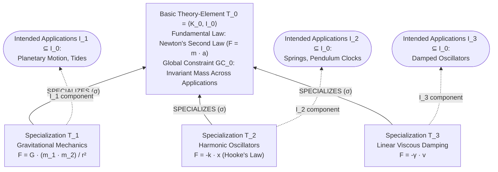

# Theory-Nets, Posets & Topologies

This document specifies the structuralist **Layer 4 Theory-Net** topology, the statement-level sentence and relation typologies that bridge Layer 3 to Layer 4, macro-level **Theory-Holons**, multi-scale **recursive Leiden community detection**, and orientation-aware **node centrality**. All symbols follow the [Canonical Notation & Symbol Reference](notation.md); all bibliographic citations resolve to the [Consolidated References & Bibliography](references.md).

---

## 1. Structuralist Theory-Nets as Posets (Layer 4)

In the structuralist non-statement view of science ([Sneed, 1971](references.md#sneed-1971); [Stegmüller, 1976](references.md#stegmuller-1976); [Balzer, Moulines, & Sneed, 1987](references.md#balzer-1987)), the basic unit of a scientific theory is a **theory-element**:

$$
T = \langle K,\; I \rangle, \qquad K = \langle M_p,\; M,\; M_{pp},\; GC,\; GL \rangle
$$

where $K$ is the five-component formal core (potential models $M_p$, actual models $M \subseteq M_p$, partial potential models $M_{pp} = \{r(x) : x \in M_p\}$ via the restriction map $r: M_p \to M_{pp}$, global constraints $GC$, and global intertheoretical links $GL$) and $I \subseteq M_{pp}$ is the domain of intended applications (see [Formal Graph Schema](formal_graph_model.md#5-layer-4-structuralist-model-theoretic-foundations-and-two-level-bridge)).

In Episteme's **two-level architecture**, theory-elements $T \in N$ reside in **Layer 4 ($L_4$)** as non-statement model-theoretic objects (whose cores are neither true nor false; only their *empirical claims* $I \in \operatorname{Cn}_{\text{str}}(K)$ are falsifiable), linked via `FORMULATES` edges from their statement-level expressions in Layer 3 ($\mathcal{D}$). For qualitative philosophical corpora lacking formal structure species, Layer 4 operates under **Structuralism Light** (specialization poset topology + $T$-theoreticity annotation), whereas quantitative/formal domains additionally support operational parametric enrichment ($TS_{\text{local}}, TS_{\text{edge}}$; see [Formal Graph Schema](formal_graph_model.md#51-two-level-stance-and-operational-scope)).

A mature scientific theory is organized as a **Theory-Net** $\mathcal{N} = \langle N, \sigma \rangle$ — a finite set $N$ of theory-elements ordered by the **specialization relation** $\sigma$ ([Balzer et al., 1987](references.md#balzer-1987), ch. IV).

*(Note on structuralist components: intended applications $I_k \subseteq M_{pp}$ are the second component of $T_k = \langle K_k, I_k \rangle$, not specialized child elements; global constraints $GC$ restrict combinations of models across overlapping applications within a theory-element's core, whereas bridges to distinct theories are intertheoretical links $GL$.)*

### 1.1 The BMS Specialization Relation ($\sigma$)

Following [Balzer, Moulines, & Sneed (1987, ch. IV, pp. 168–172)](references.md#balzer-1987), $T' = \langle K', I' \rangle$ is a **specialization** of $T = \langle K, I \rangle$, written $T' \,\sigma\, T$, if and only if both share the exact same conceptual framework and $T'$ restricts the laws, constraints, links, and intended applications of $T$:

$$
T' \,\sigma\, T \iff M_p' = M_p \;\wedge\; M_{pp}' = M_{pp} \;\wedge\; M' \subseteq M \;\wedge\; GC' \subseteq GC \;\wedge\; GL' \subseteq GL \;\wedge\; I' \subseteq I.
$$

- **Role of Bourbaki Structure Species:** Nicolas Bourbaki's *species of structures* ([Bourbaki, 1968](references.md#bourbaki-1968)) are used in structuralism to typify the class of **potential models $M_p$**. Specialization preserves $M_p$ and $M_{pp}$ unchanged while adding special laws (such as Hooke's law $F = -k \cdot x$ or linear viscous damping $F = -\gamma \cdot v$) that narrow the subclass of actual models $M' \subseteq M$.
- **Partial Order vs. Hasse DAG:** $\langle N, \sigma \rangle$ is a finite **partially ordered set (poset)**:
  1. **Reflexivity:** $T_i \,\sigma\, T_i$
  2. **Antisymmetry:** $T_i \,\sigma\, T_j \;\wedge\; T_j \,\sigma\, T_i \implies T_i = T_j$
  3. **Transitivity:** $T_i \,\sigma\, T_j \;\wedge\; T_j \,\sigma\, T_k \implies T_i \,\sigma\, T_k$

  Because $\sigma$ is reflexive, its full relation graph contains self-loops and is not itself acyclic; its **strict part** ($\sigma \setminus \Delta_N$) and **Hasse diagram** (transitive reduction, with directed covering edges $T_j \xrightarrow{\text{SPECIALIZES}} T_i$ from specialized element to parent) are strictly **directed acyclic graphs (DAGs)**. Antisymmetry and transitivity prevent *specialization cycles* among theory-elements (they do not address circular concept definitions, which are governed by definitional theory; cf. [Belnap, 1993](references.md#belnap-1993)).

### 1.2 Basic Elements and Theory-Trees

Under $T' \,\sigma\, T$ ("$T'$ specializes $T$"), the most general elements of $\mathcal{N} = \langle N, \sigma \rangle$ are its **maximal elements** — called **basic theory-elements** in BMS ([Balzer et al., 1987](references.md#balzer-1987), p. 175):

$$
\mathrm{Basic}(\mathcal{N}) = \bigl\{ T_0 \in N \;\big|\; \forall T \in N,\; T_0 \,\sigma\, T \implies T = T_0 \bigr\}.
$$

When $\mathrm{Basic}(\mathcal{N}) = \{T_0\}$ is a singleton, $T_0$ is the **unique greatest (maximum) element** of the poset ($T \,\sigma\, T_0$ for all $T \in N$), which automatically guarantees that $\mathcal{N}$ is connected.

However, a unique greatest element does **not** by itself make a **Theory-Tree**: a diamond poset ($T_3 \,\sigma\, T_1$, $T_3 \,\sigma\, T_2$, $T_1 \,\sigma\, T_0$, $T_2 \,\sigma\, T_0$) has a unique maximum $T_0$ without being a tree. A Theory-Net $\mathcal{N} = \langle N, \sigma \rangle$ is a **Theory-Tree** if and only if:

1. $\mathrm{Basic}(\mathcal{N}) = \{T_0\}$ (unique greatest basic element), **and**
2. for every $T \in N$, the principal up-set $\{T' \in N : T \,\sigma\, T'\}$ is a **chain** (linearly ordered under $\sigma$) — equivalently, the Hasse diagram of $\sigma \setminus \Delta_N$ is a rooted tree.

---

## 2. Typology of Statement-Level Nodes and Relations

Layer 3 propositional atoms ($\mathcal{A} = B \uplus H$) and relations are typed using criteria synthesized from [Schurz (2014, ch. 5)](references.md#schurz-2014) and structuralist metascience ([Balzer et al., 1987](references.md#balzer-1987)).

### 2.1 Propositional Atom Classifications

- **Observation / Singular Evidential Statement (*Beobachtungssatz i.e.S.*, *im engeren Sinne* — in the narrow sense):** Singular or spatiotemporally localized statement formulated in the pre-theoretical vocabulary $L_E$ relative to $T$ (partition $B$). Carries defeasible initial presumption under Data Priority / foundherentism ([Haack, 1993](references.md#haack-1993)), not infallible certainty.
- **Empirical Generalization (*Empirischer Satz i.e.S.*):** General statement formulated in logical and pre-theoretical $L_E$ vocabulary whose quantifiers range over pre-theoretical domains (partition $B$).
- **Theoretical Hypothesis / Principle (*Theoretischer Satz i.w.S.*, *im weiteren Sinne* — in the broad sense):** Statement containing $T$-theoretical terms ($L_T$) or theoretical quantifiers (partition $H$), including pure theoretical axioms and object-level mixed mapping laws (`MIXED`).
- **Core Expansion / Auxiliary Hypothesis:** Specialized or peripheral law in $H$ formulating a specialization $T' \,\sigma\, T_0$ or a protective-belt modification $\Pi^{(j)}$. Identifying the root core $K(T_0)$ of a structuralist net with a Lakatosian hard core $\mathbf{HC}$ follows Stegmüller's reconstruction thesis ([Stegmüller, 1976](references.md#stegmuller-1976)) and is treated as an explicit analytical correspondence rather than an identity of definitions (see [Epistemology](epistemology.md#3-analytical-dimensions-of-statement-level-theory-reconstruction)).

Atoms are further annotated by **logical scope**:

- **Synthetic Contingent (*Synthetischer kontingenter Satz*):** Neither logically tautological nor self-contradictory. *(Note: being synthetic contingent is necessary, not sufficient, for empirical testability; by Duhem–Quine holism, an isolated contingent theoretical axiom has no empirical content until combined with mapping laws and auxiliaries.)*
- **Essential Universal (*Essentieller Allsatz*):** Unrestricted nomological universal law.
- **Statistical / Probabilistic Universal (*Statistischer Allsatz*):** Law expressing probabilistic or statistical regularities.
- **Existential Statement (*Existenzsatz*):** Unrestricted existential assertion (theoretical or empirical).
- **Localized Statement (*Lokalisierter All- / Existenzsatz*):** Spatiotemporally bounded statement (e.g., an experimental trial or historical observation).

### 2.2 Relation Categories Across Layers 3 and 4

1. **Specialization Edges ($L_4$, `SPECIALIZES`):** Directed Hasse covering edges $T_j \xrightarrow{\text{SPECIALIZES}} T_i$ encoding $T_j \,\sigma\, T_i$ (child $\to$ parent).
2. **Intra-Core Constraints ($L_4$, `CONSTRAINS`):** Encodings of global constraints $GC \subseteq \operatorname{Pot}(M_p)$ requiring parameter invariance (e.g., identical mass of a body) across overlapping intended applications *within* a theory-element.
3. **Intertheoretical Links & Reduction ($L_4$, `REDUCES_TO`, `LINKS_TO`):** Directed relations between distinct theory-elements encoding global intertheoretical links $GL$ or structuralist theoretical reduction $\mathrm{RED}(T, T')$ ([Balzer et al., 1987](references.md#balzer-1987), ch. VI), where a successor theory-element $T'$ subsumes the empirical claims of $T$ under appropriate translation and limiting conditions.
4. **Deductive Derivation Schemata ($L_3$, modeled via reified warrants $\xi_k \in \mathcal{W}$):**
   - *Deductive-Nomological Explanation Schema* ([Hempel & Oppenheim, 1948](references.md#hempel-1948)): $\text{Universal Law} \wedge \text{Singular Antecedent} \vdash \text{Singular Consequence}$ — requires a **conjunctive** multi-premise warrant $\xi_k \in \mathcal{W}$, which binary edges cannot express.
   - *Falsification of Empirical Generalizations (restricted strictly to $L_E$-laws, preserving Duhem–Quine holism for theoretical laws):*
     - *Counter-instance schema:* $(Fa \wedge \neg Ga) \vdash \neg \forall x\,(Fx \to Gx)$.
     - *Existential counterexample schema* (equivalent via $\exists$-introduction): $\exists x\,(Fx \wedge \neg Gx) \vdash \neg \forall x\,(Fx \to Gx)$.
5. **Dialectical & Coherence Relations ($L_3$):**
   - *Primary D-QBAF relations:* Directed non-negative-weight support ($\mathcal{R}_{\text{sup}}$: `SUPPORTS_ARG`, `ENTAILS`, `DEDUCES`, `BACKS`) and attack ($\mathcal{R}_{\text{att}}$: `REBUTS`/`ATTACKS`, `UNDERCUTS`, `UNDERMINES`).
   - *Symmetrized ECHO lens:* When projecting $\mathcal{D}$ into Thagard's ECHO lens (see [Formal Graph Schema](formal_graph_model.md#37-alternative-analytical-lenses-echo-dung-extensions-maximal-consistency)), symmetric excitatory links ($w_{ij}^{\text{echo}} > 0$; e.g., $+0.05$ in [Thagard, 1989](references.md#thagard-1989), or $+0.04$ in [Thagard, 1992](references.md#thagard-1992)) and inhibitory links ($w_{ij}^{\text{echo}} < 0$; e.g., $-0.20$ in [Thagard, 1989](references.md#thagard-1989), or $-0.06$ in [Thagard, 1992](references.md#thagard-1992)) are constructed via an explicit symmetrization map rather than mixed directly into D-QBAF.

---

## 3. Dual Topological Scales: Theory-Nets vs. Theory-Holons

Episteme distinguishes two topological scales of scientific organization ([Balzer et al., 1987](references.md#balzer-1987), ch. VIII):

1. **Theory-Net ($\mathcal{N} = \langle N, \sigma \rangle$, Intra-Theory Scale):** The specialization structure of a single theory. Its Hasse diagram is strictly acyclic (a DAG, and in canonical cases a Theory-Tree). By contrast, the associated Layer 3 Dialectical Argument Graph $\mathcal{D}$ is a general directed graph that admits cycles (e.g., mutual rebuttals).
2. **Theory-Holon (Inter-Theory Macro Scale):** The global network of distinct theories linked by intertheoretical links $GL$, theoretical reductions, and conceptual presuppositions. A holon's inter-theory dependency graph may be either **acyclic** (terminating in presupposed background theories) or **cyclic** (mutually presupposing frameworks). Describing these two macro-topologies as "foundationalist" vs. "coherentist" is strictly a **structural analogy**: the epistemological foundationalism/coherentism debate concerns the justification of beliefs rather than inter-theory presupposition (where Episteme adopts foundherentism; [Haack, 1993](references.md#haack-1993)).

---

## 4. Multi-Scale Community Detection (Recursive Leiden)

To discover macroscopic thematic clusters, debates, and research clusters in large multi-document graphs, Episteme applies **recursive Leiden community detection** — iteratively applying the Leiden algorithm ([Traag, Waltman, & van Eck, 2019](references.md#traag-2019)) to large communities (following the recursive hierarchical partitioning pattern used in GraphRAG; [Edge et al., 2024](references.md#edge-2024)). Unlike Louvain, Leiden guarantees that every detected community is internally well-connected.

### 4.1 Signed Objective, Projection Hygiene & Resolution Limits

Standard unsigned modularity optimization on a mixed-layer argumentative graph suffers from three structural hazards that Episteme addresses explicitly:

1. **Dialectical Opponents Merged Under Positive Weights:** Treating `ATTACKS` / `REBUTS` edges as positive weights merges rival camps locked in intense critique (e.g., Kantians and utilitarians) into a single "debate" cluster. Depending on the analytical goal, Episteme therefore either:
   - optimizes **signed modularity** $Q_{\text{signed}}(\gamma_{\text{res}})$ ([Traag & Bruggeman, 2009](references.md#traag-2009)) with positive weights on support/coherence links and negative weights on attack/competition links (separating rival schools), or
   - projects strictly onto **support-only / structural subgraphs** (separating cohesive doctrines), reserving unsigned projections explicitly for detecting *shared debate arenas*.
2. **Heterogeneous Layer Pooling:** Combining $L_2$ entity triples and $L_3$ argument relations into a single uncalibrated modularity score conflates bibliographic/factual proximity with argumentative support. Projections must either stay within a single layer or specify explicit per-relation-type weights.
3. **Objective & Resolution Limit:** Episteme optimizes modularity $Q_{\text{mod}}(\gamma_{\text{res}})$ (or signed modularity $Q_{\text{signed}}(\gamma_{\text{res}})$) or the Constant Potts Model (CPM; [Traag et al., 2019](references.md#traag-2019)) parameterized by resolution $\gamma_{\text{res}} > 0$. Because modularity exhibits a **resolution limit** below which small clusters merge depending on total graph weight ([Fortunato & Barthélemy, 2007](references.md#fortunato-2007)), partition boundaries depend on $\gamma_{\text{res}}$ and corpus size rather than reflecting absolute ontological cuts. Because $Q_{\text{mod}} = \sum_c q_c$ is a **partition-level** objective, any per-community score reported for community $c$ is formally defined as its **additive modularity contribution** $q_c$.

### 4.2 Interpreting Multi-Scale Partitions

Philosophical traditions and thematic subfields **cross-cut rather than nest** — for example, *Kantianism* spans epistemology, ethics, and aesthetics, while *Bayesianism* spans epistemology, philosophy of science, and decision theory. A strictly nested recursive partition therefore cannot guarantee that one depth level universally equals "subfields" and another universally equals "schools of thought".

Instead, recursive Leiden depths are interpreted strictly as **resolution scales** subject to post-hoc scholarly labeling and validation against domain taxonomies:

- **Fine Scale (Leaf Partitions):** Tightly linked local argument clusters, empirical cases, and closely related claims.
- **Meso Scale (Intermediate Partitions):** Specific research programmes, focal debates, or specialized traditions (e.g., *Bayesian Decision Theory* within a broader decision-theory corpus).
- **Coarse Scale (Top-Level Partitions):** Broad thematic arenas or disciplinary clusters (e.g., *Decision Theory*, *Moral Philosophy*, *Epistemology*).

---

## 5. Topological Node Centrality

Interpreting directed centrality requires stating **both the target subgraph and the edge orientation**, because flipping orientation reverses in-degree and out-degree ([Newman, 2018](references.md#newman-2018)):

| Metric | Target Subgraph & Edge Orientation | Epistemic Interpretation & Caveats |
|:---|:---|:---|
| **Support Out-Degree ($C_{\text{out}}^{\text{sup}}$)** | $L_3$ support projection (premise/principle $\to$ conclusion) | Counts direct supported consequences. Serves as a coarse proxy for generative activity, **not** unification (which requires cross-domain diversity). |
| **Participation Coefficient ($P_i$)** | $L_3$ support projection across community partition $\{c\}$ | $P_i = 1 - \sum_c (k_{i,c}/k_i)^2$ ([Guimerà & Amaral, 2005](references.md#guimera-2005)): diversity-sensitive proxy for **explanatory unification** across distinct empirical/thematic clusters. |
| **Specialization In-Degree ($C_{\text{in}}^{\sigma}$)** | $L_4$ Hasse diagram ($T_j \xrightarrow{\text{SPECIALIZES}} T_i$, child $\to$ parent) | Identifies foundational basic elements ($T_0$) with broad specialization fan-in (under child $\to$ parent orientation, $T_0$ has out-degree $0$). |
| **Attack In-/Out-Degree ($C_{\text{in}}^{\text{att}}, C_{\text{out}}^{\text{att}}$)** | $L_3$ attack projection (attacker $\to$ target) | High in-degree flags heavily contested claims; high out-degree flags prolific critical arguments or counterexamples. |
| **Betweenness Centrality ($C_{\text{betw}}$)** | Undirected / directed bridge projection | Identifies boundary-spanning concepts mediating conceptual transfer across communities (note: on directed DAGs, source roots with in-degree $0$ have $C_{\text{betw}} = 0$). |
| **Katz & PageRank Centrality** | Unsigned positive-support or structural projection | Quantifies transitive foundational prominence with damping/teleportation ([Newman, 2018](references.md#newman-2018)). |

> **Why Eigenvector Centrality Is Not Used on DAGs or Signed Graphs.** On any directed acyclic graph (such as a Theory-Net Hasse diagram or acyclic derivation graph), the adjacency matrix is strictly nilpotent: all its eigenvalues equal $0$, causing standard eigenvector centrality to vanish identically or become undefined. On signed graphs containing negative attack edges, the Perron–Frobenius theorem does not apply, so a unique non-negative principal eigenvector is not guaranteed to exist. Episteme therefore computes **Katz centrality** and **PageRank** over explicitly unsigned positive-support or structural projections instead of eigenvector centrality.

---

## Related Documentation

- **Shared Symbols:** [Canonical Notation & Symbol Reference](notation.md)
- **Bibliography:** [Consolidated References & Bibliography](references.md)
- **Formal Graph Schema:** [Formal Graph Schema & Argumentation Semantics](formal_graph_model.md)
- **Epistemological Criteria:** [Epistemology & Philosophy of Science](epistemology.md)
- **Motivation & KG Framing:** [From Factual Knowledge Graphs to Epistemic Theory Graphs](kg_vs_tg.md)
- **Structuralist Benchmark:** [Structuralist Theory-Net Benchmark](../research/structuralist_theory_benchmark.md)
- **Topological Metrics:** [Theory Metrics: Structural Topology](theory/metrics/structural_topology/index.md)
- **Glossary:** [Glossary](glossary.md)
