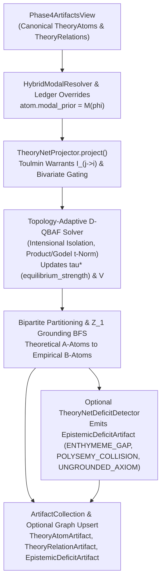

# Phase 6: TheoryNet Projection

## Overview

Phase 6 formalizes the mined argumentation and conceptual graph into a mathematically rigorous **TheoryNet**
($\rho, \alpha$). It evaluates argument acceptability, assigns node plausibility and edge weights, and verifies
empirical content bounds through bipartite partition analysis ($A$-atoms vs. $B$-atoms).

## Purpose

While earlier phases extract textual discourse units and local/global relations, Phase 6 performs the formal
epistemological projection:

1. Translates extracted argument components into formal theory atoms ($\rho$) with assigned plausibility scores.
2. Projects relations into weighted dialectical edges ($\alpha$).
3. Asserts the structuralist empirical content condition: ensuring theoretical hypotheses ($A$-partition) connect
   meaningfully to empirical observations ($B$-partition).

## Theoretical Foundation

See [Formal Graph Schema (TheoryNet)](../../concepts/formal_graph_model.md)
and [Theory-Nets, Posets & Topologies](../../concepts/theory_nets_and_topologies.md):

- Formal representation: $T = \langle \mathcal{A}, \mathcal{R}, \rho, \alpha \rangle$
- Bipartite partitioning: Theoretical Hypotheses ($A$-atoms) vs. Empirical Observations ($B$-atoms)
- Empirical content criteria ($Z_1$ connectivity)
- Gradual semantics and Quantitative Bipolar Argumentation Frameworks (QBAF)

## Components

### 1. TheoryNet Projector (`TheoryNetProjector`)

- Projects the cumulative `Phase4ArtifactsView` (`Phase5ArtifactsView`, consuming `canonical_theory_atoms` and `canonical_theory_relations`) into a formal `TheoryNet` domain contract.
- Maps component classifications to formal theoretical partitions via `SchemaConfig.component_partitions`:
    - **Partition A (Theoretical Core)**: `TheoreticalHypothesis`, `CoreExpansion`.
    - **Partition B (Empirical Grounding)**: `ObservationUnit`, `EmpiricalStatement`.

### 2. Ontological Decoupling & Continuous Quadratic Energy Semantics

- **Node Propositional Modality**: Resolves `atom.modal_prior` ($\tau_0(a) \equiv M(\phi_a) \in [0, 1]$), `resolver_type`, and `syntax_bounds` via `HybridModalResolver` (`StructuralistModalResolver` + optional `DecisionEngineModalResolver`, honoring `EpistemicCurationLedger.get_modality_override()`).
- **Inferential Warrant Force**: Assigns `relation.inferential_warrant` ($I_{j \to i} \in [0, 1]$) representing conditional inferential validity under Toulmin argument schemes (`derive_relation_warrant`: Deductive entailment/refutation `1.00`, Inductive support/attack `0.75`, Methodological undercut `0.60`, Analogy/exemplification `0.40`).
- **Perception Calibration**: Retains extraction stance probability `perception_stance_prob` ($P$) and empirical/calibrated confidence `perception_empirical_acc` / `calibrated_confidence` ($C$).
- **Bivariate Admissibility Gating**:
  - **Mode 1 (`hard`)**: Normative standard. Marks `is_admissible = (p >= tau_p) and (c >= tau_c)` (and filters at Neo4j Cypher projection via `WHERE r.perception_stance_prob >= $tau_p AND r.calibrated_confidence >= $tau_c`).
  - **Mode 2 (`soft`)**: Candidate passthrough with continuous sigmoidal relaxation $\mathcal{F}_{\text{soft}}(r) = \sigma(20(P - \tau_P)) \cdot \sigma(20(C - \tau_C))$ for smooth numerical optimization.
- **Intensional Scoping & Conjunctive T-Norms**: Isolates `suppositional` (*Reductio*) and off-perspective `attributed` nodes (`isolate_suppositional`, `isolate_attributed`, `perspective` per [ADR 0023](../../adr/0023-intensional-perspectival-scoping-and-conception-stratification.md)) and evaluates multi-premise hyperedges under `"product"` or `"godel"` `conjunctive_t_norm`.
- **Topology-Adaptive Quadratic Energy Semantics**:
  - **Acyclic Graphs (DAGs)**: Evaluated in closed form in $O(|V| + |E|)$ along a single topological pass from tenability-modulated prior $\tilde{\tau}_0(a) = \tau_0(a) \cdot TS_{\text{local}}(a)$ to `equilibrium_strength` ($\tau^*(a)$).
  - **Cyclic Graphs**: Evaluated via continuous adaptive ODE integration (`solve_ivp` RK45 / Radau fallback) when `use_continuous=True` and `semantics_model="quadratic"`.
- **Keynes-Gärdenfors Controversy Telemetry**: Records per-atom `controversy_volatility` ($\mathcal{V}(a)$).

### 3. Empirical Content ($Z_1$) Verification & Epistemic Deficit Detection

- Builds an adjacency projection over Partition `A` (`TheoreticalHypothesis`, `CoreExpansion`) and Partition `B` (`ObservationUnit`, `EmpiricalStatement`) to compute $Z_1$ BFS reachability from empirical observations.
- When configured with `deficit_detector: EpistemicDeficitDetector` (`TheoryNetDeficitDetector`), inspects $Z_1$-ungrounded `A`-atoms, zero-support central nodes (via `epistemetrics.page_rank(..., prefer_neo4j=False)` and `betweenness_centrality`), equilibrium strengths $\tau^*$, and controversy volatility $\mathcal{V}$ to emit typed `EpistemicDeficitArtifact` signals (`ENTHYMEME_GAP`, `POLYSEMY_COLLISION`, `UNGROUNDED_AXIOM`) for closed-loop refinement ([ADR 0024](../../adr/0024-closed-loop-hermeneutic-refinement.md)).

## Workflow

## Implementation Details

- [`pipeline_explanation.md`](pipeline_explanation.md) - Detailed step-by-step implementation walkthrough
- **Runner**: `Phase6Runner` in `episteme_pipeline/phases/phase6_theorynet/runner.py`
- **Projector**: `TheoryNetProjector` in `episteme_pipeline/projection/theorynet_projector.py`
- **Deficit Detector**: `TheoryNetDeficitDetector` in `episteme_pipeline/refinement/detector.py`
- **Configuration**: `Phase6Config` in `episteme_pipeline/config.py`
- **Solvers**: `WeightedQuadraticEnergySolver` and `QBAFGradualSemanticsSolver` in `epistemetrics.epistemic.qbaf`

## Configuration

Configuration is managed via `Phase6Config` in `episteme_pipeline/config.py`:

| Parameter | Type | Default | Description |
|:----------|:-----|:--------|:------------|
| `enabled` | `bool` | `True` | Whether to execute the formal TheoryNet projection pass. |
| `admissibility_mode` | `Literal["hard", "soft"]` | `"hard"` | Bivariate gating mode: hard threshold pruning vs. continuous sigmoidal relaxation. |
| `tau_p` | `float` | `0.0` | Minimum perception stance probability threshold for relation admissibility. |
| `tau_c` | `float` | `0.0` | Minimum perception calibration confidence threshold for relation admissibility. |
| `admissibility_threshold` | `float` | `0.0` | Legacy empirical accuracy threshold ($\tau_{\text{admissibility}}$) fallback when `tau_p`/`tau_c` are `0.0`. |
| `prune_inadmissible` | `bool` | `False` | When `True`, relations failing admissibility are dropped; when `False`, `is_admissible=False` and `active_weight=0.0`. |
| `semantics_model` | `str` | `"quadratic"` | Gradual semantics model (`"quadratic"`, `"euler"`, `"categorizer"`, `"linear"`). |
| `use_continuous` | `bool` | `True` | Use continuous `WeightedQuadraticEnergySolver` (DAG closed-form / adaptive ODE) for `"quadratic"`. |
| `iterations` | `int` | `20` | Maximum iterative convergence steps for gradual semantics. |
| `tolerance` | `float` | `1e-4` | Max error tolerance for equilibrium convergence. |
| `perspective` | `str \| None` | `None` | Optional epistemic perspective filter (`"author"`, `"<Agent>"`, `"all"`, or `None`). |
| `isolate_suppositional` | `bool` | `True` | Isolate `suppositional` (*Reductio*) premises from inflating asserted claims. |
| `isolate_attributed` | `bool` | `True` | Isolate `attributed` opponent summaries from non-matching perspectives. |
| `conjunctive_t_norm` | `Literal["product", "godel"]` | `"product"` | Conjunctive t-norm operator for multi-premise hyperedges (`premise_ids`). |
| `modal_resolver` | `ModalResolverConfig` | `ModalResolverConfig()` | Configuration for `HybridModalResolver`. |

## Phase Contract

**Inputs:**

- `Phase4ArtifactsView` (`Phase5ArtifactsView`): Cumulative canonicalized `TheoryAtom` and `TheoryRelation` artifacts across the pipeline run.

**Outputs:**

- `ArtifactCollection` containing:
    - `TheoryAtomArtifact` envelopes with resolved `modal_prior`, `equilibrium_strength` ($\tau^*$), and `controversy_volatility` ($\mathcal{V}$).
    - `TheoryRelationArtifact` envelopes with `inferential_warrant`, `is_admissible`, `active_weight`, `effective_weight`, `weight_support`, and `weight_attack`.
    - Optional `EpistemicDeficitArtifact` envelopes when `deficit_detector` is configured (`refinement_pass` stamped on provenance).
- Optional direct `ProjectionGraph` updates (when `graph_store` is injected):
    - `upsert_argument_components()` and `upsert_theory_relations()`.

**Invariants:**

- Equilibrium plausibility $\tau^*$, modal prior $\tau_0$, inferential warrant, and active edge weights are bounded in $[0.0, 1.0]$.
- Every $A$-atom's empirical grounding is verifiable via $Z_1$ paths; ungrounded central hubs or conflicting bridges trigger `EpistemicDeficitArtifact` emissions when deficit detection is active.

## Related

- **Theory**: [Formal Graph Schema (TheoryNet)](../../concepts/formal_graph_model.md)
- **Previous Phase**: [Phase 5: Alignment & Theory Fusion](../5_inter_document_argument_web/)
- **Post-Processing**: [Theoretical Enrichment & Tenability Evaluation](../post_processing/theoretical_enrichment.md)
