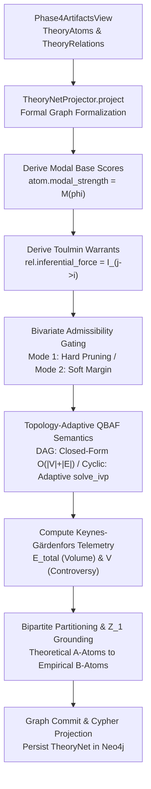

# Phase 6: TheoryNet Projection

## Overview

Phase 6 formalizes the mined argumentation and conceptual graph into a mathematically rigorous **TheoryNet**
($\rho, \alpha$). It evaluates argument acceptability, assigns node plausibility and edge weights, and verifies
empirical content bounds through bipartite partition analysis ($A$-atoms vs. $B$-atoms).

## Purpose

While earlier phases extract textual discourse units and local/global relations, Phase 6 performs the formal
epistemological projection:

1. Translates extracted argument components into formal theory atoms ($\rho$) with assigned plausibility scores.
2. Projects relations into weighted dialectical edges ($\alpha$).
3. Asserts the structuralist empirical content condition: ensuring theoretical hypotheses ($A$-partition) connect
   meaningfully to empirical observations ($B$-partition).

## Theoretical Foundation

See [Formal Graph Schema (TheoryNet)](../../concepts/formal_graph_model.md)
and [Theory-Nets, Posets & Topologies](../../concepts/theory_nets_and_topologies.md):

- Formal representation: $T = \langle \mathcal{A}, \mathcal{R}, \rho, \alpha \rangle$
- Bipartite partitioning: Theoretical Hypotheses ($A$-atoms) vs. Empirical Observations ($B$-atoms)
- Empirical content criteria ($Z_1$ connectivity)
- Gradual semantics and Quantitative Bipolar Argumentation Frameworks (QBAF)

## Components

### 1. TheoryNet Projector (`TheoryNetProjector`)

- Projects the cumulative `Phase4ArtifactsView` into a formal `TheoryNet` domain contract.
- Maps component classifications to formal theoretical partitions:
    - **Partition A (Theoretical Core)**: `THEORETICAL_HYPOTHESIS`, `AXIOM`, `LAW`.
    - **Partition B (Empirical Grounding)**: `EMPIRICAL_STATEMENT`, `OBSERVATION_UNIT`.

### 2. Ontological Decoupling & Continuous Quadratic Energy Semantics

- **Node Propositional Modality**: Initializes `atom.modal_strength` ($M(\phi) \in [0, 1]$) and `atom.base_score` representing authorial propositional certainty asserted in text (Axiom/Law: 1.0, Observation: 0.85, Analytic Hypothesis: 0.75, Synthetic Hypothesis: 0.60, Conjecture: 0.35).
- **Inferential Warrant Force**: Assigns `relation.inferential_force` ($I_{j \to i} \in [0, 1]$) representing conditional inferential validity under Toulmin argument schemes (Deductive entailment: 1.0, Inductive support: 0.75, Methodological undercut: 0.60, Defeasible analogy: 0.40).
- **Perception Calibration**: Retains extraction confidence `stance_probability` ($P$) and calibration confidence `model_confidence` ($C$).
- **Bivariate Admissibility Gating**:
  - **Mode 1 (`hard`)**: Normative standard. Pruned at database level in Neo4j Cypher projection (`WHERE r.stance_probability >= $tau_p AND r.model_confidence >= $tau_c`).
  - **Mode 2 (`soft`)**: Candidate passthrough with continuous sigmoidal relaxation $\mathcal{F}_{\text{soft}}(r) = \sigma(20(P - \tau_P)) \cdot \sigma(20(C - \tau_C))$ for smooth numerical optimization.
- **Topology-Adaptive Quadratic Energy Semantics**:
  - **Acyclic Graphs (DAGs)**: Evaluated in closed form in $O(|V| + |E|)$ along a single topological pass (Proposition 5).
  - **Cyclic Graphs**: Evaluated via continuous adaptive ODE integration (`solve_ivp` RK45 / Radau fallback) with terminal root-finding stationary termination ($\|\dot{\mathbf{s}}\|_\infty < \text{atol}$).
- **Keynes-Gärdenfors Orthogonal Telemetry**: Tracks gross epistemic weight $E_{\text{total}}$ and controversy volatility $\mathcal{V}$.

### 3. Empirical Content & $Z_1$ Connectivity Verification

- Builds an adjacency projection over the theoretical partition ($A$-atoms).
- Identifies $Z_1$-connected components: theoretical atoms directly connected to empirical $B$-atoms or reachable
  through connected $A$-hypotheses.
- Computes empirical content coverage and verifies that theoretical constructs maintain grounding in the empirical
  manifold.

## Workflow

## Implementation Details

- [`pipeline_explanation.md`](pipeline_explanation.md) - Detailed step-by-step implementation walkthrough
- **Runner**: `Phase6Runner` in `pipeline/phases/phase6_theorynet/runner.py`
- **Projector**: `TheoryNetProjector` in `pipeline/projection/theorynet_projector.py`
- **Configuration**: `Phase6Config` in `pipeline/config.py`
- **Solvers**: `WeightedQuadraticEnergySolver` and `QBAFGradualSemanticsSolver` in `epistemetrics.epistemic.qbaf`

## Configuration

Configuration is managed via `Phase6Config` in `pipeline/config.py`:

| Parameter | Type | Default | Description |
|:----------|:-----|:--------|:------------|
| `enabled` | `bool` | `True` | Whether to execute the formal TheoryNet projection pass. |
| `admissibility_mode` | `Literal["hard", "soft"]` | `"hard"` | Bivariate gating mode: Mode 1 hard database pruning vs. Mode 2 continuous sigmoidal relaxation. |
| `tau_p` | `float` | `0.0` | Minimum stance probability threshold for relation admissibility. |
| `tau_c` | `float` | `0.0` | Minimum model confidence threshold for relation admissibility. |
| `admissibility_threshold` | `float` | `0.0` | Legacy empirical accuracy threshold ($\tau_{\text{admissibility}}$). |
| `prune_inadmissible` | `bool` | `False` | When True, relations failing admissibility are pruned; when False, tenability is set to False. |
| `semantics_model` | `str` | `"quadratic"` | Gradual semantics model (`"quadratic"`, `"euler"`, `"categorizer"`, `"linear"`). |
| `iterations` | `int` | `20` | Maximum iterative convergence steps for gradual semantics. |
| `tolerance` | `float` | `1e-4` | Max error tolerance for equilibrium convergence. |

## Phase Contract

**Inputs:**

- `Phase4ArtifactsView`: Cumulative collection of `TheoryAtom` and `TheoryRelation` artifacts across the pipeline run.

**Outputs:**

- `ArtifactCollection` containing formal TheoryNet artifacts.
- Neo4j graph updates:
    - Updated `ArgumentComponent` / `TheoryAtom` nodes with `.modal_strength`, `.base_score`, and `.plausibility`.
    - Updated `TheoryRelation` edges with `.inferential_force`, `.stance_probability`, `.model_confidence`, `.active_weight`, `.is_admissible`, `.effective_weight`, `.weight_support`, and `.weight_attack`.

**Invariants:**

- Plausibility, modal strength, stance probability, and effective edge weights are bounded in $[0.0, 1.0]$.
- Every $A$-atom's empirical grounding is verifiable via $Z_1$ paths.

## Related

- **Theory**: [Formal Graph Schema (TheoryNet)](../../concepts/formal_graph_model.md)
- **Previous Phase**: [Phase 5: Alignment & Theory Fusion](../5_inter_document_argument_web/)
- **Post-Processing**: [Theoretical Enrichment & Tenability Evaluation](../post_processing/theoretical_enrichment.md)
