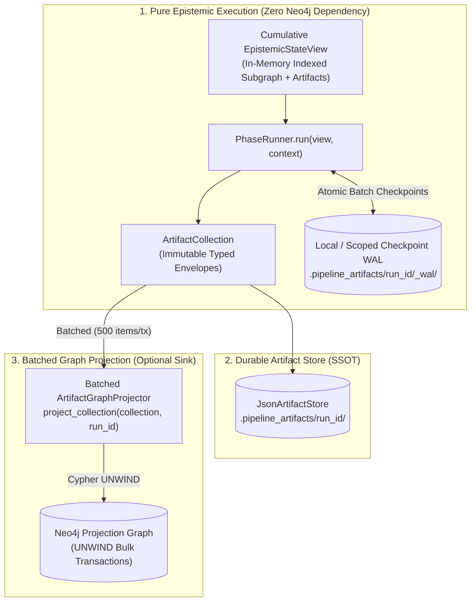

# [ISSUE-046] Split-Brain State Architecture: Resolving the "Artifact-Native" Illusion vs. Shared Mutable Neo4j Stores

| Metadata | Details |
| :--- | :--- |
| **Issue ID** | `ISSUE-046` |
| **Domain / Category** | `09-Architecture, Workflow & Domain` (Hexagonal Isolation, State Management, Reproducibility) |
| **Target Package(s)** | `packages/episteme-pipeline` (`pipeline.py`, `artifacts/`, `projection/`, `graph/`) |
| **Priority** | **Critical** |
| **Status** | `Completed` |
| **Evaluated Docs & ADRs** | [`docs/architecture/artifact_run_model.md`](../../docs/architecture/artifact_run_model.md), [`docs/architecture/pipeline_architecture.md`](../../docs/architecture/pipeline_architecture.md), [`ADR-0001`](../../docs/adr/0001-neo4j-async-graph-backend.md), [`ADR-0013`](../../docs/adr/0013-per-run-neo4j-credentials-and-graph-fallback.md), [`ADR-0016`](../../docs/adr/0016-phase-3-within-phase-checkpointing-and-atomicity.md), [`ADR-0017`](../../docs/adr/0017-explicit-batch-contracts-and-bulk-io.md) |

---

## 1. Current State

Across [`docs/architecture/artifact_run_model.md`](../../docs/architecture/artifact_run_model.md) and [`docs/architecture/pipeline_architecture.md`](../../docs/architecture/pipeline_architecture.md), the Episteme architecture is defined as **Artifact-Native and Graph-Independent**:

- *"The pipeline executes entirely on durable, run-scoped research artifacts and first-class run manifests, rather than ephemeral inter-phase execution values or graph-as-run-state."* (`artifact_run_model.md §Purpose & Motivation`)
- *"Phases have no direct write dependencies on the final projection graph... Intermediate outputs are evaluated, replayed, and inspected without querying Neo4j. Graph persistence is isolated to an explicit projection step."* (`artifact_run_model.md §Graph Projection & Decoupling`)

However, inspecting the actual architectural wiring across [`ADR-0001`](../../docs/adr/0001-neo4j-async-graph-backend.md), [`ADR-0016`](../../docs/adr/0016-phase-3-within-phase-checkpointing-and-atomicity.md), [`ADR-0017`](../../docs/adr/0017-explicit-batch-contracts-and-bulk-io.md), and the composition root [`Pipeline.for_task()`](../../packages/episteme-pipeline/episteme_pipeline/pipeline.py#L322-L406) reveals a **Split-Brain State Architecture** where execution is simultaneously coupled to three overlapping Neo4j handles (`projection_graph`, `checkpoint_store`, `graph_reader`) and the JSON `ArtifactStore`:

1. **Direct Graph Mutations Inside Phase Runners**:
   - `Phase1Runner`, `Phase6Runner`, and `TheoreticalEnrichmentRunner` are constructed with `graph_store=projection_graph` and mutate the target graph directly during `.run()` (`pipeline.py#L323-L328`, `#L382-L406`, `ADR-0017 §5`).
   - `Phase2Runner`, `Phase3Runner`, `Phase4EntityMaturationRunner`, and `Phase4Runner` are injected with `graph_store=checkpoint_store` and write chunks, entities, descriptions, triples, and `:PhaseItem` records directly into Neo4j (`ADR-0016`, `ADR-0017`).
   - `Phase3bLatentConsolidationRunner` and `Phase5ArgumentWebRunner` are injected with `graph_store=graph_reader` (`pipeline.py#L349-L381`) and query Neo4j directly for k-hop neighborhoods, entity inventories, and community topologies rather than operating purely on their input `ArtifactsView`.
2. **Redundant Unbatched Post-Phase Projection**:
   - After `entry.runner.run()` completes—having already persisted batches into Neo4j via `ADR-0017` `UNWIND` calls—`Pipeline._execute()` (`pipeline.py#L985-L987`) loops over every emitted artifact *one by one* and calls `await self._projector.project(art)`, issuing $O(N)$ individual Cypher transactions against `projection_graph`.
3. **Unscoped Global Graph Keys Across Runs**:
   - In [`ADR-0001`](../../docs/adr/0001-neo4j-async-graph-backend.md) and [`ADR-0016`](../../docs/adr/0016-phase-3-within-phase-checkpointing-and-atomicity.md), Neo4j nodes (`:Entity {id: ...}`, `:Chunk {id: ...}`, `:PhaseItem {phase: ..., key: ...}`) use global uniqueness constraints that **deliberately omit `run_id`** (`ADR-0016 §1`: *"The key deliberately excludes ephemeral `run_id` strings"*).

---

## 2. Why This Causes Problems

### A. Researcher & Scientific Reproducibility Perspective
- **Cross-Run State Contamination in Ablation Studies**: Researchers routinely branch experiments from a shared baseline (e.g., comparing Run A with `Llama-3-8B` vs. Run B with `Claude-3.5-Sonnet`, or varying `Phase3Config` thresholds) while pointing at the same Neo4j instance. Because `:Entity {id}`, `:Chunk {id}`, and `:PhaseItem {phase, key}` are merged globally without `run_id` namespace isolation, Run B overwrites Run A's entity descriptions (`is_mature`, `textual_envelope`), chunk flags (`{phase}_processed = true`), and `:PhaseItem` records in-place.
- **Broken Phase Reuse & Hydration When Neo4j State Diverges**: When `Pipeline.run()` reuses Phases 1–3 from `parent_run_id` via `_hydrate_previous_collection()` (`pipeline.py#L425-L454`), it only hydrates the in-memory `ArtifactCollection` from `.pipeline_artifacts/`. It does **not** verify or re-hydrate the Neo4j `checkpoint_store` or `graph_reader`. If the researcher switched Neo4j databases (per [`ADR-0013`](../../docs/adr/0013-per-run-neo4j-credentials-and-graph-fallback.md)), restarted a container, or ran an intervening experiment that mutated Neo4j, Phase 3b/4/5 will read empty or corrupted state from `graph_reader`/`checkpoint_store` while believing Phases 1–3 were safely reused!

### B. Software Engineering & Hexagonal Architecture Perspective
- **Violation of Single Source of Truth (SSOT)**: State is split between `.pipeline_artifacts/<run_id>/` (immutable JSON envelopes) and Neo4j (mutable global graph state). A phase runner reading from both `input: PhaseNArtifactsView` and `self.graph_store` has no guarantee that the two stores agree.
- **Contradiction of `ADR-0017` Bulk I/O Mandate**: While `ADR-0017` refactored internal phase writes to use `itertools.batched(..., 500)` with Cypher `UNWIND`, `ArtifactGraphProjector.project(art)` in `pipeline.py#L986-L987` executes sequential, single-artifact Cypher writes (`for art in collection.artifacts: await self._projector.project(art)`), re-introducing the exact $O(N)$ transaction bottleneck `ADR-0017` was written to eliminate.

### C. Observability & Provenance Perspective
- **Untracked Side-Effects**: Mutations made directly to `projection_graph` inside `Phase1Runner`, `Phase6Runner`, or `TheoreticalEnrichmentRunner` bypass `ArtifactGraphProjector` and are invisible to artifact-level lineage (`ArtifactDependencyGraph`).

---

## 3. Proposed Solution & Architectural Explanation

We must eliminate the Split-Brain State by enforcing **Strict Hexagonal Artifact-State Isolation**, separating **1. Pure Epistemic Execution (Artifact-Driven)**, **2. Intra-Phase Crash Checkpointing (WAL)**, and **3. Batched Graph Materialization (Projector)**.

### Step 1: Decouple `PhaseRunner` from `GraphReader` / `ProjectionGraph`
- Phase runners (`Phase1` through `Phase6` and `TheoreticalEnrichment`) must **never** receive `projection_graph` or query Neo4j `graph_reader` to discover upstream entities, chunks, or k-hop neighborhoods.
- Instead, provide an in-memory, indexed **`ArtifactSubgraphReader` (implementing `GraphReader`)** constructed deterministically from the accumulated `ArtifactCollection` inside `ArtifactsView`. For corpora of $10^3\text{--}10^5$ entities and triples, an in-memory adjacency & vector index hydrated from `ArtifactCollection` executes 1-hop/k-hop neighborhood lookups (`get_structural_neighborhood`) in microseconds ($<1\text{ms}$) with zero network I/O and 100% run isolation.

### Step 2: Isolate Intra-Phase Checkpoints (`PhaseCheckpointStore`) from Domain Entities
- `PhaseCheckpointStore` (`ADR-0016`) should store **only** intra-phase progress records (completed chunk keys, candidate pair keys, and intermediate extracted payloads for crash recovery), **not** serve as a shared mutable entity database across runs.
- Scope checkpoint keys by `(lineage_fingerprint, phase_key, item_key)` where `lineage_fingerprint` is the cumulative hash of upstream phase outputs and current phase config/method fingerprints. Thus:
  - Resuming an interrupted run with identical upstream state and config automatically reuses completed batches (`R_1 \to R_2`).
  - Running a branched experiment with a different prompt or model automatically namespaces its checkpoints without wiping or colliding with `R_1`.
- Provide a default **`FileSystemCheckpointStore`** (append-only JSONL/SQLite WAL under `.pipeline_artifacts/<run_id>/_checkpoints/`) so the entire pipeline can execute, crash-recover, and resume with **zero Neo4j dependency** when `project_artifacts_to_graph = False`.

### Step 3: Refactor `ArtifactGraphProjector` to Bulk `UNWIND` & Re-Projection on Hydration
- Replace `await self._projector.project(art)` in `Pipeline._execute()` with `await self._projector.project_collection(collection, batch_size=500)`.
- Group artifacts by `ArtifactKind` (Nodes first: `DOCUMENT`, `CHUNK`, `LINKED_ENTITY`, `THEORY_ATOM`; Edges second: `ENTITY_MENTION`, `LOCAL_RELATION`, `GLOBAL_RELATION`, `CANONICALIZATION`, `THEORY_RELATION`) and commit each group via parameterized Cypher `UNWIND $batch` transactions (conforming to `ADR-0017`).
- When a run reuses upstream phases (`reused_phase_ordinals`) and targets a Neo4j database where those upstream phases have not yet been projected, `ArtifactGraphProjector` can idempotently bulk-project the hydrated `initial_previous_collection`.

---

## 4. Acceptance Criteria

- [x] No `PhaseRunner` (`Phase1`–`Phase6`, `TheoreticalEnrichment`) performs direct writes to `projection_graph`; all target graph mutations flow exclusively through `ArtifactGraphProjector`.
- [x] `ArtifactSubgraphReader` implements `GraphReader` over `ArtifactCollection`, allowing `Phase3`, `Phase3b`, `Phase4`, and `Phase5` to execute 100% offline without an active Neo4j connection.
- [x] `ArtifactGraphProjector.project_collection()` batches projections by `ArtifactKind` using Cypher `UNWIND` in topological dependency order (nodes before edges).
- [x] Two concurrent or alternating runs with different LLM configurations can execute and resume without overwriting each other's checkpoints or entity states.

---

## 5. Key Target Files

- [`packages/episteme-pipeline/episteme_pipeline/pipeline.py`](../../packages/episteme-pipeline/episteme_pipeline/pipeline.py)
- [`packages/episteme-pipeline/episteme_pipeline/projection/artifact_projector.py`](../../packages/episteme-pipeline/episteme_pipeline/projection/artifact_projector.py)
- [`packages/episteme-pipeline/episteme_pipeline/protocols/graph_store.py`](../../packages/episteme-pipeline/episteme_pipeline/protocols/graph_store.py)
- [`packages/episteme-pipeline/episteme_pipeline/graph/neo4j_store.py`](../../packages/episteme-pipeline/episteme_pipeline/graph/neo4j_store.py)
- [`docs/architecture/artifact_run_model.md`](../../docs/architecture/artifact_run_model.md)
