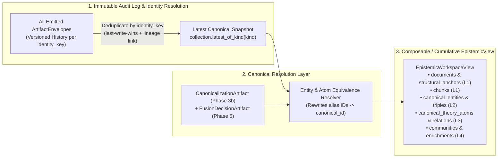

# [ISSUE-047] Information Loss, Identity Collision, and Severed Lineage in Inter-Phase `ArtifactsView` Handoffs

| Metadata | Details |
| :--- | :--- |
| **Issue ID** | `ISSUE-047` |
| **Domain / Category** | `09-Architecture, Workflow & Domain` (Data Contracts, Inter-Phase Handoff, Epistemic Integrity) |
| **Target Package(s)** | `packages/episteme-pipeline` (`artifacts/execution.py`, `artifacts/models.py`, `pipeline.py`) |
| **Priority** | **Critical** |
| **Status** | `Open` |
| **Evaluated Docs & ADRs** | [`docs/architecture/pipeline_architecture.md`](../../docs/architecture/pipeline_architecture.md), [`docs/architecture/artifact_run_model.md`](../../docs/architecture/artifact_run_model.md), [`ADR-0003`](../../docs/adr/0003-coreference-absorbed-into-fusion.md), [`ADR-0005`](../../docs/adr/0005-two-pass-fusion-strategy.md), [`ADR-0015`](../../docs/adr/0015-theoretical-enrichment-and-tenability-evaluation.md) |

---

## 1. Current State

In [`docs/architecture/artifact_run_model.md`](../../docs/architecture/artifact_run_model.md) (§Execution & Inter-Phase Handoff) and [`docs/architecture/pipeline_architecture.md`](../../docs/architecture/pipeline_architecture.md) (§Phase-by-Phase Breakdown), inter-phase data flow is governed by accumulating `ArtifactEnvelope`s into a flat list (`previous = ArtifactCollection(previous.artifacts + collection.artifacts)` in [`pipeline.py#L1048`](../../packages/episteme-pipeline/episteme_pipeline/pipeline.py#L1048)) and projecting that collection into phase-specific `ArtifactsView` dataclasses defined in [`packages/episteme-pipeline/episteme_pipeline/artifacts/execution.py`](../../packages/episteme-pipeline/episteme_pipeline/artifacts/execution.py):

- **`Phase1ArtifactsView`**: Exposes `documents: list[L1Document]` and `chunks: list[L1Chunk]`. Consumed by `Phase2Runner`.
- **`Phase2ArtifactsView`**: Exposes `entities: list[L2Entity]` and `local_triples: list[L2Triple]`. Consumed by `Phase3Runner`.
- **`Phase3ArtifactsView`**: Exposes `global_triples: list[L2Triple]`, `chunks: list[L1Chunk]`, and `relation_type_distribution`. Consumed by `Phase3bLatentConsolidationRunner`, `Phase4EntityMaturationRunner`, and `Phase4Runner` (Argument Mining).
- **`Phase4ArtifactsView`**: Exposes `theory_atoms: list[TheoryAtom]` and `theory_relations: list[TheoryRelation]`. Consumed by `Phase5ArgumentWebRunner`, `Phase6Runner`, and `TheoreticalEnrichmentRunner`.

Additionally, in `Pipeline._execute()` (`pipeline.py#L912-L916`, `#L943`, `#L1044`):
```python
record.input_artifact_ids = list(upstream_artifact_ids)
...
upstream_artifact_ids = produced_ids
```
`upstream_artifact_ids` only records the artifact IDs emitted by the *immediately preceding* ordinal runner ($k-1$), rather than the actual artifacts consumed by phase $k$'s `ArtifactsView`.

---

## 2. Why This Causes Problems

### A. Researcher & Epistemic Integrity Perspective
1. **Severed Consolidation & Maturation Backbone (`ADR-0003` & `ADR-0005` Violation)**:
   - [`ADR-0003`](../../docs/adr/0003-coreference-absorbed-into-fusion.md) and [`ADR-0005`](../../docs/adr/0005-two-pass-fusion-strategy.md) establish a core scientific invariant: *Phase 3b (Latent Graph Consolidation) and Phase 4 Entity Maturation MUST unify duplicate entity aliases and synthesize canonical entity descriptions before Phase 4 Argument Mining executes.*
   - Yet in the artifact architecture, `Phase3b` emits `CanonicalizationArtifact` (`SAME_AS` mappings) and `Phase4EntityMaturationRunner` emits updated `LinkedEntityArtifact` envelopes, while `Phase4Runner` receives `Phase3ArtifactsView`—which contains **neither `entities`, nor `local_triples`, nor `CanonicalizationArtifact`s**!
   - Even if a view reads `LINKED_ENTITY` from `ArtifactCollection`, `Phase3b`'s `CanonicalizationArtifact`s are never applied to rewrite non-canonical entity IDs in `local_triples` or `global_triples`.
2. **Duplicate Entity Collision (Append-Only `ArtifactCollection` Bug)**:
   - `Phase2Runner` emits initial `LinkedEntityArtifact` instances (`is_mature=False`). Later, `Phase4EntityMaturationRunner` emits matured `LinkedEntityArtifact` instances (`is_mature=True`, synthesized description) with the same `entity_id` / `identity_key`.
   - Because `Pipeline._execute()` concatenates lists (`previous.artifacts + collection.artifacts`) and `Phase2ArtifactsView.from_collection()` iterates over `collection.of_kind(ArtifactKind.LINKED_ENTITY)` without deduplicating by `identity_key`, any downstream consumer reading entities from the collection receives **both the unmatured Phase 2 entity and the matured Phase 4 entity as duplicate entries**!
3. **Phase 6 (`TheoryNet` / QBAF) is Blind to Phase 5 (`FusionDecisionArtifact`)**:
   - `Phase5ArgumentWebRunner` clusters semantically equivalent `TheoryAtom`s across documents (`EmbeddingArgumentClustering`) and computes Leiden communities, emitting `FusionDecisionArtifact` (which `artifact_run_model.md#L215` notes is `_NOT_PROJECTED`).
   - `Phase6Runner` consumes `Phase4ArtifactsView`, which extracts only raw Phase 4 `THEORY_ATOM` and `THEORY_RELATION` artifacts and completely ignores `FusionDecisionArtifact`!
   - **Scientific Consequence**: When the same philosophical premise or objection is extracted from 4 different chunks and fused into an equivalence cluster in Phase 5, Phase 6 QBAF gradual semantics (`WeightedQuadraticEnergySolver`) evaluates all 4 raw nodes independently instead of their fused equivalence class—**quadruple-counting** their argumentative support/attack force and distorting equilibrium justification scores $\tau^*$.

### B. Software Engineering & Provenance Perspective
4. **Drop of Structural Anchors (`L1Document`) After Phase 2**:
   - `Phase2ArtifactsView`, `Phase3ArtifactsView`, and `Phase4ArtifactsView` omit `documents: list[L1Document]`. Consequently, `L1Document.structural_anchor` (the Table of Contents / chapter hierarchy required by `ADR-0009` and `ADR-0016 §6` `candidate_pairs(entities, structural_anchor=...)`) is inaccessible from the view in Phases 3, 3b, 4, and 5.
5. **Corrupted `input_artifact_ids` in `RunPhaseRecord`**:
   - In `pipeline.py#L1044`, `upstream_artifact_ids = produced_ids` overwrites `upstream_artifact_ids` after every phase.
   - For example, `Phase4Runner` (Argument Mining) runs immediately after `Phase4EntityMaturationRunner`. If `Phase4EntityMaturationRunner` matured 10 entities (`produced_ids` = 10 entity artifacts), `Phase4Runner`'s `RunPhaseRecord.input_artifact_ids` records *only* those 10 matured entity IDs—omitting all `ChunkArtifact`s and `GlobalRelationArtifact`s that `Phase4Runner` actually consumed! And if an optional phase produces 0 artifacts (`produced_ids = []`), the next phase's `input_artifact_ids` is recorded as empty `[]`.

---

## 3. Proposed Solution & Architectural Explanation

Replace the lossy, phase-numbered `PhaseNArtifactsView` hierarchy and flat list concatenation with an **Identity-Resolved `ArtifactCollection`** and a **Canonical `EpistemicGraphView`**.



### Step 1: Identity-Keyed Versioning in `ArtifactCollection`
- Upgrade `ArtifactCollection` (`execution.py`) to maintain both:
  1. `history: list[ArtifactEnvelope[ArtifactPayload]]` (complete append-only log of all emitted versions for provenance and `ArtifactStore` persistence).
  2. `latest_by_identity: dict[str, ArtifactEnvelope[ArtifactPayload]]` (mapping each `identity_key`—or `artifact_id` if `identity_key is None`—to its most recently emitted envelope).
- `collection.of_kind(*kinds, latest_only: bool = True)` defaults to returning only the latest version of each `identity_key`. When `Phase4EntityMaturationRunner` emits an updated `LinkedEntityArtifact` for `linked_entity::kant_space`, its `provenance.upstream_artifact_ids` automatically references the Phase 2 `artifact_id`, and downstream views see exactly **one** matured `L2Entity`.

### Step 2: Automatic Canonical Rewrite for Phase 3b (`SAME_AS`) and Phase 5 (`FusionDecision`)
- When constructing a view after Phase 3b (`CanonicalizationArtifact`), build a deterministic alias map $\pi_{L2}: \text{entity\_id} \to \text{canonical\_entity\_id}$:
  - Filter `entities` to canonical representatives (merging `source_chunk_ids` and aliases from subsumed entities).
  - Rewrite `subject_id` and `object_id` across all `local_triples` and `global_triples` via $\pi_{L2}(e)$, deduplicating parallel triples with identical `(canonical_subject, predicate, canonical_object)` by retaining the maximum calibrated confidence and unioning `supporting_chunk_ids`.
- When constructing a view after Phase 5 (`FusionDecisionArtifact`), build an equivalence map $\pi_{L3}: \text{atom\_id} \to \text{canonical\_atom\_id}$ for `EQUIVALENT_FUSION` clusters:
  - Provide both raw `theory_atoms` (for provenance inspection) and `canonical_theory_atoms` / `canonical_theory_relations` (for Phase 6 `TheoryNet` and QBAF gradual semantics solver), preventing duplicate ADU double-counting.

### Step 3: Cumulative / Capability-Based `ArtifactsView` & Exact `input_artifact_ids` Tracking
- Enrich `Phase3ArtifactsView` (or unify into a cumulative `EpistemicStateView`) so `documents`, `chunks`, `entities` (matured & canonicalized), `local_triples`, and `global_triples` remain accessible to Phase 3b, Phase 4 Maturation, and Phase 4 Argument Mining.
- Enrich `Phase4ArtifactsView` (or introduce `Phase5ArtifactsView` for Phase 6 and Theoretical Enrichment) so `entities`, `chunks`, `theory_atoms`, `theory_relations`, and `fusion_decisions` / `communities` are preserved through Phase 6 and Post-Processing.
- Have `input_view.from_collection(collection)` record the exact set of `consumed_artifact_ids` read during view construction, and assign `record.input_artifact_ids = view.consumed_artifact_ids` in `Pipeline._execute()`.

---

## 4. Acceptance Criteria

- [ ] `ArtifactCollection.of_kind()` deduplicates envelopes by `identity_key` (returning the latest version) while preserving full version history in `ArtifactStore`.
- [ ] `Phase4EntityMaturationRunner` updates `LinkedEntityArtifact` without creating duplicate `L2Entity` instances in downstream views.
- [ ] `CanonicalizationArtifact` merges from Phase 3b are reflected in the entity and triple views consumed by Phase 4 Argument Mining.
- [ ] `FusionDecisionArtifact` equivalence merges from Phase 5 are reflected in Phase 6 `TheoryNet` materialization and QBAF gradual semantics calculations.
- [ ] `RunPhaseRecord.input_artifact_ids` accurately records the exact artifact IDs consumed by each phase's `input_view`.

---

## 5. Key Target Files

- [`packages/episteme-pipeline/episteme_pipeline/artifacts/execution.py`](../../packages/episteme-pipeline/episteme_pipeline/artifacts/execution.py)
- [`packages/episteme-pipeline/episteme_pipeline/artifacts/models.py`](../../packages/episteme-pipeline/episteme_pipeline/artifacts/models.py)
- [`packages/episteme-pipeline/episteme_pipeline/pipeline.py`](../../packages/episteme-pipeline/episteme_pipeline/pipeline.py)
- [`docs/architecture/artifact_run_model.md`](../../docs/architecture/artifact_run_model.md)
