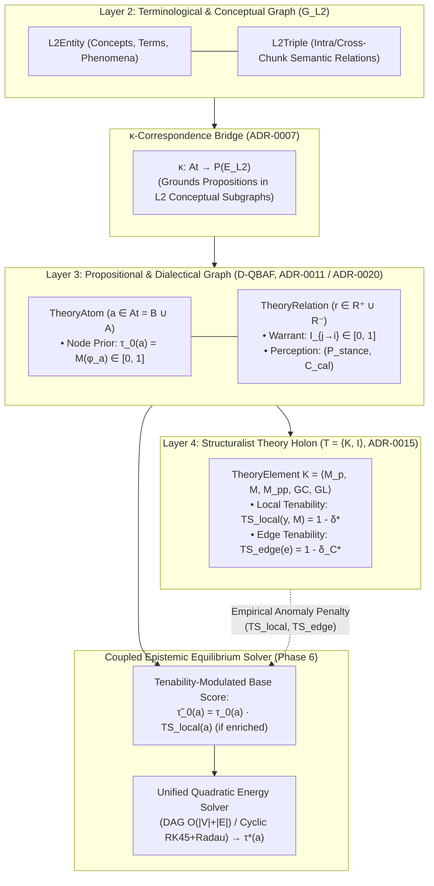

# [ISSUE-050] Theoretical & Ontological Fragmentation Across ADRs: Reconciling `TF`, `D-QBAF`, and Structuralist Tenability Feedback Loops

| Metadata | Details |
| :--- | :--- |
| **Issue ID** | `ISSUE-050` |
| **Domain / Category** | `09-Architecture, Workflow & Domain` (Epistemic Metamodel, Formal Semantics, ADR Governance) |
| **Target Package(s)** | `packages/episteme-pipeline`, `packages/epistemetrics` (`contracts/domain.py`, `artifacts/models.py`, `phases/phase6_theorynet/`, `post_processing/theoretical_enrichment/`) |
| **Priority** | **High** |
| **Status** | `Open` |
| **Evaluated Docs & ADRs** | [`docs/architecture/pipeline_architecture.md`](../../docs/architecture/pipeline_architecture.md), [`docs/architecture/runtime_analysis.md`](../../docs/architecture/runtime_analysis.md), [`ADR-0006`](../../docs/adr/0006-qbaf-mapping-deferred.md), [`ADR-0007`](../../docs/adr/0007-tf-structural-correspondence.md), [`ADR-0011`](../../docs/adr/0011-declarative-graph-metrics-and-qbaf-semantics.md), [`ADR-0015`](../../docs/adr/0015-theoretical-enrichment-and-tenability-evaluation.md), [`ADR-0020`](../../docs/adr/0020-propositional-modal-strength-resolver.md) |

---

## 1. Current State

Across the ADR history and architecture documentation, **three distinct and partially contradictory formal mathematical frameworks** have been layered onto Layers 3 and 4 of the pipeline without an overarching ontological reconciliation:

1. **`ADR-0007` (Theoriennetz `TF` replaces `QBAF`)**:
   - [`ADR-0007`](../../docs/adr/0007-tf-structural-correspondence.md) (Status: `Accepted`, Supersedes: `ADR-0006`) declares:
     - *"TF replaces QBAF as the target L3 representation. `QBAF`, `QBAFMapper`, and all `qbaf_weight` fields are deprecated and will be removed once `TF` and `TFMapper` are implemented."*
     - *"The `qbaf_weight` property on nodes and edges is renamed `structural_correspondence: float | null`... a confidence score that the structural overlap condition $\kappa$-admissibility holds."*
     - Defines `TF` evaluation semantics as *"Maximal $B$-consistent subsets of $P$"* grounded in $\Delta = (B, P)$.
2. **`ADR-0011` (Addenda 1 & 2) & `ADR-0020` (Decoupled QBAF / `D-QBAF`)**:
   - [`ADR-0011 Addendum 2`](../../docs/adr/0011-declarative-graph-metrics-and-qbaf-semantics.md) (2026-10-06) and [`ADR-0020`](../../docs/adr/0020-propositional-modal-strength-resolver.md) (2026-10-07)—without marking `ADR-0007` as superseded or amended—declare the exact opposite:
     - *"The dialectical theory graph layer is formally standardized as Quantitative Bipolar Argumentation Frameworks (QBAF)."*
     - Specifically defines a 3-layer **D-QBAF** where `TheoryAtom` owns Propositional Modality $M(\phi_a) \equiv \tau_0(a) \in [0, 1]$, and `TheoryRelation` owns Inferential Warrant Force $I_{j \to i} \in [0, 1]$ and Perception Calibration $(P(\text{stance}), C \in [0, 1])$, evaluated via closed-form DAG topological passes or continuous adaptive RK45/Radau ODE integration (`WeightedQuadraticEnergySolver`).
   - Meanwhile, [`docs/architecture/runtime_analysis.md#L19,L36,L99`](../../docs/architecture/runtime_analysis.md) still states that Phase 6 runs a *"fixed number of iterations in QBAF iterative gradual semantics convergence ($I=5$)"*, contradicting `ADR-0011 Addendum 2`.
3. **Contract Regressions in `TheoryAtom` & `TheoryRelation` (`execution.py`)**:
   - Although `ADR-0011 Addendum 2 §Context.1` explicitly proved that attaching `modal_strength` to edges creates a pseudo-decoupling that quadratically double-penalizes tentative premises ($M^2$), inspecting [`packages/episteme-pipeline/episteme_pipeline/artifacts/execution.py#L220-L255`](../../packages/episteme-pipeline/episteme_pipeline/artifacts/execution.py#L220-L255) shows:
     - `TheoryAtom` / `TheoryAtomArtifact` only carries `plausibility` (missing explicit `modal_strength`, `resolver_type`, `syntax_bounds`, and `equilibrium_strength` $\tau^*$).
     - `TheoryRelation` / `TheoryRelationArtifact` has accumulated **11 overlapping weight/score fields**: `confidence`, `weight`, `class_probability`, `empirical_accuracy`, `modal_strength` (still on the edge!), `effective_weight`, `tenability`, `calibrated_confidence`, `weight_support`, and `weight_attack`.
4. **Severed Epistemic Feedback Loop Between `ADR-0015` (Structuralist Tenability) and `ADR-0011` (Phase 6 D-QBAF)**:
   - In [`ADR-0015`](../../docs/adr/0015-theoretical-enrichment-and-tenability-evaluation.md), `TheoreticalEnrichmentRunner` runs as a *post-processor after Phase 6*, computing local empirical tenability $TS_{\text{local}}(y, M) = \sup\{1 - \delta \mid \exists x^* \in M : (\Phi(y), x^*) \in u_\delta\}$ and inter-theoretical constraint tenability $TS_{\text{edge}}(e)$ over Bourbaki uniform spaces, flagging anomalies where $TS < 0.5$.
   - Because Phase 6 (TheoryNet / D-QBAF gradual semantics) executes *before* `TheoreticalEnrichmentRunner`, empirical falsification / low tenability ($TS_{\text{local}} < 0.5$) never updates the prior base score $\tau_0(a)$ or warrant $I_{j \to i}$ of the corresponding hypotheses in the D-QBAF!

---

## 2. Why This Causes Problems

### A. Researcher & Philosophy of Science Perspective
1. **Epistemic Incoherence (Dialectical Justification Divorced from Empirical Tenability)**:
   - In both Schurz's (2014/2024) cognitive epistemology and Stegmüller/Balzer's structuralist metatheory, a theoretical hypothesis $h \in A$ supported by a web of deductive arguments cannot maintain a high degree of final justification $\tau^*(h)$ if its intended empirical applications $I \subseteq M_{pp}$ fail tenability ($TS_{\text{local}} < 0.5$) or violate inter-theoretical constraints ($TS_{\text{edge}} < 0.5$).
   - By running `TheoreticalEnrichmentRunner` strictly *after* Phase 6 without a re-convergence pass, a hypothesis that is empirically refuted by `SafeFormulaEvaluator` in `TheoreticalEnrichmentRunner` still displays a high justification score $\tau^*$ in the Phase 6 TheoryNet projection!
2. **Double-Penalization ($M^2$) Hazard in Edge Contracts**:
   - Retaining `modal_strength` on `TheoryRelationArtifact` alongside `effective_weight = M * P` while also setting node base scores $\tau_0(a) = M(\phi_a)$ via `ADR-0020` causes any solver reading `effective_weight` as the edge weight $W_{ji}$ in Quadratic Energy semantics to multiply the source node's already-modulated state $s_j \propto M(\phi_j)$ by $M$ a second time ($O(M^2)$ attenuation).

### B. Software Engineering & Domain Modeling Perspective
3. **Kitchen-Sink Domain Contracts & ADR Drift**:
   - Having 11 partially redundant float fields on `TheoryRelation` (`weight`, `effective_weight`, `confidence`, `calibrated_confidence`, `class_probability`, `empirical_accuracy`, `modal_strength`, `tenability`, `weight_support`, `weight_attack`) makes it ambiguous for downstream consumers (`epistemetrics`, `episteme-studio`, `ArtifactGraphProjector`) which field represents the canonical edge weight $W_{ji}$.
   - Leaving `ADR-0007` as `Status: Accepted` while `ADR-0011` and `ADR-0020` standardize on D-QBAF confuses contributors and external reviewers reading the Diátaxis documentation (`ADR-0008`).

---

## 3. Proposed Solution & Architectural Explanation

Formalize a **Unified 4-Layer Stratified Epistemic Metamodel** via a superseding ADR (`ADR-0021`), clean up the `TheoryAtom` / `TheoryRelation` Pydantic contracts into orthogonal uncertainty sub-models, and couple Structuralist Tenability (`ADR-0015`) with D-QBAF Equilibrium Convergence (`ADR-0011`).

### Step 1: Reconcile `TF`, `D-QBAF`, and Structuralism in a Unified Metamodel (`ADR-0021`)
- Mark `ADR-0007`'s deprecation of QBAF as **Superseded by `ADR-0011` (Addendum 2) and `ADR-0021`**, while preserving `ADR-0007`'s formal definition of **$\kappa$-Structural Correspondence** as the cross-layer grounding map $\kappa: \text{At}_{L3} \to \mathcal{P}(V_{L2})$ linking L3 propositional atoms (`TheoryAtom`) to L2 conceptual entities (`L2Entity`).
- Formally stratify the three mathematical structures as complementary projections of the same TheoryNet:
  1. **Relational Skeleton (`TF = (At, R)`)**: The typed multigraph over partition $\Delta = (B, A)$ ($B$ = empirical observation sentences, $A$ = theoretical axioms/hypotheses).
  2. **Dialectical Dynamics (`D-QBAF`)**: Bipolar projection $(At, R^+, R^-, \tilde{\tau}_0, W)$ governing continuous justification propagation $\tau^*: At \to [0, 1]$.
  3. **Model-Theoretic Core (`T = \langle K, I \rangle`)**: Structuralist macro-clustering where communities of $A$ form theory cores $K = \langle M_p, M, M_{pp}, GC, GL \rangle$ tested against empirical clusters $I \subseteq B$ via admissible blurs $\delta^*$.

### Step 2: Refactor `TheoryAtom` & `TheoryRelation` Contracts into Orthogonal Components
Eliminate the 11-field flat float soup on `TheoryRelation` (`contracts/domain.py` and `artifacts/models.py`):
- **`TheoryAtom` (Node Contract)**:
  - `modal_prior: float` ($\tau_0(a) \equiv M(\phi_a) \in [0, 1]$, resolved by `ModalStrengthResolver` per `ADR-0020`).
  - `local_tenability: float | None = None` ($TS_{\text{local}} \in [0, 1]$ from `TheoreticalEnrichment`, if evaluated).
  - `equilibrium_strength: float | None = None` ($\tau^*(a) \in [0, 1]$, output of the D-QBAF solver).
  - `controversy_volatility: float | None = None` ($\mathcal{V}(a)$ Keynes-Gärdenfors telemetry per `ADR-0011 Addendum 2`).
- **`TheoryRelation` (Edge Contract)**:
  - `inferential_warrant: float` ($I_{j \to i} \in [0, 1]$, Toulmin warrant strength).
  - `perception_stance_prob: float` ($P(\text{stance}) \in [0, 1]$).
  - `perception_empirical_acc: float` ($C \in [0, 1]$, calibrated empirical accuracy).
  - `structural_correspondence: float | None = None` ($\kappa$-overlap score from `ADR-0007`).
  - `edge_tenability: float | None = None` ($TS_{\text{edge}} \in [0, 1]$ for `CONSTRAINS` / `REDUCES_TO` links from `ADR-0015`).
  - Computed property `effective_weight(gating_mode, tau_p, tau_c) -> float`: Derived deterministically as $W_{ji} = I_{j \to i} \cdot \mathcal{F}_{\text{gate}}(P, C) \cdot (TS_{\text{edge}} \text{ if present else } 1.0)$—**strictly free of node modality $M(\phi)$**.

### Step 3: Couple `TheoreticalEnrichment` with D-QBAF Equilibrium
- Either execute `TheoreticalEnrichmentRunner` *prior* to Phase 6 (`Phase 5 -> TheoreticalEnrichment -> Phase 6`), or have `TheoreticalEnrichmentRunner` trigger a lightweight incremental re-solve of `QBAFGradualSemanticsSolver` ($O(|A| + |R|)$ on DAGs) using tenability-modulated priors $\tilde{\tau}_0(a) = \tau_0(a) \cdot TS_{\text{local}}(a)$ and constraint weights modulated by $TS_{\text{edge}}(e)$.
- Update [`docs/architecture/runtime_analysis.md`](../../docs/architecture/runtime_analysis.md) to reflect `ADR-0011 Addendum 2` ($O(|A| + |R|)$ single topological pass for DAGs; adaptive RK45/Radau ODE integration with terminal root-finding for cyclic graphs) instead of fixed $I=5$ iteration loops.

---

## 4. Acceptance Criteria

- [ ] `ADR-0007` header and `docs/adr/index.md` are updated to clarify which sections are superseded by `ADR-0011 Addendum 2` and `ADR-0020`, eliminating contradiction between `TF` and `D-QBAF`.
- [ ] `modal_strength` is removed from `TheoryRelation` / `TheoryRelationArtifact` and consolidated on `TheoryAtom` / `TheoryAtomArtifact` to prevent $M^2$ double-penalization.
- [ ] Empirical tenability ($TS_{\text{local}}, TS_{\text{edge}}$) from `TheoreticalEnrichmentRunner` feeds into D-QBAF equilibrium justification $\tau^*$, ensuring empirically falsified hypotheses ($TS < 0.5$) reflect degraded justification.
- [ ] `docs/architecture/runtime_analysis.md` accurately documents the closed-form DAG and adaptive ODE cyclic complexity of Phase 6.

---

## 5. Key Target Files

- [`packages/episteme-pipeline/episteme_pipeline/contracts/domain.py`](../../packages/episteme-pipeline/episteme_pipeline/contracts/domain.py)
- [`packages/episteme-pipeline/episteme_pipeline/artifacts/models.py`](../../packages/episteme-pipeline/episteme_pipeline/artifacts/models.py)
- [`packages/episteme-pipeline/episteme_pipeline/artifacts/execution.py`](../../packages/episteme-pipeline/episteme_pipeline/artifacts/execution.py)
- [`packages/episteme-pipeline/episteme_pipeline/phases/phase6_theorynet/runner.py`](../../packages/episteme-pipeline/episteme_pipeline/phases/phase6_theorynet/runner.py)
- [`docs/adr/0007-tf-structural-correspondence.md`](../../docs/adr/0007-tf-structural-correspondence.md)
- [`docs/architecture/runtime_analysis.md`](../../docs/architecture/runtime_analysis.md)
