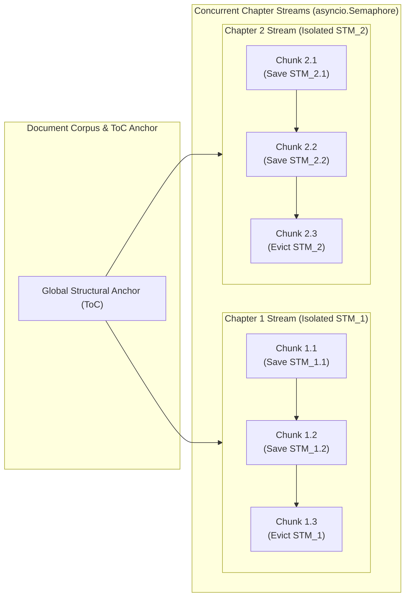

# [ISSUE-051] Intra-Phase Scalability & Resilience: Episodic Working Memory Crash Amnesia, Sequential Bottlenecks, and Anisotropic Cosine Thresholding

| Metadata | Details |
| :--- | :--- |
| **Issue ID** | `ISSUE-051` |
| **Domain / Category** | `09-Architecture, Workflow & Domain` (Scalability, Fault Tolerance, Working Memory, Vector Retrieval) |
| **Target Package(s)** | `packages/episteme-pipeline` (`phases/phase2_entity_discovery/`, `phases/phase3_global_relations/`, `phases/phase3b_consolidation/`, `phases/phase4_argument_mining/`) |
| **Priority** | **High** |
| **Status** | `Open` |
| **Evaluated Docs & ADRs** | [`docs/architecture/runtime_analysis.md`](../../docs/architecture/runtime_analysis.md), [`docs/architecture/pipeline_architecture.md`](../../docs/architecture/pipeline_architecture.md), [`ADR-0001`](../../docs/adr/0001-neo4j-async-graph-backend.md), [`ADR-0009`](../../docs/adr/0009-sota-dual-memory-episodic-working-memory.md), [`ADR-0016`](../../docs/adr/0016-phase-3-within-phase-checkpointing-and-atomicity.md) |

---

## 1. Current State

An examination of [`docs/architecture/runtime_analysis.md`](../../docs/architecture/runtime_analysis.md), [`ADR-0009` (SOTA Dual-Memory Architecture & Episodic Working Memory)](../../docs/adr/0009-sota-dual-memory-episodic-working-memory.md), and [`ADR-0016` (Phase 3 Within-Phase Checkpointing)](../../docs/adr/0016-phase-3-within-phase-checkpointing-and-atomicity.md) highlights **four interconnected architectural vulnerabilities in intra-phase execution, crash recovery, and asymptotic scaling**:

1. **Episodic Working Memory Crash Amnesia (`ADR-0001` vs. `ADR-0009`)**:
   - [`ADR-0009 §Decision.1 & .3`](../../docs/adr/0009-sota-dual-memory-episodic-working-memory.md) specifies that Phase 2 maintains a stateful Short-Term Memory (STM) in RAM across sequential chunks ($C_{i-1} \to C_i$), tracking `active_entities`, `unresolved_references`, and `current_argument_branch`. Crucially, `ADR-0009` dictates: *"The STM state itself is **never committed to Neo4j**; its short-lived variables are purged from runtime memory (RAM)."*
   - At the same time, [`ADR-0001 §Decision`](../../docs/adr/0001-neo4j-async-graph-backend.md) specifies that Phase 2 crash recovery works by setting `phase2_processed = true` on each committed `:Chunk` node, so *"re-running any phase picks up from the last committed chunk."*
2. **Global Sequential Bottleneck in Phase 2 (`ADR-0009 §Consequences`)**:
   - Because STM state flows sequentially from $C_{i-1} \to C_i$, Phase 2 processes chunks sequentially even across independent chapters or independent documents in a multi-document corpus, despite `ADR-0009` stating that STM is purged/evicted at chapter/semantic boundaries anyway.
3. **Asymmetric Intra-Phase Checkpointing (`ADR-0016` Limited to Phase 3)**:
   - [`ADR-0016`](../../docs/adr/0016-phase-3-within-phase-checkpointing-and-atomicity.md) introduced atomic batch checkpointing, `:PhaseItem` tracking, poison-pill quarantine, and systematic failure guards (`100%` first-batch failure abort)—but **only for Phase 3 (`Phase3Runner`)**.
   - `Phase4Runner` (which executes $O(C)$ local ADU/ACC LLM calls and $O(A \cdot K)$ global ARC LLM calls, per `runtime_analysis.md §Phase 4`), `Phase4EntityMaturationRunner` ($O(E)$ LLM calls), and `TheoreticalEnrichmentRunner` ($O(|\mathcal{C}| \cdot |\mathcal{T}|)$ LLM calls) lack `:PhaseItem` poison-pill quarantine and atomic batch recovery.
4. **Anisotropic Cosine Similarity & Small-Corpus $O(N^2)$ Explosion (`runtime_analysis.md`)**:
   - [`docs/architecture/runtime_analysis.md §The "Small Input" Overhead`](../../docs/architecture/runtime_analysis.md#L120-L139) documents two severe operational issues:
     - In Phase 3 and Phase 3b, a fixed scalar `dense_similarity_threshold` (e.g., $0.50$ or $0.85$) is used to filter raw cosine similarities. As `runtime_analysis.md#L134-L136` explicitly notes, for many embedding models (`all-MiniLM-L6-v2`, `bge-m3`, etc.), raw cosine similarities naturally cluster in a narrow anisotropic cone above $0.5$, allowing nearly 100% of all $O(E^2)$ pairs to bypass the filter!
     - In Phase 4 ARC (`runtime_analysis.md#L82,L131-L132`), candidate pairs ($O(A \cdot K)$) are sent directly to the generative LLM without a Cross-Encoder or System 1 Jev filter by default, causing a 1-page document with 15 theory atoms to trigger ~100 generative LLM calls.

---

## 2. Why This Causes Problems

### A. Researcher & Scientific Reproducibility Perspective
1. **Silent Epistemic Divergence Between Uninterrupted and Crash-Resumed Runs**:
   - Suppose Phase 2 is processing a 100-chunk chapter of Kant's *Critique of Pure Reason* and crashes at chunk $C_{42}$ due to a transient API rate limit. Chunks $C_1 \dots C_{41}$ have `phase2_processed = true`.
   - When the researcher resumes the run, Phase 2 skips $C_1 \dots C_{41}$ and starts at $C_{42}$ with an **empty RAM `WorkingMemoryState`**!
   - All `active_entities`, `unresolved_references` (e.g., *"dieser Grundsatz"* / *"the second antinomy"*), and `current_argument_branch` accumulated across $C_{35} \dots C_{41}$ are permanently lost. Consequently, a resumed run produces a **different, degraded knowledge graph** compared to an uninterrupted run, violating crash-recovery determinism!
2. **Embedding Model Lock-In & Hubness Distortion**:
   - High-dimensional transformer embeddings suffer from **anisotropy** (Ethayarajh, 2019) and **hubness** (Radovanović et al., 2010), where certain "hub" nodes have artificially high raw cosine similarity to almost all other nodes in the graph.
   - Relying on raw cosine threshold cutoffs (`0.5` or `0.85`) means switching `EmbeddingModel` (e.g., from `all-MiniLM-L6-v2` to `text-embedding-3-large` or `jina-embeddings-v3`) completely shifts the baseline cosine distribution, either flooding Phase 3 with $O(E^2)$ false positives or starving Phase 3b of valid merges.

### B. Software Engineering & Performance Perspective
3. **Unnecessary Serialization Across Independent Chapters/Documents**:
   - In a 10-chapter book or a 20-paper corpus, chapters/documents are bounded by explicit structural anchors (`L1Document.structural_anchor` / `chapter_id` on `L1Chunk`). Running all 10 chapters in a single serial loop wastes $5\times\text{--}10\times$ wall-clock throughput when each chapter's episodic state is logically independent at chapter boundaries.
4. **Duplicated / Missing Fault-Tolerance Infrastructure**:
   - Implementing `:PhaseItem` checkpointing, batching, and poison-pill quarantine ad-hoc inside `Phase3Runner` (`ADR-0016`) instead of as a generic runtime abstraction leaves Phase 2, Phase 4 (ADU/ACC/ARC), and Post-Processing vulnerable to the exact same poison-pill crash loops documented in `ADR-0016 §Context.2`.

---

## 3. Proposed Solution & Architectural Explanation

### Step 1: Checkpoint-Coupled Episodic Working Memory & Chapter-Parallel Execution
1. **Persist `WorkingMemoryState` Snapshots with Chunk Checkpoints**:
   - Whenever chunk $C_i$ is committed in Phase 2, serialize the post-chunk `WorkingMemoryState` ($S_i$, typically $< 4\text{KB}$ of JSON) alongside the chunk's checkpoint record `(chapter_id, sequence_index, state_snapshot_json)`.
   - On crash recovery at chunk $C_k$, load $S_{k-1}$ from the checkpoint of $C_{k-1}$ before invoking `NERExtractor` on $C_k$. This guarantees **bit-for-bit state equivalence** between an uninterrupted run and a resumed run!
2. **Chapter- & Document-Scoped Parallel Episodic Streams**:
   - Group `L1Chunk`s by `(source_doc_id, chapter_id)`.
   - Since `ADR-0009` resets episodic state at chapter boundaries while retaining the static Global Structural Anchor (ToC), spawn independent `WorkingMemoryManager` instances per `(source_doc_id, chapter_id)` stream and execute streams concurrently under a configurable `asyncio.Semaphore(max_concurrent_chapters)`.
   - Within each chapter stream, chunks $C_{c,1} \to C_{c,m}$ execute sequentially to preserve intra-chapter anaphora and argument branch tracking.

### Step 2: Generalize `ADR-0016` into a Reusable `CheckpointedBatchExecutor[ItemT, OutT]`
Extract the atomic batch checkpointing, order-invariant content hashing, poison-pill dead-letter quarantine, and first-batch systematic failure guard from `Phase3Runner` (`ADR-0016`) into a generic runtime service `CheckpointedBatchExecutor` in `pipeline/runtime/`:
- Apply `CheckpointedBatchExecutor` uniformly across:
  - **Phase 2**: Per-chunk NER + Linking batches (with STM snapshot persistence).
  - **Phase 3**: Global relation candidate pair batches.
  - **Phase 4 Maturation**: Entity centroid synthesis batches.
  - **Phase 4 Argument Mining**: Local chunk ADU/ACC batches and global ARC candidate pair batches.
  - **Theoretical Enrichment**: Empirical cluster $\times$ Theory lens evaluation batches.

### Step 3: Replace Raw Cosine Cutoffs with CSLS (Cross-Domain Similarity Local Scaling) & Adaptive $K(N)$ Bounding
1. **Mitigate Anisotropy & Hubness via CSLS (Conneau et al., 2018)**:
   Instead of raw cosine similarity $\cos(\mathbf{u}, \mathbf{v})$, compute the locally scaled similarity:
   $$\text{CSLS}(\mathbf{u}, \mathbf{v}) = 2 \cos(\mathbf{u}, \mathbf{v}) - r_T(\mathbf{u}) - r_T(\mathbf{v})$$
   where $r_T(\mathbf{u}) = \frac{1}{T} \sum_{\mathbf{z} \in \mathcal{N}_T(\mathbf{u})} \cos(\mathbf{u}, \mathbf{z})$ is the mean cosine similarity of $\mathbf{u}$ to its $T$ nearest neighbors (e.g., $T=10$).
   - **Why this works**: CSLS automatically subtracts the baseline anisotropic offset of the embedding model and penalizes "hub" nodes, making candidate filtering invariant to whether the user selects `all-MiniLM-L6-v2`, `bge-m3`, or `text-embedding-3-large`!
2. **Dynamic Sub-Linear Candidate Cap $K_{\text{eff}}(N)$ for Small Corpora**:
   Fix the "Small Input Overhead" (`runtime_analysis.md §3.2`) by bounding the per-node candidate degree $K_{\text{eff}}$ dynamically:
   $$K_{\text{eff}}(E) = \min\big(K_{\max},\; \max(K_{\min},\; \lceil \gamma \sqrt{E} \rceil)\big)$$
   combined with a standardized z-score threshold $z(\text{CSLS}(u, v)) \ge \tau_z$ (e.g., $\mu + 1.5\sigma$ of the empirical pairwise similarity distribution), preventing $O(E^2)$ / $O(A^2)$ all-to-all evaluation on 1-page excerpts.

---

## 4. Acceptance Criteria

- [ ] Phase 2 persists serialized `WorkingMemoryState` snapshots alongside chunk checkpoints and restores the exact prior chunk's STM state upon mid-chapter crash resumption.
- [ ] Phase 2 supports concurrent execution across independent `(source_doc_id, chapter_id)` groups while maintaining sequential STM ordering within each chapter.
- [ ] `CheckpointedBatchExecutor` provides `ADR-0016` atomic batch checkpointing and poison-pill quarantine to Phase 4 (ADU/ACC/ARC), Phase 4 Maturation, and Theoretical Enrichment.
- [ ] Candidate pair generation in Phase 3, Phase 3b, and Phase 4 ARC supports CSLS / z-score normalized thresholding and dynamic $K_{\text{eff}}(E)$ scaling so 1-page documents do not trigger unpruned all-to-all LLM evaluations.

---

## 5. Key Target Files

- [`packages/episteme-pipeline/episteme_pipeline/phases/phase2_entity_discovery/working_memory.py`](../../packages/episteme-pipeline/episteme_pipeline/phases/phase2_entity_discovery/working_memory.py)
- [`packages/episteme-pipeline/episteme_pipeline/phases/phase2_entity_discovery/runner.py`](../../packages/episteme-pipeline/episteme_pipeline/phases/phase2_entity_discovery/runner.py)
- [`packages/episteme-pipeline/episteme_pipeline/phases/phase3_global_relations/runner.py`](../../packages/episteme-pipeline/episteme_pipeline/phases/phase3_global_relations/runner.py)
- [`packages/episteme-pipeline/episteme_pipeline/phases/phase4_argument_mining/runner.py`](../../packages/episteme-pipeline/episteme_pipeline/phases/phase4_argument_mining/runner.py)
- [`docs/architecture/runtime_analysis.md`](../../docs/architecture/runtime_analysis.md)
