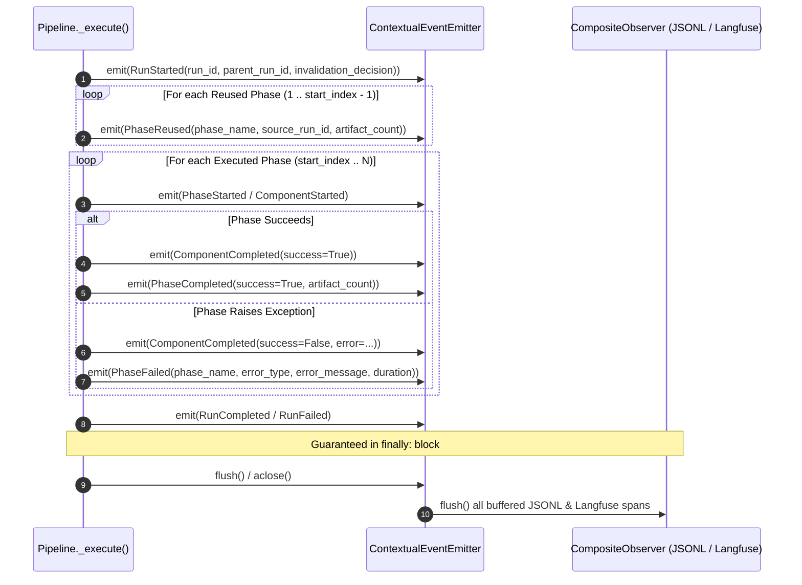

# [ISSUE-052] Observability & Event System Integrity: Missing Failure/Reuse Lifecycle Events, Unflushed Async Spans, and Silent Audit Drops

| Metadata | Details |
| :--- | :--- |
| **Issue ID** | `ISSUE-052` |
| **Domain / Category** | `09-Architecture, Workflow & Domain` (Observability, Event Bus, Audit Trail, Langfuse Telemetry) |
| **Target Package(s)** | `packages/episteme-pipeline` (`events/`, `pipeline.py`, `runs/models.py`) |
| **Priority** | **Medium** |
| **Status** | `Completed` |
| **Evaluated Docs & ADRs** | [`docs/architecture/event-system.md`](../../docs/architecture/event-system.md), [`docs/architecture/cross_cutting_concerns.md`](../../docs/architecture/cross_cutting_concerns.md), [`ADR-0012`](../../docs/adr/0012-phase-config-redesign-and-langfuse-integration.md), [`ADR-0019`](../../docs/adr/0019-typesafe-jev-client-and-decision-observability.md) |

---

## 1. Current State

[`docs/architecture/event-system.md`](../../docs/architecture/event-system.md) and [`docs/architecture/cross_cutting_concerns.md`](../../docs/architecture/cross_cutting_concerns.md) define Episteme's observability architecture around task-local `contextvars` dispatch (`use_event_emitter`, `get_event_emitter`), `SimpleEventEmitter`, and pluggable `EventObserver` sinks (`LoggingObserver`, `JsonlRunObserver`, `MetricsObserver`, `LangfuseObserver`, `RichProgressObserver`).

An audit of the event specification in [`docs/architecture/event-system.md`](../../docs/architecture/event-system.md) against the orchestrator lifecycle in [`packages/episteme-pipeline/episteme_pipeline/pipeline.py#L919-L1060`](../../packages/episteme-pipeline/episteme_pipeline/pipeline.py#L919-L1060) uncovers **four observability and audit-trail defects**:

1. **Unclosed Spans & Missing `PhaseFailed` / `ComponentCompleted(success=False)` Events on Phase Exception**:
   - In `Pipeline._execute()` (`pipeline.py#L949-L978`), the orchestrator emits `ComponentStarted(component_name=phase_name, ...)` before entering `try: with use_event_emitter(phase_emitter): collection = await entry.runner.run(...)`.
   - If `entry.runner.run()` raises an exception, the `except Exception as exc:` block (`pipeline.py#L965-L977`) updates `record.status = RunStatus.FAILED`, writes `manifest.json`, and immediately re-raises `exc`—**without emitting `ComponentCompleted(success=False, ...)` or a `PhaseFailed` event**!
   - Meanwhile, `ComponentCompleted(success=True)` and `PhaseCompleted(success=True)` are only emitted on the happy path (`pipeline.py#L1004-L1022`).
2. **Zero Telemetry Events Emitted for Reused Phases & Hydrated Artifacts**:
   - When `Pipeline.run()` or `Pipeline.run_from_phase()` reuses phases $1 \dots k-1$ (`invalidation_decision.reused_phase_ordinals`), `_execute()` starts its loop at `range(start_index, len(self._phase_entries) + 1)` (`pipeline.py#L920`).
   - No `PhaseReused` or `ArtifactsHydrated` event is emitted for phases $1 \dots k-1$.
3. **Synchronous `emit()` without Lifecycle `flush()` / `aclose()` Guarantees**:
   - `EventEmitter.emit()` (`event-system.md §Side-Effect Only & Non-Blocking`) is synchronous and returns `None`.
   - Observers performing buffered network I/O (such as `LangfuseObserver` uploading spans/generations or `ADR-0019` active learning dataset items to Langfuse) or buffered file I/O (`JsonlRunObserver`) rely on background flushes. Yet `use_event_emitter()` in `pipeline.py#L484` and `#L572` is a synchronous `with` context manager that does **not** invoke an `await emitter.aclose()` or `flush()` in a `finally:` block upon run completion or crash.
4. **Uniform Exception Swallowing Across Critical vs. Best-Effort Observers**:
   - `event-system.md §Failure Isolation` mandates: *"An exception raised inside an observer's `on_event` handler must be caught, logged, and isolated."*
   - While swallowing errors in `RichProgressObserver` (TTY) or a transient `LangfuseObserver` timeout is appropriate, silently swallowing write failures in `JsonlRunObserver` (which writes the local immutable scientific audit trail `.jsonl`) leaves the researcher with a `RunStatus.COMPLETED` manifest whose audit log is silently truncated or missing, with zero indication in `RunReport`.

---

## 2. Why This Causes Problems

### A. Researcher & Auditability Perspective
1. **Dangling Spans & Invisible Crash Root Causes in Langfuse and JSONL Traces**:
   - Because `ComponentStarted` is emitted without a matching `ComponentCompleted(success=False)` or `PhaseFailed` when a phase crashes, `LangfuseObserver` spans remain open/unterminated (missing error status, exception type, traceback, and duration), and `RichProgressObserver` leaves the console progress bar frozen in an active state.
2. **Fragmented Lineage in Resumed Run Traces**:
   - When a researcher inspects a resumed run ($R_2$, which reused Phases 1–3 from $R_1$ and ran Phase 4–6) in Langfuse or `.jsonl`, the trace begins abruptly at Phase 4 with no record of which parent `run_id` supplied Phases 1–3, how many artifacts were hydrated, or why Phases 1–3 were reused vs. Phase 4 invalidated.
3. **Lost Telemetry on Fast-Failing or Short Runs**:
   - Without an explicit `flush()` barrier in `finally:` at the end of `Pipeline.run()`, short runs (e.g., cached/reused runs or fast System 1 Jev runs) or crashing runs exit the Python process before `LangfuseObserver`'s background SDK worker thread finishes uploading the final `PhaseCompleted`, `DecisionEvaluationCompleted`, or `ActiveLearning` dataset records.

### B. Software Engineering Perspective
4. **Dead Code / Semantic Misnomer in `ComponentCompleted(success=...)`**:
   - Defining `success: bool` on `ComponentCompleted` and `PhaseCompleted` (`pipeline.py#L1008`, `#L1018`) while only ever emitting them with `success=True` violates contract expectations for any observer filtering on `event.success is False`.

---

## 3. Proposed Solution & Architectural Explanation

Upgrade the Event Bus lifecycle to guarantee **Symmetric Start/End Bracket Events (`try/finally`)**, **Explicit Reuse/Hydration Lineage Events**, and **Observer Health Telemetry in `RunReport`**.

### Step 1: Symmetric `try / except / finally` Phase & Run Lifecycle Events
- In `Pipeline._execute()` (`pipeline.py#L949-L1025`):
  - Emit `RunStarted` at the start of `_execute()` (carrying `parent_run_id`, `reused_phase_ordinals`, `invalidated_phase_ordinals`, and `invalidation_reason`).
  - For every phase in `reused_phase_ordinals`, emit `PhaseReused(phase_name=..., source_run_id=..., hydrated_artifact_count=...)` so `LangfuseObserver` and `JsonlRunObserver` record the complete upstream provenance of the run.
  - In the `except Exception as exc:` block of phase execution, calculate `duration_sec` and emit `ComponentCompleted(component_name=phase_name, duration_seconds=duration_sec, success=False, error=str(exc))` and `PhaseCompleted(phase_name=phase_name, duration_seconds=duration_sec, artifact_count=0, success=False, error=str(exc))` before re-raising.

### Step 2: Explicit `flush()` Barrier on `EventObserver` and `EventEmitter`
- Add `def flush(self) -> None:` (or `async def aflush(self) -> None:`) to the `EventObserver` and `EventEmitter` protocols.
- Ensure `use_event_emitter(emitter)` (or an async context manager `async with ause_event_emitter(emitter):`) invokes `emitter.flush()` inside a `finally:` block so that whether the pipeline completes normally or aborts with an exception, `LangfuseObserver.flush()` and `JsonlRunObserver.flush()` drain all pending spans and file buffers before returning control.

### Step 3: Observer Health & Drop Accounting in `RunReport`
- In `SimpleEventEmitter` / `CompositeObserver`, maintain per-observer counters: `events_delivered: dict[str, int]` and `observer_errors: dict[str, list[str]]`.
- Attach `observer_telemetry` to `RunReport` so any failure in `LangfuseObserver` or `JsonlRunObserver` is surfaced explicitly in the run report and Studio UI rather than disappearing silently into stderr logs.

---

## 4. Acceptance Criteria

- [x] When a phase raises an exception in `Pipeline._execute()`, `ComponentCompleted(success=False)` and `PhaseCompleted(success=False, error=...)` are emitted before the exception propagates.
- [x] Reused phases emit `PhaseReused` events carrying `source_run_id` and `artifact_count` to all registered observers.
- [x] `EventEmitter.flush()` is guaranteed to execute in a `finally` block at the end of every pipeline run (both completed and failed).
- [x] `SimpleEventEmitter` tracks observer exception counts and surfaces any dropped audit events in `RunReport`.

---

## 5. Key Target Files

- [`packages/episteme-pipeline/episteme_pipeline/pipeline.py`](../../packages/episteme-pipeline/episteme_pipeline/pipeline.py)
- [`packages/episteme-pipeline/episteme_pipeline/events/models.py`](../../packages/episteme-pipeline/episteme_pipeline/events/models.py)
- [`packages/episteme-pipeline/episteme_pipeline/events/bus.py`](../../packages/episteme-pipeline/episteme_pipeline/events/bus.py)
- [`packages/episteme-pipeline/episteme_pipeline/events/langfuse_observer.py`](../../packages/episteme-pipeline/episteme_pipeline/events/langfuse_observer.py)
- [`docs/architecture/event-system.md`](../../docs/architecture/event-system.md)
