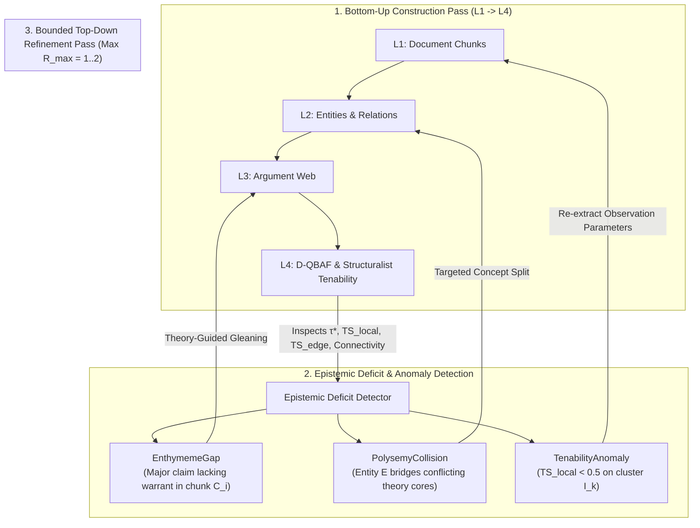

# [ISSUE-053] Closed-Loop Hermeneutic Refinement: Top-Down Epistemic Deficit Signals ($\text{L4/L3} \to \text{L1/L2}$ Feedback)

| Metadata | Details |
| :--- | :--- |
| **Issue ID** | `ISSUE-053` |
| **Domain / Category** | `09-Architecture, Workflow & Domain` (Macro-Architecture, Bidirectional Reasoning, Hermeneutic Loop) |
| **Target Package(s)** | `packages/episteme-pipeline` (`pipeline.py`, `phases/`, `post_processing/theoretical_enrichment/`) |
| **Priority** | **High** |
| **Status** | `Open` |
| **Evaluated Docs & ADRs** | [`docs/architecture/pipeline_architecture.md`](../../docs/architecture/pipeline_architecture.md), [`ADR-0002`](../../docs/adr/0002-tag-reranker-global-relation-extraction.md), [`ADR-0015`](../../docs/adr/0015-theoretical-enrichment-and-tenability-evaluation.md) |

---

## 1. Current State

[`docs/architecture/pipeline_architecture.md`](../../docs/architecture/pipeline_architecture.md) defines Episteme as a **Synergized Bidirectional Reasoning Engine** (grounded in Pan et al., 2024) that combines LLMs and Knowledge Graphs in a mutually beneficial feedback loop.

However, at the macro-architectural level, the pipeline executes as a **strictly unidirectional, one-pass feed-forward waterfall**:
$$\text{Phase 1 (L1 Chunks)} \to \text{Phase 2/3/3b/4m (L2 Ontology)} \to \text{Phase 4/5 (L3 Argument Web)} \to \text{Phase 6 / Post-Processing (L4 TheoryNet & Tenability)}$$

Currently, "gleaning" is restricted to a local, intra-chunk retry loop during initial extraction (Phase 2/4), and higher layers (`Phase 6` D-QBAF and `TheoreticalEnrichmentRunner` in [`ADR-0015`](../../docs/adr/0015-theoretical-enrichment-and-tenability-evaluation.md)) have **no feedback path** to request targeted re-extraction, concept splitting, or premise recovery from lower layers (L1/L2).

---

## 2. Why This Causes Problems

### A. Researcher & Epistemological Perspective
1. **Unrecovered Enthymemes (Implicit Premises)**:
   - In scholarly prose, authors frequently omit intermediate premises that they assume the reader can supply from the surrounding theoretical context (**enthymemes**).
   - During bottom-up Phase 4 ADU segmentation, an implicit premise or bridging warrant is missed because the macro-theoretical structure ($T = \langle K, I \rangle$) has not yet been induced. When Phase 6 / `TheoreticalEnrichment` later identifies an ungrounded major claim or an isolated deductive island, the pipeline cannot go back to the source chunks (L1) with the induced theory lens to recover the implicit premise.
2. **Unresolved Polysemy & Conflated Hub Concepts**:
   - When Phase 5 (Leiden clustering) or `TheoreticalEnrichment` (`ADR-0015`) detects a tenability anomaly ($TS_{\text{local}} < 0.5$ or $TS_{\text{edge}} < 0.5$) caused by Phase 2/3b conflating two distinct theoretical senses of a term into a single hub `L2Entity`, there is no mechanism to trigger a top-down **Concept Split** in L2 and re-evaluate the affected subgraph.

### B. Software Engineering Perspective
3. **Asymmetry Between Documented Vision and Execution Topology**:
   - Without a bounded cyclic refinement protocol in the orchestrator, the "bidirectional feedback loop" described in `pipeline_architecture.md` only exists locally within Phase 2 working memory (`ADR-0009`) and Phase 3 TAG retrieval (`ADR-0002`), rather than across the epistemic layers ($\text{L4/L3} \to \text{L2/L1}$).

---

## 3. Proposed Solution & Architectural Explanation

Introduce a bounded **Top-Down Epistemic Refinement Loop (Hermeneutic Cycle)** driven by typed **`EpistemicDeficitArtifact`s** emitted by Layer 3/4 evaluators.

### Key Architectural Concepts
1. **`EpistemicDeficitArtifact` Contract**:
   - Emitted by Phase 6 (`TheoryNet`) and `TheoreticalEnrichmentRunner` when structural anomalies are detected:
     - `ENTHYMEME_GAP`: A `MAJOR_CLAIM` or `TheoreticalHypothesis` with high centrality but zero incoming `SUPPORTS` edges or broken path to the empirical base $B$.
     - `POLYSEMY_COLLISION`: An `L2Entity` or `TheoryAtom` connected across mutually incompatible theory communities with high controversy volatility $\mathcal{V}$ (`ADR-0011 Addendum 2`) or low edge tenability $TS_{\text{edge}} < 0.5$.
2. **Bounded Selective Re-Entry**:
   - The orchestrator supports a configurable `max_refinement_cycles: int = 1` (default `0` for pure feed-forward runs, `1..2` for hermeneutic refinement).
   - Instead of re-running the entire corpus, the refinement pass executes **strictly on the localized target chunks/entities** referenced in the `EpistemicDeficitArtifact`s, conditioned on the macro-theory schema $K = \langle M_p, M, M_{pp} \rangle$ discovered in the first pass.

---

## 4. Acceptance Criteria

- [ ] Define `EpistemicDeficitArtifact` (`ENTHYMEME_GAP`, `POLYSEMY_COLLISION`, `UNGROUNDED_AXIOM`) in `artifacts/models.py`.
- [ ] Implement a bounded refinement pass in the orchestrator that routes deficit artifacts back to targeted L2/L3 extractors without invalidating unaffected subgraphs.
- [ ] Record refinement iteration lineage (`refinement_pass: int`) in `RunManifest` and `ArtifactProvenance`.
