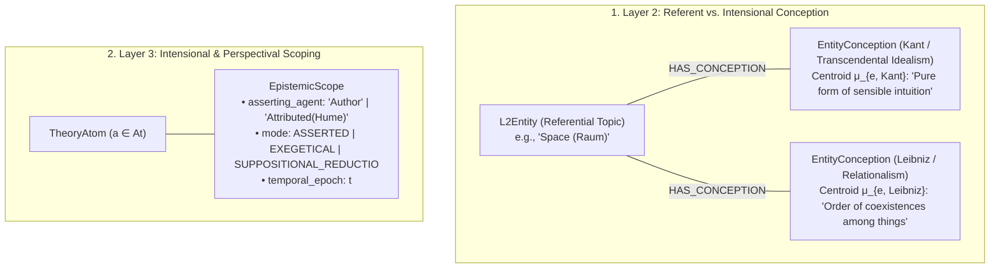

# [ISSUE-054] Intensional & Perspectival Scoping: Epistemic Attribution, Counterfactual Contexts, and Theory-Laden Conceptions

| Metadata | Details |
| :--- | :--- |
| **Issue ID** | `ISSUE-054` |
| **Domain / Category** | `09-Architecture, Workflow & Domain` (Epistemic Representation, Intensional Logic, Conceptual Drift) |
| **Target Package(s)** | `packages/episteme-pipeline`, `packages/epistemetrics` (`contracts/domain.py`, `phases/phase2_entity_discovery/`, `phases/phase4_entity_maturation/`, `phases/phase4_argument_mining/`) |
| **Priority** | **High** |
| **Status** | `Open` |
| **Evaluated Docs & ADRs** | [`docs/concepts/formal_graph_model.md`](../../docs/concepts/formal_graph_model.md), [`docs/concepts/assumptions_limitations.md`](../../docs/concepts/assumptions_limitations.md), [`ADR-0003`](../../docs/adr/0003-coreference-absorbed-into-fusion.md), [`ADR-0016-attribute-alignment`](../../docs/adr/0016-attribute-alignment-deferred.md), [`ADR-0020`](../../docs/adr/0020-propositional-modal-strength-resolver.md) |

---

## 1. Current State

Across the current pipeline architecture ([`formal_graph_model.md`](../../docs/concepts/formal_graph_model.md), [`ADR-0003`](../../docs/adr/0003-coreference-absorbed-into-fusion.md), [`ADR-0020`](../../docs/adr/0020-propositional-modal-strength-resolver.md)):

1. **Unattributed Flat Propositional Space (Layer 3)**:
   - `TheoryAtom` models a proposition $a \in \mathcal{A}$ with a single intrinsic base score $\tau_0(a) = M(\phi_a)$ representing "Authorial Propositional Modality" (`ADR-0020`), without an **Epistemic Attribution / Intensional Scope** property indicating *who* asserts $a$ or *under what rhetorical mode* $a$ is introduced.
2. **Single-Centroid Conceptual Collapse (Layer 2)**:
   - `Phase3bLatentConsolidationRunner` merges entity mentions into a single `L2Entity`, and `Phase4EntityMaturationRunner` computes a single geometric centroid $\boldsymbol{\mu}_e = \frac{1}{N} \sum E_{\text{ctx}}(T_i)$ across all mentions to synthesize **one global canonical description** per entity.

---

## 2. Why This Causes Problems

### A. Researcher & Philosophy of Science Perspective
1. **Contamination from Exegesis, Opponent Reconstruction, and *Reductio ad Absurdum***:
   - In philosophical and scientific literature, a large fraction of claims are **not asserted by the document's author**:
     - **Exegetical / Attributed Claims**: Kant summarizing Leibniz's monadology or Hume's skepticism over several pages before refuting it; a modern physics paper reviewing Newtonian mechanics.
     - **Suppositional / Counterfactual / *Reductio* Scopes**: *"Assume for the sake of argument that space is an empirical concept derived from outer experiences... Then synthetic a priori geometrical propositions would be impossible."*
   - When Phase 4 extracts these spans as `TheoryAtom`s with `SUPPORTS` edges and positive modal scores $\tau_0(a) \in [0.55, 0.90]$, they are injected directly into the same global D-QBAF as the author's actual assertions—polluting equilibrium justification scores $\tau^*$ with counterfactual and opponent premises!
2. **Eradication of Doctrinal Polysemy via Centroid Averaging**:
   - In multi-document or historical corpora, foundational terms (*"Substance"*, *"Space"*, *"Causality"*, *"Gene"*, *"Entropy"*) have **same referent/topic** but **mutually incompatible intensional definitions (conceptions)** across theories ($T_1$ vs. $T_2$) or epochs ($t_1$ vs. $t_2$).
   - Averaging their mention embeddings into a single geometric centroid $\boldsymbol{\mu}_e$ in Phase 4 Maturation produces an artificial, blended summary that obscures the exact conceptual shift between theories.

---

## 3. Proposed Solution & Architectural Explanation

Introduce **1. Intensional Attribution Envelopes** on Layer 3 `TheoryAtom`s and **2. Concept-vs-Conception Stratification** on Layer 2 `L2Entity` nodes.

### Key Architectural Concepts
1. **`EpistemicAttribution` & `IntensionalMode` on `TheoryAtom`**:
   - Extend `TheoryAtom` with:
     - `intensional_mode: Literal["asserted", "attributed", "suppositional", "historical"] = "asserted"`
     - `attributed_to: str | None = None` (e.g., canonical entity ID of the cited author/school when `intensional_mode == "attributed"`).
   - **D-QBAF Solver Isolation**: When computing authorial theory justification $\tau^*$, propositions with `intensional_mode == "suppositional"` (e.g., *Reductio* premises whose conclusion is attacked) do not contribute positive unconditioned prior weight $\tau_0(a)$ to the author's asserted theory base, and `attributed` claims can be evaluated within their perspective-scoped subgraph $\mathcal{G}_{\text{agent}}$.
2. **Multi-Centroid `EntityConception` Maturation (Replacing Single-Centroid Collapse)**:
   - Instead of computing a single unconditional mean $\boldsymbol{\mu}_e = \frac{1}{N} \sum E_{\text{ctx}}(T_i)$ in Phase 4 Maturation, partition mention envelopes by document/theory community (or detect multi-modal variance via spherical $k$-means / silhouette score when variance $\sigma^2(E_{\text{ctx}}) > \tau_{\text{polysemy}}$).
   - Preserve the shared `L2Entity` as the canonical *Referential Topic*, while synthesizing distinct `EntityConception` facets per theoretical perspective.

---

## 4. Acceptance Criteria

- [ ] `TheoryAtom` and `TheoryAtomArtifact` include `intensional_mode` (`asserted`, `attributed`, `suppositional`) and optional `attributed_to` agent reference.
- [ ] `QBAFGradualSemanticsSolver` supports perspective-filtered and supposition-aware evaluation so *Reductio* assumptions and opponent summaries do not artificially inflate authorial claim justification.
- [ ] `Phase4EntityMaturationRunner` detects high-variance / multi-modal entity envelopes across documents/theories and preserves perspective-specific conceptions rather than forcing a single global average description.
