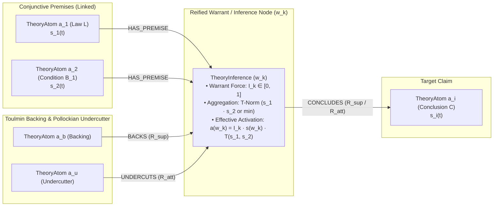

# [ISSUE-055] Bipartite Inference Hypergraph: Reifying Warrant Nodes for Conjunctive Premises, Undercutting Defeaters, and Toulmin Backing

| Metadata | Details |
| :--- | :--- |
| **Issue ID** | `ISSUE-055` |
| **Domain / Category** | `09-Architecture, Workflow & Domain` (Formal Graph Model, Argumentation Theory, D-QBAF Semantics) |
| **Target Package(s)** | `packages/episteme-pipeline`, `packages/epistemetrics` (`contracts/domain.py`, `phases/phase4_argument_mining/`, `phases/phase6_theorynet/`, `epistemetrics/epistemic/qbaf/`) |
| **Priority** | **High** |
| **Status** | `Open` |
| **Evaluated Docs & ADRs** | [`docs/concepts/formal_graph_model.md`](../../docs/concepts/formal_graph_model.md), [`ADR-0004`](../../docs/adr/0004-acc-outputs-triples-single-pass.md), [`ADR-0011`](../../docs/adr/0011-declarative-graph-metrics-and-qbaf-semantics.md), [`ADR-0020`](../../docs/adr/0020-propositional-modal-strength-resolver.md) |

---

## 1. Current State

In [`docs/concepts/formal_graph_model.md`](../../docs/concepts/formal_graph_model.md), [`ADR-0004`](../../docs/adr/0004-acc-outputs-triples-single-pass.md), and [`ADR-0011 Addendum 2`](../../docs/adr/0011-declarative-graph-metrics-and-qbaf-semantics.md), Layer 3 argumentation is modeled as a **directed pairwise multigraph** $E \subseteq \mathcal{A} \times \mathcal{A}$:
- Every inferential relation is a binary edge $r = (a_j \to a_i)$ between a single source `TheoryAtom` $a_j$ and a single target `TheoryAtom` $a_i$.
- In Phase 6 (`WeightedQuadraticEnergySolver`), incoming support and attack energies at claim $a_i$ are aggregated via a **linear independent sum**:
  $$E_i(t) = \sum_{j:(a_j, a_i) \in \mathcal{R}_{sup}} W_{ji} \cdot s_j(t) - \sum_{k:(a_k, a_i) \in \mathcal{R}_{att}} W_{ki} \cdot s_k(t)$$

---

## 2. Why This Causes Problems

### A. Researcher & Formal Epistemology Perspective
1. **Conflation of Linked (Conjunctive) vs. Convergent (Independent) Arguments**:
   - In formal epistemology and philosophy of science (Freeman, 1991; Walton, 2006; Schurz, 2014), deductive and nomological-deductive explanations require **conjunctive (linked) premises**: e.g., a universal theoretical law $L \in A$ and an empirical boundary condition $B_1 \in B$ **jointly** entail conclusion $C$ ($\{L, B_1\} \vdash C$).
   - Under conjunctive semantics, if the empirical condition $B_1$ is falsified ($s_{B_1} = 0$), the deduction fails completely and $L$ alone transmits **zero** support to $C$.
   - Because Episteme's pairwise graph decomposes $\{L, B_1\} \vdash C$ into two independent additive edges ($L \to C$ and $B_1 \to C$), refuting $B_1$ ($s_{B_1} = 0$) leaves $W_{L,C} \cdot s_L > 0$ intact—falsely maintaining high justification $\tau^*(C)$ for an uninstantiated law!
2. **Inability to Represent Pollockian Undercutting Defeaters**:
   - Epistemology distinguishes three fundamental modes of defeat (Pollock, 1987; Modgil & Prakken, 2013 ASPIC+):
     - **Undermining**: Attacking a premise $a_j$.
     - **Rebutting**: Attacking a conclusion $a_i$.
     - **Undercutting**: Attacking the **inferential rule / warrant $(a_j \implies a_i)$ itself** without disputing $a_j$'s truth or directly asserting $\neg a_i$ (e.g., *"Measuring fMRI BOLD signals ($a_j$) does not validly measure unconscious repression ($a_i$) because of confounding hemodynamic noise"*).
   - Because Neo4j property-graph edges cannot point to other edges, a pairwise `TheoryRelation` model forces undercutters to be misclassified as direct rebuttals against $a_i$ or underminers against $a_j$, distorting the dialectical cascade.
3. **Missing Structural Target for Toulmin Backing (`ADR-0020`)**:
   - While `ADR-0011 Addendum 2` and `ADR-0020` ground edge weights in Toulmin's (1958) *Warrant*, Toulmin's *Backing* is an evidentiary proposition that supports the *Warrant* (the edge), which cannot be represented without reifying the inference step.

---

## 3. Proposed Solution & Architectural Explanation

Extend Layer 3 from a purely pairwise graph to support **Reified Inference / Warrant Nodes (`TheoryInference` / Hyperedges)** (aligned with the Argument Interchange Format [AIF] and ASPIC+ bipartite structure), while remaining 100% compatible with pairwise edges as degenerate 1-premise inferences.

### Mathematical Formulation in Continuous Quadratic Energy (`epistemetrics`)
- For a reified inference node $w_k \in \mathcal{W}$ with conjunctive premise set $\text{Prem}(w_k) = \{a_{j_1}, \dots, a_{j_m}\}$ and conclusión $a_i$:
  1. **Warrant Validity State $s(w_k, t) \in [0, 1]$**: Initialized at intrinsic warrant force $w_0(w_k) = \mathcal{I}(w_k)$, modulated by incoming **Backing** ($b \xrightarrow{\text{sup}} w_k$) and **Undercutting** ($u \xrightarrow{\text{att}} w_k$) atoms via the standard Quadratic Energy ODE.
  2. **Conjunctive Premise T-Norm Activation**:
     $$\Phi_{\text{conj}}(w_k, t) = \prod_{a_j \in \text{Prem}(w_k)} s_j(t) \quad \text{(Product T-Norm)} \quad \text{or} \quad \min_{a_j \in \text{Prem}(w_k)} s_j(t) \quad \text{(Gödel T-Norm)}$$
  3. **Net Contribution to Conclusion $a_i$**:
     $$W_{w_k \to i}(t) = s(w_k, t) \cdot \mathcal{F}_{\text{gate}}(w_k) \cdot \Phi_{\text{conj}}(w_k, t)$$
- Notice that when $|\text{Prem}(w_k)| = 1$ and $w_k$ has no undercutters or backings ($s(w_k, t) = \mathcal{I}(w_k)$), this **reduces identically** to the existing pairwise formula $W_{ji} \cdot s_j(t)$!

---

## 4. Acceptance Criteria

- [ ] Support optional `premise_ids: tuple[str, ...]` (conjunctive premise sets) and `undercuts_relation_id: str | None` on `TheoryRelation` / `TheoryInferenceArtifact`.
- [ ] Project multi-premise inferences and undercutters as `:TheoryInference` intermediate nodes in `ArtifactGraphProjector` when $|\text{Prem}| > 1$ or when targeted by an undercutter/backing.
- [ ] Extend `WeightedQuadraticEnergySolver` in `epistemetrics` to evaluate Product/Gödel t-norms over conjunctive premise sets and propagate undercutting/backing energy onto inference warrants.
