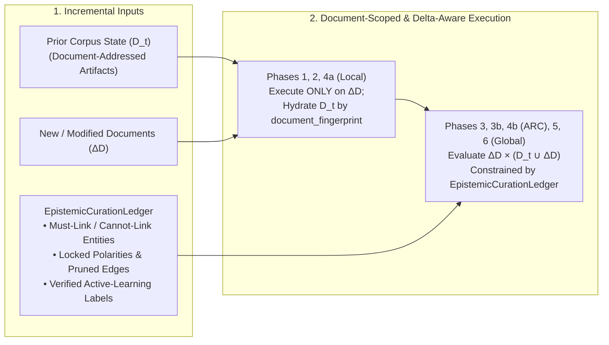

# [ISSUE-057] Incremental Knowledge Base Lifecycle ($\mathcal{G}_t + \Delta D \to \mathcal{G}_{t+1}$) & Persistent HITL Constraint Ledgers

| Metadata | Details |
| :--- | :--- |
| **Issue ID** | `ISSUE-057` |
| **Domain / Category** | `09-Architecture, Workflow & Domain` (Knowledge Base Evolution, Incremental Ingestion, HITL Curation) |
| **Target Package(s)** | `packages/episteme-pipeline`, `packages/episteme-studio` (`runs/`, `artifacts/`, `pipeline.py`) |
| **Priority** | **High** |
| **Status** | `Open` |
| **Evaluated Docs & ADRs** | [`docs/architecture/artifact_run_model.md`](../../docs/architecture/artifact_run_model.md), [`docs/architecture/invalidation_and_resume.md`](../../docs/architecture/invalidation_and_resume.md), [`ADR-0010`](../../docs/adr/0010-graph-preview-driver-selection-neo4j.md), [`ADR-0014`](../../docs/adr/0014-deterministic-identity-diffing-and-progression-workbench.md), [`ADR-0019`](../../docs/adr/0019-typesafe-jev-client-and-decision-observability.md) |

---

## 1. Current State

In [`docs/architecture/invalidation_and_resume.md`](../../docs/architecture/invalidation_and_resume.md) (§Source and Input Fingerprints & §Phase Invalidation Logic):
- `RunManifest.input_fingerprint` is computed as a single monolithic hash over all files in `PipelineInput.source_paths` and `bib_paths`.
- Rule 3 of `_choose_reuse_source()` (`invalidation_and_resume.md#L202-L203` and [`pipeline.py#L788-L790`](../../packages/episteme-pipeline/episteme_pipeline/pipeline.py#L788-L790)) states:
  > *"If `prior.input_fingerprint != current.input_fingerprint`, all phases are invalidated starting at Phase 1."*
- Furthermore, while [`ADR-0019`](../../docs/adr/0019-typesafe-jev-client-and-decision-observability.md) and Studio issues (`ISSUE-012`, `ISSUE-027`) introduce Active Learning queues and Human-in-the-Loop (HITL) graph curation, the pipeline architecture has **no input contract for a persistent Curation / Constraint Ledger**.

---

## 2. Why This Causes Problems

### A. Researcher & Corpus Evolution Perspective
1. **Adding One Paper Invalidates the Entire Existing Corpus**:
   - Scholarly research is inherently incremental: a researcher constructs a Theory Graph over 25 foundational papers ($\mathcal{D}_t$), analyzes the result, and then adds 2 newly published papers ($\Delta D$) so that $\mathcal{D}_{t+1} = \mathcal{D}_t \cup \Delta D$.
   - Because `input_fingerprint` hashes the aggregate file list, adding $\Delta D$ changes `input_fingerprint` and **invalidates Phase 1, Phase 2, Phase 3, and Phase 4 across all 25 already-processed documents**, forcing redundant re-chunking, re-embedding, and re-extraction of $\mathcal{D}_t$!
2. **Ephemeral / Orphaned Human Expert Curations**:
   - Suppose a domain philosopher spends 3 hours in Episteme Studio curating Run $R_1$: merging two alias entities, splitting a conflated concept, and flipping an edge polarity from `SUPPORTS` to `ATTACKS`.
   - When the researcher subsequently runs $R_2$ (either adding a new paper $\Delta D$ or adjusting a Phase 5 clustering parameter), the pipeline has no architectural mechanism to ingest the expert's curations as **axiomatic constraints** (e.g., *Must-Link*, *Cannot-Link*, *Fixed-Polarity*, *Deleted-Spurious-Edge*). The automated pipeline simply re-commits the same machine errors in $R_2$, rendering human curation a throwaway post-processing step rather than cumulative knowledge building.

---

## 3. Proposed Solution & Architectural Explanation

Decouple **Per-Document Content-Addressed Caching** and **Persistent Epistemic Constraint Ledgers** from ephemeral `run_id` snapshots.

### Key Architectural Concepts
1. **Per-Document Fingerprinting (`document_fingerprints: dict[str, str]`)**:
   - Replace the monolithic `source_fingerprint` check with a map of `{document_id: sha256_fingerprint}` in `RunManifest`.
   - For document-local operations (**Phase 1 Chunking/Embedding**, **Phase 2 Per-Document NER**, **Phase 4 Local ADU/ACC**), artifacts are indexed and reused for every document $d \in \mathcal{D}_t \cap \mathcal{D}_{t+1}$ whose individual content hash and phase method/config fingerprint are unchanged!
   - For cross-document operations (**Phase 3 Global Relations**, **Phase 3b Consolidation**, **Phase 4 Global ARC**, **Phase 5 Fusion**), candidate generation evaluates only the delta frontier $\Delta E \times (E_{\text{prior}} \cup \Delta E)$ rather than recomputing $E_{\text{prior}} \times E_{\text{prior}}$.
2. **First-Class `EpistemicCurationLedger` Input Contract**:
   - Introduce `EpistemicCurationLedger` in `contracts/phase_contracts.py` (passed via `PipelineInput.curation_ledger_path`):
     - `cannot_link_entities: set[tuple[str, str]]` & `must_link_entities: set[tuple[str, str]]` (enforced as hard constraints in Phase 2 Linking and Phase 3b Consolidation).
     - `relation_overrides: dict[str, RelationOverride]` (enforcing human-verified `SUPPORTS` / `ATTACKS` / `REJECTED` decisions in Phase 3 and Phase 4).
     - `modality_overrides: dict[str, float]` (locking human-adjudicated $\tau_0(a)$ priors in Phase 6).

---

## 4. Acceptance Criteria

- [ ] `RunManifest` tracks per-document SHA-256 fingerprints (`document_fingerprints`), allowing Phase 1, Phase 2, and local Phase 4 artifacts for unchanged documents to be hydrated when new documents ($\Delta D$) are added to `PipelineInput`.
- [ ] `EpistemicCurationLedger` is defined as a first-class Pydantic contract and respected by Phase 2/3b (must-link / cannot-link constraints) and Phase 3/4/6 (relation & polarity overrides).
