# Architectural Critique & Remediation Registry (`09-architecture-workflow-domain`)

This directory contains a comprehensive architectural critique of **Episteme** based on a systematic audit of [`docs/architecture/`](../../docs/architecture/overview.md), [`docs/adr/`](../../docs/adr/index.md) (`ADR-0001` through `ADR-0020`), and their foundational composition boundaries in [`packages/episteme-pipeline`](../../packages/episteme-pipeline/episteme_pipeline/pipeline.py).

> [!IMPORTANT]
> **Macro-Level Synthesis**:
> See [**`HIGH-LEVEL-ARCHITECTURAL-CRITIQUE.md`**](HIGH-LEVEL-ARCHITECTURAL-CRITIQUE.md) for the overarching conceptual analysis of the **7 macro-architectural paradigms** (Hermeneutic Feedback Loops, Intensional/Perspectival Attribution, Hypergraph Inference Reification, Compositional Uncertainty Propagation, Incremental Knowledge Base Lifecycle, Active Epistemic Quality Gates, and Declarative Dataflow Separation).

---

## 1. Foundational Architectural Pillars Assessment (What Is Sound & Preserved)

Before detailing the critique issues, our evaluation confirms that **Episteme's five core architectural pillars are fundamentally sound and best-in-class** for a research-engineering platform. None of the issues below require replacing these core paradigms; rather, they **enforce** and **extend** them:

1. **Hexagonal Architecture (Ports & Adapters + Composition Root DI)**: Decoupling domain logic via strict Python `Protocol`s (`GraphReader`/`GraphWriter`, `StructuredLLM`, `EmbeddingModel`, `RelationReranker`, `DecisionEngine`, `ModalStrengthResolver`) normalized at the composition root (`ensure_*`) is exemplary and enables 100% deterministic non-LLM testing (`InMemoryGraphStore`, `MockJevDecisionEngine`).
2. **Artifact-First & Manifest-Driven Execution**: Treating phase outputs as immutable, content-addressed `ArtifactEnvelope[T]` records governed by a `RunManifest`—with dual identifiers (`artifact_id` for lineage + `identity_key` for semantic identity across runs, `ADR-0014`) and recursive component fingerprinting (`Fingerprintable`)—is the right foundation for scientific reproducibility.
3. **Task-Local Domain Event Bus (`contextvars` + `EventObserver`)**: Binding `EventEmitter` to async task contexts (`use_event_emitter`) and emitting semantic domain events to pluggable observers (`LangfuseObserver`, `JsonlRunObserver`, `RichProgressObserver`) avoids constructor prop-drilling and isolates concurrent runs cleanly.
4. **Dual-Process Neuro-Symbolic Engine (System 1 + System 2) & Conformal Triage**: Combining sub-second local System 1 classification (`Laya`/`Jev`, `ADR-0018`/`0019`) with Split Conformal Prediction (`conformal_prediction.md`), decoupled NL-to-Format constrained decoding (`constrained_decoding.md`), and stratified `D-QBAF` ODE/DAG solvers (`ADR-0011 Addendum 2`, `ADR-0020`) is both theoretically and operationally rigorous.
5. **Staged Epistemic Progression ($\Phi_{\text{gen}}$ vs. $\Phi_{\text{spec}}$)**: Separating domain-agnostic extraction (`Phases 1–5`) from domain-specific structuralist theory lenses (`TheoreticalEnrichmentRunner`, `ADR-0015`) preserves library generality across scientific disciplines.

---

## 2. Part I: Subsystem & Boundary Enforcement Issues (`ISSUE-046` – `ISSUE-052`)

These issues address places where current runtime boundaries deviate from or incomplete the promises of the foundational architecture:

| Issue ID | Architectural Critique Title | Primary Lens | Priority | Core Defect & Refinement Summary |
| :--- | :--- | :--- | :--- | :--- |
| [**ISSUE-046**](resolved/ISSUE-046-split-brain-state-artifact-vs-neo4j-isolation.md) | **Split-Brain State Architecture: "Artifact-Native" Illusion vs. Shared Mutable Neo4j Stores** | Hexagonal Isolation & State | **Critical** | Phases still read/write `projection_graph`, `checkpoint_store`, and `graph_reader` directly without `run_id` isolation, while `ArtifactGraphProjector` re-projects in an unbatched $O(N)$ loop. **Fix**: `ArtifactSubgraphReader`, lineage-scoped checkpoints, and bulk `UNWIND` projection. |
| [**ISSUE-047**](resolved/ISSUE-047-inter-phase-artifacts-view-information-loss-and-identity-collision.md) | **Information Loss, Identity Collision & Severed Lineage in `ArtifactsView` Handoffs** | Domain & Data Contracts | **Critical** | `ArtifactCollection` appends updated entities without deduplicating by `identity_key`; `Phase3ArtifactsView` & `Phase4ArtifactsView` drop `CanonicalizationArtifact` (Phase 3b) and `FusionDecisionArtifact` (Phase 5), causing Phase 6 QBAF to double-count duplicate claims. **Fix**: Identity-resolved collection & canonical rewrite views. |
| [**ISSUE-048**](resolved/ISSUE-048-linear-ordinal-invalidation-vs-dag-execution-and-selective-recomputation.md) | **Linear Ordinal Execution & Coarse Cascade Invalidation vs. True Epistemic DAG** | Workflow & Caching | **High** | `_phase_lists_match()` invalidates all phases from Phase 1 whenever a post-processor is toggled; custom phases silently fallback to `phase_key = "phase1"`; `ArtifactDependencyGraph` is unused during execution. **Fix**: Sub-DAG prefix compatibility & delta-aware execution contexts. |
| [**ISSUE-049**](resolved/ISSUE-049-reproducibility-hazards-stochastic-auditing-prompt-fingerprints-and-conformal-drift.md) | **Reproducibility & Cache Coherence Hazards in System 1/2 Triage & Conformal Calibration** | Reproducibility & Statistics | **High** | Unseeded 2% stochastic auditing breaks determinism under async concurrency; `_prompt_fingerprints()` hardcodes only 4 phases; unstratified conformal $\mathcal{D}_{\text{cal}}$ violates exchangeability across tasks and GER/ENG domains. **Fix**: HMAC-SHA256 PRF auditing, recursive `Fingerprintable` prompts, and Mondrian calibration. |
| [**ISSUE-050**](ISSUE-050-ontological-schism-tf-vs-dqbaf-vs-structuralist-tenability-feedback.md) | **Theoretical & Ontological Fragmentation Across ADRs (`TF` vs. `D-QBAF` vs. Structuralism)** | Epistemic Metamodel | **High** | `ADR-0007` (TF) and `ADR-0011`/`0020` (D-QBAF) contradict each other; `TheoryRelation` retains `modal_strength` risking $M^2$ double-penalization; `ADR-0015` tenability ($TS_{\text{local}}$) runs *after* Phase 6 and never updates D-QBAF $\tau^*$. **Fix**: Unified L2–L4 metamodel (`ADR-0021`) and coupled tenability-QBAF convergence. |
| [**ISSUE-051**](resolved/ISSUE-051-episodic-memory-crash-amnesia-and-quadratic-retrieval-scaling.md) | **Episodic Working Memory Crash Amnesia, Sequential Bottlenecks & Anisotropic Cosine Thresholds** | Scalability & Resilience | **High** | Phase 2 purges RAM Working Memory (`ADR-0009`), so resuming mid-chapter (`ADR-0001`) starts with empty STM; sequential chunking blocks chapter parallelism; raw cosine cutoffs fail under anisotropy/hubness. **Fix**: Checkpointed STM snapshots, ToC-bounded chapter parallelism, `CheckpointedBatchExecutor`, and CSLS scaling. |
| [**ISSUE-052**](resolved/ISSUE-052-event-bus-lifecycle-gaps-unflushed-spans-and-audit-completeness.md) | **Event System Lifecycle Gaps: Missing Failure/Reuse Events, Unflushed Spans & Silent Drops** | Observability & Telemetry | **Medium** | Crashing phases never emit `ComponentCompleted(success=False)` or `PhaseFailed`; reused phases emit zero lineage events; synchronous `emit()` lacks a `finally: flush()` barrier. **Fix**: Symmetric lifecycle bracket events, guaranteed flush barrier, and observer drop counters in `RunReport`. |

---

## 3. Part II: Higher-Level Architectural & Epistemic Evolution Issues (`ISSUE-053` – `ISSUE-058`)

These issues translate the 7 macro-level architectural concepts from [**`HIGH-LEVEL-ARCHITECTURAL-CRITIQUE.md`**](HIGH-LEVEL-ARCHITECTURAL-CRITIQUE.md) into concrete architectural evolution specifications:

| Issue ID | Macro-Architectural Evolution Title | Macro Concept Addressed | Priority | Core Architectural Advancement |
| :--- | :--- | :--- | :--- | :--- |
| [**ISSUE-053**](ISSUE-053-closed-loop-hermeneutic-refinement-and-top-down-feedback.md) | **Closed-Loop Hermeneutic Refinement: Top-Down Epistemic Deficit Signals ($\text{L4/L3} \to \text{L1/L2}$)** | #1 Bidirectional Hermeneutic Loop | **High** | Replaces strict one-pass waterfall with bounded top-down feedback: Phase 6 / Enrichment emits `EpistemicDeficitArtifact`s (`ENTHYMEME_GAP`, `POLYSEMY_COLLISION`) that trigger targeted L1/L2 premise recovery and concept splitting. |
| [**ISSUE-054**](ISSUE-054-intensional-perspectival-scoping-and-conception-stratification.md) | **Intensional & Perspectival Scoping: Epistemic Attribution, Counterfactuals & Conceptions** | #2 Intensional & Perspectival Space | **High** | Scopes `TheoryAtom`s by `intensional_mode` (`asserted`, `attributed`, `suppositional` for *Reductio* / opponent exegesis) and stratifies `L2Entity` into *Referential Topic* vs. theory-specific *EntityConceptions* instead of single-centroid averaging. |
| [**ISSUE-055**](ISSUE-055-bipartite-inference-hypergraph-conjunctive-premises-and-undercutters.md) | **Bipartite Inference Hypergraph: Reifying Warrant Nodes for Conjunctive Premises & Undercutters** | #3 Hypergraph Inference Topology | **High** | Reifies multi-premise deductions as `TheoryInference` (Warrant) nodes evaluated via Product/Gödel t-norms, enabling linked vs. convergent premise distinction, Pollockian undercutting defeaters, and Toulmin backings. |
| [**ISSUE-056**](resolved/ISSUE-056-non-transitive-consolidation-and-compositional-conformal-risk.md) | **Non-Transitive Consolidation & Compositional End-to-End Conformal Risk Control** | #4 End-to-End Uncertainty & Risk | **Medium** | Replaces transitive Union-Find in Phase 3b/5 with diameter-bounded correlation clustering (preventing single-linkage bridge chaining) and introduces sequence-level $\alpha$-budget allocation across phases. |
| [**ISSUE-057**](resolved/ISSUE-057-incremental-corpus-evolution-and-persistent-hitl-constraint-ledger.md) | **Incremental Knowledge Base Lifecycle ($\mathcal{G}_t + \Delta D \to \mathcal{G}_{t+1}$) & Persistent HITL Constraint Ledgers** | #5 Knowledge Lifecycle & HITL | **High** | Replaces monolithic corpus hashing with per-document content-addressed caching (`document_fingerprints`) for incremental paper additions ($\Delta D$), and introduces a persistent `EpistemicCurationLedger` for human must-link/cannot-link/polarity constraints. |
| [**ISSUE-058**](ISSUE-058-runtime-epistemic-quality-gates-and-declarative-orchestrator.md) | **Active Runtime Epistemic Quality Gates & Declarative Dataflow Orchestration** | #6 Quality Gates & #7 Orchestrator | **Medium** | Introduces inter-phase `EpistemicQualityGate` circuit breakers (ontology entropy, percolation diameter, conformal OOD rate) and splits `Pipeline` into `PipelineFactory` (DI), `WorkflowDAG` (topology), and `ArtifactExecutionEngine` (runtime). |

---

## 4. Part III: Clean Code, Design Pattern & Phase Implementation Issues (`ISSUE-059` – `ISSUE-065`)

Grounded in **[Design Patterns, Clean Code & Architectural Standards (`docs/architecture/design_patterns_and_standards.md`)](../../docs/architecture/design_patterns_and_standards.md)**, these issues catalogue concrete design-pattern violations, anti-patterns (`getattr`/`hasattr` proliferation, silent exception swallowing, mid-loop instantiation), and phase-specific workflow/domain bugs across the orchestrator and Phases 1–6 + Post-Processing, complete with direct code fixes:

| Issue ID | Clean Code, Pattern & Workflow Defect Title | Primary Pattern / Principle | Priority | Core Defect & Direct Remediation Summary |
| :--- | :--- | :--- | :--- | :--- |
| [**ISSUE-059**](resolved/ISSUE-059-phase-runner-template-method-lifecycle-and-component-wiring.md) | **Missing `PhaseRunner` Template Method, Unscoped Progress Lifecycle, Silent Exception Swallowing & Invisible Component Fingerprinting** | Template Method, DIP & Fingerprinting | **High** | `event_emitter` duplicated 12x; unguarded `ProgressStarted` leaves dangling progress bars on crash; `LLMNERExtractor`/`LLMADUSegmenter`/`LLMACCClassifier` swallow exceptions into `[]` (bypassing `_guard_systematic_failure` and permanently marking failed Phase 4 chunks processed); `Phase4Runner` instantiates segmenter/classifier inside `_process_chunk` (hiding them from `find_components()`); `Phase1Runner` stores unused `self.llm` (falsely invalidating Phase 1). |
| [**ISSUE-060**](resolved/ISSUE-060-broken-system1-system2-cascades-and-flawed-audit-semantics.md) | **Broken System 1 $\to$ System 2 Cascading Classifiers, Inverted Stochastic Audit Semantics & Protocol-Breaking `isinstance` Dispatch** | Chain of Responsibility / `CalibratedCascade` | **Critical** | `CascadingACCClassifier` checks `or not relations:` while `JevACCClassifier` always returns `relations=[]`, causing a **100% LLM fallback rate**; `CascadingARCClassifier` re-runs the entire corpus on a single audit coin flip; `InterDocumentClusterVerifier.should_fuse` sets `is_confirmed = True` on rejected merges when `audit_rate` triggers; `CascadingEntityLinker` uses `isinstance(self.primary, JevEntityLinker)`. |
| [**ISSUE-061**](resolved/ISSUE-061-reflection-antipatterns-getattr-hasattr-and-leaky-protocols.md) | **Proliferation of `getattr`/`hasattr` Reflection Anti-Patterns (`AGENTS.md` Violation) & Incomplete Port Protocols** | Hexagonal Ports, ISP, LSP & Static Typing | **High** | 50+ `getattr`/`hasattr` calls across `pipeline.py`, `phases/`, and `post_processing/`; `Pipeline.__init__` overwrites unknown `phase_key`s to `"phase1"`; `TheoryProjector` ABC omits `async def aproject`; `Phase5Config` omits `max_cluster_size`; strategy protocols lack `Fingerprintable` inheritance, relying on hardcoded `_CORE_COMPONENT_NAMES`. |
| [**ISSUE-062**](resolved/ISSUE-062-lossy-artifact-codecs-corrupted-maturation-mentions-and-empty-phase6-artifacts.md) | **Lossy Domain–Artifact–Graph Codecs, Corrupted Phase 4 Maturation `source_chunk_ids`, and Empty Phase 6 Artifact Output** | Bidirectional Codec (`ArtifactCodec`) | **Critical** | `Phase4EntityMaturationRunner` passes `artifact::{cid}` instead of `artifact::mention::{entity_id}::{cid}`, causing `parse_mention_id` to wipe `source_chunk_ids = []` on all matured entities; `ChunkArtifact` drops `embedding` & `metadata` (breaking Phase 2 section eviction on resume); `TheoryAtomArtifact` drops `entity_ids` & `modal_strength`; `Phase6Runner` returns `ArtifactCollection([])` and logs `0 TheoryRelations`; `TheoreticalEnrichmentRunner` overwrites graph edges via raw dicts. |
| [**ISSUE-063**](resolved/ISSUE-063-phase1-to-phase3-domain-and-concurrency-bugs.md) | **Phase 1–3 Domain & Concurrency Defects: LaTeX ToC Post-Conversion Bug, Word-Count Token Overwrite, Concurrent Working Memory Race Condition, Unchecked `CrossEncoder`, and Missing Confidence Filter** | Stateful Reducer ($S_t = f(S_{t-1}, x_t)$) & Domain Invariants | **Critical** | Phase 1 runs `LaTeXToCParser` on Pandoc-converted Markdown (finding 0 `\section`s) and overwrites `tiktoken` counts with `len(raw.text.split())`; Phase 2 runs `asyncio.gather` concurrently mutating shared `EpisodicWorkingMemoryManager.state` out of order and emits duplicate `LinkedEntityArtifact`s per batch; `DenseEntityLinker.link` crashes when `cross_encoder=None`; Phase 3 `DenseRetrievalGlobalRelationExtractor` ignores `global_relation_confidence_threshold` and zero-norm guards. |
| [**ISSUE-064**](resolved/ISSUE-064-phase4-to-postprocessing-domain-bugs-and-hardcoded-heuristics.md) | **Phase 4–6 & Post-Processing Defects: `processed_chunk_ids` `UnboundLocalError`, Fake `L2Entity` Adapter, Order-Dependent Tenability Lookup & Hardcoded Psychology Parameters** | Two-Pass Map-Reduce, LSP & OCP | **Critical** | `Phase4Runner.run` raises `UnboundLocalError: processed_chunk_ids` when `chunks` is empty; `TAGARCClassifier._component_as_entity` fabricates a fake `L2Entity` to call Phase 3's `global_extractor`; `TheoreticalEnrichmentRunner._find_target_parameters` queries `cluster_theory_params` in a single-pass loop before target clusters are populated; `TenabilitySolver.solve_edge_tenability` hardcodes `"RepressionMagnitude"` / `"AmygdalaHyperactivity"` / `"DopamineDepletion"`. |
| [**ISSUE-065**](resolved/ISSUE-065-dry-consolidation-of-vector-graph-and-pairing-primitives.md) | **DRY Violations Across Mathematical & Graph Primitives, Orchestrator Entrypoint Duplication & Dead Legacy Code** | DRY, YAGNI & Shared Domain Utilities | **Medium** | Consolidates 6 copies of L2-normalized cosine similarity, 2 copies of Union-Find, 2 copies of `_stable_component_id`, 2 copies of cross-chunk priority pairing, and 2 copies of candidate embedding caches into `episteme_pipeline/utils/`; fixes `Pipeline.resume_from_run()` missing `use_event_emitter` & `run_folder_logger`; removes dead `artifacts/mappers.py` and `phase5_fusion/models.py`. |

---

## 5. Recommended Staged Roadmap

```mermaid
flowchart LR
    subgraph Stage0 ["Stage 0: Critical Phase Bug & Cascade Fixes"]
        I60["ISSUE-060<br/>Fix System 1/2 Cascades"] --> I62["ISSUE-062<br/>Lossless Artifact Codecs"]
        I63["ISSUE-063<br/>Phase 1-3 Concurrency & Domain Fixes"] --> I64["ISSUE-064<br/>Phase 4-6 & Enrichment Fixes"]
    end

    subgraph Stage1 ["Stage 1: Clean Code, Ports & State Integrity"]
        I59["ISSUE-059<br/>PhaseRunner Template & Exceptions"] --> I61["ISSUE-061<br/>Eliminate getattr & Strict Protocols"]
        I65["ISSUE-065<br/>Shared Math Utils & DRY"] --> I47["ISSUE-047<br/>Identity-Resolved Views"]
        I47 --> I46["ISSUE-046<br/>Hexagonal Artifact Isolation"]
    end

    subgraph Stage2 ["Stage 2: Determinism & Observability"]
        I49["ISSUE-049<br/>HMAC Audit & Mondrian Conformal"]
        I52["ISSUE-052<br/>Symmetric Event Lifecycle"]
    end

    subgraph Stage3 ["Stage 3: DAG Runtime & Incremental KB"]
        I48["ISSUE-048<br/>Sub-DAG Reuse"] --> I58["ISSUE-058<br/>Declarative DAG & Quality Gates"]
        I51["ISSUE-051<br/>Checkpointed STM & CSLS"] --> I57["ISSUE-057<br/>Incremental Corpus & HITL Ledger"]
    end

    subgraph Stage4 ["Stage 4: Next-Gen Epistemic Expressivity"]
        I50["ISSUE-050<br/>Unified L2-L4 Metamodel"] --> I54["ISSUE-054<br/>Intensional Scoping & Conceptions"]
        I50 --> I55["ISSUE-055<br/>Bipartite Inference Hypergraph"]
        I54 & I55 --> I53["ISSUE-053<br/>Closed-Loop Hermeneutic Refinement"]
        I56["ISSUE-056<br/>Non-Transitive Clustering & RCPS"]
    end

    Stage0 --> Stage1 --> Stage2 --> Stage3 --> Stage4
```

