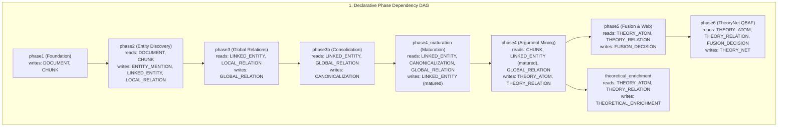

# [ISSUE-048] Linear Ordinal Pipeline Execution & Coarse Cascade Invalidation vs. True Epistemic DAG & Selective Recomputation

| Metadata | Details |
| :--- | :--- |
| **Issue ID** | `ISSUE-048` |
| **Domain / Category** | `09-Architecture, Workflow & Domain` (Orchestration, DAG Scheduling, Invalidation & Caching) |
| **Target Package(s)** | `packages/episteme-pipeline` (`pipeline.py`, `artifacts/invalidate.py`, `protocols/phase_runner.py`) |
| **Priority** | **High** |
| **Status** | `Resolved` |
| **Evaluated Docs & ADRs** | [`docs/architecture/invalidation_and_resume.md`](../../docs/architecture/invalidation_and_resume.md), [`docs/architecture/pipeline_architecture.md`](../../docs/architecture/pipeline_architecture.md), [`ADR-0012`](../../docs/adr/0012-phase-config-redesign-and-langfuse-integration.md), [`ADR-0014`](../../docs/adr/0014-deterministic-identity-diffing-and-progression-workbench.md), [`ADR-0015`](../../docs/adr/0015-theoretical-enrichment-and-tenability-evaluation.md) |

---

## 1. Current State

The pipeline orchestrator ([`packages/episteme-pipeline/episteme_pipeline/pipeline.py`](../../packages/episteme-pipeline/episteme_pipeline/pipeline.py)) and [`docs/architecture/invalidation_and_resume.md`](../../docs/architecture/invalidation_and_resume.md) currently model pipeline execution and cache invalidation as a **1-based sequential array of ordinals** (`1..N`):

1. **All-or-Nothing Phase List Equality (`_phase_lists_match`)**:
   In `pipeline.py#L725-L735` and `invalidation_and_resume.md §Phase Invalidation Logic`:
   ```python
   def _phase_lists_match(self, prior: RunManifest) -> bool:
       prior_names = [rec.phase_name for rec in sorted(prior.phase_records, key=lambda r: r.phase_ordinal)]
       current_names = [entry.name for entry in self._phase_entries]
       return prior_names == current_names
   ```
   If `prior_names != current_names`, `_choose_reuse_source()` immediately returns `reused_phase_ordinals=[]` and invalidates **all phases from Phase 1 onward** (`reason="phase-list-changed"`).
2. **Linear Suffix Invalidation**:
   In `_choose_reuse_source()` (`pipeline.py#L793-L816`), the orchestrator scans phases in linear order $1 \dots N$, finds the first `earliest_invalid` index where a config or method fingerprint changed, and invalidates every phase $i \ge \text{earliest\_invalid}$ regardless of whether phase $j > i$ actually depends on phase $i$'s outputs.
3. **Unused `ArtifactDependencyGraph` at Execution Time**:
   `ArtifactDependencyGraph` (`pipeline/artifacts/invalidate.py`) constructs a fine-grained DAG over `identity_key`s and `dependency_fingerprint`s. However, as noted in `pipeline.py#L836`, *"Diagnostic only — it is not consulted by `_choose_reuse_source`."* When a phase is invalidated, it re-executes from scratch over 100% of upstream artifacts rather than selectively recomputing only the stale subgraph.
4. **Fragile String-Matching & Silent `"phase1"` Fallback in `Pipeline.__init__`**:
   In `pipeline.py#L130-L155`, if a `PhaseRunner` does not define `phase_key` or if `not hasattr(config, phase_key)`, the orchestrator falls back to substring checks (`if "Phase 1" in name_str: ...`) and finally defaults to `phase_key = "phase1"`:
   ```python
   if not hasattr(config, phase_key):
       phase_key = "phase1"
   ```
   Furthermore, `RunManifest.phase_config_fingerprints` keys fingerprints by ordinal (`f"phase_{i}"` in `pipeline.py#L714`) rather than by semantic `phase_key`.

---

## 2. Why This Causes Problems

### A. Researcher & Iterative Experimentation Perspective
1. **Toggling Optional Post-Processors Wipes All Upstream Work**:
   - [`ADR-0015`](../../docs/adr/0015-theoretical-enrichment-and-tenability-evaluation.md) specifically designed `TheoreticalEnrichmentRunner` (and custom `post_processors` / `extra_phases` in `pipeline_architecture.md §Extensibility`) to be modular analytical passes attached after core construction.
   - Suppose a researcher runs Phases 1–6 on a 400-page philosophy monograph (consuming 45 minutes and significant LLM API budget). Next, the researcher enables `config.theoretical_enrichment.enabled = True` (or passes `post_processors=[MyEvaluator()]`) and calls `pipeline.run()`.
   - Because `current_names` now has 9 phases instead of 8, `_phase_lists_match(prior)` returns `False` (`phase-list-changed`), **invalidating Phases 1 through 6 and re-running the entire 45-minute extraction from Phase 1**!
2. **False Transitive Invalidation Between Orthogonal Branches**:
   - Consider the actual data dependencies in `pipeline_architecture.md`:
     - `Phase 2 (Entity Discovery)` $\to$ `Phase 3 (Global Relations)` $\to$ `Phase 3b (Consolidation)` $\to$ `Phase 4 Maturation`.
     - Meanwhile, `Phase 4 (Argument Mining: ADU/ACC)` segments and classifies claims from `Phase 1 (Chunks)` and `Phase 3 (Global Relations)`.
     - Similarly, after `Phase 4`, `Phase 5 (Leiden Theory Clustering)`, `Phase 6 (TheoryNet QBAF)`, and `TheoreticalEnrichmentRunner` form a branching analytical DAG.
   - Under linear ordinal invalidation, modifying a hyperparameter in `TheoreticalEnrichmentRunner` or `Phase 5` invalidates phases that have zero data dependency on them if ordered later in the list.
3. **Disproportionate Cost of Minor Upstream Edits**:
   - If a researcher adds a 2-page appendix to a 10-chapter corpus or tweaks an entity linking threshold that alters 2 entities out of 800, `ArtifactDependencyGraph` knows that 98% of chunks and entities have unchanged `dependency_fingerprint`s. Because `ArtifactDependencyGraph` is only used post-hoc in `diff_artifacts()`, the pipeline cannot reuse unchanged entity synthesis or ADU segmentations across runs.

### B. Software Engineering & SOLID Perspective
4. **Violation of Open/Closed Principle (OCP) & Silent Config Corruption**:
   - Hardcoding `if "Phase 1" in name_str:` in `Pipeline.__init__` and silently falling back to `phase_key = "phase1"` when a custom runner (`extra_phases` or `post_processors`) is registered violates OCP and SOLID Directive §2.
   - Worse, because `if not hasattr(config, phase_key): phase_key = "phase1"`, any custom `PhaseRunner` injected via `extra_phases` or `post_processors` has its `phase_config_fingerprints` computed from **`config.phase1`**! Changing the custom runner's own configuration will never trigger invalidation, while changing `config.phase1` will appear as a config change on the custom runner.

---

## 3. Proposed Solution & Architectural Explanation

Upgrade the orchestrator from a 1-based ordinal loop to a **Topological Stage DAG with Longest-Valid-Prefix / Sub-DAG Reuse and Delta-Aware Execution Contexts**.



### Step 1: Enforce Explicit `phase_key`, `reads`, `writes`, and `config_fingerprint()` on `PhaseRunner`
- Update `PhaseRunner` protocol (`protocols/phase_runner.py`) to require:
  - `phase_key: str` (unique machine identifier, e.g., `"phase1"`, `"theoretical_enrichment"`, `"custom_eval"`).
  - `reads_kinds: frozenset[ArtifactKind]` and `writes_kinds: frozenset[ArtifactKind]` (derived automatically from `input_view._allowed_kinds` or declared on the runner).
  - Optional `runner.config_fingerprint() -> str` method so custom `extra_phases` and `post_processors` can fingerprint their own configuration object without requiring a hardcoded field on `PipelineConfig`.
- Remove the `if "Phase 1" in name_str:` chain and the silent `phase_key = "phase1"` fallback in `Pipeline.__init__()`. Key `RunManifest.phase_config_fingerprints` by `entry.phase_key` instead of `f"phase_{i}"`.

### Step 2: Sub-DAG & Prefix Compatibility Reuse in `_choose_reuse_source()`
- Delete the rigid `_phase_lists_match(prior)` check that rejects reuse whenever a phase is appended or toggled.
- Instead, evaluate reuse per `phase_key` along the dependency DAG:
  - A phase $p$ can be reused from `prior` if and only if:
    1. $p.\text{phase\_key}$ completed (`RunStatus.COMPLETED`) in `prior`.
    2. All upstream phases $u \in \text{ancestors}(p)$ that produce `ArtifactKind`s in $p.\text{reads\_kinds}$ were also reused (and in the same relative order).
    3. `prior.input_fingerprint == current.input_fingerprint` (for root phases).
    4. $p$'s `phase_config_fingerprint` and `method_fingerprints` match `prior`.
- **Immediate Benefit**: Appending `TheoreticalEnrichmentRunner` or custom `post_processors` to a completed 6-phase run automatically reuses Phases 1–6 (`🟢 Reused`) and executes **only** the newly attached post-processor!

### Step 3: Semantic `phase_key` Alignment with `ArtifactHydrator` (`IncrementalRetentionScope`)
- Centralized intra-phase delta recomputation is handled by `ArtifactHydrator` and `IncrementalRetentionScope` (`artifacts/execution.py`), which filter unchanged documents, chunks, entities, and argument components across runs.
- Bind `ArtifactExecutionContext.hydrator(phase_key, phase_name)` and `is_phase_unchanged(manifest, prior_manifest, phase_key, phase_name)` exclusively to semantic `phase_key` so that phases whose ordinal position differs from their phase number (e.g., `Phase4Runner` with `phase_key="phase4"` executing at ordinal 6 after `phase3b` and `phase4_maturation`) evaluate configuration stability against their own semantic `phase_key` rather than positional `phase_4`.

---

## 4. Acceptance Criteria

- [x] Appending or toggling `TheoreticalEnrichmentRunner`, `post_processors`, or `extra_phases` reuses all completed upstream phases (Phases 1–6) without triggering `"phase-list-changed"` full-pipeline invalidation.
- [x] `Pipeline.__init__` raises an explicit `ValueError` / `TypeError` on missing `phase_key` rather than silently defaulting to `"phase1"` or string-matching `runner.name`.
- [x] `RunManifest.phase_config_fingerprints` is keyed by semantic `phase_key` and supports custom `PhaseRunner` configurations outside `PipelineConfig`.
- [x] Independent post-processing branches in the phase DAG do not transitively invalidate each other when their respective configs change.

---

## 5. Key Target Files

- [`packages/episteme-pipeline/episteme_pipeline/pipeline.py`](../../packages/episteme-pipeline/episteme_pipeline/pipeline.py)
- [`packages/episteme-pipeline/episteme_pipeline/protocols/phase_runner.py`](../../packages/episteme-pipeline/episteme_pipeline/protocols/phase_runner.py)
- [`packages/episteme-pipeline/episteme_pipeline/artifacts/invalidate.py`](../../packages/episteme-pipeline/episteme_pipeline/artifacts/invalidate.py)
- [`docs/architecture/invalidation_and_resume.md`](../../docs/architecture/invalidation_and_resume.md)
