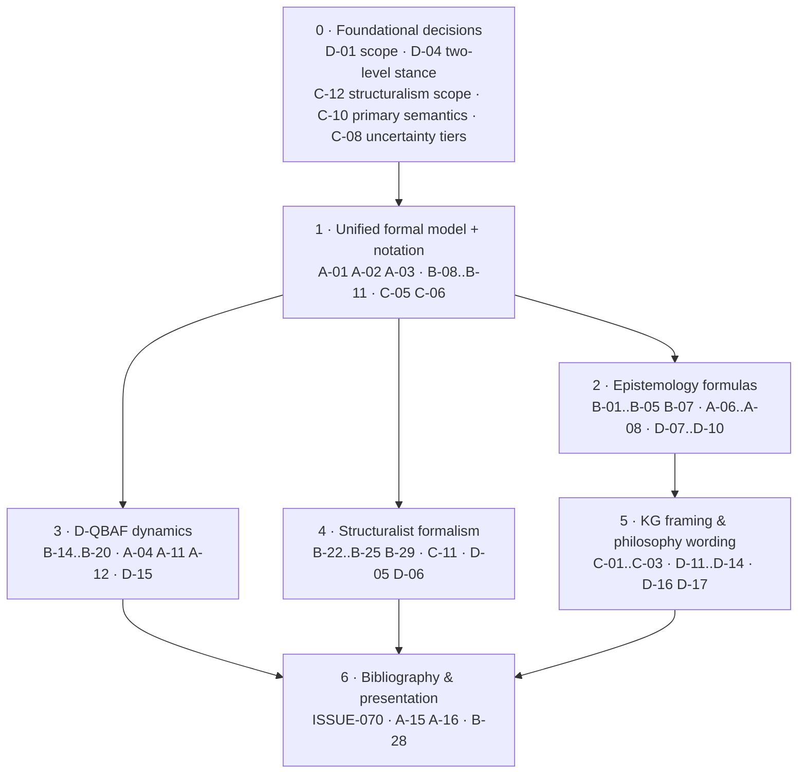

# 10 — Formal & Conceptual Documentation Audit

Audit of the four self-contained concept documents for **publication readiness**:

| Document                                                                                        | Lines | Role                                                         |
|:------------------------------------------------------------------------------------------------|:------|:-------------------------------------------------------------|
| [`kg_vs_tg.md`](../../docs/concepts/kg_vs_tg.md)                                                  | 211   | Motivation: knowledge graphs vs. theory graphs                |
| [`epistemology.md`](../../docs/concepts/epistemology.md)                                          | 256   | Philosophy-of-science criteria (Schurz, Lakatos, Thagard)     |
| [`formal_graph_model.md`](../../docs/concepts/formal_graph_model.md)                              | 417   | Formal graph, layers, D-QBAF, structuralist model theory      |
| [`theory_nets_and_topologies.md`](../../docs/concepts/theory_nets_and_topologies.md)              | 196   | Structuralist theory-nets, typology, Leiden, centrality       |

**Method.** Line-by-line reading of all four files. Every formula was type-checked and, where possible,
proved or refuted (counter-examples are given). Claims were compared with the primary literature and the current state
of the art in each field. Bibliographic data were spot-checked externally. Each finding has a stable ID, exact line
links, a severity, the reason it is wrong, and a concrete fix.

**Severity.** **Critical** = contradicts a core claim or would cause rejection in peer review · **Major** = must fix before
publishing · **Minor** = precision / style / presentation.

---

## Issue files

| Issue                                                                                   | Category (task item)                         | Findings | Critical | Major | Minor |
|:----------------------------------------------------------------------------------------|:---------------------------------------------|:--------:|:--------:|:-----:|:-----:|
| [**ISSUE-066**](ISSUE-066-cross-document-inconsistencies-and-notation.md)               | (a) Inconsistencies & incoherence             | 16       | 4        | 9     | 3     |
| [**ISSUE-067**](ISSUE-067-mathematical-errors-in-formalisms.md)                          | (b) Mathematical & formal-logical errors      | 33       | 6        | 20    | 7     |
| [**ISSUE-068**](ISSUE-068-conceptual-and-domain-errors.md)                               | (c) Conceptual & domain errors                | 19       | 5        | 12    | 2     |
| [**ISSUE-069**](ISSUE-069-philosophical-errors.md)                                       | (d) Philosophical errors                      | 17       | 4        | 12    | 1     |
| [**ISSUE-070**](ISSUE-070-bibliography-and-attribution-audit.md)                         | Cross-cutting: citations & attributions       | 4 (+ bibliography) | – | 3 | 1  |
| **Total**                                                                               |                                              | **89**   | **19**   | **56**| **14**|

---

## The 19 critical findings at a glance

| ID                                                                       | Finding                                                                                                                  | Doc     |
|:-------------------------------------------------------------------------|:-------------------------------------------------------------------------------------------------------------------------|:--------|
| [A-01](ISSUE-066-cross-document-inconsistencies-and-notation.md) | "TheoryNet" denotes both an argument graph $(At,R)$ and a structuralist poset $\langle N,\sigma\rangle$     | FGM, TN, KG |
| [A-02](ISSUE-066-cross-document-inconsistencies-and-notation.md) | Layer model differs per document; $V\cong At$ and $V=B\uplus A$ are both incompatible with $V\ni$ *Person*        | all     |
| [A-05](ISSUE-066-cross-document-inconsistencies-and-notation.md) | "TGs are DAGs" vs. inherently cyclic dialectics and coherentist holons                                | KG, TN, FGM |
| [A-08](ISSUE-066-cross-document-inconsistencies-and-notation.md) | The tacked theory $T\wedge H$ *passes* the creativity test that homogeneity is meant to reject             | EPI     |
| [B-01](ISSUE-067-mathematical-errors-in-formalisms.md) | $E(H_1\wedge H_2)\supset E(H_1)\cup E(H_2)$ holds for almost any pair (closure under $\wedge$)                    | EPI     |
| [B-02](ISSUE-067-mathematical-errors-in-formalisms.md) | Every theory is factorizable ($T\equiv T\wedge\top$); "disjoint" closed sets impossible                   | EPI     |
| [B-04](ISSUE-067-mathematical-errors-in-formalisms.md) | Ad-hoc condition $\operatorname{Cn}(K_{i+1})\setminus\{a\}\subseteq\operatorname{Cn}(K_i)$ is never satisfiable; changes the hard core | EPI |
| [B-14](ISSUE-067-mathematical-errors-in-formalisms.md) | Filippov argument invalid: filter acts on constant parameters, the ODE is $C^1$ in the state                | FGM     |
| [B-16](ISSUE-067-mathematical-errors-in-formalisms.md) | "Correction to Potyka" fails: an upper bound cannot prove instability, the numbers are off by roughly 8×, and on DAGs $\operatorname{spec}(J)=\{-1\}$ | FGM |
| [B-24](ISSUE-067-mathematical-errors-in-formalisms.md) | Approximative adequacy $(I,X)\in u$ is ill-typed (set vs. model); $r$, constraints and $\exists u$ are missing | FGM |
| [C-01](ISSUE-068-conceptual-and-domain-errors.md) | KG straw man (Wikidata ranks/qualifiers/references, OWA, ORKG, AIFdb); Episteme's own L2 is a KG          | KG      |
| [C-05](ISSUE-068-conceptual-and-domain-errors.md) | Binary edges cannot express linked premises, undercutters (which attack inferences), or ECHO co-hypotheses | FGM, TN, EPI |
| [C-08](ISSUE-068-conceptual-and-domain-errors.md) | 12+ uncertainty scores with no tiering or shared calculus                                              | FGM     |
| [C-10](ISSUE-068-conceptual-and-domain-errors.md) | Five evaluation semantics (D-QBAF, ECHO, Dung, Rescher–Manor, subjective/fuzzy logic) with no stated relation | FGM, EPI |
| [C-12](ISSUE-068-conceptual-and-domain-errors.md) | The argument-mining → structuralist-net bridge is asserted, never defined; philosophy texts lack structure species | KG |
| [D-01](ISSUE-069-philosophical-errors.md) | Empiricist criteria applied to philosophy/ethics amount to a reintroduced verificationist meaning criterion | EPI, FGM, KG |
| [D-02](ISSUE-069-philosophical-errors.md) | Textual provenance ("author said $p$") conflated with empirical justification ("$p$ is warranted")          | FGM, KG |
| [D-03](ISSUE-069-philosophical-errors.md) | *Zuordnungsgesetze* (object-level mixed sentences) recast as L3→L2 DB edges and $[0,1]$ functions          | FGM     |
| [D-04](ISSUE-069-philosophical-errors.md) | Statement view (Schurz/argumentation) and non-statement view (structuralism) combined without reconciliation | FGM, EPI, TN |

(KG = `kg_vs_tg.md`, EPI = `epistemology.md`, FGM = `formal_graph_model.md`, TN = `theory_nets_and_topologies.md`.)

---

## Per-document hotspot map

| Document                        | (a) | (b) | (c) | (d) | Dominant problem                                                                                     |
|:--------------------------------|:---:|:---:|:---:|:---:|:-----------------------------------------------------------------------------------------------------|
| `kg_vs_tg.md`                   | 6   | –   | 9   | 6   | Straw-man KG contrast; terminology (truth pluralism, incommensurability, "theory graph")              |
| `epistemology.md`               | 7   | 7   | 2   | 9   | Formal definitions (creativity, homogeneity, progress, ad hoc, $D$) wrong; Thagard misreported         |
| `formal_graph_model.md`         | 10  | 21  | 10  | 6   | Ill-typed definitions; D-QBAF propositions; structuralist formulas; uncertainty proliferation         |
| `theory_nets_and_topologies.md` | 6   | 5   | 5   | 3   | Order-theoretic slips; structuralist components mis-rendered; Leiden semantics                        |

(Counts are approximate; many findings span several documents.)

---

## Suggested remediation order

> [!IMPORTANT]
> **Step 0 needs owner decisions** before the texts can be rewritten consistently:
> 1. **Scope of empirical criteria** (D-01): restrict to empirical science, or generalise "evidence" (e.g. reflective
>    equilibrium for normative theories)?
> 2. **Ontological stance** (D-04): adopt an explicit two-level model (theory-elements vs. their statement-level
>    formulations)?
> 3. **Depth of structuralism** (C-12): full model-theoretic apparatus as computed objects, or a "structuralism light"
>    (net topology + theoreticity annotation) with model theory as regulative ideal?
> 4. **Primary acceptability semantics** (C-10): D-QBAF gradual semantics as normative, ECHO/Dung as alternative
>    lenses?

---

## Items verified as correct

No action needed beyond notation:

- Potyka's quadratic-energy update and impact function $h$
- forward invariance of $[0,1]^n$ (Prop. 2)
- $\lvert\dot s_i\rvert<1$
- Gershgorin constant $\max h' = 9/(8\sqrt3)\approx0.65$
- DAG closed form and linear complexity (Prop. 5)
- Heaviside limit a.e. (Prop. 1)
- ECHO harmony formula
- poset axioms
- strict-partial-order property of the progress relation
- the Leiden-vs-Louvain connectivity claim and Traag et al. (2019) citation
- Thagard (1989), Quine (1951), Schurz (2014), Stegmüller (1976), BMS (1987) bibliographic data
- the use of Newton's 2nd law as the root of the CPM theory-net and the gravitational/Hooke specializations
