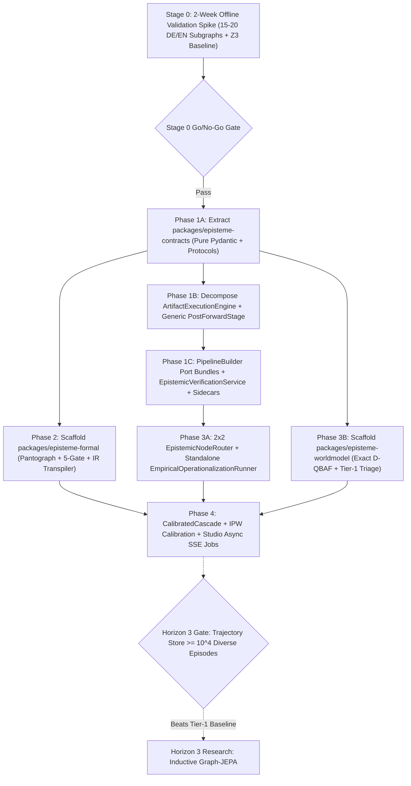

# Execution Plan: `episteme-contracts`, Orchestrator Decomposition, Opt-In Lean 4 & World Models

- **Governing Index:** [Suite Index](index.md)
- **Governing ADR:** [ADR-0025 Proposal](ADR-0025-PROPOSAL-epistemic-commit-cascade-and-world-models.md)
- **Companion Issues:** [ISSUE-111](ISSUE-111-core-epistemic-commit-interceptor-and-operator-algebra.md), [ISSUE-112](ISSUE-112-inductive-graph-world-model-and-jepa-capabilities.md), [ISSUE-113](ISSUE-113-lean4-formal-verification-oracle-and-logikey-adapter.md), [ISSUE-114](ISSUE-114-neuro-symbolic-interaction-dynamics-and-distillation.md), [ISSUE-115](ISSUE-115-epistemic-node-router-and-programmatic-empirical-world-models.md)
- **Status:** `Proposal` (Zero backward-compatibility shims per `AGENTS.md` §2 `[NO LEGACY]`)

---

## 1. Execution Architecture & Critical Path

Work proceeds from a gated **2-week validation spike (Stage 0)** into **core dependency inversion (`Phase 1A`)**, followed by parallel tracks for **pipeline orchestrator refactoring (`Phase 1B/1C`)**, **symbolic Lean 4 integration (`Phase 2`)**, and **empirical/inductive World Models (`Phase 3A/3B`)**, converging in **hybrid cascade calibration & Studio async jobs (`Phase 4`)**.

---

## 2. Detailed Phase & Work-Package Breakdown

### Stage 0 — Two-Week Offline Go/No-Go Validation Spike (Zero Core Code Changes)
- **Objective:** Empirically validate formalizability, anti-skeleton quality, and baseline performance before touching workspace packaging.
- **Work Items:**
  1. Curate 15–20 real DE/EN `TheoryNet` subgraphs (5–15 atoms each) split cleanly between formal/axiomatic works and qualitative prose.
  2. Measure `DecisionEngine` formalizability precision vs. qualitative rejection accuracy.
  3. Measure **non-triviality rate** (% of autoformalizations escaping degenerate `opaque P : Prop; P -> Q` skeletons), Blind Read-Back faithfulness (`< 15%` drift target), consistency-cone clash rate ($\Gamma \vdash \bot$ triggering MCS pre-repair), and SMT `unknown` rate.
  4. Benchmark a zero-LLM-heavy-toolchain **Z3/FOL + exact `epistemetrics` D-QBAF** baseline.
- **Exit Criteria:** Go/no-go report signed off in [ISSUE-114](ISSUE-114-neuro-symbolic-interaction-dynamics-and-distillation.md) (§4.1); decision recorded on default `max_lean_seconds_per_run` budgets and formalizability prompts.

---

### Phase 1A & 1B — Core Platform Prerequisites (Tracked in [Suite 13](../13-core-architecture-and-docs-refactoring/index.md))
- **`Phase 1A` ([ISSUE-116](../13-core-architecture-and-docs-refactoring/ISSUE-116-extract-episteme-contracts-and-workspace-dependency-inversion.md) + [ISSUE-119](../13-core-architecture-and-docs-refactoring/ISSUE-119-monorepo-uv-packaging-hygiene-and-plugin-isolation.md)):** Extract `packages/episteme-contracts/` (pure `pydantic>=2.0`, `stable_fingerprint`, `TheorySubgraphQuery`, `SchemaConfig`, L1–L4 contracts) and enforce Python `>=3.13` + AST boundary tests.
- **`Phase 1B` ([ISSUE-117](../13-core-architecture-and-docs-refactoring/ISSUE-117-execution-engine-decomposition-and-post-forward-stage-port.md) + [ISSUE-118](../13-core-architecture-and-docs-refactoring/ISSUE-118-pipeline-builder-typed-port-bundles-and-component-discovery.md)):** Decompose [`execution_engine.py`](../../packages/episteme-pipeline/episteme_pipeline/runtime/execution_engine.py) into 5 services (`ManifestTracker`, `RunHydrationService`, `PhaseExecutor`, `ProjectionCoordinator`, `PostForwardRunner`), introduce generic `PostForwardStage` + `RunManifest.post_forward_lineage_fingerprints`, fix dataclass traversal in `find_components()`, and replace 23-arg `Pipeline.for_task` with `PipelineBuilder`. See [Suite 13 Execution Plan](../13-core-architecture-and-docs-refactoring/EXECUTION-PLAN.md).

---

### Phase 1C — Verification Contracts, `EpistemicVerificationService` & Sidecar Verdicts ([ISSUE-111](ISSUE-111-core-epistemic-commit-interceptor-and-operator-algebra.md))
- **Objective:** Wire pure neuro-symbolic verification contracts and batch/async adapters cleanly onto the Suite 13 foundation (`VerificationPorts` bundle via `PipelineBuilder`).
- **Work Items:**
  1. Fix `find_components()` in `episteme_contracts/fingerprint.py` to support `@dataclass` fields (`dataclasses.is_dataclass` + `dataclasses.fields`) alongside `__dict__` objects—preventing silent `{}` returns if any port bundle uses `slots=True`.
  2. Introduce typed port bundles (`ModelPorts`, `ExtractionPorts`, `ArgumentMiningPorts`, `DecisionPorts`, `RefinementPorts`, `VerificationPorts`, `StoragePorts`) and `PipelineBuilder` / `PipelineFactory.from_bundles(...)`, eliminating `build_standalone_refinement`'s reflective scraping over `phases`.
  3. Implement core verification plumbing in `episteme-pipeline`:
     - Pure `EpistemicVerificationService` taking `(TheorySubgraphQuery, EpistemicChangeset) -> VerificationOutcome` (replacing L2-only `GraphReader`),
     - `SubgraphSelector` querying `EpistemicStateView` (implements `TheorySubgraphQuery`) across Poset roots $T_0$, perspective/`intensional_mode` cones, and polarity-opposed anchors,
     - `ArtifactKind.VERIFICATION_VERDICT` (`VerificationVerdictArtifact`, `identity_key = f"verification::{target_id}"`) projected as sidecar properties/relations onto `TheoryAtom` / `TheoryRelation` without mutating `TheoryAtomArtifact` hashes,
     - Versioned `PipelineInput.formal_signature_ledger` + `RunManifest.signature_ledger_fingerprint` mirroring `EpistemicCurationLedger`,
     - Non-`Fingerprintable` write-only `VerificationTrajectoryStore` sink recording `propensity_score`,
     - Batch `VerificationDeficitDetector` adapter plugged into `ClosedLoopRefinementStage` (for `max_refinement_cycles > 0`) plus standalone `FormalVerificationStage` (for certification without re-extraction or post-refinement certification—never running both on identical unchanged atoms).
- **Exit Criteria:** Deterministic tests with `MockEpistemicEvaluator` verify zero-diff fingerprints when `verification.enabled = False`, identical manifest invalidation when `formal_signature_ledger` changes, zero invalidation when `VerificationTrajectoryStore` grows, and non-recursive `max_cascade_depth <= 2` refinement loops.

---

### Phase 2 — Scaffold & Build `packages/episteme-formal/` (Symbolic Only)
- **Objective:** Implement [ISSUE-113](ISSUE-113-lean4-formal-verification-oracle-and-logikey-adapter.md) in a standalone symbolic workspace package with zero PyTorch/GNN dependencies.
- **Work Items:**
  1. Add `packages/episteme-formal/` to `members = ["packages/*"]` in root [`pyproject.toml`](../../pyproject.toml) while **omitting it from root `[project].dependencies`** (isolated optional extra `[formal]` / dedicated CI job).
  2. Build `EpistemeLogic` Lean 4 base library (`EpistemeLogic.Modal` with selectable `K`/`T`/`S4`/`S5`/`KD45` frames + Bourbaki/Sneed `PartialPotentialModel` / `PotentialModel` / `ActualLawModel` templates).
  3. Implement warm `Pantograph` REPL process pool + `max_lean_seconds_per_run` / per-episode budget guards.
  4. Implement the **5-Gate Hardened Pipeline + Blind Critic Amendment Protocol**:
     - MCS / Unsat-Core cone pre-repair when $\Gamma \vdash \bot$,
     - Read-only held-out `FormalSignatureLedger` TCB injection,
     - Anti-skeleton structural check + reachability witnesses ($\exists m, \Gamma(m)$) + semantic mutation tests + `native_decide` ban,
     - Cross-family Blind Sub-Agent Read-Back + `Jev` equivalence gate (for `machine_draft`; skipped for `human_verified`),
     - Falsify-before-prove (`Z3` / `CVC5` / `lean-smt` / `plausible`, mapping `unknown -> unverified`) + fresh-env `leanprover/comparator` kernel replay.
  5. Implement deterministic **`TransitionGraphIR` $\to$ Lean 4 transpiler** (`structure State` + total `def step`).
- **Exit Criteria:** Passes Stage-0 adversarial DE/EN `TheoryNet` suite with `< 15%` Read-Back drift, zero false `consistent_independent` on SMT `unknown`, and clean fresh-env `comparator` audit.

---

### Phase 3A — 2×2 `EpistemicNodeRouter` & Standalone `EmpiricalOperationalizationRunner`
- **Objective:** Implement [ISSUE-115](ISSUE-115-epistemic-node-router-and-programmatic-empirical-world-models.md) safely on declarative IR without touching `TheoreticalEnrichmentRunner`'s 882 lines.
- **Work Items:**
  1. Implement `EpistemicNodeRouter` over the `2 × 2` (`Partition A/B` × `Analytisch/Synthetisch`) matrix gated by `DecisionEngine` formalizability checks (`FORMAL_CASCADE`, `EMPIRICAL_WORLD`, `BRIDGE_SYNTHESIS`, `DQBAF_ONLY`).
  2. Implement standalone `EmpiricalOperationalizationRunner` + `EmpiricalOperationalizationStage` (`PostForwardStage`) emitting `ArtifactKind.OPERATIONALIZED_SCENARIO` (`TransitionGraphIR`, reusing [`SafeFormulaEvaluator`](../../packages/episteme-pipeline/episteme_pipeline/post_processing/theoretical_enrichment/solvers.py#L26-L135), zero raw Python synthesis).
  3. Implement Regime B1 (`empirical_corpus_b` matching `Partition B` `ObservationUnit` records) and Regime B2 (`transition_graph_interpreter` with $\phi_1 \land \phi_2$ reachability checks + optional `episteme-formal` IR $\to$ Lean 4 transpilation), writing empirical scores to `TS_local` and `BRIDGE_SYNTHESIS` diagnostics (`ENTHYMEME_GAP` vs. `BRIDGE_DEFECT` vs. `EMPIRICAL_FALSIFICATION`).
  4. Expose Regime B3 (`studio_scm_dag`) **only** as an interactive `episteme-studio` prior-probing workbench with zero automatic write-back to `TS_local`.
- **Exit Criteria:** Deterministic zero-token replay of `TransitionGraphIR` scenarios; clear artifact-level separation between $H_{\text{bridge}}$ and $H_{\text{world}}$; zero `exec()`/`eval()` calls.

---

### Phase 3B — Scaffold `packages/episteme-worldmodel/` (Exact D-QBAF + Tier-1 Triage)
- **Objective:** Implement [ISSUE-112](ISSUE-112-inductive-graph-world-model-and-jepa-capabilities.md) pragmatically around `epistemetrics` exact counterfactuals and low-data calibrated inductive triage.
- **Work Items:**
  1. Add `packages/episteme-worldmodel/` outside root mandatory dependencies; put PyTorch/PyG neural training dependencies strictly under `[project.optional-dependencies] train = [...]`.
  2. Implement exact millisecond `D-QBAF` counterfactual sensitivity rollouts over sliced connected components via `epistemetrics` (`WeightedQuadraticEnergySolver` / `QBAFGradualSemanticsSolver`).
  3. Implement deterministic `TransitionGraphIR` interpreter (Regime B2 default backend) inside `episteme-worldmodel`.
  4. Build Tier-1 supervised 4-class inductive triage (`entailed`, `sketch_verified`, `consistent_independent`, `refuted`) over frozen `EmbeddingModel` vectors + lightweight edge-typed GNN/MLP calibrated via `ConformalCalibrator`.
- **Exit Criteria:** Both `entailed` and `consistent_independent` maintain low incompatibility risk $E_{\text{WM}}$; zero-shot document split AUROC outperforms cosine baselines cleanly.

---

### Phase 4 — Hybrid `CalibratedCascade`, IPW Calibration & Studio Async HITL Jobs
- **Objective:** Complete closed-loop neuro-symbolic integration ([ISSUE-114](ISSUE-114-neuro-symbolic-interaction-dynamics-and-distillation.md)) across batch pipelines and `episteme-studio`.
- **Work Items:**
  1. Wire `CalibratedCascade` (`Mode 1 Tier-1 triage -> Mode 2 LeanFormalEvaluator`) with SHA-256 deterministic auditing (`should_audit_deterministically`) and `propensity_score` IPW logging.
  2. Implement off-policy IPW-weighted conformal recalibration and retraining pipelines reading from the `VerificationTrajectoryStore` sink.
  3. Build `episteme-studio` async HITL endpoints (`POST /runs/{id}/verify-changeset` returning a `job_id` + `sse-starlette` progress stream) plus instant `<20ms` Tier-1 triage and exact `D-QBAF` axiom-retraction rollouts, plus interactive `TransitionGraphIR` visualization and Regime B3 exploration.
- **Exit Criteria:** FastAPI event loops never block on Lean 4 timeouts; Studio correctly renders `VerificationVerdictArtifact` overlays and minimal unsatisfiable cores without mutating core `TheoryAtom` hashes.

### Horizon 3 Research Gate — Inductive Graph-JEPA
- **Unlock Condition:** `VerificationTrajectoryStore` holds $\ge 10^4$ diverse certified episodes across disjoint works AND ADU-level vector indexing exists. Any Graph-JEPA candidate must beat Tier-1 supervised triage on zero-shot AUROC and beat `LLMTheoryGuidedPremiseRecoverer` on ADU Recall@5 before promotion.

---

## 3. Codebase Pitfalls & Verification Matrix

| Concrete Codebase Trap Found During Audit | Exact File / Symbol | Mandatory Guardrail | Verification Check |
| :--- | :--- | :--- | :--- |
| **1. Upward hash helper import blocks `episteme-contracts`** | [`domain.py`](../../packages/episteme-pipeline/episteme_pipeline/contracts/domain.py#L1037) (`CandidatePair.key`) | Move `stable_fingerprint` to `episteme_contracts/fingerprint.py`. | Isolated venv import of `episteme_contracts` with only `pydantic`. |
| **2. `artifacts/` persistence models leak into protocols** | [`refinement.py`](../../packages/episteme-pipeline/episteme_pipeline/protocols/refinement.py#L16-L23) | Use `TheorySubgraphQuery` / pure domain protocols in `episteme-contracts`; implement via `EpistemicStateView` in `episteme-pipeline`. | AST import check confirming zero `episteme_pipeline` imports inside `episteme-contracts`. |
| **3. Slotted port-bundle dataclasses silently zero out fingerprints** | [`fingerprint.py`](../../packages/episteme-pipeline/episteme_pipeline/protocols/fingerprint.py#L120-L125) (`vars(root)`) | Extend `find_components()` with `dataclasses.is_dataclass` / `fields()` traversal and never rely solely on `vars()`. | Unit test asserting `find_components()` discovers nested LLMs inside `@dataclass(slots=True)` bundles. |
| **4. Root `uv.lock` pulls multi-GB GPU/Lean toolchains into dev** | Root [`pyproject.toml`](../../pyproject.toml#L6-L10) | Keep `episteme-formal` & `episteme-worldmodel` out of mandatory root `dependencies`; gate PyTorch/PyG behind `worldmodel[train]`. | `rtk uv run pytest` passes offline in standard environment without Lean or Torch installed. |
| **5. Double verification or `TheoryAtom` hash churn** | [`execution_engine.py`](../../packages/episteme-pipeline/episteme_pipeline/runtime/execution_engine.py#L1254) & [`models.py`](../../packages/episteme-pipeline/episteme_pipeline/artifacts/models.py#L139) | Emit `ArtifactKind.VERIFICATION_VERDICT` sidecars; separate `ClosedLoopRefinementStage` deficit verification from final certification `FormalVerificationStage`. | Replay test confirming identical `TheoryAtom` artifact IDs with verification on vs. off. |
