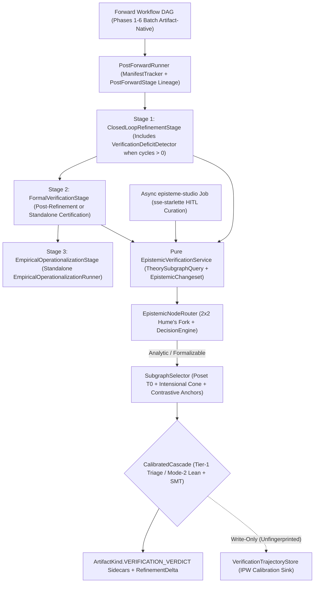

# [ISSUE-111] Neuro-Symbolic Verification Contracts, `EpistemicVerificationService` & Sidecar Verdicts

| Metadata | Details |
| :--- | :--- |
| **Issue ID** | `ISSUE-111` |
| **Domain / Category** | `12-Neuro-Symbolic World Models & Lean` (Verification Domain Service, Sidecar Artifacts, Versioned Signature Ledger) |
| **Target Package(s)** | `episteme-contracts` (`verification.py`, `signatures.py`), `episteme-pipeline` (`artifacts/`, `refinement/`, `config.py`), `episteme-studio` (`jobs/`) |
| **Priority** | **High** |
| **Status** | `Proposal` |
| **Roadmap Horizon** | Horizon 2 |
| **Upstream Platform Prerequisites** | [ISSUE-116 (`episteme-contracts`)](../13-core-architecture-and-docs-refactoring/ISSUE-116-extract-episteme-contracts-and-workspace-dependency-inversion.md), [ISSUE-117 (`PostForwardStage`)](../13-core-architecture-and-docs-refactoring/ISSUE-117-execution-engine-decomposition-and-post-forward-stage-port.md), [ISSUE-118 (`PipelineBuilder`)](../13-core-architecture-and-docs-refactoring/ISSUE-118-pipeline-builder-typed-port-bundles-and-component-discovery.md) |
| **Governing ADR & Plan** | [ADR-0025 Proposal](ADR-0025-PROPOSAL-epistemic-commit-cascade-and-world-models.md) \| [Execution Plan (`Phase 1C`)](EXECUTION-PLAN.md) |
| **Related Docs & ADRs** | [Overview](../../docs/architecture/overview.md), [Design Patterns](../../docs/architecture/design_patterns_and_standards.md), [ADR-0017](../../docs/adr/0017-explicit-batch-contracts-and-bulk-io.md), [ADR-0021](../../docs/adr/0021-incremental-corpus-evolution-and-persistent-hitl-constraint-ledger.md), [ADR-0023](../../docs/adr/0023-intensional-perspectival-scoping-and-conception-stratification.md), [ADR-0024](../../docs/adr/0024-closed-loop-hermeneutic-refinement.md) |

---

## 1. Architectural Scope (Post-`13-core-architecture-and-docs-refactoring/`)

General workspace dependency inversion (`episteme-contracts`), the 5-service decomposition of `ArtifactExecutionEngine` (`ManifestTracker`, `RunHydrationService`, `PhaseExecutor`, `ProjectionCoordinator`, `PostForwardRunner` + `PostForwardStage`), and `PipelineBuilder` port bundles are specified cleanly in Suite 13 ([`ISSUE-116`](../13-core-architecture-and-docs-refactoring/ISSUE-116-extract-episteme-contracts-and-workspace-dependency-inversion.md)–[`ISSUE-118`](../13-core-architecture-and-docs-refactoring/ISSUE-118-pipeline-builder-typed-port-bundles-and-component-discovery.md)).

`ISSUE-111` focuses strictly on the **neuro-symbolic verification layer** built on top of that foundation:
1. Adding verification domain contracts (`VerificationTrack`, `FormalProvenance`, `FormalStatus`, `EpistemicChangeset`, `ScopedVerificationContext`, `VerificationVerdict`, `EpistemicVerificationMetadata`, `FormalSignatureLedger`, `VerificationTrajectoryRecord`) to `episteme-contracts`.
2. Implementing the pure domain service **`EpistemicVerificationService`** (`Route -> Select -> Compute -> Update`) operating over `TheorySubgraphQuery` (implemented by `EpistemicStateView` and `episteme-studio` session snapshots).
3. Plugging verification cleanly into batch runs via `PostForwardStage` adapters (`VerificationDeficitDetector` inside `ClosedLoopRefinementStage`, standalone `FormalVerificationStage`) and interactive HITL curation via an async `episteme-studio` background job (`sse-starlette`).
4. Persisting verdicts via sidecar **`ArtifactKind.VERIFICATION_VERDICT`** envelopes so Phase 4/6 `TheoryAtomArtifact` IDs stay invariant when verification is off or re-run.

---

## 2. Verification Operator Flow & Non-Redundant Post-Forward Composition

Phases 1–6 remain strictly **batch and artifact-native**. Verification executes after the forward DAG via `PostForwardRunner` ([ISSUE-117](../13-core-architecture-and-docs-refactoring/ISSUE-117-execution-engine-decomposition-and-post-forward-stage-port.md)) or asynchronously in `episteme-studio`:



### Avoiding Double Execution Across Refinement and Final Certification
- **When `max_refinement_cycles > 0`:** `VerificationDeficitDetector` runs inside `ClosedLoopRefinementStage`, emitting `EpistemicDeficitKind.LOGICAL_CONTRADICTION` and `ENTHYMEME_GAP` (carrying formal Lean `proof-sketch` lemmas in `theory_lens`) so `ClosedLoopRefinementCoordinator` can trigger L1/L2 premise recovery or polysemy splitting. Downstream `FormalVerificationStage` checks sidecar verdict lineage hashes and skips already-verified unchanged items.
- **When `max_refinement_cycles == 0`:** `FormalVerificationStage` executes standalone certification and emits sidecar `VerificationVerdictArtifact` records cleanly without invoking LLM text re-extraction.
- **After stabilization:** `EmpiricalOperationalizationStage` ([ISSUE-115](ISSUE-115-epistemic-node-router-and-programmatic-empirical-world-models.md)) operationalizes only stabilized synthetic claims and certified `A |- b_hat` formal entailments.

---

## 3. Verification Contracts, Port Bundle & Sidecar Persistence

### 3.1 Pure Contracts (`episteme_contracts/verification.py` & `signatures.py`)

```python
from __future__ import annotations

from enum import StrEnum
from typing import Literal, Protocol, runtime_checkable

from pydantic import BaseModel, Field

from episteme_contracts.domain import (
    L2Entity,
    RefinementDelta,
    TheoryAtom,
    TheoryRelation,
)
from episteme_contracts.fingerprint import Fingerprintable
from episteme_contracts.protocols.query import TheorySubgraphQuery
from episteme_contracts.signatures import FormalSignatureEntry

FormalProvenance = Literal["human_verified", "hybrid_reviewed", "machine_draft"]
FormalStatus = Literal[
    "entailed",               # Gamma |- phi (sorry-free)
    "sketch_verified",        # Gamma U Delta |- phi via sorry-free proof-sketch
    "consistent_independent", # Gamma |/- phi and Gamma |/- ~phi (model witness found)
    "refuted",                # Gamma |- ~phi under Gamma |/- False
    "unverified",             # Timeout, SMT unknown, gate rejection, or disabled
]


class VerificationTrack(StrEnum):
    """Routing branch selected by ``EpistemicNodeRouter`` (2x2 Hume's Fork + DecisionEngine)."""

    FORMAL_CASCADE = "formal_cascade"     # Partition A / Analytisch or manual Lean spec
    EMPIRICAL_WORLD = "empirical_world"   # Operationalizable Synthetisch -> Type-B World Model
    BRIDGE_SYNTHESIS = "bridge_synthesis" # A |- b_hat -> Verify entailment in Lean, test empirically
    DQBAF_ONLY = "dqbaf_only"             # Qualitative prose -> remains solely in D-QBAF


class EpistemicChangeset(BaseModel):
    """Coherent batch connected-component or Studio HITL curation changeset."""

    changeset_id: str
    mode: Literal["batch_refinement", "post_forward_certification", "studio_hitl_job"]
    atoms: list[TheoryAtom] = Field(default_factory=list)
    relations: list[TheoryRelation] = Field(default_factory=list)
    entities: list[L2Entity] = Field(default_factory=list)
    perspective: str = "author"
    theory_id: str | None = None


class ScopedVerificationContext(BaseModel):
    """Perspective-isolated, anti-confirmation-bias L3 subgraph context for evaluation."""

    perspective: str
    active_theory_id: str | None = None
    poset_root_atoms: list[TheoryAtom]
    local_atoms: list[TheoryAtom]
    local_relations: list[TheoryRelation]
    contrastive_anchor_atoms: list[TheoryAtom]
    signature_ledger: list[FormalSignatureEntry]
    excluded_suppositional_ids: tuple[str, ...] = ()


class EpistemicVerificationMetadata(BaseModel):
    """Compact orthogonal sub-model attached to hydrated TheoryAtom/TheoryRelation views."""

    formal_provenance: FormalProvenance = "machine_draft"
    formal_status: FormalStatus = "unverified"
    world_model_energy: float | None = Field(default=None, ge=0.0, le=1.0)
    logical_energy: float | None = Field(default=None, ge=0.0, le=1.0)
    formal_assumptions: tuple[str, ...] = ()
    formal_trace_ref: str | None = None


class VerificationVerdict(BaseModel):
    """Output emitted by Mode-1 triage, Mode-2 Lean/SMT oracle, or hybrid cascade."""

    changeset_id: str
    target_ids: tuple[str, ...] = ()
    evaluator_mode: Literal["mode1_triage", "mode2_formal_oracle", "cascade_hybrid"]
    metadata: EpistemicVerificationMetadata = Field(default_factory=EpistemicVerificationMetadata)
    faithfulness_passed: bool | None = None
    vacuity_check_passed: bool | None = None
    anti_skeleton_passed: bool | None = None
    unproved_sketch_lemmas: list[str] = Field(default_factory=list)
    conflicting_atom_ids: list[str] = Field(default_factory=list)
    propensity_score: float = Field(default=1.0, gt=0.0, le=1.0)


@runtime_checkable
class SubgraphSelector(Fingerprintable, Protocol):
    """Selects a perspective-isolated ``ScopedVerificationContext`` from ``TheorySubgraphQuery``."""

    async def select(
        self,
        changeset: EpistemicChangeset,
        query: TheorySubgraphQuery,
        signature_ledger: list[FormalSignatureEntry],
    ) -> ScopedVerificationContext:
        """Assemble Poset roots, perspective-filtered cone, and contrastive anchors."""
        ...


@runtime_checkable
class EpistemicEvaluator(Fingerprintable, Protocol):
    """Evaluates a changeset against a ``ScopedVerificationContext``."""

    async def evaluate(
        self,
        context: ScopedVerificationContext,
        changeset: EpistemicChangeset,
    ) -> VerificationVerdict:
        """Return a deterministic verdict and propensity metadata."""
        ...


@runtime_checkable
class EpistemicVerificationService(Fingerprintable, Protocol):
    """Pure verification domain service invoked by refinement, stages, or Studio jobs."""

    async def verify(
        self,
        query: TheorySubgraphQuery,
        changeset: EpistemicChangeset,
        *,
        cascade_depth: int = 0,
    ) -> tuple[VerificationVerdict, RefinementDelta]:
        """Execute Route -> Select -> Compute -> Update cleanly on immutable state."""
        ...


@runtime_checkable
class VerificationTrajectorySink(Protocol):
    """Write-only replay sink intentionally NOT Fingerprintable (excluded from cache hashes)."""

    async def record(
        self,
        context: ScopedVerificationContext,
        changeset: EpistemicChangeset,
        verdict: VerificationVerdict,
        delta: RefinementDelta,
    ) -> None:
        """Persist immutable Mode-2 trajectory + propensity_score for offline IPW calibration."""
        ...
```

### 3.2 `VerificationPorts` Bundle Plugging Into `PipelineBuilder` ([ISSUE-118](../13-core-architecture-and-docs-refactoring/ISSUE-118-pipeline-builder-typed-port-bundles-and-component-discovery.md))

```python
from __future__ import annotations

from dataclasses import dataclass
from typing import Any


@dataclass(frozen=True)
class VerificationPorts:
    """Opt-in neuro-symbolic verification, routing, and empirical world-model collaborators."""

    node_router: Any | None = None
    verification_service: Any | None = None
    operationalizer: Any | None = None
    domain_world_model: Any | None = None
    trajectory_sink: Any | None = None
```

Registered cleanly via `PipelineBuilder(...).with_extension("verification", verification_ports)` (traversed cleanly by dataclass-aware `find_components()`, while skipping `trajectory_sink` because it does not implement `Fingerprintable`).

### 3.3 Sidecar `ArtifactKind.VERIFICATION_VERDICT`, Versioned `FormalSignatureLedger` & Slim `TheoryAtom`

1. **Sidecar Verdict Envelopes ([`artifacts/models.py`](../../packages/episteme-pipeline/episteme_pipeline/artifacts/models.py#L132-L145)):** Add `ArtifactKind.VERIFICATION_VERDICT = "verification_verdict"` carrying `VerificationVerdictArtifact(BaseArtifactPayload)` (`identity_key = f"verification::{target_id}"`). `ProjectionCoordinator` joins verdicts onto existing Neo4j `TheoryAtom` / `TheoryRelation` nodes/edges without altering `TheoryAtomArtifact` IDs. Hydrated read views MAY attach optional `verification: EpistemicVerificationMetadata | None = None` without changing serialized Phase 4/6 `TheoryAtom` artifacts.
2. **Versioned `FormalSignatureLedger` ([`phase_contracts.py`](../../packages/episteme-pipeline/episteme_pipeline/contracts/phase_contracts.py#L105)):** Modeled directly after `EpistemicCurationLedger`, carried on `PipelineInput.formal_signature_ledger` and hashed into `RunManifest.signature_ledger_fingerprint`. Blind-Critic-approved amendments (`FormalSignatureAmendment`) mint a new versioned ledger for a child run (`parent_run_id`), enforcing an immutable held-out TCB inside every run.
3. **New Deficit Kind in `domain.py`:** Add `EpistemicDeficitKind.LOGICAL_CONTRADICTION = "logical_contradiction"` alongside `ENTHYMEME_GAP` (carrying formal Lean `proof-sketch` lemma hints inside `EpistemicDeficit.theory_lens`).

---

## 4. Mandatory System Hooks (`AGENTS.md` §2 & [ADR-0017](../../docs/adr/0017-explicit-batch-contracts-and-bulk-io.md))

- **Zero `getattr` Dispatch:** All port validation, stage dispatch, and `BaseArtifactPayload` projection rely on `@runtime_checkable` protocols and polymorphism.
- **Telemetry Only on `EventEmitter`:** Emit `VerificationStageStarted`, `WorldModelTriaged`, `FormalVerificationCompleted`, and `LogicalContradictionDetected` strictly for observability.
- **Write-Only Sink Exclusion:** `VerificationTrajectorySink` omits `Fingerprintable` and is ignored by `ManifestTracker`.
- **Zero-Diff Opt-Out (`VerificationConfig.enabled = False`):** Default disabled settings produce byte-identical Phase 1–6 manifests and fingerprints.

---

## 5. Acceptance Criteria

- [ ] Add `verification.py` and `signatures.py` contracts to `episteme-contracts` alongside `VerificationTrajectorySink` and `EpistemicVerificationService` protocols.
- [ ] Implement `SubgraphSelector(TheorySubgraphQuery)`, `EpistemicVerificationService`, `VerificationDeficitDetector` (`ClosedLoopRefinementStage`), and standalone `FormalVerificationStage` (`PostForwardStage`) in `episteme-pipeline`.
- [ ] Implement `ArtifactKind.VERIFICATION_VERDICT` sidecar projection and `PipelineInput.formal_signature_ledger` + `RunManifest.signature_ledger_fingerprint` hashing.
- [ ] Wire `VerificationPorts` into `PipelineBuilder` and expose async `episteme-studio` HITL background job routes (`sse-starlette`), verified with deterministic mock tests (`rtk uv run pytest`).
