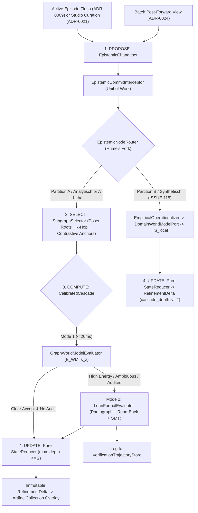

# [ISSUE-111] Core Pipeline Architecture: Epistemic Commit Interceptor & Unified Operator Algebra (`Propose -> Select -> Compute -> Update`)

| Metadata | Details |
| :--- | :--- |
| **Issue ID** | `ISSUE-111` |
| **Domain / Category** | `12-Neuro-Symbolic World Models & Lean` (Core Pipeline Architecture, Hexagonal Ports, Transaction Middleware) |
| **Target Package(s)** | `episteme-pipeline` (`protocols/`, `contracts/domain.py`, `runtime/`, `refinement/`, `events/`) |
| **Priority** | **High** |
| **Status** | `Proposal` |
| **Roadmap Horizon** | Horizon 2 |
| **Governing ADR** | [ADR-0025 Proposal](ADR-0025-PROPOSAL-epistemic-commit-cascade-and-world-models.md) |
| **Related Docs & ADRs** | [Overview](../../docs/architecture/overview.md), [Design Patterns](../../docs/architecture/design_patterns_and_standards.md), [ADR-0009](../../docs/adr/0009-sota-dual-memory-episodic-working-memory.md), [ADR-0017](../../docs/adr/0017-explicit-batch-contracts-and-bulk-io.md), [ADR-0024](../../docs/adr/0024-closed-loop-hermeneutic-refinement.md) |

---

## 1. Architectural Motivation & Current Pipeline Boundaries

Inspection of the current `episteme-pipeline` core shows why neither Lean 4 verification nor Graph World Model evaluation should be wired directly into [`EventEmitter`](../../packages/episteme-pipeline/episteme_pipeline/events/bus.py) or inside raw chunk-level extractors:

1. **Immutable Artifact-Native Execution:** [`Pipeline`](../../packages/episteme-pipeline/episteme_pipeline/pipeline.py) and [`ArtifactExecutionEngine`](../../packages/episteme-pipeline/episteme_pipeline/runtime/execution_engine.py) execute a strictly acyclic `WorkflowDAG`, collecting immutable `ArtifactCollection`s ([`execution.py`](../../packages/episteme-pipeline/episteme_pipeline/artifacts/execution.py)) and projecting them in topological bulk batches ([ADR-0017](../../docs/adr/0017-explicit-batch-contracts-and-bulk-io.md)).
2. **Passive Event Bus:** `EventObserver.on_event(event) -> None` is purely an observability sink (Langfuse, JSONL logs, progress bars) and is suppressed under `NoOpEventEmitter`.
3. **Existing Hook Point Already Proven:** [ADR-0024](../../docs/adr/0024-closed-loop-hermeneutic-refinement.md) already established `ArtifactCollection.latest_by_identity` overlays, `RefinementDelta` reduction, `EpistemicDeficitArtifact`, and `ClosedLoopRefinementCoordinator`.

To support **both** an **Active / Intra-Document Episode Mode** (evaluating statements as working-memory episodes flush into the graph or when curated interactively in `episteme-studio`) **and** the **Batch Post-Forward Mode**, `episteme-pipeline` requires a first-class, `Fingerprintable` transactional middleware layer: **`EpistemicCommitInterceptor`**.

---

## 2. The Unified Operator Algebra

Both the Graph World Model ([ISSUE-112](ISSUE-112-inductive-graph-world-model-and-jepa-capabilities.md)) and the Lean 4 Formal Oracle ([ISSUE-113](ISSUE-113-lean4-formal-verification-oracle-and-logikey-adapter.md)) share the exact same four-stage operator composition $\mathcal{T} = \mathcal{U} \circ \mathcal{C} \circ \mathcal{S}$ on an incoming proposal $\Delta_{\text{prop}}$:



### Why Episode/Changeset Granularity Is Mandatory
- **Solves *Modus Tollens* Non-Commutativity:** Evaluating a coherent episode changeset (`{A, A -> B, ¬B}`) instead of isolated sentences avoids falsely rejecting premises introduced solely for refutation.
- **Solves Joint Inconsistency (*Trilemmas*):** Multi-statement changesets expose sets $\{P, Q, R\}$ where every pair is consistent yet $P \land Q \land R \vdash \bot$.
- **Guarantees Termination:** `EpistemicCommitInterceptor` executes a bounded, acyclic overlay reduction (`max_cascade_depth = 1..2`), preventing `Insert -> Event -> Update -> Event` infinite cascades.

---

## 3. Detailed Technical Contracts & Protocol Specifications

### 3.1 Canonical Formal Signature Ledger (Extending `domain.py`)
To prevent cross-chunk type fragmentation in Lean 4 (*Prove2Me*, §4.4), canonical `L2Entity` and `EntityConception` nodes carry persistent formal signature bindings:

```python
class FormalSignatureEntry(BaseModel):
    """Canonical formal type/predicate binding anchored to an L2Entity or EntityConception.

    Parameters
    ----------
    signature_id : str
        Deterministic identifier ``sig::<entity_id>[::<conception_id>]``.
    entity_id : str
        Canonical parent L2Entity identifier.
    conception_id : str | None, optional
        Optional EntityConception identifier when polysemous senses diverge.
    lean_symbol : str
        Valid Lean 4 identifier (e.g., ``Episteme.Kant.Causality``).
    lean_type_signature : str
        Immutable Lean 4 declaration signature (e.g., ``Event -> Event -> Prop``).
    import_module : str
        Compiled Lean module path exposing this symbol.
    """

    signature_id: str
    entity_id: str
    conception_id: str | None = None
    lean_symbol: str
    lean_type_signature: str
    import_module: str
```

### 3.2 `EpistemicChangeset` & `ScopedVerificationContext` (`Propose` & `Select`)
```python
class EpistemicChangeset(BaseModel):
    """Atomic or episode-level candidate insertion/modification proposed to the graph."""

    changeset_id: str
    mode: Literal["active_episode", "batch_refinement", "hitl_curation"]
    atoms: list[TheoryAtom] = Field(default_factory=list)
    relations: list[TheoryRelation] = Field(default_factory=list)
    entities: list[L2Entity] = Field(default_factory=list)
    perspective: str = "author"
    source_episode_id: str | None = None


class ScopedVerificationContext(BaseModel):
    """Perspective-isolated, anti-confirmation-bias subgraph context for evaluation."""

    perspective: str
    active_theory_id: str | None = None
    poset_root_atoms: list[TheoryAtom]
    local_atoms: list[TheoryAtom]
    local_relations: list[TheoryRelation]
    contrastive_anchor_atoms: list[TheoryAtom]
    signature_ledger: list[FormalSignatureEntry]
    excluded_suppositional_ids: tuple[str, ...] = ()
```

### 3.3 `SubgraphSelector` (`Select` Operator)
`SubgraphSelector` MUST implement `Fingerprintable` and combine **three mandatory retrieval channels** (countering dense-retrieval confirmation bias):
1. **Structuralist Poset Ancestors:** Traverse specialization/entailment ancestors up to root theory-elements $T_0$ ([Theory-Nets](../../docs/concepts/theory_nets_and_topologies.md)), ensuring core axioms are always in $\Gamma$.
2. **Perspective-Filtered $k$-Hop Neighborhood:** Traverse $k$-hop argumentative dependencies strictly restricted to the matching `perspective` and `intensional_mode` ([ADR-0023](../../docs/adr/0023-intensional-perspectival-scoping-and-conception-stratification.md)), excluding unbound `suppositional` (*Reductio*) nodes.
3. **Contrastive Polarity-Opposed Anchors:** Retrieve existing `asserted` atoms sharing canonical `L2Entity` referents that carry opposite stance/polarity or high `controversy_volatility`.

### 3.4 `VerificationVerdict`, `EpistemicEvaluator`, and `EpistemicCommitInterceptor`
```python
FormalStatus = Literal[
    "entailed",               # Gamma |- phi (sorry-free)
    "sketch_verified",        # Gamma U Delta |- phi via sorry-free proof-sketch
    "consistent_independent", # Gamma |/- phi and Gamma |/- ~phi (model witness found)
    "refuted",                # Gamma |- ~phi under Gamma |/- False
    "unverified",             # Timeout, faithfulness gate rejection, or disabled
]


class VerificationVerdict(BaseModel):
    """Unified output emitted by Mode-1 World Models and Mode-2 Formal Evaluators."""

    changeset_id: str
    evaluator_mode: Literal["mode1_world_model", "mode2_formal_oracle", "cascade_hybrid"]
    formal_status: FormalStatus = "unverified"
    world_model_energy: float | None = Field(default=None, ge=0.0, le=1.0)
    logical_energy: float | None = Field(default=None, ge=0.0, le=1.0)
    faithfulness_passed: bool | None = None
    vacuity_check_passed: bool | None = None
    unproved_sketch_lemmas: list[str] = Field(default_factory=list)
    predicted_enthymeme_vector: list[float] | None = None
    conflicting_atom_ids: list[str] = Field(default_factory=list)
    formal_trace_ref: str | None = None


@runtime_checkable
class SubgraphSelector(Fingerprintable, Protocol):
    async def select(
        self,
        changeset: EpistemicChangeset,
        reader: GraphReader,
    ) -> ScopedVerificationContext: ...


@runtime_checkable
class EpistemicEvaluator(Fingerprintable, Protocol):
    async def evaluate(
        self,
        context: ScopedVerificationContext,
        changeset: EpistemicChangeset,
    ) -> VerificationVerdict: ...


@runtime_checkable
class EpistemicNodeRouter(Fingerprintable, Protocol):
    """Dispatches candidate items along Partition A/formal vs. Partition B/empirical tracks (ISSUE-115)."""

    def route(
        self,
        component_type: str,
        epistemic_status: str | None,
        is_formal_prediction: bool = False,
    ) -> str: ...


@runtime_checkable
class EpistemicCommitInterceptor(Fingerprintable, Protocol):
    async def intercept(
        self,
        changeset: EpistemicChangeset,
        reader: GraphReader,
        *,
        cascade_depth: int = 0,
    ) -> tuple[VerificationVerdict, RefinementDelta]: ...
```

### 3.5 Extending `EpistemicDeficitKind` & Replay Trajectory Persistence
1. **New Deficit Kind in [`domain.py`](../../packages/episteme-pipeline/episteme_pipeline/contracts/domain.py#L1050-L1065):**
   Add `LOGICAL_CONTRADICTION = "logical_contradiction"` to `EpistemicDeficitKind` so `ClosedLoopRefinementCoordinator` can route formal refutations ($\Gamma \vdash \neg\phi$) either to relation polarity repair (`ATTACKS`/`REFUTES`), `ConceptionConceptSplitter` (`POLYSEMY_COLLISION`), or HITL flagging without deleting nodes.
2. **Orthogonal Fields on `TheoryAtom` / `TheoryRelation`:**
   Store `world_model_energy`, `formal_status`, `logical_energy`, and `formal_assumptions` alongside existing `ADR-0022` fields (`modal_prior`, `inferential_warrant`, `local_tenability`, `equilibrium_strength`).
3. **Replay Buffer (`VerificationTrajectoryStore`):**
   ```python
   class VerificationTrajectoryRecord(BaseModel):
       """Immutable training record emitted on every Mode-2 evaluation for Mode-1 distillation."""

       trajectory_id: str
       context_fingerprint: str
       changeset_fingerprint: str
       context: ScopedVerificationContext
       changeset: EpistemicChangeset
       verdict: VerificationVerdict
       resulting_delta: RefinementDelta
       toolchain_version: str
   ```

---

## 4. Mandatory System Hooks (`AGENTS.md` §2 & [ADR-0017](../../docs/adr/0017-explicit-batch-contracts-and-bulk-io.md))

- **Deterministic Fingerprinting:** `SubgraphSelector`, `EpistemicEvaluator`, and `EpistemicCommitInterceptor` MUST implement `Fingerprintable.component_metadata()` and bind in `__init__` / `PipelineFactory` so `find_components()` detects config, model-weight, or Lean-toolchain changes.
- **Caching:** Content-addressed cache keyed by `(context_fingerprint, changeset_fingerprint, evaluator_fingerprint)` avoids re-running Lean or World Model inference on unchanged subgraphs.
- **Domain Events & Observability:** Emit new typed `PipelineEvent` variants (`CommitInterceptionStarted`, `WorldModelEnergyEvaluated`, `FormalVerificationCompleted`, `LogicalContradictionDetected`, `VerificationTrajectoryRecorded`) through `EventEmitter` / `LangfuseObserver` strictly for telemetry—never for control flow.
- **Configuration Opt-In:** Add `VerificationConfig` (`enabled: bool = False`, `active_episode_mode: bool = False`, `max_cascade_depth: int = 1`, `world_model_accept_threshold`, `audit_rate`) to `PipelineConfig`, preserving identical fingerprints when `enabled = False`.

---

## 5. Acceptance Criteria

- [ ] Define `FormalSignatureEntry`, `EpistemicChangeset`, `ScopedVerificationContext`, `VerificationVerdict`, and `EpistemicDeficitKind.LOGICAL_CONTRADICTION` in `episteme-pipeline/contracts/`.
- [ ] Define `SubgraphSelector`, `EpistemicEvaluator`, `EpistemicCommitInterceptor`, and `VerificationTrajectoryStore` protocols in `episteme-pipeline/protocols/`.
- [ ] Implement deterministic `MockEpistemicEvaluator` and `NoOpCommitInterceptor` with full non-LLM unit tests (`rtk uv run pytest`).
- [ ] Wire `EpistemicCommitInterceptor` into `PipelineFactory` (`Pipeline.for_task`) and `ClosedLoopRefinementCoordinator` with `max_cascade_depth` termination guard and Langfuse observability spans.
