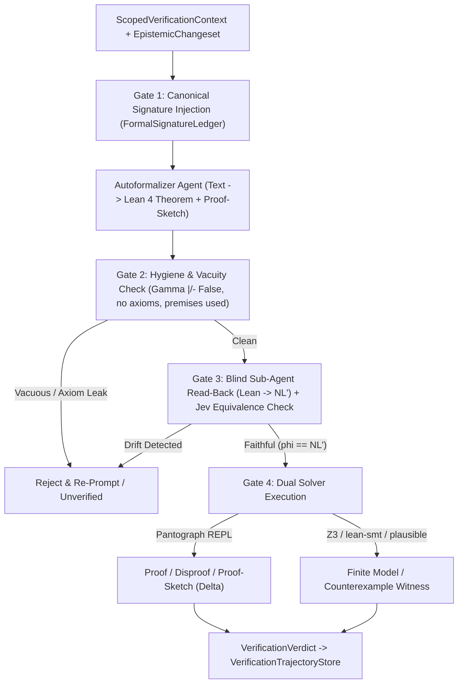

# [ISSUE-113] Lean 4 Deductive Verification Oracle, LogiKEy Embeddings & Faithfulness Auditing (`packages/episteme-formal`)

| Metadata | Details |
| :--- | :--- |
| **Issue ID** | `ISSUE-113` |
| **Domain / Category** | `12-Neuro-Symbolic World Models & Lean` (Automated Theorem Proving, Formal Philosophy, SMT) |
| **Target Package(s)** | `packages/episteme-formal` (new package), `episteme-pipeline` (adapter ports) |
| **Priority** | **High** |
| **Status** | `Research` |
| **Roadmap Horizon** | Horizon 2 & 3 |
| **Governing ADR** | [ADR-0025 Proposal](ADR-0025-PROPOSAL-epistemic-commit-cascade-and-world-models.md) |

---

## 1. Why Binary Theorem Proving Fails on Philosophical Knowledge Graphs

A naive Lean 4 integration asks: *"Does the new node $\phi$ follow from the existing graph $\Gamma$ ($\Gamma \vdash \phi$)?"* On philosophical and scientific corpora, this binary framing fails immediately because logical compatibility is **four-valued**:

| Outcome | Formal Condition | Epistemic Meaning in Episteme | Pipeline Action |
| :--- | :--- | :--- | :--- |
| **`entailed`** | $\Gamma \vdash \phi$ (`sorry`-free, $\Gamma \not\vdash \bot$) | Deductively guaranteed theorem / valid inference step. | Set `inferential_warrant = 1.0`; certify derivation in Neo4j. |
| **`sketch_verified`** | $\Gamma \cup \Delta \vdash \phi$ (`sorry`-free modulo minimal open lemmas $\Delta = \{z_1, \dots, z_k\}$) | Valid argument structure *modulo explicit missing premises* (*Prove2Me* §4.2). | Emit `EpistemicDeficitKind.ENTHYMEME_GAP` carrying the formal Lean types of $\Delta$ to `ClosedLoopRefinementCoordinator` ([ADR-0024](../../docs/adr/0024-closed-loop-hermeneutic-refinement.md)). |
| **`consistent_independent`** | $\Gamma \not\vdash \phi \land \Gamma \not\vdash \neg\phi$ (certified via SMT / finite model witness) | **Logically consistent new axiom, empirical observation ($B$), or specialization ($\alpha$).** | Admit cleanly! Almost all genuine new empirical/theoretical knowledge belongs here. |
| **`refuted`** | $\Gamma \vdash \neg\phi$ (with vacuity check $\Gamma \not\vdash \bot$ passed) | Hard logical contradiction against active perspective cone $\Gamma$. | **Do not discard!** Emit `LOGICAL_CONTRADICTION`: retype edge to `ATTACKS`/`REFUTES`, escalate `POLYSEMY_COLLISION`, or flag aporia in Studio. |

---

## 2. Formalizing Philosophy & Structuralism in Lean 4

### 2.1 LogiKEy Shallow Semantical Embeddings (`EpistemeLogic.Modal`)
Philosophical arguments rely heavily on **modal** ($\Box, \Diamond$), **deontic**, and **intensional/perspectival** operators (*"Leibniz holds that..."*, *"Necessarily..."*, *"Suppose for reductio..."*). Rather than building bespoke theorem provers for each non-classical logic, we adopt the **LogiKEy** methodology (Benzmüller et al., 2020) via shallow semantical embeddings in Lean 4's higher-order dependent type theory—directly reflecting Episteme's `intensional_mode` and `attributed_to` fields ([ADR-0023](../../docs/adr/0023-intensional-perspectival-scoping-and-conception-stratification.md)):

```lean4
-- EpistemeLogic/Modal.lean (Base compiled .olean preamble)
namespace EpistemeLogic

opaque World : Type
opaque Agent : Type
opaque R_alethic : World -> World -> Prop
opaque R_doxastic : Agent -> World -> World -> Prop

abbrev ModalProp := World -> Prop

def box (p : ModalProp) : ModalProp := fun w => ∀ v, R_alethic w v -> p v
def dia (p : ModalProp) : ModalProp := fun w => ∃ v, R_alethic w v ∧ p v
def believes (a : Agent) (p : ModalProp) : ModalProp := fun w => ∀ v, R_doxastic a w v -> p v

-- Prevents cross-author explosion: Leibniz's and Kant's axioms live under separate `believes` modalities.
def valid (p : ModalProp) : Prop := ∀ w, p w

end EpistemeLogic
```

### 2.2 Bourbaki / Sneed Structuralist Theory-Elements (`ADR-0015`) as Lean Dependent Types
Episteme's structuralist metatheory ($T = \langle K, I \rangle$ with $M_{pp}, M_p, M$, [Formal Graph Model](../../docs/concepts/formal_graph_model.md)) maps natively onto Lean 4 `structure` inheritance and `class` law constraints—upgrading [`SafeFormulaEvaluator`](../../docs/adr/0015-theoretical-enrichment-and-tenability-evaluation.md#L48) into type-checked theory specialization posets ($\alpha$):

```lean4
-- Example structuralist hierarchy: M_pp -> M_p -> M -> Specialization alpha
structure PartialPotentialModel where
  domain : Type
  position : domain -> Real

structure PotentialModel extends PartialPotentialModel where
  mass : domain -> Real
  force : domain -> Real

class ActualLawModel (m : PotentialModel) : Prop where
  newton_second_law : ∀ x : m.domain, m.force x = m.mass x * m.position x -- schematic

-- Specialization (alpha): strictly inherits PotentialModel & ActualLawModel
class HarmonicSpecialization (m : PotentialModel) extends ActualLawModel m where
  spring_k : Real
  hooke_law : ∀ x : m.domain, m.force x = -spring_k * m.position x
```

---

## 3. Solving the Autoformalization Faithfulness Crisis: The 4-Gate Pipeline

As documented in *Prove2Me* (Chen et al., 2026, §2 & §3.3, citing Bourigault et al., 2026), automated LLM-as-judge audits find **only ~43% of AI-formalized and kernel-proved statements faithful** to the source natural-language claim. Agents routinely satisfy the Lean compiler by dropping boundary conditions, inventing vacuous preconditions, or introducing subtly different predicates. `packages/episteme-formal/` enforces a strict **4-Gate Pipeline**:



### Gate Details
1. **Gate 1 — Canonical Signature Injection (*Prove2Me* §4.4 Milestone Pattern):**
   Inject immutable declarations from `FormalSignatureLedger` (`L2Entity` / `EntityConception` bindings) as the Lean file preamble. Two chunks may never declare conflicting types for the same concept.
2. **Gate 2 — Vacuity & Hygiene Check:**
   - Verify $\Gamma \not\vdash \text{False}$ before testing $\phi$ (guards against *Ex Falso Quodlibet*).
   - Forbid `axiom`, `sorry` inside final claims (except explicit `proof-sketch` child lemmas), and `Classical.choice` surprises via `#print axioms` inspection.
   - Run unused-hypothesis linting so $\Gamma$ cannot be ignored in vacuous implications.
3. **Gate 3 — Blind Sub-Agent Read-Back + System 1 `Jev` Equivalence Gate (*Prove2Me* §3.3 & Bourigault et al., 2026):**
   An independent auditor model receives **strictly the Lean 4 declaration and unfolded definitions—never the original German/English source text**—and translates what the Lean code *literally asserts* back into natural language $\phi'$ (making quantifiers, edge cases, and empty-set conventions explicit). Episteme's calibrated `DecisionEngine.evaluate_noul` (`Jev`) tests semantic equivalence $\phi \equiv \phi'$ within conformal confidence bounds before trusting any proof.
4. **Gate 4 — Warm `Pantograph` REPL + SMT Model Finding:**
   - **Stateful Lean Server (`Pantograph`):** Avoids cold `lake env lean` subprocess recompilation cones (*Prove2Me* §4.1) by keeping `EpistemeLogic` + per-document `.olean` environments warm in memory and executing tactic states incrementally.
   - **SMT / Model Finder Pairing (`Z3` / `CVC5` / `lean-smt` / `plausible`):** Essential because Lean tactics prove $\Gamma \vdash \phi$ or $\Gamma \vdash \neg\phi$, whereas certifying `consistent_independent` requires constructing a **satisfying model or counterexample**.

---

## 4. Annotated Research Guide & Primary Literature

| Paper / System | Core Contribution | What to Adopt / Study for `episteme-formal` |
| :--- | :--- | :--- |
| **Chen et al. (2026)**, *Prove2Me: An Open Collaborative Platform for Scaling Math Formalization* (`arXiv:2608.28433v2`) | Immutable statement/proof separation; `proof-sketches` importing open child lemmas; Milestone consensus; **Sub-Agent Read-Back**. | **§3.2–3.3** (Read-back auditing, Fig. 3), **§4.1–4.4** (Recompilation bottleneck & `proof-sketch` DAGs), **§4.5** (Disproof-driven boundary repair, Fig. 8). |
| **Bourigault et al. (2026)**, *Risk-Controlled Lean-as-Judge for Natural-Language Mathematical Reasoning* (`arXiv:2605.28365`) | Empirical measurement of unfaithful autoformalization (~43% baseline faithfulness) + conformal risk control. | Conformal threshold calibration for our Blind Read-Back + `Jev` equivalence gate. |
| **Benzmüller, Parent, & van der Torre (2020)**, *Designing Normative Theories for Ethical and Legal Reasoning: LogiKEy Framework* (*Artificial Intelligence* 287) | Shallow Semantical Embeddings (SSE) of modal, deontic, and conditional logics in classical HOL. | Design of `EpistemeLogic.Modal` and Lean 4 ports of Gödel/Scott ontological proofs (`#print axioms` dependency tracking). |
| **Kirchner, Benzmüller, & Zalta (2019)**, *Computer Science and Metaphysics: A Cross-Fertilization* (`arXiv:1905.00787`) | Automated verification of Zalta's **Abstract Object Theory (AOT)** (*exemplification* vs. *encoding*) and paradox detection. | Handling fictional, abstract, and non-existent philosophical objects without quantifier paradoxes. |
| **Aniva et al. (2024)**, *Pantograph: A Machine-to-Machine Interaction Interface for Lean 4* (`arXiv:2410.16429`) & **Yang et al. (2023)** (*LeanDojo*, `arXiv:2306.15626`) | Stateful programmatic Lean 4 REPL server supporting branching tactic search, `sorry` extraction, and persistent environments. | Core execution engine for `packages/episteme-formal/` instead of slow CLI invocations. |
| **Jiang et al. (ICLR 2023)**, *Draft, Sketch, and Prove* (`arXiv:2210.12283`) & **Meadows et al. (ACL 2026)** (*FormalScience*) | Hierarchical proof sketching + human-in-the-loop scientific autoformalization in Lean. | Translating informal philosophical proof prose into structured `proof-sketches` with explicit missing-lemma placeholders. |
| **Pan et al. (EMNLP 2023)** (*Logic-LM*, `arXiv:2305.12295`) & **Olausson et al. (EMNLP 2023)** (*LINC*, `arXiv:2310.15164`) | Coupling LLM autoformalizers with external symbolic solvers (Z3, Prover9, Isabelle) and self-refinement on solver error traces. | Error-trace feedback loop during Mode-2 autoformalization retries. |

---

## 5. Acceptance Criteria

- [ ] Scaffold `packages/episteme-formal/` with `pyproject.toml`, `EpistemeLogic` Lean 4 base library, and `Pantograph` REPL client adapter.
- [ ] Implement the 4-Gate Verification Pipeline (`FormalSignatureLedger` injection, vacuity/axiom check, Blind Sub-Agent Read-Back + `Jev` gate, Lean + SMT dual solver).
- [ ] Emit `proof-sketch` child lemmas as `EpistemicDeficitKind.ENTHYMEME_GAP` and hard refutations as `EpistemicDeficitKind.LOGICAL_CONTRADICTION`.
- [ ] Pass Stage-0 benchmark on 15–20 DE/EN `TheoryNet` subgraphs with `< 15%` semantic drift after Read-Back filtering.
