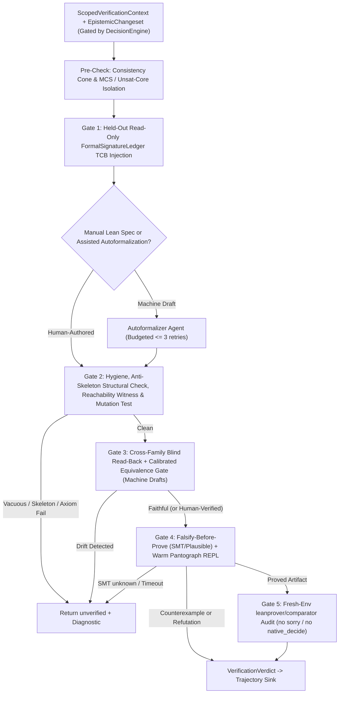

# [ISSUE-113] Opt-In Lean 4 Integration: Consistency Checking, Calculation & Deductive Verification (`packages/episteme-formal`)

| Metadata | Details |
| :--- | :--- |
| **Issue ID** | `ISSUE-113` |
| **Domain / Category** | `12-Neuro-Symbolic World Models & Lean` (Opt-In Formal Verification, Formal Calculation, SMT) |
| **Target Package(s)** | `packages/episteme-formal` (new symbolic-only package), `packages/episteme-contracts` |
| **Priority** | **High** |
| **Status** | `Research` |
| **Roadmap Horizon** | Horizon 2 & 3 |
| **Governing ADR & Plan** | [ADR-0025 Proposal](ADR-0025-PROPOSAL-epistemic-commit-cascade-and-world-models.md) \| [Execution Plan](EXECUTION-PLAN.md) |

---

## 1. Strategic Positioning: Native Opt-In Integration, Not Universal Autoformalization

Episteme does **not** claim to automatically translate arbitrary qualitative or hermeneutic philosophical prose into faithful Lean 4 theorems. Natural-language philosophy contains open-textured concepts and *ceteris paribus* rules that belong in Episteme's defeasible `D-QBAF` layer ([ADR-0022](../../docs/adr/0022-unified-stratified-epistemic-metamodel.md)).

Instead, `packages/episteme-formal/` provides a **native, opt-in Lean 4 integration** for users and domains where formal checking adds genuine rigor (analytic philosophy, formal epistemology, logic, game/decision theory, economics, physics, structuralist $M_p \to M$ laws):
- **Check consistency, entailment, or calculations in Lean 4** directly against Episteme's perspective-scoped Theory Graph cones (`ScopedVerificationContext`) and canonical `FormalSignatureLedger`.
- **Gate *when* and *what* to formalize with `DecisionEngine` ([ADR-0018](../../docs/adr/0018-decision-engine-architecture-and-contracts.md)):** Episteme's calibrated System-1 `DecisionEngine` (`evaluate_noul` / `evaluate_choice`) filters out non-formalizable prose up front so Lean 4 budget is spent only on formally structured subgraphs.
- **Support three explicit provenance tiers (`FormalProvenance`):**
  1. **`human_verified`:** Scholar-authored Lean 4 definitions/theorems attached in `episteme-studio` and verified automatically against the scoped graph cone.
  2. **`hybrid_reviewed`:** Machine-drafted Lean 4 specifications audited and approved by a human researcher.
  3. **`machine_draft`:** Assisted autoformalization gated by `DecisionEngine`, non-triviality checks, and Blind Read-Back (never conflated with human-certified proofs).

---

## 2. Four-Valued Compatibility (Why Binary Theorem Proving Fails)

A naive Lean 4 integration asks only *"Does $\Gamma \vdash \phi$ hold?"* On scientific and philosophical knowledge graphs, logical compatibility is **four-valued** (plus `unverified` for timeouts, SMT `unknown`, or gate rejections):

| Outcome | Formal Condition | Epistemic Meaning in Episteme | Pipeline Action |
| :--- | :--- | :--- | :--- |
| **`entailed`** | $\Gamma \vdash \phi$ (`sorry`-free, $\Gamma \not\vdash \bot$) | Deductively guaranteed theorem / valid inference step. | Certify `inferential_warrant = 1.0` in `EpistemicVerificationMetadata`. |
| **`sketch_verified`** | $\Gamma \cup \Delta \vdash \phi$ (`sorry`-free modulo minimal open lemmas $\Delta = \{z_1, \dots, z_k\}$) | Valid argument structure *modulo explicit missing premises* (*Prove2Me* §4.2). | Emit `EpistemicDeficitKind.ENTHYMEME_GAP` carrying formal Lean types of $\Delta$ to `ClosedLoopRefinementCoordinator` ([ADR-0024](../../docs/adr/0024-closed-loop-hermeneutic-refinement.md)). |
| **`consistent_independent`** | $\Gamma \not\vdash \phi \land \Gamma \not\vdash \neg\phi$ (**strictly certified** via finite model witness; SMT `unknown` $\to$ `unverified`) | **Logically consistent new axiom, empirical observation ($B$), or specialization ($\alpha$).** | Admit cleanly—most genuine new theoretical/empirical knowledge belongs here. |
| **`refuted`** | $\Gamma \vdash \neg\phi$ (with $\Gamma \not\vdash \bot$ passed) | Hard logical contradiction against active perspective cone $\Gamma$. | **Do not discard!** Emit `LOGICAL_CONTRADICTION`: retype edge to `ATTACKS`/`REFUTES`, escalate `POLYSEMY_COLLISION`, or flag aporia in Studio. |
| **`unverified`** | Timeout, SMT `unknown`, budget cap hit, or Gate 2/3 rejection | No kernel guarantee achieved. | Leave `D-QBAF` weights untouched; log diagnostic reason. |

---

## 3. Formalizing Logic, Structuralism & Executable Models in Lean 4

### 3.1 Configurable LogiKEy Modal Frames (`EpistemeLogic.Modal`)
Philosophical arguments use **modal** ($\Box, \Diamond$), **deontic**, and **doxastic/perspectival** operators (*"Leibniz holds that..."*, *"Necessarily..."*). Following LogiKEy (Benzmüller et al., 2020), `EpistemeLogic.Modal` provides Shallow Semantical Embeddings with **explicitly selectable modal frame classes** (`K`, `T`, `S4`, `S5`, `KD45`) so accessibility relations are never silently under-axiomatized:

```lean4
-- EpistemeLogic/Modal.lean (Base compiled .olean preamble)
namespace EpistemeLogic

structure ModalFrame where
  World : Type
  Agent : Type
  R_alethic : World -> World -> Prop
  R_doxastic : Agent -> World -> World -> Prop

class ReflexiveFrame (F : ModalFrame) : Prop where
  refl : ∀ w, F.R_alethic w w  -- Modal logic T

class TransitiveFrame (F : ModalFrame) : Prop where
  trans : ∀ w u v, F.R_alethic w u -> F.R_alethic u v -> F.R_alethic w v  -- S4

abbrev ModalProp (F : ModalFrame) := F.World -> Prop

def box {F : ModalFrame} (p : ModalProp F) : ModalProp F :=
  fun w => ∀ v, F.R_alethic w v -> p v

def believes {F : ModalFrame} (a : F.Agent) (p : ModalProp F) : ModalProp F :=
  fun w => ∀ v, F.R_doxastic a w v -> p v

def valid {F : ModalFrame} (p : ModalProp F) : Prop := ∀ w, p w

end EpistemeLogic
```

### 3.2 Bourbaki / Sneed Structuralist Theory-Elements & Executable Calculations
Episteme's structuralist metatheory ($T = \langle K, I \rangle$ with $M_{pp}, M_p, M$, [Formal Graph Model](../../docs/concepts/formal_graph_model.md)) maps cleanly onto Lean 4 `structure` inheritance and `class` law constraints—enabling both type-checked specialization posets ($\alpha$) and **executable formal calculations** (`#eval` / kernel-verified arithmetic and discrete state transitions):

```lean4
structure PartialPotentialModel where
  domain : Type
  position : domain -> Float

structure PotentialModel extends PartialPotentialModel where
  mass : domain -> Float
  force : domain -> Float

class ActualLawModel (m : PotentialModel) : Prop where
  law_holds : ∀ x : m.domain, m.force x = m.mass x * m.position x
```

### 3.3 Deterministic IR $\to$ Lean 4 Transpiler (Connecting to [ISSUE-115](ISSUE-115-epistemic-node-router-and-programmatic-empirical-world-models.md))
When `packages/episteme-formal/` is enabled alongside Regime B2 ([ISSUE-115](ISSUE-115-epistemic-node-router-and-programmatic-empirical-world-models.md)), a deterministic transpiler compiles Episteme's **Declarative Typed Transition Graph IR** (`OperationalizedScenarioArtifact`) into total Lean 4 `structure State` + `def step (s : State) (a : Action) : State` modules—enabling both deterministic simulation ($\phi_1$) and formal reachability/invariant verification ($\phi_2$) without ever executing untrusted LLM-generated Python.

---

## 4. Hardened Verification Pipeline (With MCS Pre-Repair & Anti-Skeleton Checks)

To prevent the ~43% baseline autoformalization unfaithfulness (*Bourigault et al.*, 2026), propositional-skeleton degeneracy (`opaque P : Prop; P -> Q`), cone poisoning from prior *ceteris paribus* clashes, and swarm specification weakening (*AlphaProof Code*, 2026), `packages/episteme-formal/` enforces a budgeted **5-Gate Pipeline**:



### Key Safeguards
1. **Pre-Check — Consistency Cone & MCS / Unsat-Core Isolation:**
   - Before checking $\phi$, test $\Gamma \not\vdash \bot$. If $\Gamma$ itself is already inconsistent (e.g., due to an existing philosophical aporia or unguarded *ceteris paribus* clash), do **not** silently fail all future checks with `unverified`: extract a **minimal unsatisfiable core**, emit `LOGICAL_CONTRADICTION` for the core, and evaluate $\phi$ against the **Maximal Consistent Subset (MCS)** excluding the conflicting core (clearly flagged in `formal_assumptions`).
2. **Gate 1 — Held-Out Read-Only `FormalSignatureLedger` TCB (*AlphaProof Code* §4 + *Prove2Me* §4.4):**
   - Versioned `FormalSignatureLedger` bindings are passed explicitly on `PipelineInput` and fingerprinted into `RunManifest.signature_ledger_fingerprint` (mirroring `EpistemicCurationLedger`), then injected as a read-only module separate from agent-writable proof files. Provers may never edit canonical definitions or target theorem signatures.
3. **Gate 2 — Hygiene, Anti-Skeleton Non-Triviality, Reachability & Mutation Checks:**
   - **Anti-Skeleton Structural Check:** Reject degenerate machine drafts that merely wrap raw prose in `opaque ClaimA : Prop; opaque ClaimB : Prop; axiom h : ClaimA -> ClaimB` without shared predicates, quantifiers, or `FormalSignatureLedger` bindings.
   - **Reachability Witness & Mutation Test:** Verify positive non-vacuity ($\exists m, \Gamma(m)$) and confirm semantic mutants ($\phi_{\text{mut}}$) fail verification. Forbid `sorry`, ad-hoc `axiom`, and `native_decide`.
4. **Gate 3 — Cross-Family Blind Read-Back & Calibrated Equivalence (For `machine_draft`):**
   - A cross-model-family auditor receives **only** the Lean 4 declaration + unfolded definitions (never the original prose) and translates it back to natural language $\phi'$, checked via a task-calibrated equivalence gate (bypassed when `formal_provenance == "human_verified"`).
5. **Gate 4 & Gate 5 — Budgeted Falsify-Before-Prove + Warm `Pantograph` + `leanprover/comparator`:**
   - Run fast SMT/property falsification first (`Z3`/`CVC5`/`lean-smt`/`plausible`), strictly mapping SMT `unknown` to `unverified` (never `consistent_independent`).
   - Use a stateful warm `Pantograph` REPL pool governed by `max_lean_seconds_per_run` and per-episode timeouts. Interactive HITL runs in `episteme-studio` ALWAYS dispatch via **async `sse-starlette` background jobs** so multi-second Lean runs never block FastAPI endpoints.
   - Replay accepted proofs in a clean environment via `leanprover/comparator` (optionally cross-checked with `nanoda_lib`).
6. **4-Condition Blind Critic Protocol for `FormalSignatureLedger` Amendments (*AlphaProof Code* §6.1):**
   - Any canonical signature update requires: (1) concrete disproof/counterexample, (2) non-weakening semantic diff, (3) preservation of existing reachability witnesses, and (4) minting a **new versioned `FormalSignatureLedger` artifact** on a child run (`parent_run_id`) rather than mutating the running ledger in place.

---

## 5. Annotated Research Guide & Primary Literature

| Paper / System | Core Contribution | What to Adopt for `episteme-formal` |
| :--- | :--- | :--- |
| **Chen et al. (2026)**, *Prove2Me* (`arXiv:2608.28433v2`) | Immutable statement/proof separation; `proof-sketches` importing open child lemmas; **Sub-Agent Read-Back**. | Read-back auditing, `proof-sketch` DAGs, and disproof-driven boundary repair. |
| **Bourigault et al. (2026)**, *Risk-Controlled Lean-as-Judge* (`arXiv:2605.28365`) | Empirical measurement of unfaithful autoformalization (~43% baseline) + conformal risk control. | Conformal calibration for Read-Back equivalence gating. |
| **Benzmüller, Parent, & van der Torre (2020)**, *LogiKEy* (*AIJ* 287) | Shallow Semantical Embeddings (SSE) of modal/deontic logics in HOL. | Configurable `EpistemeLogic.Modal` frame classes. |
| **Aniva et al. (2024)** (*Pantograph*, `arXiv:2410.16429`) & **Yang et al. (2023)** (*LeanDojo*, `arXiv:2306.15626`) | Stateful programmatic Lean 4 REPL server supporting persistent `.olean` environments. | Core execution engine avoiding cold `lake env lean` recompilation cones. |
| **Chaudhuri et al. (Google DeepMind, Nov 2026)** (*AlphaProof Code*) | Held-out read-only TCB checked via `leanprover/comparator` + `nanoda_lib`, banning `native_decide`, reachability witnesses, mutation testing, Blind Critic amendments, falsify-before-prove, `DyLean`+`VCVio` refinement. | TCB hardening, comparator audit, and symbolic/executable separation. |
| **Pan et al. (EMNLP 2023)** (*Logic-LM*) & **Olausson et al. (EMNLP 2023)** (*LINC*) | Coupling LLM autoformalizers with external symbolic solvers (Z3, Prover9, Isabelle). | Lightweight Z3/FOL Stage-0 baseline and solver error-trace retry loop. |

---

## 6. Acceptance Criteria

- [ ] Scaffold `packages/episteme-formal/` depending solely on `episteme-contracts` (zero PyTorch/GNN dependencies), kept **out of mandatory root `pyproject.toml` dependencies**, with `EpistemeLogic` Lean 4 library and warm `Pantograph` REPL adapter.
- [ ] Support `human_verified`, `hybrid_reviewed`, and `DecisionEngine`-gated `machine_draft` workflows with per-run/per-episode time budgets and non-blocking async `episteme-studio` background jobs (`sse-starlette`).
- [ ] Implement MCS / Unsat-Core cone pre-repair, anti-skeleton non-triviality checks, Blind Read-Back auditing, strict SMT `unknown -> unverified` handling, and `leanprover/comparator` Gate 5 audit + immutable versioned `FormalSignatureLedger` handling.
- [ ] Implement deterministic IR $\to$ Lean 4 transpiler for [ISSUE-115](ISSUE-115-epistemic-node-router-and-programmatic-empirical-world-models.md)'s Declarative Typed Transition Graph IR.
- [ ] Pass Stage-0 go/no-go benchmark (formalizability precision, non-triviality anti-skeleton rate, Read-Back `< 15%` drift, and comparison against a Z3/FOL baseline).
