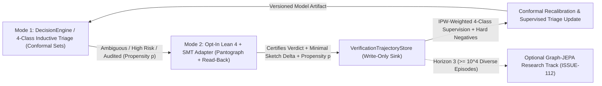

# [ISSUE-114] Neuro-Symbolic Synergy: Cross-System Interaction Dynamics, Logical Energy & Mode-2-to-Mode-1 Calibration

| Metadata | Details |
| :--- | :--- |
| **Issue ID** | `ISSUE-114` |
| **Domain / Category** | `12-Neuro-Symbolic World Models & Lean` (Neuro-Symbolic Coupling, Belief Revision, Off-Policy Calibration) |
| **Target Package(s)** | `episteme-formal`, `episteme-worldmodel`, `episteme-pipeline`, `epistemetrics` |
| **Priority** | **Medium** |
| **Status** | `Research` |
| **Roadmap Horizon** | Horizon 3 |
| **Governing ADR & Plan** | [ADR-0025 Proposal](ADR-0025-PROPOSAL-epistemic-commit-cascade-and-world-models.md) \| [Execution Plan](EXECUTION-PLAN.md) |

---

## 1. Bridging Deterministic Proofs, Latent Assumptions, and Continuous `D-QBAF`

### 1.1 Deterministic Logical Assumption Energy ($E_{\text{logic}}$)
In `packages/episteme-formal/`, a Lean 4 `proof-sketch` quantifies minimal assumption cost deterministically: let $\Delta = \{\psi_1, \dots, \psi_k\}$ be the minimal set of unproved child lemmas required to close $\Gamma \cup \Delta \vdash \phi$ without `sorry` (rejecting trivial collapse $\bot \in \Delta$ or $\phi \in \Delta$):

$$E_{\text{logic}}(\Gamma, \phi) = \begin{cases} 0.0 & \text{if } \Gamma \vdash \phi \quad (\Delta = \emptyset,\; \Gamma \not\vdash \bot) \\ \frac{1}{2} \tanh\!\left(\sum_{\psi \in \Delta} c(\psi)\right) \in (0, 0.5) & \text{if } \Gamma \cup \Delta \vdash \phi \text{ via sorry-free proof-sketch} \\ 0.5 & \text{if } \Gamma \not\vdash \phi \land \Gamma \not\vdash \neg\phi \quad (\text{certified consistent \& independent}) \\ 1.0 & \text{if } \Gamma \vdash \neg\phi \quad (\text{hard refutation under } \Gamma \not\vdash \bot) \end{cases}$$

### 1.2 Orthogonal Projection via Sidecar `VERIFICATION_VERDICT` Envelopes ([ADR-0022](../../docs/adr/0022-unified-stratified-epistemic-metamodel.md))
All formal verification outputs persist as standalone **`ArtifactKind.VERIFICATION_VERDICT` sidecar envelopes** (`VerificationVerdictArtifact`, [ISSUE-111](ISSUE-111-core-epistemic-commit-interceptor-and-operator-algebra.md)) joined onto Neo4j nodes/edges during `ProjectionCoordinator` runs (and attached on read views as optional `verification: EpistemicVerificationMetadata | None = None`). This guarantees Mode-1 triage scores and Mode-2 kernel verdicts never overwrite each other **and preserves zero-diff Phase 4/6 `TheoryAtomArtifact` IDs**:
- **Non-Duplicating Stage Roles:** Inside `ClosedLoopRefinementStage` (`max_refinement_cycles > 0`), `VerificationDeficitDetector` emits `LOGICAL_CONTRADICTION` and `ENTHYMEME_GAP` (with formal `proof-sketch` lemmas in `theory_lens`) so `ClosedLoopRefinementCoordinator` can recover missing L1/L2 premises or split polysemous entities; `FormalVerificationStage` skips unchanged verified items and certifies residual stabilized atoms when cycles finish (or when `max_refinement_cycles == 0`).
- **Verified Warrants:** For relations with `formal_status == "entailed"`, `inferential_warrant` $I_{j \to i}$ can be certified at `1.0` (optionally gated on `formal_provenance in {"human_verified", "hybrid_reviewed"}` or high-confidence `machine_draft`) without altering `modal_prior` $\tau_0(a)$ or `local_tenability` $TS_{\text{local}}(a)$, preserving `D-QBAF` forward invariance in $[0, 1]^n$ (Nagumo's condition, [Formal Graph Model](../../docs/concepts/formal_graph_model.md#L251)).
- **Dialectical Routing of `refuted` ($E_{\text{logic}} = 1.0$):** In philosophy, logical incompatibility is an analytical discovery, never a silent `DELETE`. The `StateReducer` routes `refuted` verdicts along three deterministic branches:
  1. *Explicit Critique / Counterargument:* Retype or link the candidate relation as `ATTACKS` / `REFUTES` instead of `SUPPORTS`.
  2. *Conceptual Equivocation Across Theories:* Emit `EpistemicDeficitKind.POLYSEMY_COLLISION` to trigger `ConceptionConceptSplitter` ([ADR-0024](../../docs/adr/0024-closed-loop-hermeneutic-refinement.md#L48)).
  3. *Unresolved Internal Aporia / Antinomy:* Emit `EpistemicDeficitKind.LOGICAL_CONTRADICTION` and surface both conflicting derivations (and minimal unsatisfiable core) in `episteme-studio` ([ISSUE-016](../06-discovery-and-querying/ISSUE-016-neutral-contradiction-management-workspace.md)).

---

## 2. Five Non-Obvious Cross-System Interactions & Failure Modes

### Interaction 1: Mode-1 Incompatibility Risk ($E_{\text{WM}}$) vs. Mode-2 ($E_{\text{logic}}$) Discrepancy Matrix
Because Mode-1 predicts calibrated 4-class probabilities with incompatibility risk $E_{\text{WM}} = P(\text{refuted}) + 0.5\, P(\text{sketch\_verified})$ ([ISSUE-112](ISSUE-112-inductive-graph-world-model-and-jepa-capabilities.md)), **both `entailed` and `consistent_independent` have low $E_{\text{WM}}$**—preventing valid new axioms from flooding Mode-2 escalation:

| | **Low $E_{\text{logic}}$ (`0.0` – `0.5`, Entailed / Sketch / Consistent)** | **High $E_{\text{logic}}$ (`1.0`, Refuted)** |
| :--- | :--- | :--- |
| **Low $E_{\text{WM}}$** (Structurally compatible) | **Routine Confirmation:** Valid fast-exit target once Mode-1 conformal sets are calibrated. | **Overgeneralization / Edge-Case Trap (High Value!):** Plausible prose missing a boundary quantifier (e.g., $n > 0$, cf. *Prove2Me* Fig. 8). High-priority record for Trajectory Sink! |
| **High $E_{\text{WM}}$** (High incompatibility risk) | **Non-Trivial Unification / False Alarm:** Surprising consistency or entailment across distant clusters; re-calibrates Mode 1. | **Clear Anomaly / Contradiction:** Both Mode-1 triage and symbolic kernel flag incompatibility; immediate dialectical routing. |

### Interaction 2: Confirmation Bias in `Select` $\leftrightarrow$ `Compute`
Retrieving $\Gamma$ solely via dense cosine similarity preferentially selects supporting claims and misses counter-axioms. **Mitigation:** Mandatory 3-channel selection over `EpistemicStateView` (Poset root $T_0$ + perspective-filtered $k$-hop cone + polarity-opposed anchors on shared `L2Entity`s, [ISSUE-111](ISSUE-111-core-epistemic-commit-interceptor-and-operator-algebra.md)).

### Interaction 3: Order Sensitivity, *Modus Tollens* & Trilemmas (`Propose` $\leftrightarrow$ `Compute`)
Single-statement verification flags the *final* sentence of a *reductio* or trilemma $\{P, Q, R\} \vdash \bot$ as the sole culprit. **Mitigation:** Evaluate connected batch components post-forward (or coherent HITL `EpistemicChangeset`s in `episteme-studio`), returning `conflicting_atom_ids` as a minimal *unsatisfiable core* rather than blaming only the newest node.

### Interaction 4: Downstream Invalidation After `Update`
When `Update` splits a polysemous entity (`ConceptionConceptSplitter`) or bumps `FormalSignatureLedger`, downstream proofs importing that signature become stale (*Prove2Me* §4.1). **Mitigation:** Strictly scope re-evaluation to the affected connected component (`slice_phase4_component_view`, [ADR-0024](../../docs/adr/0024-closed-loop-hermeneutic-refinement.md#L55)) and enforce `max_cascade_depth <= 2`.

### Interaction 5: Cold-Start Bootstrap & Off-Policy Selection Bias
On Day 1, `packages/episteme-worldmodel/` has zero verified trajectories; later, Mode 2 is preferentially invoked on ambiguous or high-risk items (creating covariate shift in `VerificationTrajectoryStore`).
- **Cold-Start Mitigation:** Operate cleanly with `DecisionEngine` formalizability + escalation gating as Mode 1 and opt-in Lean 4 as Mode 2.
- **Selection-Bias Mitigation:** Log `propensity_score` (the Mode-1 escalation + deterministic SHA-256 audit sampling probability) on every `VerificationTrajectoryRecord` and apply **Inverse Propensity Weighting (IPW)** during Mode-1 training and conformal recalibration.

---

## 3. Mode-2 $\to$ Mode-1 Calibration & Distillation Loop

Every Mode-2 episode yields three simultaneous signals:
1. **Calibrated 4-Class Supervision:** Updates `ConformalCalibrator` thresholds and Tier-1 inductive verifier weights without collapsing `consistent_independent` into an ambiguity trap.
2. **Hard Negative Mining:** Certified `refuted` statements are semantically close to valid text (often differing by one quantifier or negation), directly addressing negation blindness.
3. **Sketch Lemma Targets:** Minimal open lemmas from `sketch_verified` trajectories benchmark and refine premise recovery (`LLMTheoryGuidedPremiseRecoverer`).

---

## 4. Stage-0 Go/No-Go Experimental Protocol & Further Reading

### 4.1 Two-Week Stage-0 Validation Spike (Hard Go/No-Go Gate Before Core Refactors)
1. **Dataset:** Sample 15–20 German and English `TheoryNet` subgraphs (5–15 atoms each) spanning **both** formal/axiomatic domains (e.g., decision/economic models, formal epistemology) and qualitative philosophical prose (e.g., `planwirtschaft.md`, historical treatises).
2. **Adversarial Metrics to Measure:**
   - **Formalizability Gate Precision (`DecisionEngine`):** Can `DecisionEngine` reliably separate formalizable subgraphs from open-textured prose?
   - **Non-Triviality (Anti-Skeleton) Rate:** What % of compiling autoformalizations carry genuine predicate/quantifier/structuralist structure rather than degenerate `opaque P : Prop; P -> Q` skeletons?
   - **Faithfulness Rate (Blind Read-Back + Human Gold Check):** Target $> 85\%$ semantic preservation on formalizable subgraphs (exceeding the ~43% raw baseline in Bourigault et al., 2026).
   - **Consistency-Cone Clash & SMT `unknown` Rate:** How often do real author cones $\Gamma$ already trigger $\Gamma \vdash \bot$ (testing MCS pre-repair), and how often does SMT return `unknown` vs. certified finite models on `EpistemeLogic.Modal`?
   - **Deterministic Baseline Comparison:** Benchmark a lightweight **Z3/FOL + exact `epistemetrics` D-QBAF** baseline to establish the minimum quality bar that `Pantograph` + Lean 4 must beat.

### 4.2 Annotated Bibliography on Neuro-Symbolic Argumentation & Belief Revision
- **Alchourrón, Gärdenfors, & Makinson (1985)**, *On the Logic of Theory Change* (*Journal of Symbolic Logic* 50) — Foundational **AGM Belief Revision** postulates (expansion, contraction, revision).
- **Modgil & Prakken (2013)**, *A General Account of Argumentation with Preferences* (*Artificial Intelligence* 195) — **ASPIC+** separating *strict deductive rules* (Mode 2) from *defeasible rules* (`D-QBAF` warrants).
- **Hunter (2018)** / **Potyka (2018)** — Probabilistic and continuous gradual epistemic argumentation frameworks grounding the interaction between formal consistency and `[0, 1]` node weights.
- **Garcez & Lamb (2023)**, *Neurosymbolic AI: The 3rd Wave* (*Artificial Intelligence Review*) — Taxonomy of neuro-symbolic coupling patterns.

---

## 5. Acceptance Criteria

- [ ] Complete Stage-0 go/no-go benchmark report (including formalizability precision, anti-skeleton rate, MCS/SMT `unknown` rate, and Z3/FOL baseline) before merging into `episteme-pipeline`.
- [ ] Implement $E_{\text{logic}}$ calculation and dialectical routing (`ATTACKS`, `POLYSEMY_COLLISION`, `LOGICAL_CONTRADICTION`) in `StateReducer`.
- [ ] Implement IPW-weighted Mode-2 $\to$ Mode-1 conformal recalibration and supervised 4-class triage training over `VerificationTrajectoryStore`, verifying held-out AUROC improvement over raw text-similarity baselines.
