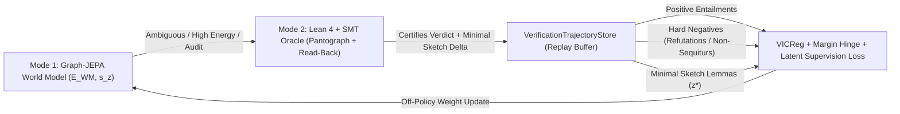

# [ISSUE-114] Neuro-Symbolic Synergy: Cross-System Interaction Dynamics, Logical Energy & Mode-2-to-Mode-1 Distillation

| Metadata | Details |
| :--- | :--- |
| **Issue ID** | `ISSUE-114` |
| **Domain / Category** | `12-Neuro-Symbolic World Models & Lean` (Neuro-Symbolic Coupling, Belief Revision, Distillation) |
| **Target Package(s)** | `episteme-formal`, `episteme-pipeline`, `epistemetrics` |
| **Priority** | **High** |
| **Status** | `Research` |
| **Roadmap Horizon** | Horizon 3 |
| **Governing ADR** | [ADR-0025 Proposal](ADR-0025-PROPOSAL-epistemic-commit-cascade-and-world-models.md) |

---

## 1. Bridging Deterministic Proofs, Latent Assumptions, and Continuous `D-QBAF`

### 1.1 Deterministic Logical Assumption Energy ($E_{\text{logic}}$)
In LeCun (2022, §4.2 Eq. 5), the zero-temperature free energy of an Energy-Based Model minimizes prediction discrepancy plus a latent complexity regularizer: $F_w(x, y) = \min_z (E_w(x, y, z) + R(z))$. In `episteme-formal`, **a Lean 4 `proof-sketch` instantiates this exact equation deterministically**: the latent variable $z \equiv \Delta = \{\psi_1, \dots, \psi_k\}$ is the minimal set of unproved child lemmas required to close $\Gamma \cup \Delta \vdash \phi$ without `sorry`, and $R(\Delta)$ penalizes Ockham complexity (number and logical strength of extra axioms) while rejecting trivial collapse ($\bot \in \Delta$ or $\phi \in \Delta \implies R(\Delta) = \infty$):

$$E_{\text{logic}}(\Gamma, \phi) = \begin{cases} 0.0 & \text{if } \Gamma \vdash \phi \quad (\Delta = \emptyset,\; \Gamma \not\vdash \bot) \\ \frac{1}{2} \tanh\!\left(\sum_{\psi \in \Delta} c(\psi)\right) \in (0, 0.5) & \text{if } \Gamma \cup \Delta \vdash \phi \text{ via sorry-free proof-sketch} \\ 0.5 & \text{if } \Gamma \not\vdash \phi \land \Gamma \not\vdash \neg\phi \quad (\text{consistent \& independent}) \\ 1.0 & \text{if } \Gamma \vdash \neg\phi \quad (\text{hard refutation under } \Gamma \not\vdash \bot) \end{cases}$$

### 1.2 Orthogonal Projection Into `D-QBAF` ([ADR-0022](../../docs/adr/0022-unified-stratified-epistemic-metamodel.md))
- **Verified Warrants:** For relations with `formal_status == "entailed"`, `inferential_warrant` $I_{j \to i}$ is certified at `1.0` without touching `modal_prior` $\tau_0(a)$ or `local_tenability` $TS_{\text{local}}(a)$, preserving `D-QBAF` forward invariance in $[0, 1]^n$ (Nagumo's condition, [Formal Graph Model](../../docs/concepts/formal_graph_model.md#L251)).
- **Dialectical Routing of `refuted` ($E_{\text{logic}} = 1.0$):** In philosophy, logical incompatibility is an analytical discovery, never a silent `DELETE`. The `StateReducer` routes `refuted` verdicts along three deterministic branches:
  1. *Explicit Critique / Counterargument:* Retype or link the candidate relation as `ATTACKS` / `REFUTES` instead of `SUPPORTS`.
  2. *Conceptual Equivocation Across Theories:* Emit `EpistemicDeficitKind.POLYSEMY_COLLISION` to trigger `ConceptionConceptSplitter` ([ADR-0024](../../docs/adr/0024-closed-loop-hermeneutic-refinement.md#L48)).
  3. *Unresolved Internal Aporia / Antinomy:* Emit `EpistemicDeficitKind.LOGICAL_CONTRADICTION` and surface both conflicting derivations in `episteme-studio` ([ISSUE-016](../06-discovery-and-querying/ISSUE-016-neutral-contradiction-management-workspace.md)).

---

## 2. Five Non-Obvious Cross-System Interactions & Failure Modes

### Interaction 1: Mode-1 ($E_{\text{WM}}$) vs. Mode-2 ($E_{\text{logic}}$) Discrepancy Matrix
Because the Graph World Model evaluates *topological-semantic plausibility* while Lean 4 evaluates *strict deductive soundness*, disagreements between Mode 1 and Mode 2 are extraordinarily informative—provided they never overwrite each other's fields:

| | **Low $E_{\text{logic}}$ (`0.0` – `0.4`, Entailed / Sketch)** | **High $E_{\text{logic}}$ (`1.0`, Refuted)** |
| :--- | :--- | :--- |
| **Low $E_{\text{WM}}$** (Structurally plausible) | **Routine Confirmation:** Fast-exit target once Mode 1 is calibrated. | **Overgeneralization / Edge-Case Trap (High Value!):** Plausible prose missing a boundary quantifier (e.g., $n > 0$, cf. *Prove2Me* Fig. 8 `gotsman_linial` $\to$ `gotsman_linial_with_zero`). |
| **High $E_{\text{WM}}$** (Structurally surprising) | **Non-Trivial Unification / Discovery:** Surprise logical entailment across distant clusters; high priority to store in Replay Buffer! | **Clear Anomaly / Hallucination:** Both neural topology and symbolic kernel reject consistency; immediate deficit escalation. |

### Interaction 2: Confirmation Bias in `Select` $\leftrightarrow$ `Compute`
If `SubgraphSelector` retrieves context $\Gamma$ using only dense cosine similarity, it preferentially selects supporting claims and misses foundational counter-axioms from Chapter 1. **Mitigation:** Mandatory 3-channel selection (Poset root $T_0$ + perspective-filtered $k$-hop cone + polarity-opposed anchors on shared `L2Entity`s, [ISSUE-111](ISSUE-111-core-epistemic-commit-interceptor-and-operator-algebra.md)).

### Interaction 3: Order Sensitivity, *Modus Tollens* & Trilemmas (`Propose` $\leftrightarrow$ `Compute`)
Single-statement verification flags the *final* sentence of a *reductio* or trilemma $\{P, Q, R\} \vdash \bot$ as the sole culprit. **Mitigation:** Evaluate coherent **episode changesets** at working-memory flush boundaries ([ADR-0009](../../docs/adr/0009-sota-dual-memory-episodic-working-memory.md)), returning `conflicting_atom_ids` as an *unsatisfiable core* (minimal inconsistent subset) rather than blaming only the newest node.

### Interaction 4: Downstream Invalidation After `Update` (GNN Embeddings & Lean Imports)
When `Update` splits a polysemous entity (`ConceptionConceptSplitter`) or repairs a `FormalSignatureEntry`, both local GNN node embeddings in the Graph World Model and downstream Lean proofs importing that signature become stale (*Prove2Me* §4.1). **Mitigation:** Strictly scope re-evaluation to the affected connected component (`slice_phase4_component_view`, [ADR-0024](../../docs/adr/0024-closed-loop-hermeneutic-refinement.md#L55)) and enforce `max_cascade_depth <= 2`.

### Interaction 5: Cold-Start Bootstrap & Off-Policy Distribution Shift
On Day 1, the Graph-JEPA World Model has zero verified philosophical trajectories. **Mitigation:** Episteme operates seamlessly in cold start using `Jev` + `D-QBAF` as Mode 1 and Lean 4 as Mode 2, accumulating verified trajectories in `VerificationTrajectoryStore` until Graph-JEPA passes calibration gates on held-out works.

---

## 3. Mode-2 $\to$ Mode-1 Amortized Inference Distillation Loop

Every Mode-2 episode yields three simultaneous supervision signals for the Graph-JEPA World Model (LeCun, 2022, §3.1.3 & §4.5):
1. **Energy Ordering:** $E_{\text{WM}}(G, \Delta_{\text{entailed}}) < E_{\text{WM}}(G, \Delta_{\text{consistent}}) < E_{\text{WM}}(G, \Delta_{\text{refuted}})$.
2. **Hard Negative Mining Without Collapse:** Certified `refuted` statements are semantically close to valid text (often differing by one quantifier or negation), solving the hardest failure mode of contrastive EBM training (LeCun §4.3 Table 1).
3. **Latent Enthymeme Alignment:** Matching $\tilde{\mathbf{s}}_z = \text{Pred}(s_x, \check{z})$ against the text embeddings of lemmas recovered in `sketch_verified` trajectories.

---

## 4. Stage-0 Experimental Protocol & Further Reading

### 4.1 Two-Week Stage-0 Validation Spike (Before Any Core Refactor)
1. **Dataset:** Sample 15–20 German and English `TheoryNet` subgraphs (5–15 atoms each) already extracted by `episteme-pipeline` (e.g., `planwirtschaft.md`, philosophical treatises).
2. **Metrics to Measure:**
   - **Autoformalization Compilation Rate:** % of generated Lean 4 snippets passing `Pantograph` syntax/typechecking within $\le 3$ error-trace retries.
   - **Faithfulness Rate (Blind Read-Back + Human Gold Check):** Target $> 85\%$ semantic preservation (exceeding the ~43% raw baseline reported in Bourigault et al., 2026).
   - **Signature Reuse Rate:** % of recurring `L2Entity` concepts successfully reusing `FormalSignatureLedger` types across chunks.
   - **Trilemma & *Modus Tollens* Precision:** Accuracy of classifying `entailed` vs. `sketch_verified` vs. `consistent_independent` vs. `refuted` on curated test cases.

### 4.2 Annotated Bibliography on Neuro-Symbolic Argumentation & Belief Revision
- **Alchourrón, Gärdenfors, & Makinson (1985)**, *On the Logic of Theory Change: Partial Meet Contraction and Revision Functions* (*Journal of Symbolic Logic* 50) — Foundational **AGM Belief Revision** postulates (expansion, contraction, revision) governing how a consistent theory $\Gamma$ must absorb or contract around incompatible assertions.
- **Modgil & Prakken (2013)**, *A General Account of Argumentation with Preferences* (*Artificial Intelligence* 195) — **ASPIC+** framework separating *strict deductive rules* ($\Gamma \vdash \phi$, Mode 2) from *defeasible rules* (`D-QBAF` warrants), providing formal rationality postulates for hybrid graphs.
- **Hunter (2018)** / **Potyka (2018)** — Probabilistic and continuous gradual epistemic argumentation frameworks grounding the interaction between formal consistency and `[0, 1]` node weights.
- **Garcez & Lamb (2023)**, *Neurosymbolic AI: The 3rd Wave* (*Artificial Intelligence Review*) — Taxonomy of neuro-symbolic coupling patterns (Episteme implements *Symbolic[Neuro]* + *Neuro|Symbolic* distillation).

---

## 5. Acceptance Criteria

- [ ] Complete Stage-0 offline benchmark report with faithfulness, compilation, and trilemma metrics before merging into `episteme-pipeline`.
- [ ] Implement $E_{\text{logic}}$ calculation and dialectical routing (`ATTACKS`, `POLYSEMY_COLLISION`, `LOGICAL_CONTRADICTION`) in `StateReducer`.
- [ ] Implement offline Mode-2 $\to$ Mode-1 distillation training script over `VerificationTrajectoryStore` and verify calibrated AUROC improvement over raw text similarity baselines.
