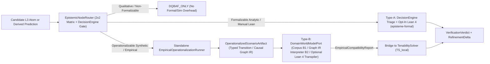

# ISSUE-115: `EpistemicNodeRouter` (2×2 Hume's Fork) & Declarative Transition Graph World Models

- **Status:** `Research` / `Proposal`
- **Target Packages:** `packages/episteme-contracts`, `packages/episteme-pipeline`, `packages/episteme-worldmodel`, `packages/episteme-formal` (optional IR $\to$ Lean 4 backend), `packages/episteme-studio`
- **Horizon / Priority:** Horizon 2 & 3 | High
- **Related ADR & Issues:** [ADR-0025-PROPOSAL](ADR-0025-PROPOSAL-epistemic-commit-cascade-and-world-models.md), [Execution Plan](EXECUTION-PLAN.md), [ISSUE-111](ISSUE-111-core-epistemic-commit-interceptor-and-operator-algebra.md), [ISSUE-112](ISSUE-112-inductive-graph-world-model-and-jepa-capabilities.md), [ISSUE-113](ISSUE-113-lean4-formal-verification-oracle-and-logikey-adapter.md), [ISSUE-114](ISSUE-114-neuro-symbolic-interaction-dynamics-and-distillation.md), [ISSUE-094](../../issues/11-epistemetrics-formal-concept/epistemic_coherence/ISSUE-094-TENABILITY.md)
- **Grounded In Repo:**
  - [default_schema.py](../../packages/episteme-pipeline/episteme_pipeline/schema/default_schema.py) (`COMPONENT_PARTITIONS` `"A"` vs. `"B"`, `EPISTEMIC_STATUSES` `"Analytisch"` / `"Synthetisch"`)
  - [0022-unified-stratified-epistemic-metamodel.md](../../docs/adr/0022-unified-stratified-epistemic-metamodel.md) (`Partition A`, `Partition B`, `TS_local`)
  - [runner.py](../../packages/episteme-pipeline/episteme_pipeline/post_processing/theoretical_enrichment/runner.py) (`TheoreticalEnrichmentRunner`, 882 lines)
  - [solvers.py](../../packages/episteme-pipeline/episteme_pipeline/post_processing/theoretical_enrichment/solvers.py) (`SafeFormulaEvaluator`, `TenabilitySolver`)
  - [roadmap.md](../../docs/roadmap.md) ("World Models for Empirical Node Validation")

---

## 1. Motivation & Epistemic Diagnosis: Correcting the 2×2 Hume's Fork Matrix

In Episteme's schema ([default_schema.py](../../packages/episteme-pipeline/episteme_pipeline/schema/default_schema.py#L140-L174)), **two orthogonal axes** classify `TheoryAtom` nodes—and must **never** be conflated:
1. **Vocabulary Partition (`Partition A` vs. `Partition B`):**
   - `Partition A` (`TheoreticalHypothesis`, `CoreExpansion`): contains theoretical terms/laws.
   - `Partition B` (`ObservationUnit`, `EmpiricalStatement`): contains observational/empirical terms.
2. **Epistemic Status (`Analytisch` vs. `Synthetisch`):**
   - `Analytisch`: truth/validity depends on definitions, logic, or mathematical structure.
   - `Synthetisch`: truth depends on empirical facts, mechanisms, or external reality.

Crucially, **most scientific and philosophical hypotheses live in the `(Partition A, Synthetisch)` quadrant** (e.g., *"Dopamine depletion causes anhedonia"*, *"Central planning without price signals causes allocation drift"*). Routing must handle all four quadrants explicitly—gated by Episteme's **`DecisionEngine` ([ADR-0018](../../docs/adr/0018-decision-engine-architecture-and-contracts.md))** so qualitative prose is never forced into Lean 4:

| Vocabulary Partition | `Analytisch` (Formal / Conceptual) | `Synthetisch` (Empirical / Mechanistic) |
| :--- | :--- | :--- |
| **`Partition A`** (Theoretical) | **`FORMAL_CASCADE`** (if `DecisionEngine` marks formalizable or manual Lean spec attached) else **`DQBAF_ONLY`** | **`BRIDGE_SYNTHESIS`** (if formal entailment $A \vdash \hat{b}$ exists: verify entailment in Lean, test $\hat{b}$ via Type-B) OR **`EMPIRICAL_WORLD`** (if operationalizable) else **`DQBAF_ONLY`** |
| **`Partition B`** (Observational) | **`FORMAL_CASCADE`** (rare: definitional/measurement identity) else **`DQBAF_ONLY`** | **`EMPIRICAL_WORLD`** (Corpus B1 / Declarative Transition Graph B2 feeding `TS_local`) |

Simultaneously, empirical LLM simulation literature exposes **four critical failure modes** to engineer around:

| Failure Mode | Evidence / Risk | Episteme Architectural Safeguard |
| :--- | :--- | :--- |
| **1. Direct LLM Elicitation Collapse** | Manning, Zhu, & Horton (2024, *Automated Social Science*): direct LLM scoring gives `MSE = 8,628` vs. `128` (**~67× worse**) and `13.2×` $\hat{\beta}$ inflation. | Never prompt an LLM directly for *"Is empirical claim X plausible?"* (`score in [0, 1]`). |
| **2. Arbitrary Python Code Execution (RCE / Auditability)** | Synthesizing and executing raw Python scripts (*WorldCoder*) creates security, sandboxing, determinism, and UI-auditability hazards. | **Never output raw Python.** Regime B2 targets a **Declarative Typed Transition / Causal Graph IR** (closed Pydantic AST extending `SafeFormulaEvaluator`), with an optional **IR $\to$ Lean 4 transpiler**. |
| **3. Duhem–Quine Conflation** | Hiding operationalization inside a Type-B client conflates bridge-law translation defects ($H_{\text{bridge}}$) with world falsification ($H_{\text{world}}$). | Standalone **`EmpiricalOperationalizationRunner`** (`PhaseRunner` / `PostForwardStage`) emitting a persisted, `Fingerprintable` `OperationalizedScenarioArtifact`. |
| **4. Self-Referential LLM Priors in `TS_local`** | Writing LLM-simulated social trials (`in_silico_scm`) automatically into `TS_local` multiplies `TheoryAtom.modal_prior` with the LLM's own RLHF/pretraining biases. | Keep Regime B3 (`in_silico_scm`) strictly as an **interactive `episteme-studio` sensitivity/exploration workbench tool**—never an automated pipeline write-back into `TS_local`. |

---

## 2. Two Orthogonal World-Model Concepts: Type-A vs. Type-B



---

## 3. Standalone `EmpiricalOperationalizationRunner` (`PostForwardStage`, Decoupled from `TheoreticalEnrichmentRunner`)

> [!IMPORTANT]
> **Hard Architectural Boundary:** Bridge-principle distillation **MUST NOT** be hidden inside an external `DomainWorldModelPort` adapter **nor** crammed into the already 882-line [`TheoreticalEnrichmentRunner`](../../packages/episteme-pipeline/episteme_pipeline/post_processing/theoretical_enrichment/runner.py#L98). It runs inside its own standalone **`EmpiricalOperationalizationRunner`** wrapped as **`EmpiricalOperationalizationStage` (`PostForwardStage`)** in `PostForwardRunner` ([ISSUE-111](ISSUE-111-core-epistemic-commit-interceptor-and-operator-algebra.md)), executing after refinement/formal verification stabilize and emitting `ArtifactKind.OPERATIONALIZED_SCENARIO`.

Keeping operationalization as an explicit artifact stage guarantees:
- **Deterministic Replay & Content-Addressed Caching:** `DomainWorldModelPort` receives schema-validated Pydantic `OperationalizedScenarioArtifact` objects keyed by `(scenario_hash, domain_spec_version, seed)`. Re-running B1/B2 requires zero LLM calls.
- **Popper/Schurz 2-Stage Falsification:** Preserves clean provenance between *"bridge translation failed"* ($H_{\text{bridge}}$) and *"under valid operationalization, the domain model refutes $\hat{b}$"* ($H_{\text{world}}$).
- **Hermeneutic Historicism:** Historical context $B(t)$ ([assumptions_limitations.md](../../docs/concepts/assumptions_limitations.md)) triggers an `ANACHRONISM_GUARD` annotation rather than anachronistically penalizing historical treatises.

---

## 4. Declarative Typed Transition / Causal Graph IR & Hexagonal Contracts (All Pydantic v2)

All contracts use **Pydantic v2 `BaseModel`** (consistent with `contracts/domain.py` and `BaseArtifactPayload` in `artifacts/models.py`) and `VerificationTrack` from [ISSUE-111](ISSUE-111-core-epistemic-commit-interceptor-and-operator-algebra.md):

```python
from __future__ import annotations

from typing import Literal, Protocol, runtime_checkable

from pydantic import BaseModel, Field

from episteme_contracts.domain import TheoryAtom
from episteme_contracts.fingerprint import Fingerprintable
from episteme_contracts.verification import VerificationTrack


class StateVariableSpec(BaseModel):
    """Typed state or observable variable in a declarative transition/causal graph."""

    name: str
    var_type: Literal["float", "int", "bool", "categorical"]
    domain_bounds: tuple[float, float] | None = None
    allowed_values: tuple[str, ...] = ()
    initial_value: float | int | bool | str | None = None


class TransitionRuleEdge(BaseModel):
    """Safe declarative transition or causal update rule (closed AST, zero Python exec)."""

    rule_id: str
    source_vars: tuple[str, ...]
    target_var: str
    guard_expr: str | None = None          # Evaluated via SafeFormulaEvaluator AST
    update_expr: str                       # Evaluated via SafeFormulaEvaluator AST
    action_trigger: str | None = None      # Optional intervention / action label


class TransitionGraphIR(BaseModel):
    """Declarative Typed Transition / Causal Graph IR replacing raw Python synthesis.

    Safe by construction (closed AST, bounded rollout steps), natively renderable
    and editable in ``episteme-studio``, and optionally transpilable to total
    Lean 4 ``structure State`` / ``def step`` modules in ``packages/episteme-formal/``.
    """

    ir_version: str = "v1"
    variables: tuple[StateVariableSpec, ...] = ()
    rules: tuple[TransitionRuleEdge, ...] = ()
    invariants: tuple[str, ...] = ()       # SafeFormulaEvaluator boolean/residual constraints
    max_rollout_steps: int = Field(default=64, ge=1, le=1024)


class OperationalizedScenarioArtifact(BaseModel):
    """Explicit, content-addressed bridge translation from prose claim to Type-B scenario."""

    artifact_id: str
    source_node_id: str
    theory_id: str
    domain_kind: Literal["empirical_corpus", "transition_graph_ir", "studio_scm_dag"]
    transition_graph: TransitionGraphIR | None = None
    treatment_intervention: dict[str, str] = Field(default_factory=dict)
    target_observable: str
    expected_direction: Literal["gt", "lt", "approx_eq", "reachable", "impossible"]
    bridge_assumptions: tuple[str, ...] = ()
    historical_regime: str | None = None
    content_fingerprint: str = ""


class EmpiricalCompatibilityReport(BaseModel):
    """Deterministic Type-B evaluation outcome returned by ``DomainWorldModelPort``."""

    scenario_id: str
    regime: Literal["empirical_corpus_b", "transition_graph_interpreter", "lean4_transition_model"]
    evidence_modality: Literal["empirical_data", "declarative_graph_ir", "lean4_executable_model"]
    compatibility_score: float = Field(ge=0.0, le=1.0)
    prediction_satisfied: bool
    empirical_tenability_ts: float = Field(ge=0.0, le=1.0)
    counterexample_trace: tuple[str, ...] = ()
    artifact_fingerprint: str = ""


@runtime_checkable
class EpistemicNodeRouter(Fingerprintable, Protocol):
    """Routes candidate atoms via 2x2 Hume's Fork + DecisionEngine formalizability gate."""

    async def route(
        self,
        atom: TheoryAtom,
        *,
        is_formal_prediction: bool = False,
        has_manual_lean_spec: bool = False,
    ) -> VerificationTrack: ...


@runtime_checkable
class EmpiricalOperationalizer(Fingerprintable, Protocol):
    """Compiles synthetic/derived claims into typed OperationalizedScenarioArtifact IR."""

    async def operationalize(
        self,
        claim_text: str,
        theory_context: dict[str, str],
    ) -> OperationalizedScenarioArtifact: ...


@runtime_checkable
class DomainWorldModelPort(Fingerprintable, Protocol):
    """Hexagonal port for Type-B external domain world models."""

    async def evaluate_scenario(
        self,
        scenario: OperationalizedScenarioArtifact,
        *,
        seed: int = 0,
    ) -> EmpiricalCompatibilityReport: ...
```

### Bridging Type-B Results Into `TenabilitySolver` & `TheoryNet`
- **Formulaic empirical laws (`BaseLaw` present):** [`TenabilitySolver`](../../packages/episteme-pipeline/episteme_pipeline/post_processing/theoretical_enrichment/solvers.py#L142) remains the zero-cost deterministic evaluator.
- **Qualitative / mechanistic claims (`BaseLaw` absent):** `DomainWorldModelPort` runs Regime B1 or B2 over `OperationalizedScenarioArtifact`, writes `empirical_tenability_ts` to `TS_local`, and preserves `evidence_modality` so real `empirical_data` always outranks model-derived checks.

---

## 5. Type-B Domain World Model Regimes (No Arbitrary Python, No Automated LLM-Prior Write-Back)

### Regime B1 — Corpus-Grounded `Partition B` Check (`empirical_corpus_b`)
First-line, lowest-cost empirical check: retrieves real `ObservationUnit` / `EmpiricalStatement` nodes inside Episteme's own `Partition B` (or linked benchmark datasets) matching `target_observable`, checks directional/support compatibility via `TenabilitySolver` + D-QBAF evidence polarity, and assigns `evidence_modality = "empirical_data"`.

### Regime B2 — Declarative Transition Graph World Models (Safe *WorldCoder* Adaptation)
Inspired by **WorldCoder** (Tang, Key, & Ellis, 2024, `arXiv:2402.12275v3`), but **never synthesizing or executing arbitrary Python**:
1. **Constrained Episteme Target Format (`TransitionGraphIR`):** The agent synthesizes a schema-validated `TransitionGraphIR` (typed variables + guarded update rules using Episteme's closed [`SafeFormulaEvaluator`](../../packages/episteme-pipeline/episteme_pipeline/post_processing/theoretical_enrichment/solvers.py#L26-L135) AST + bounded `max_rollout_steps`).
2. **Dual Epistemic Synthesis Objective ($\phi_1 \land \phi_2$):**
   - **Data Consistency ($\phi_1$):** The deterministic graph interpreter reproduces observed transitions $(s, a, s')$ from `Partition B` / harness traces.
   - **Optimism / Non-Vacuity ($\phi_2$):** The predicted phenomenon/state is actually reachable under a valid intervention—preventing vacuous "no-op" transition graphs.
3. **Two Safe Execution Backends:**
   - **Default (Zero External Deps):** Pure-Python deterministic **Transition Graph Interpreter** inside `packages/episteme-worldmodel/` (zero `eval`/`exec`, guaranteed termination via `max_rollout_steps`, directly visualizable and editable as a graph in `episteme-studio`).
   - **Optional Formal Backend (`packages/episteme-formal/`):** Deterministic **`TransitionGraphIR` $\to$ Lean 4 Transpiler** generating total `structure State` + `def step` modules for kernel-checked reachability ($\phi_2$) and global invariant proofs—unifying Type-A and Type-B under Lean 4!
4. **`REx`-Style Rule Refinement:** Refine individual buggy `TransitionRuleEdge` nodes on concrete counterexample traces with amortized $\mathcal{O}(1)$ LLM cost once verified.

### Regime B3 — Interactive Studio Ex-Ante SCM Workbench (`studio_scm_dag` — Exploration Only)
For social, ethical, and political claims (e.g., *empathy $\to$ cooperation*), Manning, Zhu, & Horton (2024, *Automated Social Science*, `arXiv:2404.11794v2`) show that unstructured LLM scoring fails badly and even structured `homo silicus` trials inherit LLM pretraining/RLHF priors.
- **Strict Epistemic Policy:** Regime B3 compiles claims into the same declarative `TransitionGraphIR` DAG format (exogenous factors $U$, orthogonal treatments `do(X=x)`, no bad collider/mediator controls), but runs **strictly as an interactive `episteme-studio` sensitivity/exploration tool**—clearly labeled as *LLM prior probing* and **never automatically mutating `TS_local` or `TheoryAtom.effective_base_prior`**.

---

## 6. Cross-Link to Lean 4: Two-Stage Falsification (`BRIDGE_SYNTHESIS`)

1. **Formal Step (`packages/episteme-formal/`):** Given `Partition A` axioms $\Gamma_A$ and bridge assumptions $\beta$, verify $\Gamma_A \land \beta \vdash \hat{b}$ in Lean 4.
2. **Empirical Step (`Type-B WM`):** Route the verified entailment $\hat{b}$ through `EmpiricalOperationalizationRunner` $\to$ `DomainWorldModelPort` (Regime B1/B2).
3. **Diagnostic Precision:** Step 1 fails $\implies$ internal logical defect (`ENTHYMEME_GAP` / `LOGICAL_CONTRADICTION`). Step 1 succeeds and Step 2 fails $\implies$ either `BRIDGE_DEFECT` ($H_{\text{bridge}}$) or empirical anomaly (`EMPIRICAL_FALSIFICATION`).

---

## 7. Annotated Research Guide & Literature Foundations

| Source | Key Concept / Empirical Finding | Role in Episteme (`ISSUE-115`) |
| :--- | :--- | :--- |
| **Tang, Key, & Ellis (2024)** (*WorldCoder*, `arXiv:2402.12275v3`) | Dual data-consistency + optimism synthesis ($\phi_1 \land \phi_2$), `REx` refinement, compositional complexity bound (Thm. 2.4). | Adapted safely onto Episteme's **Declarative Typed Transition Graph IR** (+ optional Lean 4 transpiler) instead of raw Python execution. |
| **Manning, Zhu, & Horton (2024)** (*Automated Social Science*, `arXiv:2404.11794v2`) | Quantifies direct LLM calibration collapse (`67×` MSE, `13.2×` $\hat{\beta}$ inflation) and bad-control pitfalls; introduces ex-ante SCMs. | Motivates banning direct LLM scoring and isolating Regime B3 strictly as an interactive Studio exploration workbench. |
| **Duhem (1906) / Quine (1951)** & **Schurz / Lakatos** ([formal_graph_model.md](../../docs/concepts/formal_graph_model.md)) | Empirical refutation targets $(T \land \beta_{\text{bridge}})$, requiring explicit provenance for bridge hypotheses ($M_{pp}$). | Direct rationale for standalone `EmpiricalOperationalizationRunner` emitting `OperationalizedScenarioArtifact`. |

---

## 8. Acceptance Criteria

- [ ] Define Pydantic v2 `TransitionGraphIR`, `OperationalizedScenarioArtifact`, `EmpiricalCompatibilityReport`, `EpistemicNodeRouter`, `EmpiricalOperationalizer`, and `DomainWorldModelPort` in `episteme-contracts` (`Fingerprintable.fingerprint()`, zero `getattr`).
- [ ] Implement 2×2 Hume's Fork + `DecisionEngine` formalizability routing covering all four `(Partition A/B × Analytisch/Synthetisch)` quadrants.
- [ ] Implement standalone `EmpiricalOperationalizationRunner` (decoupled from `TheoreticalEnrichmentRunner`) and safe deterministic `TransitionGraphIR` interpreter (zero Python `exec`/`eval`) + optional IR $\to$ Lean 4 transpiler in `packages/episteme-formal/`.
- [ ] Keep Regime B3 (`studio_scm_dag`) isolated as an interactive `episteme-studio` exploration tool with zero automated write-back to `TS_local`.
