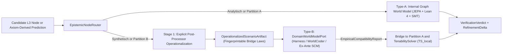

# ISSUE-115: `EpistemicNodeRouter` & Programmatic Empirical World Models (Hume's Fork)

- **Status:** `Research` / `Proposal`
- **Target Packages:** `packages/episteme-pipeline`, `packages/epistemetrics`, `packages/episteme-worldmodel` (Horizon 3)
- **Horizon / Priority:** Horizon 3 | High
- **Related ADR & Issues:** [ADR-0025-PROPOSAL](ADR-0025-PROPOSAL-epistemic-commit-cascade-and-world-models.md), [ISSUE-111](ISSUE-111-core-epistemic-commit-interceptor-and-operator-algebra.md), [ISSUE-112](ISSUE-112-inductive-graph-world-model-and-jepa-capabilities.md), [ISSUE-113](ISSUE-113-lean4-formal-verification-oracle-and-logikey-adapter.md), [ISSUE-114](ISSUE-114-neuro-symbolic-interaction-dynamics-and-distillation.md), [ISSUE-094](../../issues/11-epistemetrics-formal-concept/epistemic_coherence/ISSUE-094-TENABILITY.md)
- **Grounded In Repo:**
  - [default_schema.py](../../packages/episteme-pipeline/episteme_pipeline/schema/default_schema.py) (`L3_COMPONENT_TYPES` Partitions `"A"` vs. `"B"`, `EPISTEMIC_STATUSES` `"Analytisch"` / `"Synthetisch"`)
  - [0022-unified-stratified-epistemic-metamodel.md](../../docs/adr/0022-unified-stratified-epistemic-metamodel.md) (`Partition A`, `Partition B`, `TS_local`)
  - [runner.py](../../packages/episteme-pipeline/episteme_pipeline/post_processing/theoretical_enrichment/runner.py) (`TheoreticalEnrichmentRunner`, `TenabilitySolver`)
  - [solvers.py](../../packages/episteme-pipeline/episteme_pipeline/post_processing/theoretical_enrichment/solvers.py) (`SafeFormulaEvaluator`, `TenabilitySolver`)
  - [roadmap.md](../../docs/roadmap.md) ("World Models for Empirical Node Validation")

---

## 1. Motivation & Epistemic Diagnosis (Hume's Fork)

Episteme separates every scientific theory net $T$ into two logically distinct strata (matching [default_schema.py](../../packages/episteme-pipeline/episteme_pipeline/schema/default_schema.py) and [ADR-0022](../../docs/adr/0022-unified-stratified-epistemic-metamodel.md)):

1. **Relations of Ideas (`Analytisch` / `Partition A`):** Core axioms, structural definitions, and mathematical laws (`TheoreticalHypothesis`, `CoreExpansion`, deductive entailments). Compatibility is deterministic and formal: given axioms $\Gamma$ and candidate $\phi$, does $\Gamma \vdash \phi$ or $\Gamma \vdash \neg\phi$ hold? This is served by **Type-A World Models** ([ISSUE-112](ISSUE-112-inductive-graph-world-model-and-jepa-capabilities.md) Graph-JEPA inductive prior + [ISSUE-113](ISSUE-113-lean4-formal-verification-oracle-and-logikey-adapter.md) Lean 4 / SMT oracle).
2. **Matters of Fact (`Synthetisch` / `Partition B` + Derived Predictions):** Empirical observations (`ObservationUnit`, `EmpiricalStatement`), social/behavioral mechanisms (e.g., an empathy or coordination theory), and empirical predictions $\hat{b}$ deduced by Lean 4 from `Partition A` (`A ⊢ b̂`). **Lean 4 cannot verify synthetic truth.** Asking a proof assistant whether an empathy theory produces higher cooperation in human groups mistakes syntactic consistency for world-compatibility.

Simultaneously, the *World Models for Empirical Node Validation* note in [roadmap.md](../../docs/roadmap.md) and recent empirical LLM simulation literature expose **three critical failure modes** if an empirical world model is naively wrapped around an LLM prompt:

| Failure Mode | Empirical Evidence | Episteme Architectural Consequence |
| :--- | :--- | :--- |
| **1. Direct LLM Elicitation Calibration Collapse** | Manning, Zhu, & Horton (2024, *Automated Social Science*, §2.3 & §3.2): querying an LLM directly to predict outcomes gives auction clearing price `MSE = 8,628` vs. `128` for economic theory (**~67× worse**), and `predict-beta` overestimates true regression magnitudes in **10 of 12** causal paths by an average of **13.2×**. | Never prompt an LLM directly for *"Is empirical claim X plausible in the world?"* (`score in [0,1]`). |
| **2. Unstructured Discovery & Bad Controls** | Manning et al. (2024, §4.2, Fig. 7b & Fig. 8): letting LLM agents converse freely and running ex-post causal discovery (GES) falls into collider/mediator conditioning bias and Markov equivalence ambiguity. | Empirical tests must specify an **ex-ante Structural Causal Model (SCM)** with typed exogenous treatments (`do(X=x)`), pre-specified measurement instruments, and factorial experimental sweeps. |
| **3. Conflating Operationalization with the World Oracle (Duhem–Quine)** | If empirical distillation/operationalization happens hidden inside a World Model API client, a failure in bridge-principle translation looks identical to empirical falsification of the core theory, breaking determinism, provenance, and `Fingerprintable` caching. | **Operationalization must be an explicit, fingerprintable pipeline step** emitting an auditable `OperationalizedScenarioArtifact` before any Type-B oracle executes. |

---

## 2. Two Orthogonal World-Model Concepts: Type-A vs. Type-B

Episteme explicitly separates two distinct meanings of *"World Model"* so neither conflates internal graph coherence with external reality:



| Dimension | **Type-A: Epistemic Graph World Model** ([ISSUE-112](ISSUE-112-inductive-graph-world-model-and-jepa-capabilities.md)) | **Type-B: External Domain World Model** (`ISSUE-115`) |
| :--- | :--- | :--- |
| **Domain of Discourse** | Episteme's own formal theory graph $G = (L_1, L_2, L_3)$ | Physical, biological, computational, or social reality external to $G$ |
| **Input State** | Local poset roots, $k$-hop $L_3$ subgraph, schema constraints | `OperationalizedScenarioArtifact` (initial state $s_0$, action/intervention $a$, observable $y$) |
| **Oracle Mechanism** | Graph-JEPA latent energy + Warm `Pantograph` Lean 4 / Z3 | Three plugged regimes via `DomainWorldModelPort` (B1 Corpus, B2 *WorldCoder*, B3 Ex-Ante SCM) |
| **Core Question Answered** | *"Does $\phi$ entail or contradict $\Gamma$ inside $T$?"* | *"Under bridge laws $\beta$, does domain world $\mathcal{W}$ permit transition/intervention outcome $\hat{b}$?"* |

---

## 3. Architectural Decision: Explicit Post-Processor Operationalization vs. In-API Translation

> [!IMPORTANT]
> **Hard Architectural Boundary:** Bridge-principle distillation and scenario operationalization **MUST NOT** be hidden inside an external `WorldModelClient` adapter. They belong inside an explicit pipeline post-processor step (`EmpiricalOperationalizer` inside `TheoreticalEnrichmentRunner`) that emits a persisted, `Fingerprintable` `OperationalizedScenarioArtifact`.

### Why This Boundary Is Mandatory (Duhem–Quine Decomposition)

Consider evaluating an empathy claim $c$: *"Higher shared vulnerability increases altruistic helping in teams."* Testing $c$ against an external world model involves two falsifiable hypotheses:
1. **Translation / Bridge Hypothesis ($H_{\text{bridge}}$):** $c$ operationalizes into treatment $X := \text{vulnerability\_disclosure} \in \{0,1\}$, mediator/confounder guard, outcome $Y := \text{allocation\_share} \in [0, 1]$, and population prior $\mathcal{D}$.
2. **Empirical Truth Hypothesis ($H_{\text{world}}$):** Given exact inputs $(X, Y, \mathcal{D})$, simulator/corpus/program $\mathcal{W}$ yields $\mathbb{E}[Y \mid do(X=1)] > \mathbb{E}[Y \mid do(X=0)]$.

Keeping Step 1 inside `episteme-pipeline` guarantees:
- **Deterministic Replay & Content-Addressed Caching:** `DomainWorldModelPort` receives structured, schema-validated `OperationalizedScenarioArtifact` objects keyed by `(scenario_hash, domain_spec_version, seed)`. Re-running a deterministic regime B1/B2/B3 needs zero LLM calls.
- **Popper/Schurz 2-Stage Falsification:** When a claim fails (`COMPATIBLE = False`), Episteme preserves trace separation between *"the LLM mistranslated the philosophical prose into scenario parameters"* ($H_{\text{bridge}}$ defect) and *"even under valid operationalization, the domain model refutes prediction $\hat{b}$"* ($H_{\text{world}}$ falsification feeding [ISSUE-094](../../issues/11-epistemetrics-formal-concept/epistemic_coherence/ISSUE-094-TENABILITY.md)).
- **Hermeneutic Historicism Preserved:** Historical context $B(t)$ ([assumptions_limitations.md](../../docs/concepts/assumptions_limitations.md)) governs whether an empirical mismatch triggers an `ANACHRONISM_GUARD` annotation rather than anachronistically penalizing an ancient treatise's internal validity.

---

## 4. The `EpistemicNodeRouter` & Hexagonal Port Contracts

### 4.1 Routing Rules (`EpistemicNodeRouter`)

`EpistemicNodeRouter` sits at stage 1 of `EpistemicCommitInterceptor` ([ISSUE-111](ISSUE-111-core-epistemic-commit-interceptor-and-operator-algebra.md)) and routes each candidate `L3` node or derived edge across three explicit pathways based on `L3_COMPONENT_TYPES`, `EPISTEMIC_STATUSES`, and origin metadata:

```python
from __future__ import annotations

from dataclasses import dataclass, field
from enum import StrEnum
from typing import Literal, Protocol, runtime_checkable

from episteme_pipeline.protocols import Fingerprintable


class VerificationTrack(StrEnum):
    """Target verification pathway selected by Hume's Fork routing."""

    FORMAL_CASCADE = "formal_cascade"       # Partition A / Analytisch -> JEPA + Lean 4 (ISSUE-111..114)
    EMPIRICAL_WORLD = "empirical_world"     # Partition B / Synthetisch -> Operationalizer + Type-B WM
    BRIDGE_SYNTHESIS = "bridge_synthesis"   # A |- b_hat -> Verify formal entailment, then test b_hat empirically


@dataclass(frozen=True)
class OperationalizedScenarioArtifact:
    """Explicit, content-addressed bridge translation from prose claim to Type-B scenario.

    Notes
    -----
    Produced exclusively by ``EmpiricalOperationalizer`` inside
    ``TheoreticalEnrichmentRunner`` so bridge-law drift can be audited
    independently of Type-B simulation execution.
    """

    artifact_id: str
    source_node_id: str
    theory_id: str
    domain_kind: Literal["empirical_corpus", "programmatic_mdp", "social_scm"]
    exogenous_variables: dict[str, tuple[float, float]]
    treatment_intervention: dict[str, str]
    target_observable: str
    expected_direction: Literal["gt", "lt", "approx_eq", "reachable", "impossible"]
    bridge_assumptions: tuple[str, ...]
    historical_regime: str | None = None
    content_fingerprint: str = ""


@dataclass(frozen=True)
class EmpiricalCompatibilityReport:
    """Deterministic Type-B evaluation outcome returned by ``DomainWorldModelPort``."""

    scenario_id: str
    regime: Literal["empirical_corpus_b", "worldcoder_program", "in_silico_scm"]
    evidence_modality: Literal["empirical_data", "deterministic_program", "in_silico_scm"]
    compatibility_score: float
    prediction_satisfied: bool
    empirical_tenability_ts: float
    counterexample_trace: tuple[str, ...] = field(default_factory=tuple)
    causal_effect_estimate: float | None = None
    uncertainty_bounds: tuple[float, float] | None = None
    artifact_fingerprint: str = ""


@runtime_checkable
class EpistemicNodeRouter(Fingerprintable, Protocol):
    """Routes Partition A/B and analytic/synthetic nodes to the correct verification track."""

    def route(
        self,
        component_type: str,
        epistemic_status: str | None,
        is_formal_prediction: bool = False,
    ) -> VerificationTrack:
        """Select the deterministic routing track for a candidate epistemic item."""
        ...


@runtime_checkable
class EmpiricalOperationalizer(Fingerprintable, Protocol):
    """Pipeline post-processor that compiles synthetic/derived claims into Type-B scenarios."""

    async def operationalize(
        self,
        claim_text: str,
        theory_context: dict[str, str],
    ) -> OperationalizedScenarioArtifact:
        """Translate natural-language empirical content into a structured Type-B scenario."""
        ...


@runtime_checkable
class DomainWorldModelPort(Fingerprintable, Protocol):
    """Hexagonal port for Type-B external domain world models."""

    async def evaluate_scenario(
        self,
        scenario: OperationalizedScenarioArtifact,
        *,
        seed: int = 0,
    ) -> EmpiricalCompatibilityReport:
        """Execute deterministic or factorial empirical compatibility checking."""
        ...
```

### 4.2 Bridging Type-B Results Back into `TenabilitySolver` & `TheoryNet`

Inspection of [runner.py](../../packages/episteme-pipeline/episteme_pipeline/post_processing/theoretical_enrichment/runner.py) and [solvers.py](../../packages/episteme-pipeline/episteme_pipeline/post_processing/theoretical_enrichment/solvers.py) confirms that `TenabilitySolver` currently computes quantitative formula residuals over `BaseLaw` expressions (returning `(1.0, 0.0, [])` when laws are empty and `0.0` for unbound parameters), while `ADR-0022` already defines `TS_local` for empirical partition coherence. `ISSUE-115` connects `EmpiricalCompatibilityReport` directly into `TS_local` without replacing `TenabilitySolver`:
- **Formulaic empirical laws (`BaseLaw` present):** `TenabilitySolver` remains the zero-cost deterministic evaluator.
- **Qualitative / behavioral / state-transition claims (`BaseLaw` absent):** `DomainWorldModelPort` runs the operationalized scenario across Regimes B1–B3, writes `empirical_tenability_ts` to `TS_local`, and records `evidence_modality` so real observational records (`empirical_data`) always outrank simulated social trials (`in_silico_scm`).

---

## 5. Three Type-B Domain World Model Regimes

### Regime B1 — Corpus-Grounded `Partition B` / `TS_local` Check (`empirical_corpus_b`)

First-line, lowest-cost empirical check: retrieves real `ObservationUnit` / `EmpiricalStatement` nodes inside Episteme's own `Partition B` (or linked benchmark datasets) matching `OperationalizedScenarioArtifact.target_observable`, checks directional/support compatibility via `TenabilitySolver` + D-QBAF evidence polarity, and assigns `evidence_modality = "empirical_data"`.

### Regime B2 — Programmatic World Models via Code Synthesis (*WorldCoder*, Tang, Key, & Ellis, 2024)

For mechanistic domains (physical systems, interactive game-theoretic environments, institutional rule sets, state-transition theories), an LLM does **not** act as a black-box neural simulator on every step. Following **WorldCoder** (`arXiv:2402.12275v3`):

1. **World Model as Explicit Python Code:** The agent synthesizes an explicit, human-auditable deterministic transition program $\hat{T}(s, a) \to (s', r)$ representing the theory's causal rules.
2. **Dual Epistemic Synthesis Objective ($\phi_1 \land \phi_2$):**
   - **Data Consistency ($\phi_1$):** $\hat{T}$ must deterministically reproduce *all* observed transitions $(s, a, s', r)$ already established in `Partition B` / harness traces.
   - **Optimism / Non-Vacuity Constraint ($\phi_2$):** $\hat{T}$ must actually reach the predicted goal or phenomenon under some valid policy/intervention. **Critically, $\phi_2$ prevents trivial or vacuous "no-op" world models** (the exact empirical analogue of `ISSUE-113`'s positive reachability witness $\exists m, \Gamma(m)$ and [ISSUE-094](../../issues/11-epistemetrics-formal-concept/epistemic_coherence/ISSUE-094-TENABILITY.md) anti-vacuity).
3. **`REx` Refinement & Amortized $\mathcal{O}(1)$ LLM Cost:**
   - WorldCoder uses **Refine, Explore, and Exploit (`REx`)**—bandit Thompson-sampling over program AST nodes—to prioritize refining high-yield buggy rule branches on concrete counterexample transitions $(s, a, s'_{\text{obs}}) \neq \hat{T}(s, a)$.
   - Once $\hat{T}$ passes verification, rolling out thousands of counterfactual claims costs **zero LLM tokens** (pure deterministic Python execution).
   - **Theoretical Efficiency Guarantee (Tang et al., 2024, Theorem 2.4):** When environment rules exhibit compositional independence $K_{\perp\!\!\!\perp \mathcal{M}}$, sample complexity bounds scale polynomially in $D_{S,A,T} \cdot (K_{\perp\!\!\!\perp \mathcal{M}} + 1)$ rather than exponentially over joint state spaces—matching `TheoryNet`'s modular specialization lattice (`T_0 -> T_1 -> ...`)!

### Regime B3 — Ex-Ante Structural Causal Models (*Automated Social Science*, Manning, Zhu, & Horton, 2024)

For philosophical, ethical, sociological, and political theories making causal claims about human agents (e.g., *empathy $\to$ fairness*, *institutional design $\to$ polarization*), Manning, Zhu, & Horton (`arXiv:2404.11794v2`) demonstrate both **why naive LLM prediction fails** and **the rigorous experimental protocol required**:

1. **Mandatory Ex-Ante SCM Compilation:** Never ask an LLM to score a social claim directly or run free-form agent chat without structural constraints. Instead, compile the theory claim into an explicit Directed Acyclic Graph (DAG) specifying:
   - Exogenous background factors $U$,
   - Randomized/orthogonal treatment assignments $T_1, \dots, T_k$ (explicitly forbidding collider/mediator conditioning unless testing mediation blocks),
   - Pre-registered scenario templates and quantitative survey/choice measurement instruments $Y$.
2. **Factorial *In Silico* Simulation (`homo silicus`):** Instantiate calibrated persona priors parameterized by context variables (anchored on demographic/historical constraints $B(t)$), run randomized factorial interventions `do(X = x)`, and estimate average treatment effects $\widehat{\text{ATE}} = \mathbb{E}[Y \mid do(X=1)] - \mathbb{E}[Y \mid do(X=0)]$ using standard econometric estimators (avoiding GES Markov-equivalence pitfalls).
3. **Strict Epistemic Labeling & Safeguards:**
   - All Regime B3 outcomes are tagged `evidence_modality = "in_silico_scm"` with **bounded inferential weight** $\le 0.35$ relative to `empirical_data` (`1.0`).
   - Manning et al. explicitly warn that LLMs replicate training-corpus social priors and stereotypes (*social desirability / RLHF bias*) and exhibit large level/magnitude miscalibration; therefore B3 validates **ordinal directional robustness and structural boundary conditions** inside a candidate social model, **never ground-truth external human sociology without empirical data**.

---

## 6. Cross-Link to Lean 4: Checking Theory-Implied Empirical Predictions (`BRIDGE_SYNTHESIS`)

A core synergy unlocked by combining [ISSUE-113](ISSUE-113-lean4-formal-verification-oracle-and-logikey-adapter.md) and `ISSUE-115` is **two-stage Popper/Schurz falsification chaining**:

1. **Formal Step (`Lean 4`):** Given `Partition A` axioms $\Gamma_A$ and bridge assumptions $\beta$, verify $\Gamma_A \land \beta \vdash \hat{b}$ (is prediction $\hat{b}$ genuinely *entailed* by the theory, or is the author making an invalid leap from their own axioms?).
2. **Empirical Step (`Type-B WM`):** Route the **verified entailment** $\hat{b}$ via `BRIDGE_SYNTHESIS` into `EmpiricalOperationalizer` $\to$ `DomainWorldModelPort` to test whether $\hat{b}$ survives empirical/programmatic/SCM stress-testing.
3. **Diagnostic Precision:** If step 1 fails $\implies$ `ENTHYMEME_GAP` / `LOGICAL_CONTRADICTION` (internal logical defect). If step 1 succeeds and step 2 fails $\implies$ either `BRIDGE_DEFECT` ($H_{\text{bridge}}$) or empirical anomaly (`EMPIRICAL_FALSIFICATION` candidate edge attaching to the *Falsifikationsschema* in [theory_nets_and_topologies.md](../../docs/concepts/theory_nets_and_topologies.md)).

---

## 7. Annotated Research Guide & Literature Foundations

| Source | Key Concept / Empirical Finding | Role in Episteme (`ISSUE-115`) |
| :--- | :--- | :--- |
| **Tang, Key, & Ellis (2024)** (*WorldCoder: Model-Based LLM Agent Building World Models by Writing Code*, `arXiv:2402.12275v3`) | Synthesizes Python transition programs $\hat{T}$ with data-consistency + optimism objectives ($\phi_1 \land \phi_2$), `REx` AST bandit refinement, and compositional complexity bound $D_{S,A,T} \cdot (K_{\perp\!\!\!\perp \mathcal{M}}+1)$ (Thm. 2.4). | Blueprint for **Regime B2** programmatic mechanistic world models with $\mathcal{O}(1)$ amortized evaluation cost and anti-vacuity reachability $\phi_2$. |
| **Manning, Zhu, & Horton (2024)** (*Automated Social Science: Language Models as Scientist and Subjects*, `arXiv:2404.11794v2`) | Quantifies massive direct LLM calibration failures (`MSE = 8,628` vs. `128`, `13.2x` $\hat{\beta}$ inflation) and ex-post GES bad-control pitfalls; introduces **ex-ante SCM** + factorial `in silico` agents (`homo silicus`). | Blueprint & safety guardrails for **Regime B3** social/philosophical claim simulation. |
| **LeCun (2022)** (*A Path Towards Autonomous Machine Intelligence*, v0.9.2) | Joint Embedding Predictive Architecture (JEPA), latent trajectory rollouts, and Actor–Cost–World-Model separation. | Conceptual basis for separating internal latent predictor ([ISSUE-112](ISSUE-112-inductive-graph-world-model-and-jepa-capabilities.md)) from operationalized action/state interventions (`ISSUE-115`). |
| **Duhem (1906) / Quine (1951)** (*Holism / Auxiliary Hypotheses*) & **Schurz / Lakatos** ([formal_graph_model.md](../../docs/concepts/formal_graph_model.md), [theory_nets_and_topologies.md](../../docs/concepts/theory_nets_and_topologies.md)) | Empirical refutation always targets $(T \land \beta_{\text{bridge}})$, requiring explicit provenance for bridge hypotheses ($M_{pp}$ / *Zuordnungsgesetze*). | Direct rationale for isolating `EmpiricalOperationalizer` as a `Fingerprintable` post-processor stage rather than hiding it inside an API adapter. |

---

## 8. Acceptance Criteria

- [ ] Define `EpistemicNodeRouter`, `EmpiricalOperationalizer`, `DomainWorldModelPort`, `OperationalizedScenarioArtifact`, and `EmpiricalCompatibilityReport` protocols in `episteme-pipeline` following SOLID / DIP (`Fingerprintable`, zero `getattr`).
- [ ] Integrate `BRIDGE_SYNTHESIS` handoff between `LeanFormalEvaluator` (`A ⊢ b̂`) and `EmpiricalOperationalizer` inside `TheoreticalEnrichmentRunner`, writing calibrated outcomes to `TS_local` with explicit `evidence_modality`.
- [ ] Implement and benchmark a **Regime B2 (`WorldCoder`)** prototype with $\phi_1 \land \phi_2$ synthesis + deterministic zero-token replay on 5–10 mechanistic philosophical/decision-theoretic toy domains.
- [ ] Implement a **Regime B3 (`Ex-Ante SCM`)** harness prototype requiring pre-specified DAG/treatment schemas (rejecting free-form direct-scoring prompts) with explicit `in_silico_scm` weight cap (`<= 0.35`).
