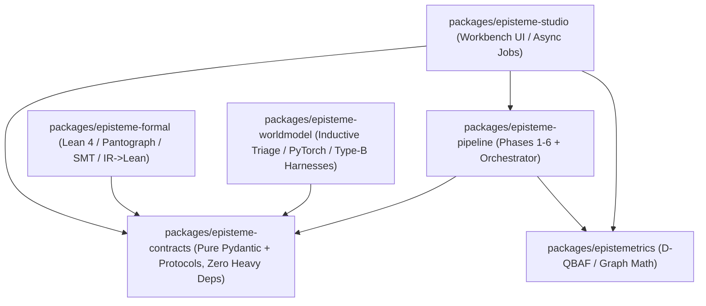

# 12 — Neuro-Symbolic Epistemic World Models & Opt-In Lean 4 Integration

This directory specifies the architectural design, formal operator algebra, and staged research roadmap for integrating **opt-in Lean 4 formal verification (`packages/episteme-formal/`)** and **inductive / declarative World Models (`packages/episteme-worldmodel/`)** into **Episteme** via narrow hexagonal contracts (`packages/episteme-contracts/`).

---

## 1. Executive Overview & Strategic Positioning

Episteme's existing tri-layer architecture ([Formal Graph Model](../../docs/concepts/formal_graph_model.md)) pairs **Layer 1** verbatim provenance and **Layer 2** canonical ontology (`L2Entity` / `EntityConception`) with **Layer 3** defeasible dialectical evaluation (`D-QBAF`, [ADR-0022](../../docs/adr/0022-unified-stratified-epistemic-metamodel.md)) and structuralist model-theoretic tenability ($TS_{\text{local}}, TS_{\text{edge}}$, [ADR-0015](../../docs/adr/0015-theoretical-enrichment-and-tenability-evaluation.md)).

Rather than claiming universal automated theorem proving over arbitrary qualitative philosophy, this suite adds two **opt-in, deeply integrated capabilities** designed to work cleanly alongside `D-QBAF`:

1. **Native Opt-In Lean 4 Verification & Calculation (`packages/episteme-formal/`):**
   If a user or domain wants to check deductive consistency ($\Gamma \not\vdash \bot$), verify entailments ($\Gamma \vdash \phi$), surface missing formal lemmas (*enthymemes*), or run executable formal calculations over their Theory Graph, Episteme supports Lean 4 natively—complete with perspective-isolated context cones, canonical signature bindings, and **Episteme's `DecisionEngine` ([ADR-0018](../../docs/adr/0018-decision-engine-architecture-and-contracts.md)) gating *what* is formalizable and *when* to invoke Lean 4**. Qualitative, open-textured, or hermeneutic prose stays cleanly in `D-QBAF` without being forced into vacuous Lean boilerplate.
2. **Typed Empirical & Inductive World Models (`packages/episteme-worldmodel/`):**
   - **Type-A (Internal Graph Verifier / World Model):** Starts with a calibrated supervised inductive triage model (built on Episteme's existing `ConformalCalibrator` / `DecisionEngine`) plus exact millisecond `D-QBAF` counterfactual rollouts in `epistemetrics`, with an optional Horizon-3 Graph-JEPA research track once sufficient verified trajectories exist.
   - **Type-B (External Empirical & Mechanistic Compatibility):** Compiles testable empirical/mechanistic claims into a **Declarative Typed Transition / Causal Graph IR** (extending `SafeFormulaEvaluator`—never executing arbitrary LLM-generated Python!), with an optional deterministic **IR $\to$ Lean 4 transpiler** when `episteme-formal` is enabled.

### Unified Algebraic Principle

Rather than bolting ad-hoc `EventEmitter` callbacks onto individual graph inserts, both subsystems instantiate **one unified pure operator pipeline** over immutable `EpistemicStateView` snapshots:

$$\text{Propose (Changeset)} \longrightarrow \text{Route (Hume's Fork + Formalizability)} \longrightarrow \text{Select (Scoped Cone)} \longrightarrow \text{Compute (Triage / Lean / IR)} \longrightarrow \text{Update (Append-Only Delta)}$$

- **Formalizability & Escalation Gate (`DecisionEngine` / Mode 1):** Decides whether a candidate subgraph is genuinely formalizable (analytic, axiomatic, mathematical, structuralist) vs. qualitative prose, and triages low-risk items in milliseconds.
- **Mode 2 (`LeanFormalEvaluator`):** Supports **human-authored**, **hybrid-reviewed**, and **assisted-autoformalization** workflows backed by a warm `Pantograph` Lean 4 REPL + SMT checking, gated by anti-skeleton checks, vacuity/MCS handling, and blind read-back auditing.
- **Trajectory Replay (`VerificationTrajectoryStore`):** An append-only sink (excluded from cache fingerprints) recording verified episodes so Mode-2 outcomes can calibrate and train Mode-1 triage models over time.

---

## 2. Specification Suite Registry

| Artifact / Issue | Category | Title & Scope | Target Package(s) | Horizon | Priority | Status |
| :--- | :--- | :--- | :--- | :--- | :--- | :--- |
| [**ADR-0025 Proposal**](ADR-0025-PROPOSAL-epistemic-commit-cascade-and-world-models.md) | **Architecture Decision** | **Transactional Epistemic Verification Cascade, Opt-In Lean 4 Integration, and World Models** | `episteme-contracts`, `episteme-pipeline`, `episteme-formal`, `episteme-worldmodel` | Horizon 2 & 3 | High | `Proposed` |
| [**EXECUTION-PLAN**](EXECUTION-PLAN.md) | **Implementation Roadmap** | **Phased Execution Plan, Package Extraction Dependency Graph & Pitfalls Matrix** | All workspace packages | Horizon 2 & 3 | High | `Proposed` |
| [**ISSUE-111**](ISSUE-111-core-epistemic-commit-interceptor-and-operator-algebra.md) | **Verification Core** | **Neuro-Symbolic Verification Contracts, `EpistemicVerificationService` & Sidecar Verdicts** | `episteme-contracts`, `episteme-pipeline` (`artifacts/`, `refinement/`), `episteme-studio` | Horizon 2 | High | `Proposal` |
| [**ISSUE-112**](ISSUE-112-inductive-graph-world-model-and-jepa-capabilities.md) | **World Models (Type-A)** | **Inductive Graph Triage, Exact D-QBAF Counterfactuals & Graph-JEPA Research Track** | `episteme-worldmodel`, `epistemetrics`, `episteme-studio` | Horizon 2 & 3 | Medium | `Research` |
| [**ISSUE-113**](ISSUE-113-lean4-formal-verification-oracle-and-logikey-adapter.md) | **Formal Integration** | **Opt-In Lean 4 Verification & Calculation Adapter (`Pantograph`, LogiKEy, Read-Back)** | `episteme-formal`, `episteme-contracts` | Horizon 2 & 3 | High | `Research` |
| [**ISSUE-114**](ISSUE-114-neuro-symbolic-interaction-dynamics-and-distillation.md) | **Interaction & Calibration** | **Cross-System Interaction Dynamics, Logical Energy & Mode-2-to-Mode-1 Calibration** | `episteme-formal`, `episteme-worldmodel`, `episteme-pipeline`, `epistemetrics` | Horizon 3 | Medium | `Research` |
| [**ISSUE-115**](ISSUE-115-epistemic-node-router-and-programmatic-empirical-world-models.md) | **Node Router & Type-B WM** | **`EpistemicNodeRouter` (2×2 Hume's Fork) & Declarative Transition Graph World Models** | `episteme-contracts`, `episteme-pipeline`, `episteme-worldmodel`, `episteme-formal` | Horizon 2 & 3 | High | `Research` |

---

## 3. Packaging Strategy: Clean Workspace Dependency Inversion

### Why Extract `packages/episteme-contracts/` First
Currently, `episteme-pipeline` owns both lightweight Pydantic domain models/protocols and heavy runtime dependencies (`neo4j`, `llama-index-*`, `mteb`, `ogb`, `sentence-transformers`, `langfuse`), while [`domain.py`](../../packages/episteme-pipeline/episteme_pipeline/contracts/domain.py#L1037) (`CandidatePair.key`) imports `stable_fingerprint` upward from `runs/fingerprints.py`. Extracting pure Pydantic contracts, `SchemaConfig`, `Fingerprintable` + `stable_fingerprint`, and read-only L3 protocols (`TheorySubgraphQuery`—keeping `ArtifactCollection` & persistence codecs inside `episteme-pipeline`) into **`packages/episteme-contracts/`** ensures clean downward dependencies with zero circular imports:

### Why Separate `episteme-formal` and `episteme-worldmodel` (Plus Root `uv.lock` Guardrail)
- **Why NOT a separate external repository:** Formal verification and world-model checks depend directly on Episteme's `intensional_mode` / `perspective` scoping ([ADR-0023](../../docs/adr/0023-intensional-perspectival-scoping-and-conception-stratification.md)), `EntityConception` disambiguation, and `L1`/`L2`/`L3` contracts.
- **Why NOT merged into one package or inside `episteme-pipeline`:** Lean 4 (`elan`, `lake`, `.olean` artifacts, `Pantograph`, Z3/CVC5) and PyTorch/GNN training stacks have incompatible build, Docker, GPU, and CI requirements. Splitting `packages/episteme-formal/` (symbolic/Lean/SMT) from `packages/episteme-worldmodel/` (neural triage & empirical harnesses) keeps `episteme-pipeline` lightweight and deterministic.
- **Root `pyproject.toml` Exclusion Rule:** Both `packages/episteme-formal/` and `packages/episteme-worldmodel/` belong in `members = ["packages/*"]` but **MUST NOT** be added to mandatory root `[project].dependencies` in [`pyproject.toml`](../../pyproject.toml#L6-L10), and heavy PyTorch/PyG training wheels live strictly inside `episteme-worldmodel[train]` so default `uv sync` and `rtk uv run pytest` remain lightweight.

---

## 4. Staged Execution Roadmap (Full Dependency Plan in [EXECUTION-PLAN.md](EXECUTION-PLAN.md))

| Stage | Deliverable | Scope & Go/No-Go Verification Gate | Dependencies |
| :--- | :--- | :--- | :--- |
| **Stage 0** | **2-Week Offline Go/No-Go Validation Spike** | Test on 15–20 real DE/EN `TheoryNet` subgraphs (split between formal/axiomatic vs. qualitative prose): measure (1) `DecisionEngine` formalizability precision, (2) **non-triviality rate** (% escaping vacuous `opaque P : Prop` skeletons), (3) Read-Back faithfulness (`< 15%` drift), (4) consistency-cone clash rate ($\Gamma \vdash \bot$), and (5) a deterministic **Z3/FOL + D-QBAF baseline**. | Existing `TheoryNet` artifacts |
| **Stage 1A–1B** | [**Suite 13 (ISSUE-116..119)**](../13-core-architecture-and-docs-refactoring/index.md) | Upstream Core Platform Refactoring: extract `episteme-contracts`, decompose `execution_engine.py` + `PostForwardStage`, and replace `Pipeline.for_task` with `PipelineBuilder` port bundles + Python `>=3.13` boundary tests. | Stage 0 sign-off |
| **Stage 1C** | [**ISSUE-111**](ISSUE-111-core-epistemic-commit-interceptor-and-operator-algebra.md) | Implement verification contracts in `episteme-contracts`, `EpistemicVerificationService`, `SubgraphSelector(TheorySubgraphQuery)`, sidecar `ArtifactKind.VERIFICATION_VERDICT`, versioned `FormalSignatureLedger`, and write-only `VerificationTrajectoryStore` sink. | Suite 13 (`ISSUE-116`–`ISSUE-118`) |
| **Stage 2** | [**ISSUE-113**](ISSUE-113-lean4-formal-verification-oracle-and-logikey-adapter.md) | Create `packages/episteme-formal/` with warm `Pantograph` Lean 4 REPL adapter, human/hybrid/draft workflows, `DecisionEngine` formalizability gate, configurable `EpistemeLogic.Modal` frames + Bourbaki/Sneed `structure` templates, MCS pre-repair, anti-skeleton + Blind Read-Back auditing, and Z3/`lean-smt` + `leanprover/comparator` checking. | `ISSUE-116` (`episteme-contracts`) |
| **Stage 3A** | [**ISSUE-115**](ISSUE-115-epistemic-node-router-and-programmatic-empirical-world-models.md) | Wire 2×2 `EpistemicNodeRouter`, standalone `EmpiricalOperationalizationRunner` (`EmpiricalOperationalizationStage`) emitting **Declarative Typed Transition / Causal Graph IR** (`OperationalizedScenarioArtifact`), safe in-process graph interpreter + optional IR $\to$ Lean 4 transpiler, and Corpus B1 checks feeding `TS_local`. | Stages 1C & 2 |
| **Stage 3B** | [**ISSUE-112**](ISSUE-112-inductive-graph-world-model-and-jepa-capabilities.md) | Create `packages/episteme-worldmodel/`: ship exact `epistemetrics` D-QBAF counterfactual rollouts in `episteme-studio` + supervised 4-class inductive triage calibrated with `ConformalCalibrator`; unlock optional Graph-JEPA research track (`worldmodel[train]`) only once trajectory scale justifies it ($\ge 10^4$ diverse episodes). | Stage 1A & Replay Buffer |
| **Stage 4** | [**ISSUE-114**](ISSUE-114-neuro-symbolic-interaction-dynamics-and-distillation.md) | Wire `CalibratedCascade` (calibrated 4-class Mode-1 fast-exit $\to$ Mode-2 Lean escalation $\to$ IPW-weighted offline calibration), sidecar `VERIFICATION_VERDICT` Neo4j projections, and async `episteme-studio` SSE HITL verification jobs. | Stages 2, 3A & 3B |

---

## 5. Consolidated Risk & Mitigation Matrix

| # | Risk / Failure Mode | Root Cause | Architectural Mitigation in This Suite |
| :--- | :--- | :--- | :--- |
| **1** | **Unfaithful Autoformalization & Propositional Skeleton Degeneracy** | LLMs either drop hypotheses (~43% baseline faithfulness in Bourigault et al., 2026) or emit vacuous `opaque P : Prop; P -> Q` skeletons that pass surface Read-Back without real logical structure. | **`DecisionEngine` Formalizability Gate** (filter out non-formalizable prose up front) + **Non-Triviality Structural Check** + **Blind Sub-Agent Read-Back** + explicit `human_verified` / `hybrid_reviewed` / `machine_draft` provenance tags ([ISSUE-113](ISSUE-113-lean4-formal-verification-oracle-and-logikey-adapter.md)). |
| **2** | **Paraconsistency, *Ceteris Paribus* Clashes & Cone Poisoning** | Classical Lean 4 explodes under a single *Reductio* premise, opponent claim, or conflicting *ceteris paribus* rule—turning $\Gamma \vdash \bot$ into permanent `unverified` failures. | Strict `intensional_mode` & `perspective` partitioning ([ADR-0023](../../docs/adr/0023-intensional-perspectival-scoping-and-conception-stratification.md)) + **MCS / Unsat-Core pre-repair** isolating minimal conflicting cores before checking $\phi$. |
| **3** | **Type & Signature Fragmentation & Cache Drift** | Different chunks formalize the same `L2Entity` under incompatible types (*Prove2Me* §4.4), and mutable ledgers break artifact cache determinism. | Immutable, versioned **`FormalSignatureLedger` artifact** anchored to canonical `L2Entity` / `EntityConception` IDs (modeled like `EpistemicCurationLedger`) and included in run lineage fingerprints. |
| **4** | **Order Sensitivity, *Modus Tollens* & Trilemmas** | Single-statement triggers misclassify *Modus Tollens* arguments and miss joint inconsistencies $\{P, Q, R\} \vdash \bot$. | Batch post-forward component evaluation + coherent HITL `EpistemicChangeset`s in `episteme-studio`, returning minimal unsatisfiable cores rather than blaming the newest node. |
| **5** | **Small-Sample Collapse & Selection Bias in Mode-1 Training** | Full Graph-JEPA/VICReg overfits on $10^3$ trajectories, and scalar energy ordering can trap valid `consistent_independent` nodes in the escalation band. | Start Mode 1 with **supervised 4-class inductive triage + `ConformalCalibrator`** (both `entailed` and `consistent_independent` can fast-exit) + importance-weighted calibration; use exact `epistemetrics` D-QBAF for Studio counterfactuals ([ISSUE-112](ISSUE-112-inductive-graph-world-model-and-jepa-capabilities.md)). |
| **6** | **Specification Weakening & Unapproved Axioms** | Agentic provers weaken upstream predicates or use `native_decide` (*AlphaProof Code* §7). | Held-out read-only `FormalSignatureLedger` TCB checked via `leanprover/comparator`, positive reachability witnesses ($\exists m, \Gamma(m)$), semantic mutation checks, and 4-condition Blind Critic amendments ([ISSUE-113](ISSUE-113-lean4-formal-verification-oracle-and-logikey-adapter.md)). |
| **7** | **Arbitrary Python Execution, Hume's Fork Conflation & LLM Simulation Bias** | Executing LLM-generated Python creates RCE/reproducibility hazards; conflating `Partition A/B` with `Analytisch/Synthetisch` misroutes empirical theories; LLM social simulation introduces circular RLHF priors (*Manning et al.*, 2024). | **2×2 Hume's Fork router** (`Partition A/B` × `Analytisch/Synthetisch`), standalone `EmpiricalOperationalizationRunner` emitting a **Declarative Typed Transition Graph IR** (zero Python `exec`, optional IR $\to$ Lean 4 export), and keeping Regime B3 (`in_silico_scm`) strictly as an **interactive Studio exploration tool** rather than an automated `TS_local` write-back ([ISSUE-115](ISSUE-115-epistemic-node-router-and-programmatic-empirical-world-models.md)). |
