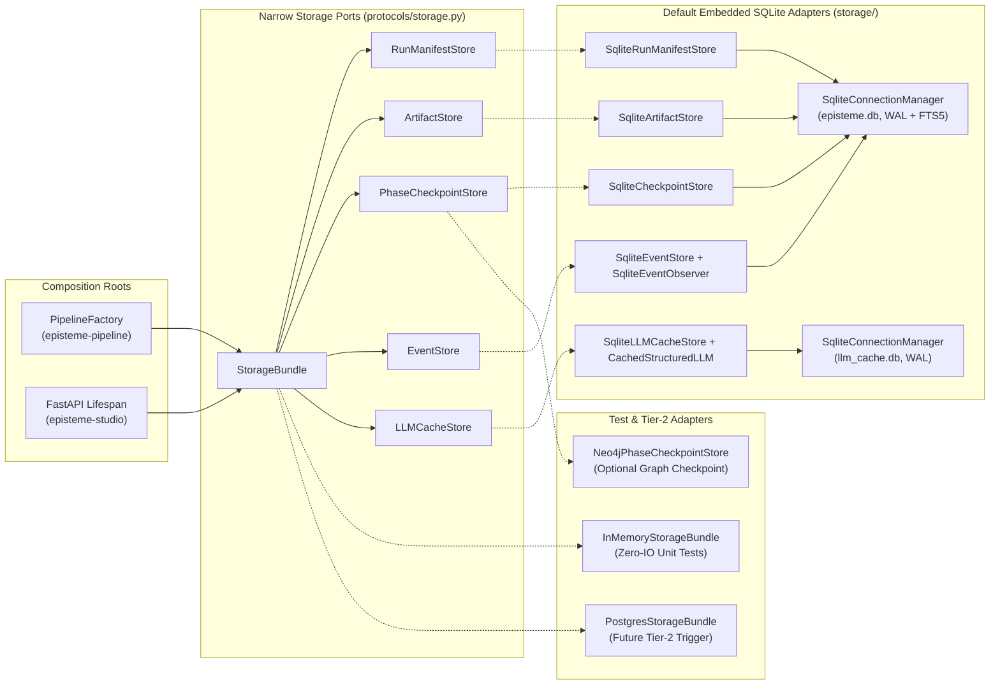
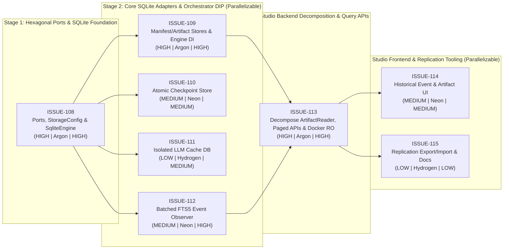

# 12 — Embedded SQLite Persistence, Hexagonal Storage Ports & Telemetry Indexing (`ISSUE-108` – `ISSUE-115`)

> **Architecture Decision Record**: [**ADR-0025: Embedded SQLite Default Persistence, Hexagonal Storage Ports, and Telemetry Indexing**](../../docs/adr/0025-embedded-sqlite-persistence-and-storage-ports.md)  
> **Directive**: `[NO LEGACY]` — Per [`AGENTS.md`](../../AGENTS.md), zero backward compatibility is required. Each increment in this backlog simultaneously delivers SQLite persistence/indexing **and** eliminates technical debt, concrete backend coupling, duplicate protocols, and `getattr`/`hasattr` violations cleanly.

---

## 1. Motivation: From 1–5 Pages to 100–500 Page Monographs

At **1–5 pages** (~200–500 artifacts and ~15 MB locally across all historical runs), flat JSON files + an in-memory Studio ring buffer work acceptably. When scaling to **100–500 page monographs** or dense intra-document runs (**20,000–80,000+ artifacts** and **50,000–200,000+ telemetry events** per run), the current persistence layer fails across four concrete dimensions even when Neo4j graph projection is enabled (since Neo4j holds only the latest projected graph—never run history/diffs, pass-$r$ refinement lineage, `EpistemicDeficitArtifact`s, rejected candidates, LLM cache, or telemetry):

1. **Volatile, Unsearchable Events**: Studio's [`EventBroker`](../../packages/episteme-studio/src/episteme_studio/runtime/broker.py) caps history at `deque(maxlen=10000)` in RAM, and [`worker.py`](../../packages/episteme-studio/src/episteme_studio/adapters/worker.py) never persists events locally. Early phases vanish mid-run on long monographs, everything disappears on restart, and `LogConsole.tsx` cannot filter or search historical runs.
2. **Severe Read Amplification in Studio**: [`ArtifactReader.list_runs()`](../../packages/episteme-studio/src/episteme_studio/adapters/artifact_reader.py) traverses `parent_run_id` chains and calls `json.loads()` on every single artifact file of every run on disk just to compute `size_bytes`; `list_artifacts(kind=...)` parses every artifact (including dense chunk embeddings) before filtering.
3. **$O(N^2)$ Checkpoint Write Amplification**: [`FileSystemCheckpointStore._save_phase_state()`](../../packages/episteme-pipeline/episteme_pipeline/artifacts/checkpoint_store.py) rewrites the entire checkpoint JSON file on every batch commit instead of appending/upserting incrementally.
4. **Non-Atomic Concurrent Cache Writes**: [`DiskCachedStructuredLLM`](../../packages/episteme-pipeline/episteme_pipeline/llm/cache.py) uses non-atomic `write_text()` under concurrent `asyncio` tasks with no backend protocol, hit/miss metrics, or LRU/TTL pruning.

---

## 2. Hexagonal Architecture Audit & Required Sustainable Refactors

While Episteme's domain logic (`phases/`, `refinement/`, `evaluation/`) already follows Hexagonal Architecture ([`design_patterns_and_standards.md`](../../docs/architecture/design_patterns_and_standards.md)), **the persistence & telemetry adapters leak concrete filesystem assumptions**. Replacing flat JSON files without fixing these seams would merely bake SQLite coupling into the orchestrator.

### Audit of Current Coupling vs. Clean Target Architecture

| Current Architectural / Clean-Code Defect | Exact Location | Required Sustainable Refactor (`[NO LEGACY]`) |
| :--- | :--- | :--- |
| **Bypassed & Incomplete `ArtifactStoreProtocol`** | [`protocols/artifact_store.py`](../../packages/episteme-pipeline/episteme_pipeline/protocols/artifact_store.py), [`pipeline.py`](../../packages/episteme-pipeline/episteme_pipeline/pipeline.py), [`execution_engine.py`](../../packages/episteme-pipeline/episteme_pipeline/runtime/execution_engine.py) | Consolidate all 5 storage ports (`RunManifestStore`, `ArtifactStore`, `PhaseCheckpointStore`, `EventStore`, `LLMCacheStore`) + `StorageBundle` into `episteme_pipeline/protocols/storage.py`. Remove concrete `JsonArtifactStore` / `JsonRunManifestStore` type hints in `Pipeline` and `ArtifactExecutionEngine`. |
| **Duplicate / Misplaced Checkpoint Contracts** | [`protocols/checkpoint_store.py`](../../packages/episteme-pipeline/episteme_pipeline/protocols/checkpoint_store.py) vs. [`protocols/graph_store.py`](../../packages/episteme-pipeline/episteme_pipeline/protocols/graph_store.py) (`PhaseCheckpointStore(GraphHandle)`) | Delete dead `protocols/checkpoint_store.py` (`CheckpointStoreProtocol`). Decouple `PhaseCheckpointStore` from `GraphHandle` (checkpoints are storage/execution state, not graph handles) and move its canonical protocol to `protocols/storage.py` (with re-export in `protocols/graph_store.py` only if needed for Neo4j handle composition). |
| **Zero `RunManifestStore` / `EventStore` / `LLMCacheStore` Ports** | [`runs/persistence.py`](../../packages/episteme-pipeline/episteme_pipeline/runs/persistence.py), [`llm/cache.py`](../../packages/episteme-pipeline/episteme_pipeline/llm/cache.py), [`events/observers.py`](../../packages/episteme-pipeline/episteme_pipeline/events/observers.py) | Define narrow protocols with batch/query/stats methods so SQLite, InMemory, and future PostgreSQL (`JSONB`) adapters are 100% interchangeable. |
| **`getattr` Reflection in Cache Wrapper** | [`llm/cache.py`](../../packages/episteme-pipeline/episteme_pipeline/llm/cache.py) (`getattr(base_llm, "base_llm", base_llm)`) | Replace `getattr` probing with an explicit `unwrap_base_llm()` / typed protocol contract per `AGENTS.md §2` & `design_patterns_and_standards.md §4.1`. |
| **Hardcoded Store Construction Outside Composition Root** | [`pipeline.py`](../../packages/episteme-pipeline/episteme_pipeline/pipeline.py), [`execution_engine.py`](../../packages/episteme-pipeline/episteme_pipeline/runtime/execution_engine.py), [`worker.py`](../../packages/episteme-studio/src/episteme_studio/adapters/worker.py), [`evaluation/pipelines.py`](../../packages/episteme-pipeline/episteme_pipeline/evaluation/pipelines.py) | Centralize wiring in `StorageFactory.from_config()` invoked at the composition root (`PipelineFactory` & Studio `lifespan.py`). Eliminate hardcoded `JsonRunManifestStore(".pipeline_runs")` in `worker.py`. |
| **1,349-Line Studio God-Adapter & Per-Request Instantiation** | [`episteme_studio/adapters/artifact_reader.py`](../../packages/episteme-studio/src/episteme_studio/adapters/artifact_reader.py), [`run_service.py`](../../packages/episteme-studio/src/episteme_studio/services/run_service.py), [`graph_service.py`](../../packages/episteme-studio/src/episteme_studio/services/graph_service.py), [`lifespan.py`](../../packages/episteme-studio/src/episteme_studio/lifespan.py) | Decompose `ArtifactReader` into focused adapters (`RunQueryAdapter`, `GraphProjectionAdapter`, `EventQueryAdapter`) injected with one shared `StorageBundle` managed in `lifespan.py` (removing `hasattr`/`getattr` in `lifespan.py` and `extra_*_dirs` scanning). |

### Target Hexagonal Storage Topology



---

## 3. Default SQLite Architecture & Schema Blueprint

### Dual-Database Split
- **`episteme.db`** (default `.pipeline_runs/episteme.db`): Authoritative research state (`runs`, `artifacts`, `events`, `events_fts`, `phase_checkpoints`, `checkpoint_triples`, `checkpoint_snapshots`, `schema_meta`).
- **`llm_cache.db`** (default `.pipeline_runs/llm_cache.db`): Disposable LLM prediction cache (`llm_cache`) isolated so heavy LLM extraction writes never contend with run/event commits and researchers can share or wipe compute caches independently.

### Core DDL Summary (`episteme.db` & `llm_cache.db`)

```sql
-- 1. Run Manifests (fast sidebar listing without scanning artifacts)
CREATE TABLE runs (
    run_id TEXT PRIMARY KEY,
    parent_run_id TEXT,
    status TEXT NOT NULL,
    schema_version TEXT,
    created_at TEXT NOT NULL,
    started_at TEXT,
    completed_at TEXT,
    refinement_pass INTEGER NOT NULL DEFAULT 0,
    artifact_count INTEGER NOT NULL DEFAULT 0,
    size_bytes INTEGER NOT NULL DEFAULT 0,
    artifact_counts_by_kind_json TEXT NOT NULL DEFAULT '{}',
    input_sources_json TEXT NOT NULL DEFAULT '[]',
    manifest_json TEXT NOT NULL
);
CREATE INDEX idx_runs_created ON runs(created_at DESC);
CREATE INDEX idx_runs_status_created ON runs(status, created_at DESC);
CREATE INDEX idx_runs_parent ON runs(parent_run_id);

-- 2. Artifacts (dense float32 embeddings isolated in nullable embedding_blob)
CREATE TABLE artifacts (
    run_id TEXT NOT NULL,
    artifact_id TEXT NOT NULL,
    identity_key TEXT,
    kind TEXT NOT NULL,
    phase_name TEXT NOT NULL,
    refinement_pass INTEGER NOT NULL DEFAULT 0,
    deficit_id TEXT,
    created_at TEXT NOT NULL,
    size_bytes INTEGER NOT NULL,
    payload_json TEXT NOT NULL,
    embedding_blob BLOB,
    PRIMARY KEY (run_id, artifact_id)
);
CREATE INDEX idx_artifacts_run_kind ON artifacts(run_id, kind);
CREATE INDEX idx_artifacts_run_phase ON artifacts(run_id, phase_name);
CREATE INDEX idx_artifacts_identity ON artifacts(run_id, identity_key, refinement_pass DESC);

-- 3. Intra-Phase Checkpoints (replaces O(N^2) FileSystemCheckpointStore rewrites)
CREATE TABLE phase_checkpoints (
    phase_key TEXT NOT NULL,
    item_key TEXT NOT NULL,
    status TEXT NOT NULL,
    error_message TEXT,
    run_id TEXT,
    updated_at TEXT NOT NULL,
    PRIMARY KEY (phase_key, item_key)
);
CREATE TABLE checkpoint_triples (
    id INTEGER PRIMARY KEY AUTOINCREMENT,
    phase_key TEXT NOT NULL,
    item_key TEXT NOT NULL,
    triple_json TEXT NOT NULL
);
CREATE INDEX idx_checkpoint_triples_phase ON checkpoint_triples(phase_key);
CREATE TABLE checkpoint_snapshots (
    phase_key TEXT NOT NULL,
    chunk_id TEXT NOT NULL,
    snapshot_json TEXT NOT NULL,
    updated_at TEXT NOT NULL,
    PRIMARY KEY (phase_key, chunk_id)
);

-- 4. Events + FTS5 Full-Text Index (supports 200k+ events/run with cursor pagination)
CREATE TABLE events (
    id INTEGER PRIMARY KEY AUTOINCREMENT,
    run_id TEXT NOT NULL,
    seq INTEGER NOT NULL,
    timestamp TEXT NOT NULL,
    phase TEXT,
    kind TEXT NOT NULL,
    level TEXT NOT NULL,
    component TEXT,
    entity_id TEXT,
    summary TEXT NOT NULL,
    payload_json TEXT NOT NULL,
    UNIQUE (run_id, seq)
);
CREATE INDEX idx_events_run_seq ON events(run_id, seq);
CREATE INDEX idx_events_run_phase_seq ON events(run_id, phase, seq);
CREATE INDEX idx_events_run_kind_seq ON events(run_id, kind, seq);
CREATE INDEX idx_events_run_level_seq ON events(run_id, level, seq);

CREATE VIRTUAL TABLE events_fts USING fts5(
    summary, kind, phase, entity_id, payload_json,
    content='events', content_rowid='id', tokenize='unicode61'
);

-- 5. Isolated LLM Response Cache (stored in llm_cache.db)
CREATE TABLE llm_cache (
    cache_key TEXT PRIMARY KEY,
    cache_version INTEGER NOT NULL,
    cache_prefix TEXT NOT NULL,
    method_fp TEXT NOT NULL,
    output_schema TEXT NOT NULL,
    payload_json TEXT NOT NULL,
    created_at TEXT NOT NULL,
    last_accessed_at TEXT NOT NULL,
    hit_count INTEGER NOT NULL DEFAULT 0,
    size_bytes INTEGER NOT NULL
);
CREATE INDEX idx_llm_cache_lru ON llm_cache(last_accessed_at);
```

### Mandatory Operational Invariants
- **Pragmas**: `journal_mode=WAL`, `synchronous=NORMAL`, `busy_timeout=10000`, `foreign_keys=ON`, `temp_store=MEMORY`, `cache_size=-65536`, `PRAGMA user_version` schema migrations.
- **Read-Only Docker Mode (`--read-only --demo`)**: Open via SQLite URI `file:<path>?mode=ro&immutable=1` so read-only containers never attempt `-wal`/`-shm` creation.
- **No `aiosqlite` Loop Coupling**: Use Python stdlib `sqlite3` wrapped behind `SqliteConnectionManager` + `asyncio.to_thread()` to stay 100% compatible with `nest_asyncio` and uvicorn/multiprocessing (`SPEC.md §4` D-05).

---

## 4. Complexity, Model & Reasoning Guide

| Dimension | Levels | Selection Criteria |
| :--- | :--- | :--- |
| **Complexity** | `LOW` / `MEDIUM` / `HIGH` | Scope of cross-package changes, concurrency/transaction semantics, schema design, and API/UI coupling. |
| **Model** | `Hydrogen` / `Neon` / `Argon` | **Hydrogen**: focused single-module / CLI / docs tasks with tight specs. **Neon**: multi-file adapter, async queue, or frontend/API integration. **Argon**: foundational Hexagonal ports, schema invariants, orchestrator & god-class refactoring. |
| **Reasoning** | `LOW` / `MEDIUM` / `HIGH` | Required depth of architectural trade-off, concurrency, and failure-mode verification. |

---

## 5. Prioritized Sub-Issue Roadmap

| Order | Issue ID | Title | Target Package(s) | Depends On | Complexity | Model | Reasoning | Status |
| :---: | :--- | :--- | :--- | :--- | :---: | :---: | :---: | :--- |
| **1** | [**ISSUE-108**](ISSUE-108-hexagonal-storage-ports-and-sqlite-foundation.md) | **Hexagonal Storage Ports, `StorageConfig`, and SQLite Engine Foundation** | `episteme-pipeline` | — | **HIGH** | **Argon** | **HIGH** | `Open` |
| **2** | [**ISSUE-109**](ISSUE-109-sqlite-manifest-artifact-store-and-engine-wiring.md) | **SQLite Run Manifest & Indexed Artifact Store + Orchestrator DIP Refactor** | `episteme-pipeline` | `ISSUE-108` | **HIGH** | **Argon** | **HIGH** | `Open` |
| **3** | [**ISSUE-110**](ISSUE-110-sqlite-checkpoint-store-and-wal-crash-recovery.md) | **SQLite Atomic Checkpoint Store & Elimination of $O(N^2)$ Full-File Rewrites** | `episteme-pipeline` | `ISSUE-108` | **MEDIUM** | **Neon** | **MEDIUM** | `Open` |
| **4** | [**ISSUE-111**](ISSUE-111-sqlite-llm-cache-and-decoupled-cache-decorator.md) | **Decoupled `LLMCacheStore` Port & Isolated SQLite LLM Cache (`llm_cache.db`)** | `episteme-pipeline` | `ISSUE-108` | **LOW** | **Hydrogen** | **MEDIUM** | `Open` |
| **5** | [**ISSUE-112**](ISSUE-112-batched-sqlite-event-store-and-non-blocking-observer.md) | **Persistent Batched SQLite Event Store (`SqliteEventObserver`) with FTS5 Search** | `episteme-pipeline`, `episteme-studio` | `ISSUE-108` | **MEDIUM** | **Neon** | **HIGH** | `Open` |
| **6** | [**ISSUE-113**](ISSUE-113-studio-backend-storage-integration-and-query-apis.md) | **Studio Backend Adapter Decomposition, Indexed Query APIs & Docker Read-Only Hardening** | `episteme-studio` (BE) | `ISSUE-109`, `ISSUE-112` | **HIGH** | **Argon** | **HIGH** | `Open` |
| **7** | [**ISSUE-114**](ISSUE-114-studio-frontend-event-and-artifact-explorer.md) | **Studio Frontend Historical Event Explorer, SSE Cursor Handoff & Paginated Artifact Views** | `episteme-studio` (FE) | `ISSUE-113` | **MEDIUM** | **Neon** | **MEDIUM** | `Open` |
| **8** | [**ISSUE-115**](ISSUE-115-portable-replication-export-and-docs-sync.md) | **Portable Research Replication Export/Import (`JSON` / Per-Run `.db`) & Documentation Sync** | `episteme-pipeline`, `episteme-studio`, `docs` | `ISSUE-109`, `ISSUE-112`, `ISSUE-113` | **LOW** | **Hydrogen** | **LOW** | `Open` |

### Execution Order & Parallelization Graph



---

## 6. Cross-Cutting Quality & Verification Mandates

Every sub-issue (`ISSUE-108` through `ISSUE-115`) must enforce:
1. **Zero `getattr` / `hasattr`**: Strictly forbidden across all new and refactored storage/lifespan/cache code ([`AGENTS.md §2`](../../AGENTS.md)).
2. **NumPy-Style Docstrings**: Mandatory on every new module, class, protocol, function, and method.
3. **Deterministic Non-LLM Tests**: Parameterized contract suites executing identically against `InMemoryStorageBundle` and `SqliteStorageBundle` (`:memory:` / `tmp_path`) via `rtk uv run pytest`, plus synthetic 100–500 page scale benchmarks (e.g., 25,000 artifacts and 100,000 events).
4. **Clean Removal of Superseded Default Code (`[NO LEGACY]`)**: Once each SQLite adapter and protocol seam lands, delete superseded flat-file default stores and legacy `ArtifactReader` monolithic methods in the same increment rather than keeping dual write paths alive.
