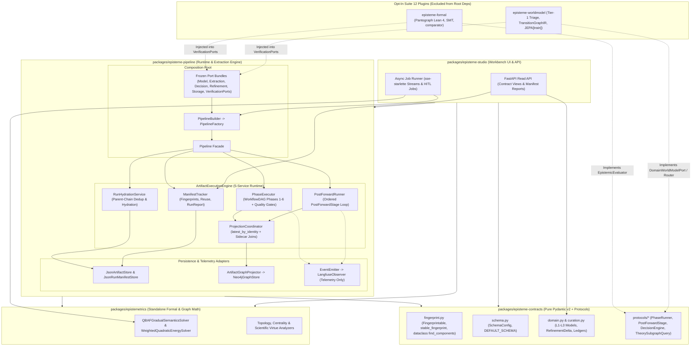
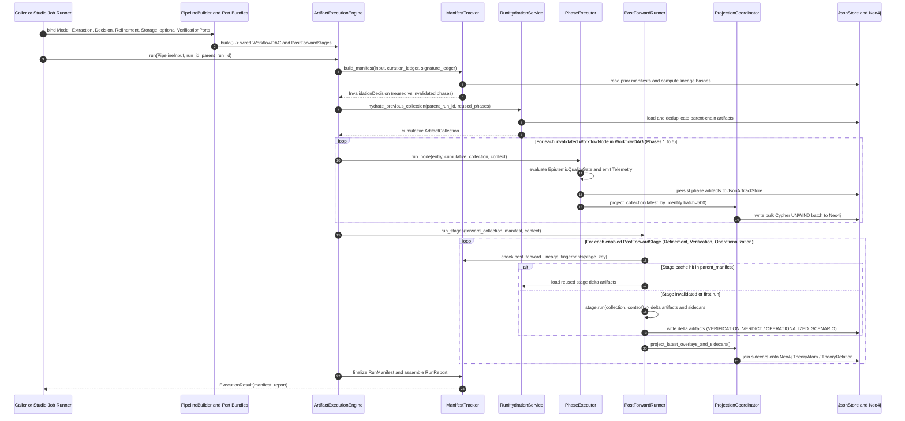
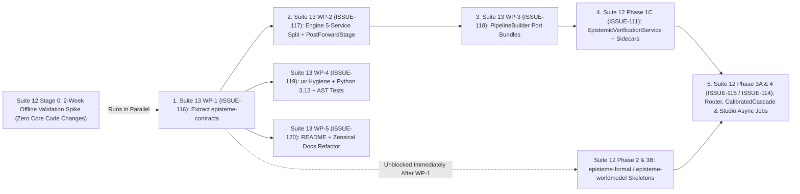

# Component, Module & Port Interactivity Architecture

- **Governing Index:** [Suite Index](index.md)
- **Governing ADR:** [ADR-0026 Proposal](ADR-0026-PROPOSAL-contract-first-workspace-modular-runtime-and-systems-first-framing.md)
- **Execution Plan:** [Execution Plan](EXECUTION-PLAN.md)
- **Downstream Neuro-Symbolic Plugins:** [Suite 12 Index](../12-neuro-symbolic-world-models-and-lean/index.md)

---

## 1. Static Component, Module & Hexagonal Port Interactivity (`flowchart TD`)

All workspace runtime packages (`episteme-pipeline`, `episteme-studio`, and opt-in Suite 12 plugins `episteme-formal` and `episteme-worldmodel`) depend strictly **downward** on pure `packages/episteme-contracts/`. Neither `episteme-contracts` nor `episteme-pipeline` imports optional symbolic or ML/GPU plugin code.

---

## 2. End-to-End Runtime Execution & Dataflow Interactivity (`sequenceDiagram`)

Trace of a single execution across `PipelineBuilder`, the decomposed `ArtifactExecutionEngine` services, ordered `PostForwardStage` plugins, and bulk persistence/projection:

---

## 3. Module Interaction Matrix & Architectural Invariants

| Caller Module | Target Port / Service | Interaction Mode | Enforced Architectural Guardrail |
| :--- | :--- | :--- | :--- |
| **`episteme-contracts`** | Python stdlib + `pydantic>=2.0` | Pure data models & ABC/Protocols | **Zero upward imports** (`test_package_boundaries.py` AST check); owns `stable_fingerprint` and dataclass-safe `find_components()`. |
| **`PipelineBuilder`** | Frozen Port Bundles (`ModelPorts`..`VerificationPorts`) | Constructor / builder DI | Replaces 23-kwarg `Pipeline.for_task` and reflective scraping in `PipelineFactory.build_standalone_refinement`. |
| **`PhaseExecutor`** | `PhaseRunner` & `EpistemicQualityGate` | Async batch over `EpistemicStateView` | Passes immutable views; emits telemetry only via `EventEmitter` (never control flow). |
| **`PostForwardRunner`** | Ordered `PostForwardStage` sequence | Async artifact-to-artifact transform | Uniform lineage hashing in `RunManifest.post_forward_lineage_fingerprints[stage_key]`; zero special-case `_run_refinement_stage()` code. |
| **`ProjectionCoordinator`** | `ArtifactGraphProjector` (`Neo4j`) | Batched `latest_by_identity` overlays | Sidecar `ArtifactKind.VERIFICATION_VERDICT` envelopes join at projection time without churning `TheoryAtomArtifact` IDs. |
| **`ManifestTracker`** | `Fingerprintable` components + ledgers | Synchronous deterministic SHA-256 | Traverses dataclass bundles; **explicitly ignores write-only sinks** (`VerificationTrajectorySink`) so replay writes never bust caches. |
| **`episteme-studio`** | `episteme-contracts` + `ManifestTracker` / `Async Job Runner` | Sync reads / `sse-starlette` async jobs | Read endpoints use pure contract models; multi-second refinement/Lean verification never blocks FastAPI event loops. |

---

## 4. Recommended Execution Sequencing: Suite 13 $\to$ Suite 12 (`flowchart LR`)

Always build **Suite 13 first**, because Suite 12 plugins import `episteme-contracts`, attach through `PostForwardStage`, and inject into `PipelineBuilder` port bundles. One zero-code fast-track exists: Suite 12's **Stage 0 validation spike** runs offline against existing `TheoryNet` JSON artifacts in parallel with `WP-1`.

