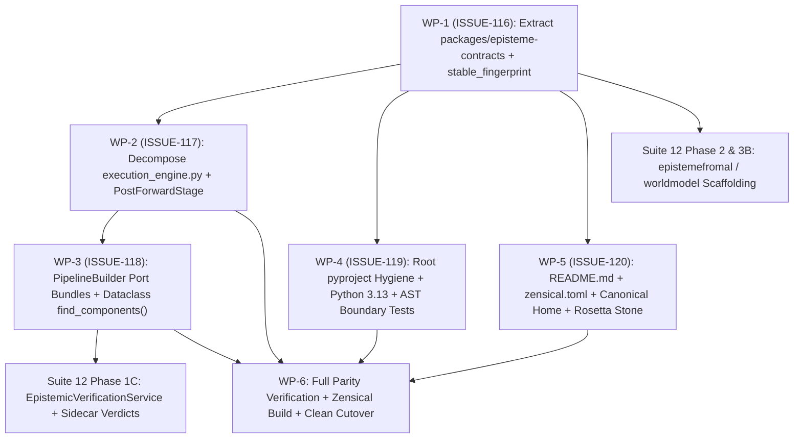

# Execution Plan: Core Platform Refactoring & Systems-First Documentation (`WP-1` – `WP-6`)

- **Governing Index:** [Suite Index](index.md)
- **Governing ADR:** [ADR-0026 Proposal](ADR-0026-PROPOSAL-contract-first-workspace-modular-runtime-and-systems-first-framing.md)
- **Component & Module Interactivity:** [COMPONENT-INTERACTIVITY.md](COMPONENT-INTERACTIVITY.md)
- **Downstream Consumers:** [Suite 12 Execution Plan](../12-neuro-symbolic-world-models-and-lean/EXECUTION-PLAN.md)
- **Policy:** Direct cutover with zero backward-compatibility shims (`AGENTS.md` §2 `[NO LEGACY]`)

---

## 1. Execution Critical Path & Parallel Workstreams

**Sequencing (`Suite 13 -> Suite 12`):** Execute **Suite 13 first (`WP-1` $\to$ `WP-2`/`WP-3` + `WP-4`/`WP-5`)** before implementing Suite 12 features (`ISSUE-111`–`ISSUE-115`), so neuro-symbolic verification and world-model plugins cleanly attach to `episteme-contracts`, `PostForwardStage`, and `PipelineBuilder`. *(Exception: Suite 12's zero-refactor `Stage 0` offline validation spike can run in parallel with `WP-1`, and once `WP-1` finishes, standalone `episteme-formal`/`episteme-worldmodel` scaffolding is unblocked alongside `WP-2`–`WP-5`.)*

`WP-1` (`episteme-contracts` extraction) is the sole sequential bottleneck on Day 1. Once `WP-1` lands, **orchestrator decomposition (`WP-2`)**, **packaging/AST guardrails (`WP-4`)**, **documentation/README restructuring (`WP-5`)**, and **Suite 12 symbolic/world-model package scaffolding** can proceed largely in parallel.



---

## 2. Work Package Specifications

### `WP-1` — Extract `packages/episteme-contracts/` ([ISSUE-116](ISSUE-116-extract-episteme-contracts-and-workspace-dependency-inversion.md))
- **Goal:** Establish the zero-heavy-dependency foundation at the bottom of the workspace DAG.
- **Concrete Code Moves:**
  1. Scaffold `packages/episteme-contracts/pyproject.toml` (`requires-python = ">=3.13"`, `dependencies = ["pydantic>=2.0"]`) using `src/episteme_contracts/` layout and register in root [`pyproject.toml`](../../pyproject.toml).
  2. Move pure modules into `episteme_contracts/`:
     - `fingerprint.py`: `Fingerprintable`, `is_component`, `find_components`, and `stable_fingerprint` (eliminating `CandidatePair.key`'s upward import in [`domain.py#L1037`](../../packages/episteme-pipeline/episteme_pipeline/contracts/domain.py#L1037)).
     - `schema.py`: `SchemaConfig`, `DEFAULT_SCHEMA`, taxonomy enums (`COMPONENT_PARTITIONS`, `EPISTEMIC_STATUSES`, `ScopeType`, `IntensionalMode`).
     - `domain.py`: `L1Document`, `L1Chunk`, `L2Entity`, `L2Triple`, `EntityConception`, `TheoryAtom`, `TheoryRelation`, `TheoryNet`, `EpistemicDeficit`, `EpistemicDeficitKind`, `RefinementDelta`, `CandidatePair`, `Measurement`, `TenabilityResult`, `SubGraph`, `SearchResult`.
     - `curation.py`: `RelationOverride`, `EpistemicCurationLedger` (split cleanly out of [`phase_contracts.py`](../../packages/episteme-pipeline/episteme_pipeline/contracts/phase_contracts.py#L105)).
     - `protocols/`: pure read-only ports (`PhaseRunner`, `DecisionEngine`, `ModalStrengthResolver`, `EpistemicQualityGate`, `TheorySubgraphQuery`) free of `artifacts/execution.py` imports.
  3. Update imports across `episteme-pipeline` and `episteme-studio` directly—leaving **no** compatibility aliases or circular re-exports.
- **Verification Gate:** `python -c "import episteme_contracts"` passes in a fresh venv with only `pydantic`; `rtk uv run pytest` passes across all existing suites.

---

### `WP-2` — Decompose `ArtifactExecutionEngine` & Add `PostForwardStage` ([ISSUE-117](ISSUE-117-execution-engine-decomposition-and-post-forward-stage-port.md))
- **Goal:** Split the 2,291-line [`execution_engine.py`](../../packages/episteme-pipeline/episteme_pipeline/runtime/execution_engine.py) into five single-responsibility modules and remove `_run_refinement_stage()` special-casing.
- **Concrete Deliverables:**
  1. Create cohesive services under `packages/episteme-pipeline/episteme_pipeline/runtime/`:
     - `manifest_tracker.py` (`ManifestTracker`): manifest construction, config/method/ledger lineage hashes, reuse invalidation decisions, `RunReport` assembly.
     - `hydration_service.py` (`RunHydrationService`): parent-run chain walking, deterministic envelope deduplication, phase-input collection hydration.
     - `phase_executor.py` (`PhaseExecutor`): topological `WorkflowDAG` traversal, inter-phase quality gates, checkpoint clearing, scoped lifecycle telemetry.
     - `projection_coordinator.py` (`ProjectionCoordinator`): `ArtifactCollection.latest_by_identity` resolution and batched `ArtifactGraphProjector` writes.
     - `post_forward_runner.py` (`PostForwardRunner`): generic loop executing any ordered sequence of `PostForwardStage` implementations.
  2. Replace `RunManifest.refinement_lineage_fingerprint` with `RunManifest.post_forward_lineage_fingerprints: dict[str, str]`.
  3. Wrap `ClosedLoopRefinementCoordinator` as `ClosedLoopRefinementStage` implementing `PostForwardStage` (`stage_key = "refinement"`).
  4. Reduce `ArtifactExecutionEngine` to a slim facade delegating cleanly to the five services.
- **Verification Gate:** Byte-for-byte parity on existing DAG reuse, `run_from_phase`, `resume_from_run`, `diff_artifacts`, and closed-loop refinement integration tests.

---

### `WP-3` — `PipelineBuilder` Typed Port Bundles & Dataclass-Safe Discovery ([ISSUE-118](ISSUE-118-pipeline-builder-typed-port-bundles-and-component-discovery.md))
- **Goal:** Eliminate the 23-argument [`Pipeline.for_task`](../../packages/episteme-pipeline/episteme_pipeline/pipeline.py#L239-L264) signature and reflective scraping in [`build_standalone_refinement`](../../packages/episteme-pipeline/episteme_pipeline/runtime/pipeline_factory.py#L353-L384).
- **Concrete Deliverables:**
  1. Update `find_components()` in `episteme_contracts/fingerprint.py` to support `dataclasses.is_dataclass(root)` + `dataclasses.fields(root)` so `@dataclass(slots=True)` objects never fall through `vars(root)` with `TypeError` and return `{}`.
  2. Define frozen port bundles (`ModelPorts`, `ExtractionPorts`, `ArgumentMiningPorts`, `DecisionPorts`, `RefinementPorts`, `StoragePorts`, plus extension hook for `VerificationPorts`).
  3. Implement `PipelineBuilder` and `PipelineFactory.from_bundles(...)`; migrate all `episteme-pipeline` tests, examples, and `episteme-studio` callers off the 23-kwarg signature.
- **Verification Gate:** Zero occurrences of `find_components()` returning `{}` on slotted dataclasses; full test suite passes.

---

### `WP-4` — Monorepo `uv` Packaging Hygiene & Boundary Fitness Tests ([ISSUE-119](ISSUE-119-monorepo-uv-packaging-hygiene-and-plugin-isolation.md))
- **Goal:** Lock down workspace packaging consistency and enforce clean hexagonal boundaries automatically in CI.
- **Concrete Deliverables:**
  1. Unify `requires-python = ">=3.13"` across root [`pyproject.toml`](../../pyproject.toml), [`epistemetrics/pyproject.toml`](../../packages/epistemetrics/pyproject.toml#L13), and [`episteme-studio/pyproject.toml`](../../packages/episteme-studio/pyproject.toml#L10).
  2. Ensure optional/future packages (`episteme-formal`, `episteme-worldmodel`) are workspace members omitted from mandatory root `dependencies` and configured with explicit extras (`[formal]`, `worldmodel[train]`).
  3. Audit `episteme-studio` read endpoints to import pure response/domain models from `episteme_contracts` directly rather than pulling runtime classes where unnecessary.
  4. Add workspace architecture fitness tests:
     - `test_package_boundaries.py` (AST verification ensuring `episteme_contracts` never imports `episteme_pipeline` / DB / ML libs, and `episteme_pipeline` contains zero imports from `episteme_formal` or `episteme_worldmodel`),
     - `test_no_getattr_dispatch.py` (guarding `AGENTS.md` §2 zero-`getattr` policy across new/refactored modules).
- **Verification Gate:** `rtk uv run pytest` passes offline in default dev environment; AST architecture tests enforce zero regressions.

---

### `WP-5` — Systems-First `README.md`, Docs & Naming Restructuring ([ISSUE-120](ISSUE-120-documentation-and-readme-systems-first-restructuring.md))
- **Goal:** Re-anchor Episteme's public identity and onboarding documentation on **Language & Graph Engineering**, fix factual drift, and quarantine deep philosophy of science cleanly into Tier-2 conceptual/evaluation pillars.
- **Concrete Deliverables:**
  1. **Consolidate Home Pages:** Merge [`docs/index.md`](../../docs/index.md) and [`docs/overview.md`](../../docs/overview.md) into a single canonical home page referenced by [`zensical.toml`](../../zensical.toml#L24), eliminating stale counts ("5-phase", "18 ADRs", `>=3.12`) and dead `../paper/index.md` links.
  2. **Rewrite [`README.md`](../../README.md):** Lead with the 8-stage + post-forward **Language-to-Argument-Graph Engine** architecture, updated package matrix (`episteme-contracts`, `episteme-pipeline`, `epistemetrics`, `episteme-studio`, plus opt-in plugins), `PipelineBuilder` snippet, and a concise **Systems $\leftrightarrow$ Epistemology Rosetta Stone** showing why Episteme's Theory-Graph abstraction beats flat RAG/KGs.
  3. **Restructure [`zensical.toml`](../../zensical.toml):** Reorganize navigation into 5 crisp pillars (`Getting Started`, `Language & Pipeline Engineering`, `Packages & API Reference`, `Architecture & ADRs`, `Theory & Epistemetrics Research`), adding package-scoped reference indexes (`contracts`, `pipeline`, `epistemetrics`, `studio`).
  4. **Update Runtime Docstrings & Guides:** Reframe core runtime docs ([`docs/architecture/overview.md`](../../docs/architecture/overview.md)) around CS/systems primitives while preserving exact Layer-3 mathematical/epistemic terminology in `docs/concepts/` and `epistemetrics`.
- **Verification Gate:** `rtk uv run zensical build` builds cleanly with zero broken internal links; all phase/package/ADR counts verified against disk.

---

### `WP-6` — Parity Sign-Off & Cutover Validation
- **Execution Command:** Run full workspace pytest + Ruff + Zensical build + AST boundary suite:
  ```bash
  rtk uv run pytest
  rtk uv run ruff check .
  rtk uv run zensical build --strict
  ```
- **Exit Criteria:** Zero test failures, zero Ruff warnings, clean Zensical docs build, and green downstream readiness for Suite 12 `Phase 1C` / `Phase 2` / `Phase 3B`.

---

## 3. Codebase Pitfalls & Verification Matrix

| Audit Finding | Location | Guardrail During Execution |
| :--- | :--- | :--- |
| **`CandidatePair.key` upward import** | [`domain.py#L1037`](../../packages/episteme-pipeline/episteme_pipeline/contracts/domain.py#L1037) | Relocate `stable_fingerprint` first inside `WP-1` before extracting `domain.py`. |
| **`find_components()` fails on slotted dataclasses** | [`fingerprint.py#L120-L125`](../../packages/episteme-pipeline/episteme_pipeline/protocols/fingerprint.py#L120-L125) | Patch `find_components()` for `dataclasses.fields()` *before* switching `PipelineFactory` to port-bundle dataclasses in `WP-3`. |
| **Refinement protocol imports runtime artifacts** | [`refinement.py#L16-L23`](../../packages/episteme-pipeline/episteme_pipeline/protocols/refinement.py#L16-L23) | Keep `ArtifactCollection` / `ArtifactExecutionContext` out of `episteme-contracts`; expose narrow read-only query protocols instead. |
| **Docs refer to `../paper/index.md` & wrong phase counts** | [`docs/overview.md#L59`](../../docs/overview.md#L59), [`README.md#L92`](../../README.md#L92) | Remove dead links and verify phase/ADR counts dynamically before running `zensical build`. |
