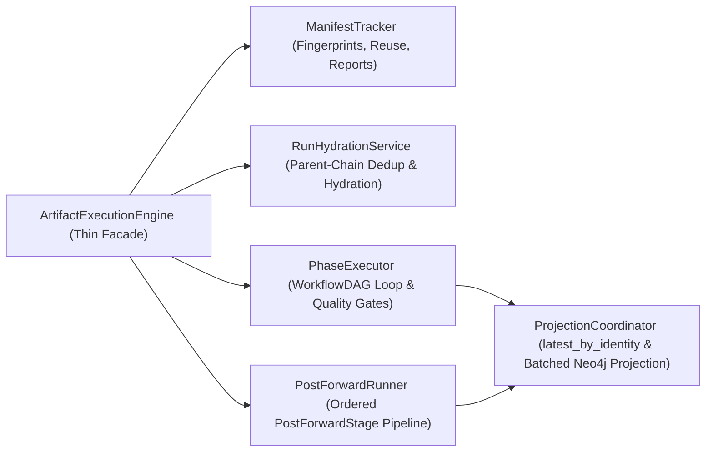

# [ISSUE-117] Decompose `ArtifactExecutionEngine` & Introduce Generic `PostForwardStage` Port

| Metadata | Details |
| :--- | :--- |
| **Issue ID** | `ISSUE-117` |
| **Domain / Category** | `13-Core Architecture & Docs Refactoring` (Runtime Orchestration, SOLID Single Responsibility) |
| **Target Package(s)** | `packages/episteme-pipeline` (`runtime/`, `runs/`, `artifacts/`) |
| **Priority** | **High** |
| **Status** | `Proposal` |
| **Roadmap Horizon** | Horizon 1 & 2 |
| **Prerequisites** | [ISSUE-116](ISSUE-116-extract-episteme-contracts-and-workspace-dependency-inversion.md) |
| **Governing ADR & Plan** | [ADR-0026 Proposal](ADR-0026-PROPOSAL-contract-first-workspace-modular-runtime-and-systems-first-framing.md) \| [Execution Plan (`WP-2`)](EXECUTION-PLAN.md) |

---

## 1. Architectural Problem Statement

[`packages/episteme-pipeline/episteme_pipeline/runtime/execution_engine.py`](../../packages/episteme-pipeline/episteme_pipeline/runtime/execution_engine.py) has grown to **2,291 lines**, violating the Single Responsibility Principle (SOLID) across five unrelated concerns:

1. **Run Manifest & Cache Reuse Logic:** `build_manifest`, `choose_reuse_source`, `prompt_fingerprints`, `method_fingerprints`, `phase_config_fingerprints`, and `get_run_report` ([`L245–L599`](../../packages/episteme-pipeline/episteme_pipeline/runtime/execution_engine.py#L245-L599), [`L2119–L2291`](../../packages/episteme-pipeline/episteme_pipeline/runtime/execution_engine.py#L2119-L2291)).
2. **Parent-Chain Artifact Hydration:** `_collect_parent_chain_artifacts`, `_dedup_chain_artifacts`, `hydrate_previous_collection`, `reused_artifact_entries` ([`L1871–L2089`](../../packages/episteme-pipeline/episteme_pipeline/runtime/execution_engine.py#L1871-L2089)).
3. **Topological Forward Phase Loop & Quality Gates:** Checkpoint invalidation, phase telemetry scope, `entry.runner.run()`, quality-gate circuit breaking ([`L1050–L1248`](../../packages/episteme-pipeline/episteme_pipeline/runtime/execution_engine.py#L1050-L1248)).
4. **Graph Projection Dispatch:** Inline `self.projector.project_collection(..., batch_size=500)` calls duplicated in both the forward loop and refinement handling.
5. **Hardcoded Post-Forward Refinement Stage (`_run_refinement_stage`):** Lines [`L1249–L1263`](../../packages/episteme-pipeline/episteme_pipeline/runtime/execution_engine.py#L1249-L1263) and [`L1329–L1560`](../../packages/episteme-pipeline/episteme_pipeline/runtime/execution_engine.py#L1329-L1560) hardcode `"refinement"` reuse hydration, `manifest.refinement_lineage_fingerprint`, and projection—meaning every new post-forward capability (such as formal verification or empirical operationalization in Suite 12) would otherwise copy-paste another 230-line special case into the engine.

---

## 2. Five-Service Decomposition + Uniform `PostForwardRunner`

Split `ArtifactExecutionEngine` into a thin coordinator over five single-responsibility modules inside `packages/episteme-pipeline/episteme_pipeline/runtime/`:



| Module & Service Class | Owned Responsibilities | Target File Size |
| :--- | :--- | :--- |
| `manifest_tracker.py` — `ManifestTracker` | Prompt/method/config/ledger fingerprinting, `build_manifest`, DAG reuse invalidation, `RunManifest.post_forward_lineage_fingerprints`, `get_run_report`, `diff_artifacts`. | ~350 lines |
| `hydration_service.py` — `RunHydrationService` | Walking `parent_run_id` chains, deterministic `(run_id, refinement_pass, ordinal)` deduplication, loading prior `ArtifactCollection`s. | ~250 lines |
| `phase_executor.py` — `PhaseExecutor` | Executing `WorkflowDAG` forward nodes, phase checkpoint clearing, quality-gate validation, and symmetric phase telemetry events. | ~300 lines |
| `projection_coordinator.py` — `ProjectionCoordinator` | Filtering `latest_by_identity` overlays and projecting incremental/batch collections (including sidecar projections) into `ArtifactGraphProjector`. | ~180 lines |
| `post_forward_runner.py` — `PostForwardRunner` | Computing lineage hashes per `stage.stage_key`, checking prior-run reuse hydration, running enabled `PostForwardStage`s, persisting delta artifacts, and delegating projection. | ~260 lines |

---

## 3. Generic `PostForwardStage` Protocol & Manifest Lineage Generalization

### 3.1 `PostForwardStage` Interface

```python
from __future__ import annotations

from typing import TYPE_CHECKING, Protocol, runtime_checkable

from episteme_contracts.fingerprint import Fingerprintable

if TYPE_CHECKING:
    from episteme_pipeline.artifacts.execution import (
        ArtifactCollection,
        ArtifactExecutionContext,
    )
    from episteme_pipeline.config import PipelineConfig


@runtime_checkable
class PostForwardStage(Fingerprintable, Protocol):
    """Uniform stage contract for post-forward transformations over ``ArtifactCollection``.

    Replaces bespoke ``_run_refinement_stage()`` plumbing in
    :class:`ArtifactExecutionEngine` so hermeneutic refinement, formal
    verification, empirical operationalization, or custom analysis stages share
    identical caching, hydration, persistence, and projection guarantees.
    """

    @property
    def stage_key(self) -> str:
        """Return unique manifest key identifying this stage (e.g., ``'refinement'``)."""
        ...

    def is_enabled(self, config: PipelineConfig) -> bool:
        """Return True when this stage is active for ``config``."""
        ...

    async def run(
        self,
        collection: ArtifactCollection,
        context: ArtifactExecutionContext,
    ) -> ArtifactCollection:
        """Execute post-forward logic on ``collection`` and return the updated collection."""
        ...
```

### 3.2 `RunManifest` Lineage Map Refactor (`runs/models.py`)
Replace `RunManifest.refinement_lineage_fingerprint: str | None` with:
- `post_forward_lineage_fingerprints: dict[str, str]` — maps each enabled `stage.stage_key` (e.g., `"refinement"`, `"formal_verification"`, `"empirical_operationalization"`) to its deterministic lineage SHA-256 computed uniformly by `PostForwardRunner` + `ManifestTracker`.
- Wrap `ClosedLoopRefinementCoordinator` cleanly inside `ClosedLoopRefinementStage` (`stage_key = "refinement"`, `is_enabled` checks `config.refinement.max_refinement_cycles > 0`).

---

## 4. Acceptance Criteria

- [ ] Extract `ManifestTracker`, `RunHydrationService`, `PhaseExecutor`, `ProjectionCoordinator`, and `PostForwardRunner` cleanly under `episteme_pipeline/runtime/` with complete NumPy-style docstrings.
- [ ] Replace `ArtifactExecutionEngine._run_refinement_stage()` and `RunManifest.refinement_lineage_fingerprint` with `PostForwardStage` and `RunManifest.post_forward_lineage_fingerprints` (`[NO LEGACY]`).
- [ ] Shrink `execution_engine.py` into a clean facade preserving identical external behavior for `run()`, `run_from_phase()`, `resume_from_run()`, `diff_artifacts()`, `get_run_report()`, and `get_run_artifacts()`.
- [ ] Verify zero regressions across all existing caching, parent-chain hydration, quality-gate, and closed-loop refinement tests (`rtk uv run pytest`).
