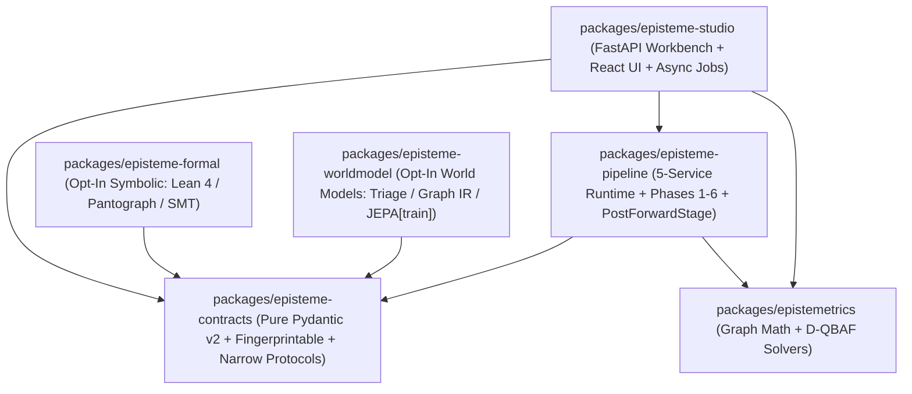

# 13 — Core Architecture, Workspace Dependency Inversion & Systems-First Documentation Refactoring

This directory specifies the **foundational platform refactoring** transforming Episteme from a single-package, epistemology-frontloaded pipeline monolith into a **contract-first, modular Language & Graph Engineering platform** (`episteme-contracts`, `episteme-pipeline`, `epistemetrics`, `episteme-studio`, plus opt-in `episteme-formal` and `episteme-worldmodel`).

It serves as the architectural and structural prerequisite for Horizon 2–3 neuro-symbolic capabilities ([Suite 12](../12-neuro-symbolic-world-models-and-lean/index.md)) and establishes a clear **Systems-First Core, Epistemology-Scoped Domain** framing across code, runtime abstractions, `README.md`, and Zensical documentation.

---

## 1. Strategic Architectural Shift

Episteme has outgrown its single-engine origin. While its runtime already implements sophisticated software engineering primitives (content-addressed artifact DAGs, parent-run hydration, conformal dual-process cascades, constrained decoding, and closed-loop post-forward recovery), four structural debts now block modularity and contributor clarity:

1. **Inverted Workspace Dependencies:** [`packages/episteme-pipeline/pyproject.toml`](../../packages/episteme-pipeline/pyproject.toml#L13-L43) bundles pure Pydantic domain models and `Protocol` ports alongside heavy runtime dependencies (`neo4j`, `mteb`, `ogb`, `sentence-transformers`, `langfuse`, and 8 `llama-index-*` libraries), while [`domain.py`](../../packages/episteme-pipeline/episteme_pipeline/contracts/domain.py#L1037) imports `stable_fingerprint` upward from `runs/fingerprints.py`. Extracting **`packages/episteme-contracts/`** fixes this inversion.
2. **2,291-Line Orchestrator & Hardcoded Stage Paths:** [`execution_engine.py`](../../packages/episteme-pipeline/episteme_pipeline/runtime/execution_engine.py) combines manifest construction, parent-chain hydration, DAG execution, quality gates, Neo4j projection, and a 230-line hardcoded `_run_refinement_stage()` branch. Splitting it into 5 single-responsibility services behind a generic **`PostForwardStage`** protocol eliminates structural duplication.
3. **23-Parameter Composition Root & Dataclass Blindspot:** [`Pipeline.for_task`](../../packages/episteme-pipeline/episteme_pipeline/pipeline.py#L239-L264) accepts 23 keyword arguments, [`build_standalone_refinement`](../../packages/episteme-pipeline/episteme_pipeline/runtime/pipeline_factory.py#L353-L384) scrapes phase runners reflectively, and [`find_components()`](../../packages/episteme-pipeline/episteme_pipeline/protocols/fingerprint.py#L120-L125) fails silently on `@dataclass(slots=True)` objects because `vars(root)` raises `TypeError`.
4. **Epistemology-First Documentation & Onboarding Friction:** Entry-point documentation ([`README.md`](../../README.md), [`docs/index.md`](../../docs/index.md), [`docs/overview.md`](../../docs/overview.md)) and core engineering docs contain factual drift (claiming a "5-phase engine" vs. 8 forward stages + post-forward stages, duplicate `docs/index.md` vs. `docs/overview.md`, broken references, `>=3.12` vs. `>=3.13`) and front-load philosophical vocabulary before explaining NLP/graph/systems mechanics.

---

## 2. Specification Suite Registry

| Artifact / Issue | Category | Title & Scope | Target Package(s) / Paths | Horizon | Priority | Status |
| :--- | :--- | :--- | :--- | :--- | :--- | :--- |
| [**ADR-0026 Proposal**](ADR-0026-PROPOSAL-contract-first-workspace-modular-runtime-and-systems-first-framing.md) | **Architecture Decision** | **Contract-First Workspace, Decomposed Runtime & Systems-First Documentation Framing** | Workspace-wide | Horizon 1 & 2 | High | `Proposed` |
| [**COMPONENT-INTERACTIVITY**](COMPONENT-INTERACTIVITY.md) | **Architecture Diagrams** | **Component, Module, Port & Runtime Sequence Interactivity Diagrams (Mermaid)** | Workspace-wide + Suite 12 Ports | Horizon 1 & 2 | High | `Proposed` |
| [**EXECUTION-PLAN**](EXECUTION-PLAN.md) | **Implementation Roadmap** | **Work Packages (`WP-1`–`WP-6`), Critical Path & Architecture Fitness Verification** | Workspace-wide | Horizon 1 & 2 | High | `Proposed` |
| [**ISSUE-116**](ISSUE-116-extract-episteme-contracts-and-workspace-dependency-inversion.md) | **Dependency Inversion** | **Extract `packages/episteme-contracts/` & Break Upward Runtime Couplings** | `episteme-contracts`, `episteme-pipeline`, `epistemetrics`, `episteme-studio` | Horizon 1 & 2 | High | `Proposal` |
| [**ISSUE-117**](ISSUE-117-execution-engine-decomposition-and-post-forward-stage-port.md) | **Runtime Architecture** | **Decompose `ArtifactExecutionEngine` into 5 Services & Generic `PostForwardStage`** | `episteme-pipeline` (`runtime/`, `runs/`, `artifacts/`) | Horizon 1 & 2 | High | `Proposal` |
| [**ISSUE-118**](ISSUE-118-pipeline-builder-typed-port-bundles-and-component-discovery.md) | **Composition Root** | **Replace 23-Arg `Pipeline.for_task` with `PipelineBuilder` Port Bundles & Fix `find_components()`** | `episteme-pipeline` (`pipeline.py`, `runtime/`), `episteme-contracts` | Horizon 1 & 2 | High | `Proposal` |
| [**ISSUE-119**](ISSUE-119-monorepo-uv-packaging-hygiene-and-plugin-isolation.md) | **Workspace Hygiene** | **Monorepo `uv` Packaging Discipline, Python `>=3.13` Alignment & Boundary Fitness Tests** | Root `pyproject.toml`, `packages/*`, `tests/architecture/` | Horizon 1 & 2 | High | `Proposal` |
| [**ISSUE-120**](ISSUE-120-documentation-and-readme-systems-first-restructuring.md) | **Docs & Framing Shift** | **Systems-First Core, Epistemology-Scoped Domain: `README.md`, `zensical.toml` & Naming Redesign** | `README.md`, `zensical.toml`, `docs/`, `episteme-pipeline` docs | Horizon 1 & 2 | High | `Proposal` |

---

## 3. Target Dependency & Framing Stratification

For detailed **module-level wiring, hexagonal port boundaries, end-to-end runtime `sequenceDiagram` flows, and `Suite 13 -> Suite 12` execution hand-offs**, see [**COMPONENT-INTERACTIVITY.md**](COMPONENT-INTERACTIVITY.md).

### Two-Tier Communication & Naming Model ([ISSUE-120](ISSUE-120-documentation-and-readme-systems-first-restructuring.md))
- **Tier 1 — Technological, NLP & Systems Core (`README.md`, Runtime/Orchestration Code, `getting_started/`, `workflow/`, `architecture/`, `reference/`):** Explain and name infrastructure in standard language-engineering and distributed-systems terms (content-addressed DAG runtime, span-grounded ingestion, context-aware entity linking, conformal System-1/System-2 cascade, argument hypergraph construction).
- **Tier 2 — Epistemological & Mathematical Differentiator (`docs/concepts/`, `docs/research/`, `packages/epistemetrics/`, Layer-3 `TheoryNet` semantics):** Preserve full philosophical rigor (*Sneed/Balzer Theory-Nets, D-QBAF stability proofs, Schurzian/Lakatosian evaluation, Hume's Fork routing*) in dedicated conceptual/metrics layers linked via a concise **Systems $\leftrightarrow$ Epistemology Rosetta Stone**.

---

## 4. Phased Delivery Summary (Full Details in [EXECUTION-PLAN.md](EXECUTION-PLAN.md))

| Work Package | Target Issue | Primary Outcome | Blocking Downstream Work |
| :--- | :--- | :--- | :--- |
| **`WP-1`** | [**ISSUE-116**](ISSUE-116-extract-episteme-contracts-and-workspace-dependency-inversion.md) | Zero-heavy-dependency `packages/episteme-contracts/` extracted; `stable_fingerprint` & `SchemaConfig` relocated cleanly. | Unblocks `WP-2`, `WP-4`, `WP-5`, plus Suite 12 `episteme-formal` & `episteme-worldmodel`. |
| **`WP-2`** | [**ISSUE-117**](ISSUE-117-execution-engine-decomposition-and-post-forward-stage-port.md) | `execution_engine.py` decomposed into 5 services + `PostForwardStage` + `post_forward_lineage_fingerprints`. | Unblocks `WP-3` & Suite 12 `FormalVerificationStage` / `EmpiricalOperationalizationStage`. |
| **`WP-3`** | [**ISSUE-118**](ISSUE-118-pipeline-builder-typed-port-bundles-and-component-discovery.md) | Dataclass-safe `find_components()`, typed port bundles, and `PipelineBuilder` (no 23-arg constructor or reflection scraping). | Unblocks Suite 12 `VerificationPorts` & clean DI wiring. |
| **`WP-4`** | [**ISSUE-119**](ISSUE-119-monorepo-uv-packaging-hygiene-and-plugin-isolation.md) | Python `>=3.13` parity, optional plugin isolation (`[formal]`, `[worldmodel]`, `worldmodel[train]`), and AST boundary fitness tests. | Enforces architectural invariants continuously in CI. |
| **`WP-5`** | [**ISSUE-120**](ISSUE-120-documentation-and-readme-systems-first-restructuring.md) | Consolidated canonical landing page, accurate 8-stage `README.md`, 5-pillar `zensical.toml` nav, and Systems $\leftrightarrow$ Epistemology Rosetta Stone. | Aligns onboarding & contributor documentation cleanly. |

---

## 5. Key Risks & Non-Negotiable Constraints

| Risk | Mitigation | Verification |
| :--- | :--- | :--- |
| **Circular or Hidden Pipeline Imports Inside `episteme-contracts`** | Strict AST boundary test verifying `episteme_contracts` imports only stdlib and `pydantic`. | Isolated venv import + `test_package_boundaries.py`. |
| **Broken Fingerprints Under `@dataclass(slots=True)` Bundles** | Extend `find_components()` with `dataclasses.is_dataclass` / `fields()` traversal in [`ISSUE-118`](ISSUE-118-pipeline-builder-typed-port-bundles-and-component-discovery.md). | Unit test verifying nested LLM/model discovery inside slotted bundles. |
| **Manifest & Replay Cache Drift During Engine Split** | Verify byte-identical `RunManifest` fingerprints and artifact counts before vs. after `WP-2`/`WP-3`. | Deterministic regression suite via `rtk uv run pytest`. |
| **Losing Epistemological Differentiation During Terminology Cleanup** | Never flatten Layer-3 scientific semantics (`TheoryAtom`, `D-QBAF`, `Structuralist` posets); separate *Systems Infrastructure Naming* from *Domain Science Naming*. | Review against the Rosetta Stone table in [`ISSUE-120`](ISSUE-120-documentation-and-readme-systems-first-restructuring.md). |
