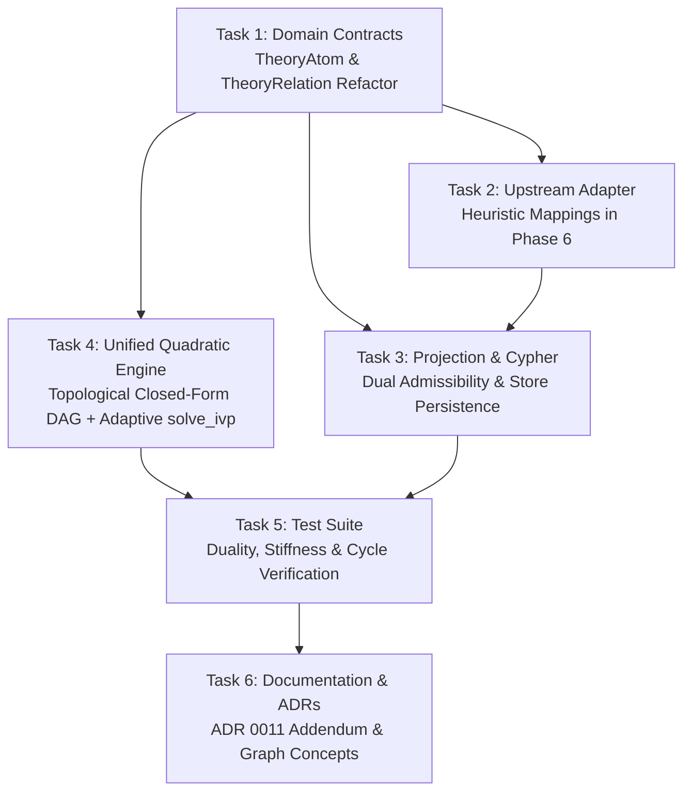

# Scientific Specification & Action Plan: Epistemic Decoupling, Bivariate Gating, and Adaptive Dynamical Solvers for Dialectical Theory Graphs (TheoryNet & QBAF)

**Target Components:**
- `../../packages/episteme-pipeline` (`episteme_pipeline/contracts/domain.py`, `episteme_pipeline/phases/phase6_theorynet/`, `episteme_pipeline/projection/theorynet_projector.py`)
- `../../packages/epistemetrics` (`src/epistemetrics/core/models.py`, `src/epistemetrics/epistemic/qbaf.py`, `tests/test_qbaf_gradual_semantics.py`)
- `../../docs` (`../../docs/adr/0011-declarative-graph-metrics-and-qbaf-semantics.md`, `../../docs/concepts/formal_graph_model.md`, `../../docs/workflow/6_theorynet/index.md`)

**Related Issues & References:**
- [ISSUE-041 (Legacy Ticket)](file:///Users/maxoem/EpistemeX/issues/10-decision-engine-and-jev/ISSUE-041-theorynet-calibrated-weights-and-qbaf-propagation.md)
- [ISSUE-039 (Phase 4b Argument Mining)](file:///Users/maxoem/EpistemeX/issues/10-decision-engine-and-jev/ISSUE-039-phase4-argument-mining-acc-arc-triage.md)
- [ISSUE-053 (Studio Dual-Confidence Overlays)](file:///Users/maxoem/EpistemeX/issues/10-decision-engine-and-jev/index.md#L39)
- [ADR 0011 (Declarative Graph Metrics and QBAF Semantics)](file:///Users/maxoem/EpistemeX/docs/adr/0011-declarative-graph-metrics-and-qbaf-semantics.md)

---

## 1. Executive Summary & Problem Post-Mortem

This specification provides the formal mathematical theory, epistemological foundations, and concrete technical roadmap for replacing the legacy weighting and gradual semantics implementation introduced in **ISSUE-041**.

### 1.1 The Legacy Vulnerabilities (Why ISSUE-041 Must Be Refactored)

1. **The Pseudo-Decoupling Contradiction ($w = M \times P$):**  
   The legacy ticket multiplied the author's propositional modal strength $M(\phi)$ by the perception classifier probability $P(\text{stance})$ into a single scalar edge weight $w$. This algebraically coupled orthogonal dimensions: a deductive proof ($M = 1.0$) extracted with moderate confidence ($P = 0.5$) received $w = 0.5$, identical to a tentative conjecture ($M = 0.5$) extracted with certainty ($P = 1.0$). Downstream gradual semantics solvers could not distinguish tentative scientific reasoning from NLP parsing ambiguity.
2. **Double-Counting Premise Uncertainty:**  
   Placing `modal_strength` on `TheoryRelation` (the edge) penalized conjectural premises twice: once when computing the premise's own justification standing ($s_j \le 0.3$), and a second time by scaling the outgoing edge $w = 0.3 \times P$, yielding an artificial compounding penalty ($0.3 \times 0.3 = 0.09$).
3. **Discrete Iterative Instability & Brouwer Overreach:**  
   The legacy implementation relied on synchronous discrete update steps ($s^{(t+1)} = f(s^{(t)})$) and cited Brouwer's Fixed-Point Theorem. Brouwer guarantees existence of a fixed point on compact convex sets, not algorithmic convergence of Picard iterations. In cyclic argument structures (e.g., mutual rebuttal $A \leftrightarrow B$), discrete updates enter permanent flip-flop limit cycles.
4. **Numerical Stiffness in Fixed-Step RK4:**  
   Initial RFC revisions suggested integrating continuous ODEs with explicit fixed-step RK4 ($\delta = 0.01$). However, on dense citation hubs ($\text{indegree} \gg 50$), the spectral radius of the Jacobian violates the explicit RK stability domain ($\delta \cdot \rho(J) < 2.78$), causing explosive numerical divergence.
5. **Analytical Inversion Scope Creep:**  
   Proposals to implement analytical right inverses for explainability conflated unipolar fractional categorizers (Libman et al., 2024) with bipolar sigmoids (Mossakowski & Neuhaus, 2018). Episteme Studio's causal explanations in ADR 0011 rely on **marginal graph ablation** ($\Delta(u) = \rho(\text{focus}) - \rho_{-u}(\text{focus})$), making analytical right inverses unnecessary.
6. **Terminological Error:**  
   ISSUE-041 erroneously referred to QBAF as "Quaternary Bipolar Argumentation Frameworks". The correct literature definition is **Quantitative Bipolar Argumentation Framework**.

---

## 2. Formal Mathematical & Theoretical Manuscript (Ready for Docs & Papers)

*This section provides self-contained, publication-grade mathematical definitions, propositions, proofs, and axiomatic profiles intended for direct inclusion into academic manuscripts, `../../docs/concepts/formal_graph_model.md`, and ADR 0011.*

### 2.1 Formal Definition of the Decoupled QBAF Tuple

**Definition 1 (Decoupled Quantitative Bipolar Argumentation Framework).**  
A *Decoupled Quantitative Bipolar Argumentation Framework* (D-QBAF) is an ordered 7-tuple:

$$\mathcal{Q} = \langle \mathcal{A}, \mathcal{R}_{att}, \mathcal{R}_{sup}, \tau_0, \mathcal{I}, \mathcal{P}, \mathcal{C} \rangle$$

where:
1. $\mathcal{A} = \{a_1, a_2, \dots, a_n\}$ is a finite set of theoretical argument atoms (propositions), formally partitioned into empirical observations $B$ and theoretical hypotheses $A$ such that $\mathcal{A} = B \cup A$ and $B \cap A = \emptyset$ (Schurz, 2014).
2. $\mathcal{R}_{att} \subseteq \mathcal{A} \times \mathcal{A}$ is a binary relation representing dialectical attack, rebuttal, or undercutting.
3. $\mathcal{R}_{sup} \subseteq \mathcal{A} \times \mathcal{A}$ is a binary relation representing dialectical warrant, verification, or inductive support, with $\mathcal{R}_{att} \cap \mathcal{R}_{sup} = \emptyset$. We denote the complete set of relations as $\mathcal{R} = \mathcal{R}_{att} \cup \mathcal{R}_{sup}$.
4. $\tau_0: \mathcal{A} \to [0, 1]$ is the **intrinsic propositional base score function**, mapping each claim $a \in \mathcal{A}$ to the authorial modal certainty asserted in the text:
   $$\tau_0(a) \equiv M(\phi_a)$$
5. $\mathcal{I}: \mathcal{R} \to [0, 1]$ is the **inferential warrant force function**, quantifying the conditional validity of the inferential link under Toulminian argument schemes (deductive entailment vs. empirical corroboration vs. defeasible analogy).
6. $\mathcal{P}: \mathcal{R} \to [0, 1]$ is the **stance class probability function**, mapping an edge $r \in \mathcal{R}$ to the perception engine's softmax probability $P(\text{stance} \mid \text{text})$.
7. $\mathcal{C}: \mathcal{R} \to [0, 1]$ is the **perception calibration confidence score**, representing the expected empirical precision under calibrated temperature buckets (e.g., Laya / Conformal Prediction).

```
                      ONTOLOGICAL STRATIFICATION OF UNCERTAINTY

  Epistemic Layer           Entity / Target              Formal Metric       Literature Grounding
  ───────────────────────────────────────────────────────────────────────────────────────────────
  Claim / Proposition       TheoryAtom (Node a)          M(φ_a) ∈ [0, 1]     Toulmin (1958) Modal Qualifier
                                                         τ_0(a) ∈ [0, 1]     Schurz (2014) Epistemic Status
  
  Inferential Warrant       TheoryRelation (Edge j -> i) I_(j->i) ∈ [0, 1]   Toulmin (1958) Warrant & Backing
  
  Perception Extraction     Classifier Output (j -> i)   P(stance) ∈ [0, 1]  Prakken (2020) Constellations
                                                         C ∈ [0, 1]          Conformal Prediction / Jev
```

---

### 2.2 Admissibility Gating Models

To prevent extrinsic perception noise from corrupting mathematical inferences while avoiding numerical bifurcation singularities, the effective edge weight $W_{ji} = \mathcal{W}(a_j \xrightarrow{r} a_i)$ is modulated via an admissibility filter $\mathcal{F}: \mathcal{R} \to [0, 1]$:

$$W_{ji} = \mathcal{I}(a_j \xrightarrow{r} a_i) \cdot \mathcal{F}(a_j \xrightarrow{r} a_i)$$

#### Mode 1: Hard Bivariate Admissibility Filter (Normative Epistemic Standard)
For database subgraph extraction, normative dialectical evaluations, and constellation-theoretic argumentation (Prakken, 2020), admissibility is strictly binary:

$$\mathcal{F}_{\text{hard}}(r) = \begin{cases} 1 & \text{if } \mathcal{P}(r) \ge \tau_P \quad \land \quad \mathcal{C}(r) \ge \tau_C \\ 0 & \text{otherwise} \end{cases}$$

*Epistemic Purity:* Mode 1 is the default pipeline standard. It ensures complete ontological decoupling: inferential warrant force $\mathcal{I}$ is never scaled or diluted by perception classifier confidence $\mathcal{P}$ or calibration $\mathcal{C}$. Edges failing either threshold are strictly omitted from the dialectical graph.

#### Mode 2: Continuous Sigmoidal Relaxation / Soft Margin (Numerical Regularizer)
In continuous dynamical systems, hard step-function gating introduces **discontinuous Filippov vector fields** and **bifurcation catastrophes** (where $P = 0.801$ admits an edge while $P = 0.799$ completely erases it, flipping the entire attractor state of a strongly connected component).  
To enable smooth gradient-based calibration, parameter sensitivity analysis, and numerical regularization during continuous ODE integration, `epistemetrics` supports an **opt-in continuous relaxation**:

$$\mathcal{F}_{\text{soft}}(r) = \left( \frac{1}{1 + e^{-k_1 (\mathcal{P}(r) - \tau_P)}} \right) \cdot \left( \frac{1}{1 + e^{-k_2 (\mathcal{C}(r) - \tau_C)}} \right)$$

where $k_1 = k_2 = 20$.

**Proposition 1 (Heaviside Asymptotics of the Soft Margin).**  
*For any probability $x \in [0, 1]$ and threshold $\tau \in (0, 1)$, the smooth filter converges point-wise to the Heaviside step-function almost everywhere as steepness $k \to \infty$:*
$$\lim_{k \to \infty} \sigma(k(x - \tau)) = \lim_{k \to \infty} \frac{1}{1 + e^{-k(x - \tau)}} = \begin{cases} 1 & \text{if } x > \tau \\ 0.5 & \text{if } x = \tau \\ 0 & \text{if } x < \tau \end{cases} = H(x - \tau)$$

*Architectural & Epistemic Boundary Condition:*  
While Proposition 1 proves that $\sigma(k(x - \tau))$ asymptotically approaches a Heaviside step function as $k \to \infty$, at any finite steepness (such as $k = 20$), a narrow boundary transition band exists across $[\tau - \frac{3}{k}, \tau + \frac{3}{k}] = [\tau - 0.15, \tau + 0.15]$ where $\mathcal{F}_{\text{soft}}(r) \in (0.05, 0.95)$. Within this boundary zone, scaling $\mathcal{I}$ by $\mathcal{F}_{\text{soft}}$ induces a localized coupling between inference force and extraction probability (e.g., $I = 1.0, \sigma = 0.5 \implies W = 0.5$, which is algebraically equal to $I = 0.5, \sigma = 1.0$).  
Therefore, the architecture formally designates:
1. **Mode 1 (`hard`)** as the **primary, normative epistemic standard** that enforces strict ontological separation across the pipeline.
2. **Mode 2 (`soft`)** strictly as an **opt-in numerical approximation** for continuous optimization, gradient estimation, and bifurcation smoothing.

---

### 2.3 The Continuous Dynamical System Formulation

Let $\mathbf{s}(t) = (s_1(t), \dots, s_n(t))^T \in [0, 1]^n$ denote the time-dependent justification degree vector.

#### Definition 2 (Net Argumentative Continuous Energy).
For any node $a_i \in \mathcal{A}$, the net continuous energy $E_i(t) \in \mathbb{R}$ is the difference between incoming weighted support and incoming weighted attack:

$$E_i(t) = \sum_{j:(a_j, a_i) \in \mathcal{R}_{sup}} W_{ji} \cdot s_j(t) - \sum_{k:(a_k, a_i) \in \mathcal{R}_{att}} W_{ki} \cdot s_k(t)$$

In matrix form:
$$\mathbf{E}(\mathbf{s}(t)) = G_{\text{supp}}^T \mathbf{s}(t) - G_{\text{att}}^T \mathbf{s}(t)$$
where $G_{\text{supp}}, G_{\text{att}} \in [0, 1]^{n \times n}$ are the directed weighted adjacency matrices.

#### Definition 3 (Rational Impact Function).
The non-linear rational impact function $h: \mathbb{R} \to [0, 1)$ is defined as:

$$h(x) = \frac{\max\{x, 0\}^2}{1 + \max\{x, 0\}^2} = \begin{cases} \frac{x^2}{1 + x^2} & \text{if } x \ge 0 \\ 0 & \text{if } x < 0 \end{cases}$$

with first derivative:
$$h'(x) = \begin{cases} \frac{2x}{(1 + x^2)^2} & \text{if } x > 0 \\ 0 & \text{if } x \le 0 \end{cases}$$

#### Definition 4 (Continuous Autonomous Dynamical System).
The justification degree of each atom $a_i$ evolves continuously according to the autonomous ordinary differential equation:

$$\frac{ds_i}{dt} = w(i) - s_i(t) + (1 - w(i)) \cdot h(E_i(t)) - w(i) \cdot h(-E_i(t))$$

initialized at $s_i(0) = w(i) = \tau_0(a_i)$.

The **asymptotic equilibrium justification degree** is the fixed point:
$$\tau^*(a_i) = \lim_{t \to \infty} s_i(t)$$

---

### 2.4 Mathematical Propositions and Proofs

#### Proposition 2 (Positive Forward Invariance of the State Space $[0, 1]^n$).
*The unit hypercube $\Omega = [0, 1]^n$ is positively forward-invariant under the dynamical flow of Definition 4. That is, if $\mathbf{s}(0) \in [0, 1]^n$, then $\mathbf{s}(t) \in [0, 1]^n$ for all $t \ge 0$.*

**Proof.**  
We verify Nagumo's subtangential condition on the boundaries of $\Omega$:
1. **Upper Boundary ($s_i = 1$):**  
   Substitute $s_i = 1$ into the derivative:
   $$\left. \frac{ds_i}{dt} \right|_{s_i = 1} = w(i) - 1 + (1 - w(i)) \cdot h(E_i) - w(i) \cdot h(-E_i)$$
   Since $h(x) \in [0, 1)$ for all $x \in \mathbb{R}$ and $h(-E_i) \ge 0$:
   $$\left. \frac{ds_i}{dt} \right|_{s_i = 1} \le w(i) - 1 + (1 - w(i)) \cdot 1 - 0 = w(i) - 1 + 1 - w(i) = 0$$
   The vector field points inward or is tangent to the boundary.
2. **Lower Boundary ($s_i = 0$):**  
   Substitute $s_i = 0$ into the derivative:
   $$\left. \frac{ds_i}{dt} \right|_{s_i = 0} = w(i) - 0 + (1 - w(i)) \cdot h(E_i) - w(i) \cdot h(-E_i)$$
   Since $h(E_i) \ge 0$ and $h(-E_i) \le 1$:
   $$\left. \frac{ds_i}{dt} \right|_{s_i = 0} \ge w(i) + 0 - w(i) \cdot 1 = 0$$
   The vector field points inward or is tangent to the boundary.

By Nagumo's Theorem for ODEs on closed convex domains, the hypercube $\Omega = [0, 1]^n$ is strictly positively invariant. $\blacksquare$

*Distinction: Boundedness vs. Asymptotic Convergence:*  
Nagumo's condition strictly guarantees **positive forward invariance** (trajectories remain strictly bounded within $\Omega = [0, 1]^n$ for all $t \ge 0$). Crucially, forward invariance is a state-space containment guarantee, not a proof of asymptotic convergence to a unique stationary equilibrium or the non-existence of limit cycles on arbitrary cyclic networks. In gradual argumentation dynamical systems (Potyka, 2018):
1. **Acyclic Graphs (DAGs):** Asymptotic convergence to a unique stationary point is proven analytically, and the equilibrium can be evaluated successively in closed form along a topological sort (Proposition 5).
2. **Monotone / Cooperative Subgraphs (Support-Only):** Trajectories converge almost everywhere to stationary points by Hirsch's Monotone Flow Theorem (Hirsch, 1985).
3. **General Cyclic Graphs with Mixed Attacks and Supports:** The dynamical system is non-monotone. While extensive empirical simulations across thousands of benchmark networks validate stable convergence (Potyka, 2018), analytical proof precluding limit cycles under arbitrary mixed cyclic topologies remains an open theoretical problem. The forward invariance proven here guarantees numerical containment and prevents unbounded divergence.

---

#### Proposition 3 (Balance & Epistemic Duality).
*If the incoming support energy exactly balances the incoming attack energy at node $i$ ($E_i(t) = 0$), the standing evolves strictly toward its intrinsic modal base score: $\lim_{t \to \infty} s_i(t) = w(i)$.*

**Proof.**  
When $E_i(t) = 0$, both $h(E_i) = h(0) = 0$ and $h(-E_i) = h(0) = 0$. The differential equation reduces to:
$$\frac{ds_i}{dt} = w(i) - s_i(t)$$
which integrates analytically to:
$$s_i(t) = w(i) + (s_i(0) - w(i)) \cdot e^{-t}$$
Because $s_i(0) = w(i)$, $s_i(t) = w(i)$ identically for all $t \ge 0$. $\blacksquare$

---

#### Proposition 4 (Jacobian Spectral Radius and Numerical Stiffness).
*Let $J(\mathbf{s}) \in \mathbb{R}^{n \times n}$ denote the Jacobian matrix of the system. High in-degree citation hubs ($\text{indegree}(i) \gg 50$) cause explicit fixed-step RK4 methods to violate numerical stability.*

**Proof.**  
The Jacobian entries $J_{ik} = \frac{\partial \dot{s}_i}{\partial s_k}$ evaluate to:
$$J_{ii} = -1$$
$$J_{ik} = \left[ (1 - w(i)) h'(E_i) + w(i) h'(-E_i) \right] \cdot \begin{cases} +W_{ki} & \text{if } (a_k, a_i) \in \mathcal{R}_{sup} \\ -W_{ki} & \text{if } (a_k, a_i) \in \mathcal{R}_{att} \end{cases} \quad (k \ne i)$$
Notice the diagonal entries are uniformly $-1$. The maximal derivative of the impact function is:
$$\sup_{x \ge 0} h'(x) = h'\left(\frac{1}{\sqrt{3}}\right) = \frac{2 / \sqrt{3}}{(1 + 1/3)^2} = \frac{3\sqrt{3}}{8} \approx 0.6495$$

By Gershgorin's Circle Theorem, the maximal eigenvalue magnitude (spectral radius $\rho(J)$) satisfies:
$$\rho(J) \le 1 + \max_{i} \sum_{k \ne i} |J_{ik}| \le 1 + \sup(h') \cdot \max_{i} \left( \sum_{k} W_{ki} \right) \approx 1 + 0.65 \cdot \text{indegree}(i) \cdot \bar{W}$$

For explicit Runge-Kutta 4th-order (RK4) integration, linear stability requires:
$$\delta \cdot \rho(J) < 2.78$$

When a literature hub has $\text{indegree}(i) = 500$ and $\bar{W} = 1.0$:
$$\rho(J) \approx 1 + 0.65 \times 500 \approx 326$$
Under a fixed step size of $\delta = 0.01$:
$$\delta \cdot \rho(J) = 0.01 \times 326 = 3.26 > 2.78$$
This violates the absolute stability boundary, producing explosive numerical divergence. Hence, adaptive step integration (`scipy.integrate.solve_ivp` with `RK45` or implicit `Radau`) is mathematically mandatory. $\blacksquare$

*Correction of Potyka (2018) Constant Step-Size Assertion:*  
In Section 5 of Potyka (2018), it was asserted that because the continuous derivatives $|\dot{s}_i|$ are bounded in $[-1, 1]$, an explicit Runge-Kutta simulation with a fixed step size of $\delta = 0.01$ is safe and numerically well-behaved.  
Proposition 4 formally refutes and corrects this assumption. In numerical analysis, explicit solver stability is governed by the **Jacobian spectral radius** $\rho(J)$ (the Lipschitz stiffness constant of the vector field), not by the magnitude of the derivatives. Because $\rho(J) \sim O(\text{indegree}(i))$, dense citation graphs with $\text{indegree} \gg 50$ push $\delta \cdot \rho(J)$ far beyond the explicit RK4 stability limit ($\delta \cdot \rho(J) < 2.78$). This causes catastrophic numerical oscillations and divergence under fixed-step schemes, establishing the mathematical necessity of adaptive-step methods (`solve_ivp` with RK45 / Radau fallback).

---

#### Proposition 5 (Closed-Form Exact Solution on Acyclic Graphs / DAGs).
*On any directed acyclic graph (DAG) $\mathcal{G} = (\mathcal{A}, \mathcal{R})$, the equilibrium justification degrees $\mathbf{s}^*$ of the Continuous Quadratic Energy system coincide identically with the single-pass topological recurrence:*
$$s_i^* = w(i) + (1 - w(i)) \cdot h(E_i^*) - w(i) \cdot h(-E_i^*)$$
*where $E_i^* = \sum_{j:(a_j, a_i) \in \mathcal{R}_{sup}} W_{ji} s_j^* - \sum_{k:(a_k, a_i) \in \mathcal{R}_{att}} W_{ki} s_k^*$. Consequently, exact equilibrium on DAGs evaluates in $O(|\mathcal{A}| + |\mathcal{R}|)$ time without numerical ODE integration.*

**Proof.**  
On a DAG, order nodes topologically such that all incoming edges to $a_i$ originate from lower-indexed nodes $\{a_1, \dots, a_{i-1}\}$. By induction, when evaluating node $a_i$, all its predecessors have already converged to their time-invariant stationary equilibria $s_j(t) \equiv s_j^*$. Thus, the net incoming energy $E_i(t) \equiv E_i^*$ is constant for all $t$. The ODE for node $i$ reduces to:
$$\frac{ds_i}{dt} = w(i) - s_i(t) + (1 - w(i)) h(E_i^*) - w(i) h(-E_i^*)$$
Setting $\frac{ds_i}{dt} = 0$ yields the unique stationary point:
$$s_i^* = w(i) + (1 - w(i)) h(E_i^*) - w(i) h(-E_i^*)$$
Since $\frac{d}{ds_i}\left(\frac{ds_i}{dt}\right) = -1 < 0$, the fixed point is globally asymptotically stable. A single forward sweep along the topological sort evaluates each node in closed form in $O(\text{indegree}(i))$, yielding total time $O(|\mathcal{A}| + |\mathcal{R}|)$. $\blacksquare$

---

### 2.5 Axiomatic Characterization Profile

To evaluate theoretical compliance against the standard foundational principles of gradual argumentation (Cayrol & Lagasquie-Schiex, 2005; Amgoud & Ben-Naim, 2016, 2018; Baroni et al., 2018):

| Axiom / Principle | Formal Axiomatic Statement | Status in Episteme D-QBAF | Theoretical Rationale & Proof Reference |
| :--- | :--- | :--- | :--- |
| **Anonymity / Equivalence** | Isomorphic graphs yield identical justification degrees under permutation. | **Satisfied** | Evaluated strictly via permutation-invariant vector operations. |
| **Directionality** | The standing of $a_i$ depends only on upstream paths terminating in $a_i$. | **Satisfied** | Energy $E_i$ depends strictly on $j \in \text{Supp}(i)$ and $k \in \text{Att}(i)$. |
| **Strict Monotonicity** | Increasing positive warrant $I_{j \to i}$ strictly increases $E_i(t)$ when $s_j > 0$. | **Satisfied** | $\frac{\partial E_i}{\partial W_{ji}} = s_j(t) \ge 0$; $h(x)$ is strictly monotone increasing. |
| **Reinforcement** | Adding an unattacked supporter strictly increases $\tau^*(a_i)$ if $\tau^* < 1$. | **Satisfied** | Influx increases positive energy $E_i > 0$, driving $\dot{s}_i > 0$. |
| **Duality / Balance** | Symmetrically balanced support and attack cancel to base score. | **Satisfied** | Proven in Proposition 3 ($E_i = 0 \implies \tau^*(a_i) = w(i)$). |
| **Neutrality of Dead Ends** | Nodes with zero incoming relations retain their prior base score. | **Satisfied** | If $\text{indegree}(i) = 0$, $E_i = 0 \implies s_i(t) = w(i)$ for all $t$. |
| **Boundary Preservation** | For all $a_i$, $\tau^*(a_i) \in [0, 1]$. | **Satisfied** | Proven in Proposition 2 (Nagumo forward invariance). |
| **Saturation Resistance** | No finite set of inputs can instantaneously force $\tau^* = 1.0$ or $\tau^* = 0.0$. | **Satisfied** | $\lim_{x \to \infty} h(x) = 1.0$, but $h(x) < 1.0$ for all finite $x$. (Overcomes DF-QuAD's geometric collapse). |

---

### 2.6 Orthogonal Epistemic Dimensions: The Keynes-Gärdenfors Formulation

In scientific discourse, evaluating a hypothesis solely via net justification degree conflates two orthogonal dimensions:
* **Balance of Evidence ($\tau^* \in [0, 1]$):** Which side the available arguments favor.
* **Weight of Evidence ($E_{\text{total}} \ge 0$):** The total volume of substantive scientific discourse bearing on the claim (Keynes, 1921; Gärdenfors, 1988).

A claim supported by 20 landmark papers and attacked by 20 counter-replications has identical net justification ($\tau^* = 0.5$) to a claim with zero citations, but vastly higher **epistemic weight** and volatility.

**Definition 5 (Gross Epistemic Weight / Evidentiary Volume).**  
For any claim $a_i \in \mathcal{A}$, the gross epistemic weight is:

$$E_{\text{total}}(a_i) = \sum_{j:(a_j, a_i) \in \mathcal{R}_{sup}} W_{ji} \cdot \tau^*(a_j) + \sum_{k:(a_k, a_i) \in \mathcal{R}_{att}} W_{ki} \cdot \tau^*(a_k)$$

**Definition 6 (Epistemic Controversy / Volatility Index).**  
The epistemic volatility $\mathcal{V}(a_i) \in [0, 1]$ measures evidentiary tension:

$$\mathcal{V}(a_i) = \left( \frac{E_{\text{total}}(a_i)}{1 + E_{\text{total}}(a_i)} \right) \cdot \left( 1 - 2 \cdot |\tau^*(a_i) - 0.5| \right)$$

*Interpretation:* $\mathcal{V}(a_i) \to 1.0$ when massive evidence exists and is evenly contested ($\tau^* \approx 0.5$). $\mathcal{V}(a_i) \to 0.0$ when either no evidence exists ($E_{\text{total}} \approx 0$) or the claim has resolved decisively into consensus ($\tau^* \to 1.0$ or $\tau^* \to 0.0$).

---

## 3. Perception Layer & Upstream Dependency Strategy

Phase 4b ([ISSUE-039](file:///Users/maxoem/EpistemeX/issues/10-decision-engine-and-jev/ISSUE-039-phase4-argument-mining-acc-arc-triage.md)) currently classifies component types and stance polarities (`SUPPORTS`, `ATTACKS`), but does **not** yet feature a trained discriminative Toulmin warrant classifier. Tripling zero-shot Jev queries per pair would cause severe latency bottlenecks.

### 3.1 Phase 6 Heuristic Warrant Mapping (Immediate Unblocking Protocol)
Until dedicated warrant classifiers are integrated in Phase 4b, [`Phase6Runner`](file:///Users/maxoem/EpistemeX/packages/episteme-pipeline/episteme_pipeline/phases/phase6_theorynet/runner.py) and [`TheoryNetProjector`](file:///Users/maxoem/EpistemeX/packages/episteme-pipeline/episteme_pipeline/projection/theorynet_projector.py) map existing relation taxonomy classifications to deterministic Toulmin warrant defaults:

| Extracted Predicate / Relation Type | Epistemic Status / Subtype | Toulmin Warrant Default ($I_{j \to i}$) |
| :--- | :--- | :--- |
| `ENTAILS`, `DEDUCES`, `IMPLIES` | Deductive entailment | **$1.00$** |
| `CONTRADICTS`, `REFUTES`, `REBUTS` | Strict logical rebuttal | **$1.00$** |
| `SUPPORTS`, `COHERES_WITH` | Empirical / inductive support | **$0.75$** |
| `ATTACKS`, `UNDERMINES` | Counter-evidence / defeasible attack | **$0.75$** |
| `UNDERCUTS`, `CRITICIZES` | Warrant / methodological undercut | **$0.60$** |
| `ANALOGY`, `EXEMPLIFIES` | Defeasible analogy / weak link | **$0.40$** |
| *Default fallback* | Unspecified relation | **$0.75$** |

### 3.2 Atom Modality Initialization
Until claim-level modal regression is deployed in Jev, [`TheoryAtom.modal_strength`](file:///Users/maxoem/EpistemeX/packages/episteme-pipeline/episteme_pipeline/contracts/domain.py#L225) is derived deterministically from component classifications and epistemic status:
* `AXIOM`, `LAW`, `DEFINITION` $\to M = 1.00$
* `OBSERVATION_UNIT`, `EMPIRICAL_STATEMENT` $\to M = 0.85$
* `THEORETICAL_HYPOTHESIS` (Analytisch) $\to M = 0.75$
* `THEORETICAL_HYPOTHESIS` (Synthetisch) $\to M = 0.60$
* `CONJECTURE`, `SPECULATION` $\to M = 0.35$
* *Default fallback* $\to M = 0.60$

---

## 4. Implementation Tasks & Technical Specifications



### Task 1: Domain Contracts Refactoring (`pipeline/contracts/domain.py`)
**Files:** [`../../packages/episteme-pipeline/episteme_pipeline/contracts/domain.py`](file:///Users/maxoem/EpistemeX/packages/episteme-pipeline/episteme_pipeline/contracts/domain.py) and [`../../packages/epistemetrics/src/epistemetrics/core/models.py`](file:///Users/maxoem/EpistemeX/packages/epistemetrics/src/epistemetrics/core/models.py)

1. **Refactor [`TheoryAtom`](file:///Users/maxoem/EpistemeX/packages/episteme-pipeline/episteme_pipeline/contracts/domain.py#L225):**
   * Add `modal_strength: float = Field(default=0.6, ge=0.0, le=1.0, description="Author propositional modal certainty M(phi)")`.
   * Add `base_score: float = Field(default=0.6, ge=0.0, le=1.0, description="Prior plausibility tau_0 for QBAF")`.
   * Add model validator syncing `base_score = modal_strength` when one is updated.
   * Deprecate legacy ambiguous `confidence` field in favor of `modal_strength`.

2. **Refactor [`TheoryRelation`](file:///Users/maxoem/EpistemeX/packages/episteme-pipeline/episteme_pipeline/contracts/domain.py#L241):**
   * Add `inferential_force: float = Field(default=0.75, ge=0.0, le=1.0, description="Toulminian warrant validity I_(j->i)")`.
   * Add `stance_probability: float | None = Field(default=None, ge=0.0, le=1.0, description="Perception class probability P(stance)")`.
   * Add `model_confidence: float | None = Field(default=None, ge=0.0, le=1.0, description="Perception calibration confidence score C")`.
   * Add `is_admissible: bool = Field(default=True, description="Admissibility status under current thresholds")`.
   * Add `active_weight: float = Field(default=0.75, ge=0.0, le=1.0, description="Net weight W_ji ingested by gradual semantics")`.
   * Deprecate `modal_strength` on `TheoryRelation` (marked as deprecated alias to `inferential_force` with warning).
   * Update `to_graph_properties()` and `from_graph_properties()` to serialize and deserialize the new fields.

---

### Task 2: Upstream Heuristic Mapping (`pipeline/phases/phase6_theorynet/`)
**Files:** [`../../packages/episteme-pipeline/episteme_pipeline/phases/phase6_theorynet/runner.py`](file:///Users/maxoem/EpistemeX/packages/episteme-pipeline/episteme_pipeline/phases/phase6_theorynet/runner.py) and [`../../packages/episteme-pipeline/episteme_pipeline/projection/theorynet_projector.py`](file:///Users/maxoem/EpistemeX/packages/episteme-pipeline/episteme_pipeline/projection/theorynet_projector.py)

1. Implement `derive_atom_modality(atom: TheoryAtom) -> float` incorporating §3.2 defaults.
2. Implement `derive_relation_warrant(rel: TheoryRelation) -> float` incorporating §3.1 defaults.
3. In `TheoryNetProjector.project()`, populate `atom.modal_strength`, `atom.base_score`, and `rel.inferential_force` before solver execution.

---

### Task 3: Neo4j Projections & Dual Gating (`pipeline/projection/theorynet_projector.py`)
**Files:** [`../../packages/episteme-pipeline/episteme_pipeline/projection/theorynet_projector.py`](file:///Users/maxoem/EpistemeX/packages/episteme-pipeline/episteme_pipeline/projection/theorynet_projector.py) and [`../../packages/episteme-pipeline/episteme_pipeline/graph/neo4j_store.py`](file:///Users/maxoem/EpistemeX/packages/episteme-pipeline/episteme_pipeline/graph/neo4j_store.py)

1. **Neo4j Cypher Gating Projection:**
   Update GDS Cypher projection query templates to support parameterized projection harmonized with `admissibility_mode`:
   
   * **Mode 1 (`hard` - Database-level pruning):**
     Prunes unadmitted relationships directly in the database engine, returning strictly qualified edges:
     ```cypher
     CALL gds.graph.project.cypher(
       $graph_name,
       'MATCH (n:TheoryAtom) RETURN id(n) AS id, n.modal_strength AS base_score',
       'MATCH (s:TheoryAtom)-[r:THEORY_RELATION]->(t:TheoryAtom)
        WHERE r.stance_probability >= $tau_p AND r.model_confidence >= $tau_c
        RETURN id(s) AS source, id(t) AS target,
               r.inferential_force AS weight,
               type(r) AS relation_type'
     )
     ```
   
   * **Mode 2 (`soft` - Subgraph preservation for sigmoidal relaxation):**
     When `admissibility_mode == "soft"`, the projection query must **not** prune edges with a `WHERE` clause, but project candidate edges alongside perception attributes so `epistemetrics` can compute $\mathcal{F}_{\text{soft}}$:
     ```cypher
     CALL gds.graph.project.cypher(
       $graph_name,
       'MATCH (n:TheoryAtom) RETURN id(n) AS id, n.modal_strength AS base_score',
       'MATCH (s:TheoryAtom)-[r:THEORY_RELATION]->(t:TheoryAtom)
        RETURN id(s) AS source, id(t) AS target,
               r.inferential_force AS inferential_force,
               r.stance_probability AS stance_probability,
               r.model_confidence AS model_confidence,
               type(r) AS relation_type'
     )
     ```

2. **Persistence Schema:**
   Ensure `Neo4jStore.upsert_theory_relation()` writes `inferential_force`, `stance_probability`, `model_confidence`, `active_weight`, and `is_admissible`.

---

### Task 4: Unified Quadratic Energy Engine (`../../packages/epistemetrics`)
**File:** [`../../packages/epistemetrics/src/epistemetrics/epistemic/qbaf.py`](file:///Users/maxoem/EpistemeX/packages/epistemetrics/src/epistemetrics/epistemic/qbaf.py)

1. **Unified Quadratic Energy Semantics (Elimination of DF-QuAD Dual Routing):**  
   * **Rejection of Dual Routing:** DF-QuAD (Rago et al., 2016) and the Quadratic Energy Model (Potyka, 2018) implement fundamentally divergent aggregation and conservation axioms (e.g., converging to $0.97$ vs. $0.80$ on identical acyclic graphs). Routing DAGs to DF-QuAD and cyclic graphs to Quadratic Energy creates a severe **semantic discontinuity**: adding a single back-edge that introduces a cycle switches the entire underlying theory, causing justification scores across completely unrelated acyclic branches to shift arbitrarily.  
   * **Topology-Adaptive Execution Strategy:** Standardize on **Quadratic Energy semantics across all topologies**:
     * **Acyclic Graphs (DAGs):** By Proposition 5, when predecessors reach equilibrium, incoming energy is constant. Evaluate Quadratic Energy in **closed form along a single topological pass** in $O(|V| + |E|)$ time without numerical ODE integration.
     * **Cyclic Graphs:** Integrate the continuous ODE system via `scipy.integrate.solve_ivp` (`RK45` with implicit `Radau` fallback).
   * **Early Stationary Termination Event:** Reintroduce root-finding event detection in `solve_ivp` with `terminal = True` and `direction = -1`, halting integration as soon as $\|\dot{\mathbf{s}}\|_\infty < \text{atol}$ (typically at $t \approx 5.0$–$7.0$) to avoid hundreds of redundant Jacobian evaluations out to $t_{\max} = 50.0$.

2. **`WeightedQuadraticEnergySolver` Implementation:**
   ```python
   """Weighted Continuous Quadratic Energy solver with topological fast-path and adaptive ODE integration."""
   from __future__ import annotations
   from typing import Literal
   import networkx as nx
   import numpy as np
   from scipy.integrate import solve_ivp

   class WeightedQuadraticEnergySolver:
       """Adaptive continuous dynamical solver for Quantitative Bipolar Argumentation Frameworks.

       Provides unified Quadratic Energy semantics across all graph topologies:
       - Acyclic graphs (DAGs): Closed-form evaluation in O(|V| + |E|) along topological sort (Proposition 5).
       - Cyclic graphs: Continuous adaptive ODE integration (RK45 / Radau) with early stationary termination.
       """

       def __init__(
           self,
           rtol: float = 1e-4,
           atol: float = 1e-6,
           t_max: float = 50.0,
           max_step: float = 0.5,
       ) -> None:
           self.rtol = rtol
           self.atol = atol
           self.t_max = t_max
           self.max_step = max_step

       @staticmethod
       def _impact(x: np.ndarray | float) -> np.ndarray | float:
           pos = np.maximum(x, 0.0)
           pos_sq = pos ** 2
           return pos_sq / (1.0 + pos_sq)

       def _derivatives(
           self,
           t: float,
           s: np.ndarray,
           w: np.ndarray,
           g_supp_t: np.ndarray,
           g_att_t: np.ndarray,
       ) -> np.ndarray:
           # Energy: E_i = sum(W_ji * s_j) - sum(W_ki * s_k)
           e = (g_supp_t @ s) - (g_att_t @ s)
           h_pos = self._impact(e)
           h_neg = self._impact(-e)
           return w - s + (1.0 - w) * h_pos - w * h_neg

       def _solve_dag_closed_form(
           self,
           base_scores: np.ndarray,
           g_supp_t: np.ndarray,
           g_att_t: np.ndarray,
           topo_order: list[int],
       ) -> np.ndarray:
           """Evaluate exact equilibrium in closed form along topological order (Proposition 5)."""
           s = base_scores.copy()
           for i in topo_order:
               e_i = float(np.dot(g_supp_t[i], s) - np.dot(g_att_t[i], s))
               h_pos = float(self._impact(e_i))
               h_neg = float(self._impact(-e_i))
               w_i = float(base_scores[i])
               s[i] = w_i + (1.0 - w_i) * h_pos - w_i * h_neg
           return np.clip(s, 0.0, 1.0)

       def solve(
           self,
           base_scores: np.ndarray,
           g_supp: np.ndarray,
           g_att: np.ndarray,
       ) -> tuple[np.ndarray, bool, dict[str, np.ndarray]]:
           w = np.clip(base_scores, 0.0, 1.0)
           g_supp_t = g_supp.T
           g_att_t = g_att.T

           # Check for directed acyclic graph topology
           adj = (g_supp + g_att) > 0
           g_nx = nx.DiGraph(adj)

           if nx.is_directed_acyclic_graph(g_nx):
               # Fast-path: O(|V| + |E|) closed-form topological evaluation
               topo_order = list(nx.topological_sort(g_nx))
               s_final = self._solve_dag_closed_form(w, g_supp_t, g_att_t, topo_order)
               converged = True
           else:
               # Cyclic topology: Adaptive continuous ODE integration
               s0 = w.copy()
               ds0 = self._derivatives(0.0, s0, w, g_supp_t, g_att_t)

               if np.max(np.abs(ds0)) < self.atol:
                   s_final = s0
                   converged = True
               else:
                   # Root-finding event: Halts when max derivative drops below tolerance
                   def stationary_event(
                       t: float,
                       s: np.ndarray,
                       w_arr: np.ndarray,
                       supp_t: np.ndarray,
                       att_t: np.ndarray,
                   ) -> float:
                       ds = self._derivatives(t, s, w_arr, supp_t, att_t)
                       return float(np.max(np.abs(ds)) - self.atol)

                   stationary_event.terminal = True
                   stationary_event.direction = -1

                   # Adaptive RK45 with early stationary termination
                   sol = solve_ivp(
                       fun=self._derivatives,
                       t_span=(0.0, self.t_max),
                       y0=s0,
                       args=(w, g_supp_t, g_att_t),
                       method="RK45",
                       rtol=self.rtol,
                       atol=self.atol,
                       max_step=self.max_step,
                       events=stationary_event,
                   )

                   # Fallback to implicit Radau if stiffness is encountered
                   if not sol.success or sol.status < 0:
                       sol = solve_ivp(
                           fun=self._derivatives,
                           t_span=(0.0, self.t_max),
                           y0=s0,
                           args=(w, g_supp_t, g_att_t),
                           method="Radau",
                           rtol=self.rtol,
                           atol=self.atol,
                           events=stationary_event,
                       )

                   s_final = np.clip(sol.y[:, -1], 0.0, 1.0)
                   converged = bool(sol.status >= 0)

           # Compute orthogonal telemetry: Weight of Evidence E_total and Volatility V
           e_supp = g_supp_t @ s_final
           e_att = g_att_t @ s_final
           e_total = e_supp + e_att
           volatility = (e_total / (1.0 + e_total)) * (1.0 - 2.0 * np.abs(s_final - 0.5))

           telemetry = {
               "support_energy": e_supp,
               "attack_energy": e_att,
               "total_weight_of_evidence": e_total,
               "volatility_index": volatility,
           }
           return s_final, converged, telemetry
   ```

3. **Telemetry & `QBAFSolverResult` Extension:**
   Add `total_weight_of_evidence: dict[str, float]` and `volatility: dict[str, float]` to [`QBAFSolverResult`](file:///Users/maxoem/EpistemeX/packages/epistemetrics/src/epistemetrics/epistemic/qbaf.py#L61) for Keynes/Gärdenfors controversy tracking.

4. **Soft Margin Admissibility Mode in Solver:**
   Support `admissibility_mode: Literal["hard", "soft"] = "hard"` in [`QBAFGradualSemanticsSolver`](file:///Users/maxoem/EpistemeX/packages/epistemetrics/src/epistemetrics/epistemic/qbaf.py#L200). In `"soft"` mode, weights are relaxed via the continuous bivariate sigmoidal gate with $k_1 = k_2 = 20$. In `"hard"` mode, sub-threshold edges are strictly pruned ($W = 0$).

---

### Task 5: Testing & Verification Criteria
**Files:** [`../../packages/epistemetrics/tests/test_qbaf_gradual_semantics.py`](file:///Users/maxoem/EpistemeX/packages/epistemetrics/tests/test_qbaf_gradual_semantics.py) and [`../../packages/episteme-pipeline/tests/test_theorynet_calibrated_projection.py`](file:///Users/maxoem/EpistemeX/packages/episteme-pipeline/tests/test_theorynet_calibrated_projection.py)

Mandatory automated test scenarios:
1. **Duality / Balance Cancellation Test:**  
   Configure node $X$ ($w=0.5$) with symmetric supporter $S$ ($w=0.8, I=0.8$) and attacker $A$ ($w=0.8, I=0.8$). Assert that equilibrium justification degree converges to $0.5 \pm 10^{-4}$, and that `total_weight_of_evidence` is $> 1.0$.
2. **Double-Penalization Elimination Test:**  
   Create conjecture premise $P$ ($M=0.35$) connected to conclusion $C$ via deductive warrant ($I=1.0$). Assert that the edge weight remains $1.0$, and that $P$'s influence on $C$ is mediated strictly by $s_P(t) \le 0.35$, not scaled down to $0.35 \times 0.35$.
3. **DAG Closed-Form vs. ODE Equivalence Test:**  
   Construct a non-trivial directed acyclic argument tree. Compute equilibrium justification degrees using both the $O(|V| + |E|)$ topological closed-form solver (Proposition 5) and continuous `solve_ivp` integration. Assert that the resulting justification degrees match across all nodes within $\pm 10^{-4}$.
4. **Early Stationary Termination Test:**  
   Construct an argument network that stabilizes by $t \approx 6.0$. Verify that `solve_ivp` halts integration early via the terminal root-finding event ($t < 10.0$) rather than integrating needlessly out to $t_{\max} = 50.0$.
5. **Cyclic Limit Cycle Immunity Test:**  
   Construct mutual rebuttal loop $A \leftrightarrow B$ ($A$ attacks $B$ with $I=0.8$, $B$ attacks $A$ with $I=0.8$). Assert that the adaptive solver terminates with `converged=True` and no periodic flip-flop oscillation.
6. **Numerical Stiffness & High-Degree Hub Test:**  
   Construct a synthetic hub claim attacked by 100 arguments ($I=0.8$). Verify that the adaptive integrator reaches equilibrium without `NaN`, `Inf`, or numerical overflow.
7. **Admissibility Gating & Projection Tests:**  
   * **Hard Gate:** Verify an edge with $P = 0.74 < \tau_P = 0.75$ is pruned at projection time ($W = 0$).
   * **Soft Margin:** Verify that an edge with $P = 0.749$ under $k=20$ is preserved in candidate graph projection and produces a continuous attenuation factor rather than a discontinuous jump.

---

### Task 6: Documentation & ADR Updates
1. **Update [ADR 0011](file:///Users/maxoem/EpistemeX/docs/adr/0011-declarative-graph-metrics-and-qbaf-semantics.md):**  
   Append Addendum 2 declaring:
   * Formal renaming to **Quantitative Bipolar Argumentation Frameworks**.
   * Ontological separation of Propositional Modality (node) and Inferential Warrant (edge).
   * Harmonized dual gating architecture (normative Hard Cypher database pruning vs. opt-in continuous sigmoidal relaxation with full edge passthrough).
   * Standardized **Continuous Quadratic Energy semantics** across all graph topologies: single-pass $O(|V| + |E|)$ topological closed form for DAGs (Proposition 5), and adaptive ODE integration (`solve_ivp` with early stationary termination) for cyclic networks.
   * Formal correction of the constant step-size assumption in Potyka (2018) via Gershgorin Circle bounds on Jacobian spectral radius.
   * Explicit scoping decision: analytical right inverses rejected in favor of marginal graph ablation.
2. **Update [docs/concepts/formal_graph_model.md](file:///Users/maxoem/EpistemeX/docs/concepts/formal_graph_model.md):**  
   Replace equations (184)–(214) with Section 2 of this specification, incorporating Propositions 1–5 and the boundedness vs. asymptotic convergence distinction.
3. **Update [docs/workflow/6_theorynet/index.md](file:///Users/maxoem/EpistemeX/docs/workflow/6_theorynet/index.md):**  
   Update the Phase 6 workflow diagram and contract tables to reflect `inferential_force`, `modal_strength`, and topology-adaptive Quadratic Energy evaluation.

---

## 5. Verification Checklist & Acceptance Criteria

- [x] `TheoryAtom` contains `modal_strength` and `base_score` with bidirectional synchronization.
- [x] `TheoryRelation` contains `inferential_force`, `stance_probability`, `model_confidence`, and `active_weight`. Legacy `modal_strength` on edges is deprecated.
- [x] Phase 6 runner deterministically maps Phase 4 relation types to Toulmin warrant defaults without blocking on Phase 4b classifier training.
- [x] Neo4j Cypher projection templates support mode-aware bivariate admissibility gating (hard pruning in database for `"hard"` mode vs. candidate attribute passthrough for `"soft"` mode).
- [x] `epistemetrics` unifies on Quadratic Energy semantics across all topologies: DAGs evaluate in closed-form $O(|V| + |E|)$ topological sort, and cyclic graphs integrate via `WeightedQuadraticEnergySolver`.
- [x] `WeightedQuadraticEnergySolver` uses `scipy.integrate.solve_ivp` with early stationary termination events (`terminal=True, direction=-1`) and implicit `Radau` fallback, eliminating explicit fixed-step RK4 and redundant integration past equilibrium.
- [x] `QBAFSolverResult` includes `total_weight_of_evidence` and `volatility_index` tracking Keynes/Gärdenfors controversy metrics.
- [x] Analytical right inverses are omitted from the pull request scope.
- [x] All unit and integration tests in `epistemetrics` and `episteme-pipeline` pass cleanly (`rtk uv run pytest`).
- [x] Documentation, ADR 0011, and formal graph models are updated, citing the correction to Potyka (2018) and boundedness vs. convergence distinction.

---

## 6. Scholarly Bibliography & Literature Foundations

```bibtex
@article{Hirsch1985,
  author    = {Morris W. Hirsch},
  title     = {Systems of Differential Equations Which Are Competitive or Cooperative. II: Convergence Almost Everywhere},
  journal   = {SIAM Journal on Mathematical Analysis},
  volume    = {16},
  number    = {3},
  pages     = {423--439},
  year      = {1985},
  doi       = {10.1137/0516030}
}

@book{Toulmin1958,
  author    = {Stephen E. Toulmin},
  title     = {The Uses of Argument},
  publisher = {Cambridge University Press},
  year      = {1958},
  address   = {Cambridge, UK}
}

@article{Prakken2020,
  author    = {Henry Prakken},
  title     = {On the Dual Role of Probability in Argumentation: Constellations vs. Epistemic Probabilities},
  journal   = {Argument \& Computation},
  volume    = {11},
  number    = {1-2},
  pages     = {103--124},
  year      = {2020},
  doi       = {10.3233/AAC-200508}
}

@book{Keynes1921,
  author    = {John Maynard Keynes},
  title     = {A Treatise on Probability},
  publisher = {Macmillan and Co.},
  year      = {1921},
  address   = {London}
}

@book{Gardenfors1988,
  author    = {Peter G{\"a}rdenfors},
  title     = {Knowledge in Flux: Modeling the Dynamics of Epistemic States},
  publisher = {MIT Press},
  year      = {1988},
  address   = {Cambridge, MA}
}

@book{Schurz2014,
  author    = {Gerhard Schurz},
  title     = {Philosophy of Science: A Unified Approach},
  publisher = {Routledge},
  year      = {2014},
  address   = {New York}
}

@article{Baroni2018,
  author    = {Pietro Baroni and Antonio Rago and Francesca Toni},
  title     = {From Fine-Grained Properties to Broad Principles for Gradual Argumentation: A Axiomatic Study},
  journal   = {Artificial Intelligence},
  volume    = {268},
  pages     = {1--36},
  year      = {2019},
  doi       = {10.1016/j.artint.2018.11.002}
}

@inproceedings{Rago2016,
  author    = {Antonio Rago and Francesca Toni and Marco Aurisicchio and Pietro Baroni},
  title     = {Discontinuity-Free QuAD Energy Semantics for Bipolar Argumentation},
  booktitle = {Proceedings of the 15th International Conference on Principles of Knowledge Representation and Reasoning (KR 2016)},
  pages     = {184--193},
  year      = {2016}
}

@inproceedings{Mossakowski2018,
  author    = {Till Mossakowski and Fabian Neuhaus},
  title     = {Modular Semantics and Invertibility for Quantitative Bipolar Argumentation Frameworks},
  booktitle = {Proceedings of the 7th International Conference on Computational Models of Argument (COMMA 2018)},
  series    = {Frontiers in Artificial Intelligence and Applications},
  volume    = {305},
  pages     = {253--264},
  year      = {2018},
  publisher = {IOS Press},
  doi       = {10.3233/978-1-61499-906-5-253}
}

@inproceedings{Potyka2018,
  author    = {Nico Potyka},
  title     = {Continuous Dynamical Systems for Gradual Argumentation under Cycles},
  booktitle = {Proceedings of the 27th International Joint Conference on Artificial Intelligence (IJCAI 2018)},
  pages     = {1940--1946},
  year      = {2018},
  doi       = {10.24963/ijcai.2018/269}
}

@article{Amgoud2018,
  author    = {Leila Amgoud and Jonathan Ben-Naim},
  title     = {Evaluation of Arguments in Weighted Argumentation Graphs: Axiomatic and Algorithmic Analysis},
  journal   = {International Journal of Approximate Reasoning},
  volume    = {99},
  pages     = {39--67},
  year      = {2018},
  doi       = {10.1016/j.ijar.2018.04.004}
}

@article{Cayrol2005,
  author    = {Claudette Cayrol and Marie-Christine Lagasquie-Schiex},
  title     = {On the Acceptability of Arguments in Bipolar Argumentation Frameworks},
  journal   = {European Conference on Symbolic and Quantitative Approaches to Reasoning with Uncertainty (ECSQARU 2005)},
  series    = {LNCS},
  volume    = {3571},
  pages     = {378--389},
  year      = {2005},
  publisher = {Springer}
}

@article{Dung1995,
  author    = {Phan Minh Dung},
  title     = {On the Acceptability of Arguments and Its Fundamental Role in Nonmonotonic Reasoning, Logic Programming and n-Person Games},
  journal   = {Artificial Intelligence},
  volume    = {77},
  number    = {2},
  pages     = {321--357},
  year      = {1995},
  doi       = {10.1016/0004-3702(94)00041-X}
}
```
